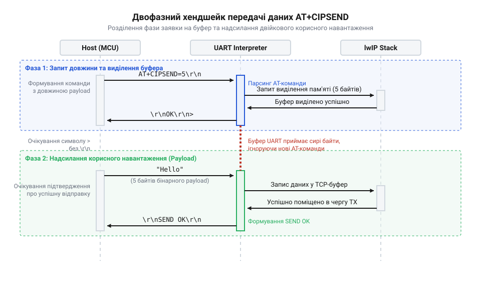
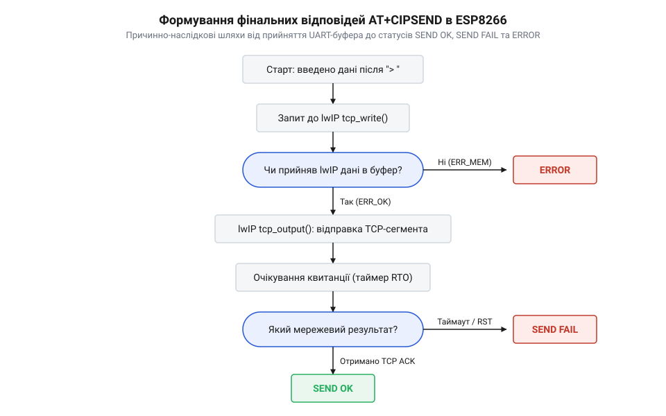
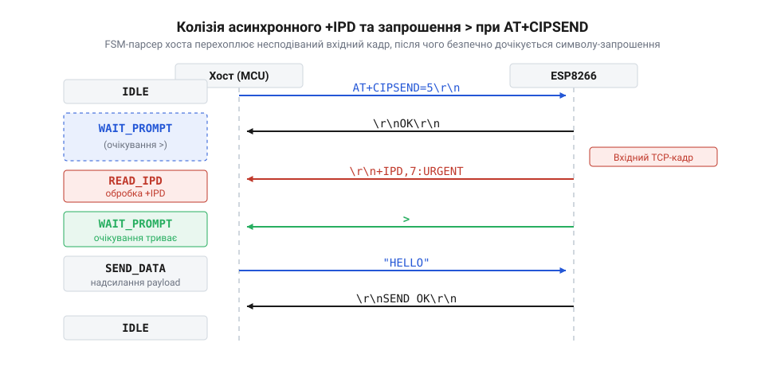
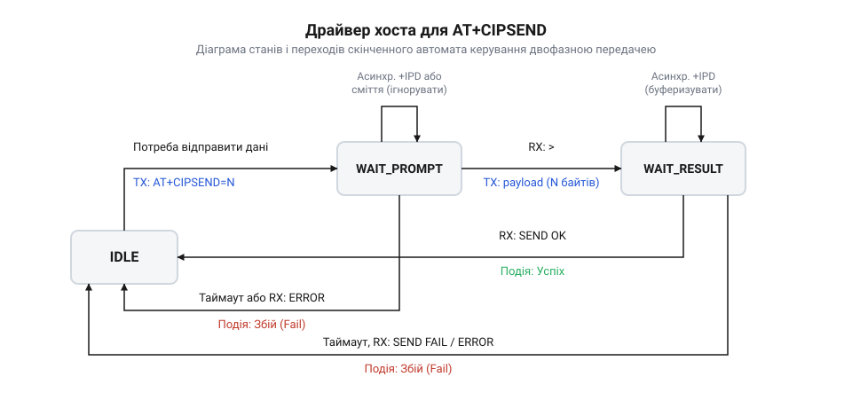

# Протокол двофазної передачі даних AT+CIPSEND в ESP8266

<preknowlist>
- [Мережеві сокети TCP/UDP на модулі ESP-01](root:cat-hw-boards/esp01-tcp-udp-sockets) — принципи створення й підтримання активних сокетних з'єднань, відмінності протоколів TCP і UDP та керування мультиплексуванням CIPMUX
- [Огляд базової системи AT-команд мікроконтролера ESP8266](root:cat-hw-boards/esp8266-at-command-set-overview) — загальний синтаксис текстових AT-команд, формати статусних відповідей та організація термінального обміну через UART
- [Архітектура мережевого стека lwIP у ESP8266](root:cat-hw-boards/lwip-architecture-esp8266) — принципи виділення буферів pbuf, функціонування сокетного шарніра прошивки та управління мережевими таймаутами
- [Апаратні FIFO-буфери інтерфейсу UART в ESP8266](root:cat-hw-boards/esp8266-uart-hardware-fifo) — організація 128-байтових приймально-передавальних FIFO-буферів UART та механізми захисту від переповнення при вичитуванні даних
</preknowlist>

## Проблема передачі бінарного корисного навантаження

Традиційна архітектура керування телекомунікаційними модемами формувалася в епоху текстових терміналів, коли обмін командами здійснювався виключно у формі ASCII-рядків. У такій системі кожна @@en|AT-команда@@ (англ. *AT command*, від *attention* — увага) та будь-яка відповідь пристрою завершуються текстовими @@en|термінаторами@@ (латин. *terminator*, від *terminus* — межа, кінець) — послідовністю повернення каретки та переведення рядка (`\r\n`, hex-коди `0x0D 0x0A`). Усі текстові протоколи на кшталт HTTP/1.1 чи SMTP функціонують у цьому середовищі бездоганно, оскільки їхній вміст за визначенням складається з друкованих символів. Проте сучасні архітектури пристроїв @@en|Internet of Things@@ (IoT) вимагають систематичної передачі довільного бінарного @@en|корисного навантаження@@ @@en|payload@@ (англ. *payload*, від *pay* — платити, *load* — вантаж) — стиснутих знімків датчиків, упакованих структур C/C++, бінарних кадрів Protocol Buffers, стиснутих зображень JPEG та криптографічних зашифрованих пакетів.

Головна фізична суперечність текстового @@en|AT-інтерпретатора@@ полягає у тому, що довільний бінарний потік містить байти у повному діапазоні значень від `0x00` до `0xFF`. Якщо у бінарному масиві даних випадково трапляється комбінація байтів `0x0D 0x0A`, звичайний текстовий парсер розпізнає її як сигнатуру завершення кадру. У результаті відбувається передчасне розривання кадру передачі, а наступні байти бінарного потоку @@en|ESP8266@@ намагається виконати як нову командну стрічку. Це призводить до критичного розсинхронізаційного збою в каналі зв'язку.

Окрім передчасного розриву кадру через символи `\r\n`, бінарний потік приховує ще кілька фундаментальних пасток для модемного парсера:

*   **Хибне спрацьовування ключових слів**: Якщо бінарний масив містить послідовності байтів, що збігаються з ASCII-кодами `OK\r\n`, `ERROR\r\n` або командними ключами `AT+RST`, внутрішній парсер прошивки змінює свій стан чи навіть ініціює апаратне перезавантаження модуля. *   **Руйнування буферів нулевим байтом**: Більшість внутрішніх функцій обробки текстових рядків на C (такі як `strlen` або `strcpy`) сприймають нулевий байт `0x00` як термінальний символ C-string. Збіг байта `0x00` у payload призводить до миттєвого обрізання буфера ще до його відправлення в мережевий сокет.

Спроба застосувати класичний для послідовних протоколів (таких як PPP чи HDLC) механізм @@en|байтового ескейпінгу@@ (англ. *escape sequence*, від *escape* — втікати), коли кожен службовий байт підміняється двобайтовою послідовністю, виявляється неприйнятною для вбудованих систем. За такого підходу пропускна здатність послідовного порту @@en|UART@@ (англ. *UART*, від *Universal Asynchronous Receiver-Transmitter* — універсальний асинхронний приймач-передавач) може падати на 50% у найгірших сценаріях, а хост-мікроконтролер та модуль @@en|ESP8266@@ змушені витрачати значні обчислювальні ресурси процесорного ядра на побайтовий сканінг і підстановку кадрів.

Рішенням цієї фундаментальної проблеми став двофазний @@en|хендшейк@@ (англ. *handshake*, від *hand* — рука, *shake* — стискати) `AT+CIPSEND`. Як детально описано в [історичному нарисі розвитку](root:cat-hw-boards/esp8266-at-cipsend-handshake/hist-esp8266-cipsend-two-phase-protocol-history.md) протоколів модемного зв'язку, Espressif Systems відмовилася від непередбачуваного побайтового парсингу на користь жорсткого розділення передачі на фазу оголошення розміру та фазу атомарного вивантаження даних.

Під час першої фази хост оголошує точну кількість байтів `N`, яку він планує передати. Лише після того, як модуль підтверджує готовність виділити буферний простір і перемикає свій послідовний інтерфейс у режим прямого вичитування, розпочинається друга фаза. У другій фазі парсер повністю вимикає аналіз службових символів і вичитує з послідовної лінії чітко `N` байтів без жодного ризику хибного спрацьовування на вміст payload.

Фізичне узгодження цієї передачі спирається на апаратну архітектуру модуля. Згідно з описом [стандартного командного інтерфейсу](root:cat-hw-boards/esp8266-at-command-set-overview) та залізними характеристиками, які наведено в [апаратному довіднику UART](root:cat-hw-boards/esp8266-at-cipsend-handshake/api-esp8266-uart-cipsend-hardware-interface.md), приймальні [приймально-передавальні буфери FIFO](root:cat-hw-boards/esp8266-uart-hardware-fifo) обсягом 128 байтів дозволяють модулю накопичувати вхідний потік без втрати байтів, поки процесорне ядро перенаправляє покажчики пам'яті прямо у мережевий стек.

Наведений нижче приклад на мові C демонструє вразливість наївного текстового розбору при спробі відправити бінарну структуру даних із неконтрольованими байтовими значеннями:

:::tabs
:::code esp8266-at-cipsend-handshake-d/c/esp-idf/demonstrate-binary-hazard.c
:::code esp8266-at-cipsend-handshake-d/cpp/arduino/sensorpayload.cpp
:::

Усвідомлення цієї фізичної обмеженості текстового розбору підводить до детального вивчення внутрішньої механіки модуля @@en|ESP8266@@ та його мережевого стека при виконанні двофазного хендшейку.

## Фізика двофазного хендшейку та lwIP

Виконання двофазної передачі даних ініціюється відправленням з хост-мікроконтролера команди фази запиту `AT+CIPSEND=<length>` для одиночного сокета або `AT+CIPSEND=<link_id>,<length>` для мультиплексного режиму. Апаратний інтерфейс UART модуля @@en|ESP8266@@ приймає цей ASCII-рядок у стандартному режимі розбору команд, накопичуючи символи у своєму приймальному буфері до моменту виявлення кінцевого термінатора `\r\n`.

Отримавши та розпарсивши параметр довжини `N`, прошивка модуля невідкладно звертається до внутрішніх ресурсів [мережевого стека lwIP](root:cat-hw-boards/lwip-architecture-esp8266) (англ. *lwIP*, від *lightweight IP* — легковаговий мережевий протокол). На цьому етапі відбувається критична перевірка доступності оперативної пам'яті @@en|RAM@@ та системних буферів:

1. **Перевірка сокетного стану**: Прошивка контролює, чи відкритий відповідний мережевий @@en|сокет@@ (англ. *socket*, від *socket* — гніздо) і чи перебуває @@en|TCP@@-з'єднання у стані `ESTABLISHED`. Якщо сокет закритий або відключений, модуль негайно відхиляє запит відповіддю `link is not valid\r\n` або `ERROR\r\n`.
2. **Запит виділення буферів pbuf**: За допомогою системної функції `tcp_sndbuf()` розраховується обсяг вільного місця у передавальному вікні TCP. Далі прошивка ініціює виділення ланцюжка структур @@en|pbuf@@ (англ. *pbuf*, від *packet buffer* — буфер пакета) потрібного розміру `N` у динамічній пам'яті. Якщо у пам'яті стека lwIP недостатньо вільних pbuf-блоків або перевищено ліміти черги, прошивка повертає статус `ERROR\r\n` або сповіщення про зайнятість `busy s...\r\n`.

Якщо перевірка буферів у стеку lwIP завершується успішно, [архітектура офіційної AT-прошивки](root:cat-hw-boards/esp8266-at-firmware-architecture) переключає стан послідовного парсера та генерує спеціальний @@en|символ-запрошення@@ @@en|prompt@@ (англ. *prompt*, від латин. *promptus* — готовий, виведений). Модуль висилає в лінію UART TX двобайтову послідовність `> ` (символ `0x3E` та пробіл `0x20`).

Найважливіша логічна та фізична особливість символу-запрошення `> ` полягає у тому, що він **не супроводжується** термінаторами `\r\n`. Це інлайн-сигнал готовності, після видачі якого внутрішній парсер UART миттєво змінює режим роботи: він вимикає інтерпретацію текстових AT-команд і переходить у режим прямих лічильників байтів (Count Mode).

З цього моменту хост-мікроконтролер отримує право вивантажувати в лінію UART суцільний бінарний потік обсягом рівно `N` байтів. Усі байти, що надходять у приймальний апаратний буфер @@en|FIFO@@ (англ. *FIFO*, від *First-In, First-Out* — перший увійшов, перший вийшов), атомарно переправляються прямими покажчиками в зарезервовану структуру `pbuf` стека lwIP. Внутрішній лічильник модуля зменшується на одиницю з кожним прийнятим байтом. Навіть якщо всередині корисного навантаження містяться символи `\r\n`, `OK` чи `AT+CIPSEND`, модуль сприймає їх виключно як сирі двійкові дані.

Невдовзі після того, як лічильник досягає нуля (прийнято повністю `N` байтів), модуль закриває фазу вивантаження payload і повертає UART-інтерпретатор у стандартний режим очікування AT-команд. Відразу після цього прошивка видає в UART підтвердження прийому буфера `Recv <length> bytes\r\n` і передає накопичений pbuf у функції `tcp_write()` та `tcp_output()`.

Фінальний статус передачі формується асинхронно залежно від реакції мережевого стека:

*   **SEND OK**: Генерується у випадку, коли remote-вузол повернув мережевий квиток @@en|ACK@@ (у режимі TCP) або коли датаграма успішно передана мережевому MAC-рівню Wi-Fi (у режимі @@en|UDP@@). *   **SEND FAIL**: Видається при виникненні мережевого таймауту, скиданні TCP-сесії або втраті пакета в ефірі без підтвердження. *   **ERROR**: Видається, якщо з'єднання розірвалося безпосередньо під час помпування даних або стався локальний збій розподілу пам'яті в lwIP.

Нижче наведено послідовну діаграму, що ілюструє повний двофазний хендшейк CIPSEND та взаємодію підсистем модуля:


*Послідовність проходження команди AT+CIPSEND, перевірки буферів lwIP, видачі символу-запрошення > та передачі бінарного payload.*

Загальний часовий інтервал виконання двофазного хендшейку розраховується за [математичною моделлю затримок](root:cat-hw-boards/esp8266-at-cipsend-handshake/math-esp8266-cipsend-timing-and-throughput-calc.md) та пропускної здатності:

```
T_total = T_cmd + T_lwip + T_prompt + T_data + T_net + T_status
        = ((N_cmd × 10) ÷ B) + T_lwip + ((2 × 10) ÷ B) + ((N_data × 10) ÷ B) + T_net + ((N_status × 10) ÷ B)   [сумування затримок фаз хендшейку]
        = T_out                                                                                                   [підсумковий таймаут хостового драйвера]
```

У цій формулі `N_cmd` — довжина текстового рядка команди `AT+CIPSEND` у байтах, `N_data` — розмір корисного навантаження `N`, `N_status` — кількість байтів статусного повідомлення (`Recv... SEND OK`), `B` — швидкість послідовного порту UART у бодах (байт зауважується як 10 біт з урахуванням стартового й стопового бітів), `T_lwip` — часова затримка виділення буферів пам'яті в стеку lwIP, а `T_net` — мережева затримка отримання квитанції TCP ACK від віддаленого сервера.

Наведений нижче приклад коду на C/C++ демонструє неблокуюче вихоплення символу-запрошення `> ` та відправлення payload хост-мікроконтролером:

:::tabs
:::code esp8266-at-cipsend-handshake-d/c/esp-idf/process-cipsend-prompt.c
:::code esp8266-at-cipsend-handshake-d/cpp/arduino/cipsendstate.cpp
:::

Детальніше про синтаксис команд та режим відправлення у мультиплексному режимі можна дізнатися у [програмному довіднику команд](root:cat-hw-boards/esp8266-at-cipsend-handshake/api-esp8266-at-cipsend-command-interface.md), а також у матеріалі про [архітектуру сокетів TCP/UDP](root:cat-hw-boards/esp01-tcp-udp-sockets).

## Особливості одиночного, мультиплексного та потокового режимів

Базова двофазна механіка `AT+CIPSEND` забезпечує надійну передачу кадрів для одного мережевого каналу. Проте реальні архітектури пристроїв @@en|Internet of Things@@ (IoT) варіюються від найпростіших автономних датчиків, що висилають покази на єдиний веб-сервер, до складних локальних шлюзів, які одночасно підтримують роботу @@en|MQTT@@-клієнта, приймають підключення по @@en|HTTP@@ на порті 80 та обробляють широкомовні @@en|UDP@@-запити пошуку пристроїв. Для гнучкого розгортання таких систем прошивка модуля @@en|ESP8266@@ надає три принципово різні режими функціонування сокетного шарніра, регульовані параметрами @@en|мультиплексування@@ (англ. *multiplexing*, від латин. *multiplex* — багатократний) `CIPMUX` та режиму передачі `CIPMODE`.

Одиночний режим (`CIPMUX=0`) є базовим станом модуля після скидання або подачі живлення. У цьому режимі стек @@en|lwIP@@ виділяє оперативну пам'ять @@en|RAM@@ під один-єдиний активний мережевий @@en|сокет@@ — @@en|TCP@@ чи @@en|UDP@@. Для ініціалізації двофазної передачі хост-мікроконтролер надсилає синтаксичну команду `AT+CIPSEND=<length>`, де параметр `length` вказує точну кількість байтів корисного навантаження @@en|payload@@. Якщо передача здійснюється через @@en|UDP@@-сокет без попередньої прив'язки конкретного віддаленого вузла, синтаксис розширюється параметрами динамічного призначення: `AT+CIPSEND=<length>,"<remote_ip>",<remote_port>`. Головна перевага одиночного режиму полягає у максимальній спрощеності стану хостового @@en|FSM-драйвера@@, якому не потрібно відстежувати ідентифікатори каналів, а також у наданні всього динамічного буферного пулу стека @@en|lwIP@@ під один сокет. Проте недоліком є неможливість прийому паралельних вхідних підключень від інших клієнтів.

Мультиплексний режим (`CIPMUX=1`) перетворює модуль на багатоканальний мережевий вузол, здатний підтримувати до 5 одночасних сокетних з'єднань з ідентифікаторами `link_id` від 0 до 4. Детальніше принципи [організації множинних сокетних з'єднань](root:com-protocol/esp8266-at-multiple-connections-management) описують розподіл ресурсів пам'яті між паралельними каналами. У цьому режимі синтаксис команди відправлення обов'язково вимагає явного вказівника цільового каналу:

```
AT+CIPSEND=<link_id>,<length>
```

Для сокета @@en|UDP@@ у мультиплексному режимі доступна адресація на льоту: `AT+CIPSEND=<link_id>,<length>,"<remote_ip>",<remote_port>`. Отримавши таку команду, текстовий парсер прошивки спочатку перевіряє системний масив сокетних блоків керування. Якщо вказаний `link_id` перебуває у закритому стані або виходить за межі діапазону 0–4, модуль відразу перериває виконання фази запиту та повертає текстову помилку `link is not valid\r\n`. Як зазначається у [програмному довіднику команд CIPSEND](root:cat-hw-boards/esp8266-at-cipsend-handshake/api-esp8266-at-cipsend-command-interface.md), при роботі у мультиплексному режимі кожен ідентифікатор `link_id` має власний ізольований лічильник очікуваних байтів і власну чергу буферів @@en|pbuf@@ у стеку @@en|lwIP@@, що запобігає змішуванню даних між паралельними @@en|TCP@@-сесіями.

Третім режимом є @@en|наскрізний режим@@ (англ. *passthrough mode*, від *pass* — проходити, *through* — наскрізь) або прозорий стримінг даних (`CIPMODE=1`). У цьому режимі двофазний хендшейк із постійним оголошенням довжини блоку вимикається. Після початкового налаштування `CIPMUX=0` та `CIPMODE=1` хост висилає команду `AT+CIPSEND` без параметрів. Модуль повертає символ-запрошення `> ` і переходить у неперервний прозорий мост між послідовною лінією @@en|UART@@ та мережевим @@en|TCP@@-сокетом. Принципи функціонування та обмеження [прозорого наскрізного режиму CIPMODE=1](root:com-protocol/esp8266-at-passthrough-mode) показують, що будь-який байт з апаратного буфера @@en|FIFO@@ миттєво упаковується в мережевий кадр і відправляється в ефір без додаткових команд `AT+CIPSEND`. Для виходу з потокового режиму хост повинен витримати паузу в 1 секунду, передати послідовність символів `+++` без термінаторів `\r\n` і витримати ще 1 секунду тиші.

Вибір оптимального режиму передачі залежить від вимог до пропускної здатності та гнучності. Проведене [практичне вимірювання пропускної здатності](root:cat-hw-boards/esp8266-at-cipsend-handshake/proj-esp8266-cipsend-throughput-benchmarking.md) підтверджує, що наскрізний режим `CIPMODE=1` забезпечує найвищу швидкість передачі за рахунок відсутності оверхеду текстових команд `AT+CIPSEND` та підтверджень `Recv...`, однако він позбавляє хост можливості працювати з кількома сокетами одночасно та контролювати межі окремих пакетів.

Наведений нижче приклад коду мовами C та C++ демонструє універсальну функцію хоста для формування двофазної команди `AT+CIPSEND` залежно від поточного режиму сокета та наявності адресації @@en|UDP@@:

:::tabs
:::code esp8266-at-cipsend-handshake-d/c/esp-idf/build-cipsend-command.c
:::code esp8266-at-cipsend-handshake-d/cpp/arduino/cipsendparam.cpp
:::

Різноманітність синтаксичних форм `AT+CIPSEND` вимагає чіткого усвідомлення подальшої долі вивантажених байтів у мережевому стеку модуля та механізмів формування зворотних статусних відповідей.

## Механізми підтвердження та обробка статусних відповідей

Після того як хост-мікроконтролер отримує символ-запрошення `> ` і передає в послідовний порт @@en|UART@@ оголошений масив байтів `N`, розпочинається внутрішній процес обробки корисного навантаження @@en|payload@@ мережевим стеком @@en|lwIP@@. Формування фінальної статусної відповіді прошивки проілюстровано двома послідовними етапами: фізичним вичитуванням з апаратного буфера @@en|FIFO@@ та мережевим підтвердженням доставки на рівнях @@en|TCP@@ чи @@en|Wi-Fi@@.

Перший етап завершується в той момент, коли внутрішній лічильник байтів модуля досягає нуля. Приймальний парсер @@en|UART@@ переконується, що прийнято всі `N` байтів, видає в лінію передачі @@en|UART@@ TX сповіщення про локальне захоплення буфера `Recv <length> bytes\r\n` (наприклад, `Recv 128 bytes\r\n`) і негайно зв'язує ланцюжок структур @@en|pbuf@@ з мережевим шарніром. Важливо розуміти: повідомлення `Recv <length> bytes\r\n` свідчить **виключно** про успішне вичитування даних із послідовного порту в оперативну пам'ять @@en|RAM@@ модуля @@en|ESP8266@@, але не є гарантією їхнього проходження через бездротовий ефір чи отримання віддаленим сервером.

Другий етап полягає у формуванні підсумкових відповідей `SEND OK`, `SEND FAIL` або `ERROR` на основі квитанцій @@en|ACK@@ (англ. *acknowledgment*, від *acknowledge* — підтверджувати) та фізичних статусів передавача:

*   **Формування `SEND OK` у режимі TCP**: Стек @@en|lwIP@@ викликає системні функції `tcp_write()` та `tcp_output()`, формуючи @@en|TCP@@-сегменти з прапором `PSH`. Модуль відправляє пакети через радіоефір на @@en|Wi-Fi@@-маршрутизатор. Віддалений сервер приймає дані й надсилає у відповідь мережевий пакет із квитанцією @@en|ACK@@, що підтверджує прийом байтів до конкретного порядкового номера (Sequence Number). Лише після того, як стек @@en|lwIP@@ модуля отримує цей квиток @@en|ACK@@ і звільняє відповідні блоки @@en|pbuf@@ у пам'яті, прошивка видає в @@en|UART@@ підсумковий рядок `SEND OK\r\n`. *   **Формування `SEND OK` у режимі UDP**: Протокол @@en|UDP@@ є протоколом без встановлення з'єднання і не передбачає підтверджень на транспортному рівні. Тому для @@en|UDP@@-сокетів відповідь `SEND OK\r\n` ґенерується відразу після того, як апаратний @@en|MAC-рівень@@ (англ. *MAC*, від *Media Access Control* — керування доступом до середовища) бездротового адаптера @@en|ESP8266@@ успішно передасть радіокадр у повітря й отримає апаратне підтвердження кадру від безпосередньої точки доступу. Тобто `SEND OK` для @@en|UDP@@ гарантує успішне випромінювання пакета в ефір, але не гарантує прийому пакета кінцевою програмою на віддаленому сервері. *   **Причини видачі `SEND FAIL`**: Відповідь `SEND FAIL\r\n` формується у разі мережевого збою. Для @@en|TCP@@ це означає вичерпання ліміту повторних спроб (Retransmission Timeout, RTO), коли віддалений сервер не відповів квитанцією @@en|ACK@@ протягом заданого таймауту через втрату пакетів у мережі або обрив зв'язку. Для @@en|UDP@@ статус `SEND FAIL` виникає при втраті асоціації з @@en|Wi-Fi@@-точкою доступу безпосередньо під час спроби відправки кадру. *   **Причини видачі `ERROR`**: Відповідь `ERROR\r\n` генерується або негайно у відповідь на команду `AT+CIPSEND` (якщо сокет закритий, переповнена пам'ять стека `pbuf_alloc` або помилка в параметрах), або після видачі `Recv...`, якщо під час помпування даних віддалений вузол надіслав @@en|TCP@@-пакет із прапором `RST` (Reset) чи з'єднання розірвалося на рівні сокета.

Алгоритмічна блок-схема пояснює причинно-наслідкові шляхи формування відповідей прошивкою:


*Причинно-наслідкові шляхи формування фінальних статусних відповідей ESP8266 залежно від типу мережевого протоколу (TCP/UDP) та підтверджень стека lwIP.*

Окрему категорію відповідей у прошивках @@en|ESP8266@@ становлять службові сповіщення про зайнятість системних ресурсів: `busy s...\r\n` та `busy p...\r\n`. Повідомлення `busy s...` (англ. *busy sending* — зайнятий відправленням) виникає у випадку, коли хост надсилає нову команду `AT+CIPSEND` у момент, коли модуль ще не завершив обробку попереднього запиту — наприклад, перебуває у стані очікування символу `> `, вичитання payload або очікування мережевого квитка @@en|ACK@@. Сповіщення `busy p...` (англ. *busy processing* — зайнятий обробкою) свідчить про те, що внутрішній інтерпретатор займається обробкою фонових системних завдань. При отриманні `busy s...` хостовий @@en|FSM-драйвер@@ не повинен скидати стан з'єднання; замість цього слід застосувати часову паузу (Backoff) та повторити спробу запиту після вирівнювання стану прошивки.

Загальний часовий інтервал виконання двофазної передачі розкладається на апаратні та мережеві компоненти. Згідно з матеріалом про [математику часових затримок UART та таймаутів](root:cat-hw-boards/esp8266-at-cipsend-handshake/math-esp8266-cipsend-timing-and-throughput-calc.md), таймаут очікування статусу `SEND OK` на хості має розраховуватись із урахуванням швидкості @@en|UART@@, розміру `N` та максимального часу круглого проходу пакетів @@en|RTT@@ (англ. *Round-Trip Time* — час туди й назад) у мережі:

```
T_timeout = T_uart_data + T_lwip_alloc + T_rtt_max
          = ((N × 10) ÷ BaudRate) + T_lwip_alloc + T_rtt_max   [розрахунок граничного таймауту]
```

При проєктуванні хостового програмного забезпечення, як показано у [практичному проєкті FSM-драйвера](root:cat-hw-boards/esp8266-at-cipsend-handshake/proj-esp8266-cipsend-fsm-driver.md), парсер повинен реалізовувати суворе розгалуження статусів та неблокуюче вичитання термінальних відповідей.

Наведений нижче приклад на мовах C та C++ ілюструє неблокуючий аналізатор текстових статусних відповідей модуля @@en|ESP8266@@:

:::tabs
:::code esp8266-at-cipsend-handshake-d/c/esp-idf/parse-cipsend-response-line.c
:::code esp8266-at-cipsend-handshake-d/cpp/arduino/sendstatusresult.cpp
:::

Розуміння точної механіки формування статусних відповідей створює необхідний підґрунтовий базис для обробки складних асинхронних накладень кадрів та проєктування надійного неблокуючого FSM-драйвера хост-мікроконтролера.

## Асинхронні накладення та аварійні граничні випадки

У реальних бездротових мережах виконання двофазного хендшейку рідко відбувається в ідеальних ізольованих умовах. Поки хост-мікроконтролер надсилає фазу запиту `AT+CIPSEND` та очікує на @@en|символ-запрошення@@ @@en|prompt@@ `> `, апаратний послідовний інтерфейс @@en|UART@@ та мережевий стек @@en|lwIP@@ модуля @@en|ESP8266@@ продовжують паралельну обробку фонових подій бездротового ефіру. Нехтування фізикою асинхронних накладень призводить до руйнування стану хостового @@en|FSM-драйвера@@ (англ. *Finite State Machine*, від *finite* — скінченний, *state* — стан, *machine* — машина), зависання шини обміну або незворотної втрати двійкових даних.

Першим аварійним граничним випадком є розрив мережевого з'єднання або втрата @@en|Wi-Fi@@-асоціації безпосередньо у проміжку між відправленням фази запиту `AT+CIPSEND` та видачею символу `> `. Якщо віддалений сервер надсилає @@en|TCP@@-пакет із прапором `RST` (Reset) чи `FIN`, або якщо точка доступу розриває зв'язок через згасання сигналу, внутрішній шарнір прошивки скасовує виділення буферів @@en|pbuf@@ у стеку @@en|lwIP@@ і повертає в лінію передачі UART TX текстове сповіщення `CLOSED\r\n` або `ERROR\r\n` замість очікуваного `> `.

Якщо хост-мікроконтролер побудовано на основі наївного блокуючого коду з примусовою затримкою (`delay`) без побайтового аналізу відповіді, хост починає примусово помпувати двійкове @@en|корисне навантаження@@ @@en|payload@@ у лінію UART. Оскільки прошивка @@en|ESP8266@@ не видала символ `> ` і залишилася в стандартному режимі розбору команд, кожен байт бінарного масиву сприймається як рядок AT-команди. Випадкові збіги байтів спричиняють масову видачу помилок `ERR COMMAND`, небажану зміну конфігураційних регістрів або навіть апаратне перезавантаження модуля через влучання у послідовність `AT+RST`.

Другим і найбільш підступним сценарієм є вклинювання (колізія) асинхронних вхідних кадрів `+IPD` від інших активних сокетів. Поки хост очікує підтвердження на надсилання даних по каналу 0, на сокет 1 від віддаленого вузла надходить мережевий пакет. Мережевий стек модуля негайно передає вичитані байти в лінію UART TX у вигляді асинхронного кадру:

```
+IPD,1,20:<binary_data>
```

Розбір цієї колізійної ситуації показано на часовій діаграмі:


*Часова діаграма вклинювання асинхронного кадру +IPD у лінію UART під час очікування хостом символу-запрошення > та розплетення даних хостовим парсером.*

Якщо бінарний масив усередині кадру `+IPD` містить ASCII-символ `>` (наприклад, у складі @@en|XML@@ чи @@en|HTML@@-тегів `<data>`), примітивний хостовий парсер, який шукає лише один байт `0x3E`, помилково сприйме цей внутрішній символ за символ-запрошення `> `. У результаті хост почне передчасно вивантажувати свій payload безпосередньо в момент, коли модуль ще видає в UART решту текстового кадру `+IPD`. Для запобігання цьому руйнівному накладенню хостовий алгоритм повинен реалізовувати сурогатно-потоковий аналізатор: детально правила [потокового розбору асинхронних кадрів +IPD](root:cat-hw-boards/esp8266-at-ipd-parser) вимагають обов'язкової перевірки двобайтового маркера `> ` (коди `0x3E 0x20`) та повного декодування довжини вхідного IPD-пакета для його пропуску або збереження в окремому буфері. XML@@ чи @@en | HTML@@-тегів `<data>`), примітивний хостовий парсер, який шукає лише один байт `0x3E`, помилково сприйме цей внутрішній символ за символ-запрошення `> `. | Докладніше про алгоритми побудови FSM-декодера та обробку асинхронних кадрів у мультиплексному режимі розповідає стаття про [потоковий розбір асинхронних кадрів +IPD в AT-прошивці ESP8266](root:com-protocol/esp8266-at-ipd-parser).

Третім граничним фактором є апаратне переповнення (англ. *overrun*) приймальних буферів UART. Згідно з [описом апаратного FIFO UART](root:cat-hw-boards/esp8266-uart-hardware-fifo) та залізними специфікаціями з [апаратного довідника UART](root:cat-hw-boards/esp8266-at-cipsend-handshake/api-esp8266-uart-cipsend-hardware-interface.md), приймальний буфер @@en|FIFO@@ модуля обмежений 128 байтами. Якщо хост вивантажує великий масив payload (наприклад, 1024 байти) на високій швидкості (115200 біт/с і вище) без урахування готовності модуля, процесорне ядро @@en|ESP8266@@ може відволіктися на витискальні переривання бездротового MAC-рівня чи обслуговування оперативної пам'яті @@en|RAM@@. Причиною втрати байтів стає переповнення FIFO:

```
T_window = T_cmd_rx + T_lwip_alloc + T_fifo_delay
         = ((N_cmd × 10) ÷ BaudRate) + T_lwip_alloc + T_fifo_delay   [часове вікно виникнення апаратного переповнення]
```

Якщо при переповненні буфера втрачається хоча б кілька байтів, внутрішній лічильник модуля не досягає нуля. Модуль залишається назавжди заблокованим у режимі вичитання байтів, очікуючи на залишок payload, тоді як хост вважає відправку завершеною й марно очікує на відповідь `SEND OK`. Радикальним розв'язком цієї проблеми є ввімкнення [апаратного керування потоком UART RTS/CTS](root:cat-hw-boards/esp8266-at-uart-flow-control), коли модуль переводить лінію @@en|RTS@@ (англ. *Request to Send* — запит на передачу) у високий логічний рівень при заповненні FIFO вище безпечного порогу.

Нижче наведено приклад коду мовами C та C++, який ілюструє алгоритм потокового розплетення кадрів `+IPD` та вихоплення символу `> `:

:::tabs
:::code esp8266-at-cipsend-handshake-d/c/esp-idf/parser-init.c
:::code esp8266-at-cipsend-handshake-d/cpp/arduino/safepromptdetector.cpp
:::

Розуміння цих фізичних граничних факторів підводить до підсумкового синтезу — проєктування неблокуючого FSM-драйвера хост-мікроконтролера.

## Проєктування неблокуючого FSM-драйвера хост-мікроконтролера

Створення надійного програмного забезпечення для хост-мікроконтролера вимагає відмови від блокирувальних циклів очікування на кшталт `while(!Serial.available())` чи тривалих викликів `delay()`. Практичні вимоги до реалізації [проектуванні FSM-драйвера](root:cat-hw-boards/esp8266-at-cipsend-handshake/proj-esp8266-cipsend-fsm-driver.md) полягають у побудові атомарного скінченного автомата (FSM), який опрацьовує символи з буфера UART неблокуючим чином під час кожного системного такту (tick), паралельно контролюючи граничні часові таймаути.

Архітектура хостового драйвера будується на основі шести чітко розграничених станів:

1. **`STATE_IDLE`**: Початковий стан очікування завдання на відправлення даних від вищого прикладного рівня.
2. **`STATE_SEND_CMD`**: Формування текстового рядка `AT+CIPSEND` відповідно до правил [системи AT-команд](root:cat-hw-boards/esp8266-at-command-set-overview) та конфігурації [множинних сокетних з'єднань](root:com-protocol/esp8266-at-multiple-connections-management). Запис команди в UART TX, фіксація початкового мітки часу `t_start` та перехід у стан очікування промпту.
3. **`STATE_WAIT_PROMPT`**: Побайтовий неблокуючий розбір вхідного потоку UART RX. Драйвер відстежує послідовність `> `, пропускаючи асинхронні кадри `+IPD`. Якщо протягом таймауту `T_prompt_timeout` символ не виявлено або отримано статус `ERROR`/`CLOSED`, автомат переходить у стан відновлення.
4. **`STATE_PUMP_PAYLOAD`**: Атомарне вивантаження фіксованого масиву payload обсягом N байтів у лінію UART. За наявності лінії @@en|RTS/CTS@@ драйвер контролює апаратну готовність модуля.
5. **`STATE_WAIT_RESULT`**: Очікування підсумкової текстової відповіді (`Recv <len> bytes`, `SEND OK`, `SEND FAIL` або `busy s...`). Запуск таймауту очікування мережевої квитанції `T_result_timeout`.
6. **`STATE_ERROR_RECOVERY`**: Аварійний стан. Застосування витримувальної паузи (англ. *backoff*), відправлення термінатора `\r\n` для скидання неповного стану прошивки та повернення автомата в `STATE_IDLE` з поверненням коду помилки вищій програмі.

Повний цикл станів та аварійних переходів FSM-драйвера зображено на діаграмі:


*Діаграма станів і переходів неблокуючого FSM-драйвера хост-мікроконтролера для керування двофазною передачею CIPSEND.*

Обчислення граничних затримок для системних таймерів контролю FSM здійснюється за математичною моделлю:

```
T_prompt_timeout = T_uart_cmd + T_lwip_max
                 = ((N_cmd × 10) ÷ BaudRate) + 500   [граничний таймаут очікування символу запрошення, мс]

T_result_timeout = T_uart_data + T_rtt_max + T_processing
                 = ((N_data × 10) ÷ BaudRate) + 5000  [граничний таймаут очікування підсумкового статусу, мс]
```

Нижче наведено повну неблокуючу реалізацію FSM-драйвера мовами C та C++, готову для інтеграції у вбудовані проєкти:

:::tabs
:::code esp8266-at-cipsend-handshake-d/c/esp-idf/fsm-driver-init.c
:::code esp8266-at-cipsend-handshake-d/cpp/arduino/cipsendfsm.cpp
:::

Проєктування неблокуючих автоматів FSM із суворим дотриманням двофазної фізики хендшейку гарантує максимальну надійність та стабільність зв'язку мікроконтролерних систем на базі ESP8266.