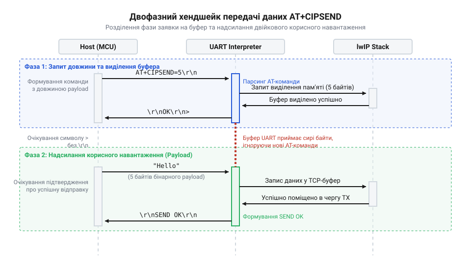

# Протокол двофазної передачі даних AT+CIPSEND в ESP8266

<preknowlist>
- [Огляд базової системи AT-команд мікроконтролера ESP8266](root:cat-hw-boards/esp8266-at-command-set-overview) — загальний синтаксис текстових AT-команд і принцип термінаторів
- [Мережеві сокети TCP/UDP на модулі ESP-01](root:cat-hw-boards/esp01-tcp-udp-sockets) — принципи створення та використання сокетних з'єднань
</preknowlist>

## Проблема текстового розбору бінарних даних

Коли мікроконтролер спілкується з модулем через AT-команди, він надсилає текстові рядки, що закінчуються термінаторами. Парсер модуля безперервно читає потік із послідовного порту, шукаючи службові слова та символи завершення рядка, щоб виконати команду. Якщо спробувати передати бінарне корисне навантаження безпосередньо як частину текстової команди, виникає критична проблема. Бінарний потік містить довільні байти від `0x00` до `0xFF`, серед яких неминуче трапляться коди, що збігаються з термінаторами — символом повернення каретки `0x0D` або переведення рядка `0x0A`. Щойно парсер натрапить на такий байт усередині корисного навантаження, він розцінить його як справжній кінець поточної команди, обірве кадр і спробує розшифрувати всі наступні байти бінарного потоку як нову AT-команду. Це миттєво призведе до помилок парсингу, втрати частини навантаження та повної розсинхронізації комунікації, після якої модуль перестане адекватно реагувати на справжні команди хоста.

## Механіка двофазного хендшейку AT+CIPSEND

Щоб безпечно передати бінарний потік, потрібно тимчасово вимкнути текстовий парсер і перевести модуль у режим прямого вичитування. Для цього використовується двофазна передача, або @@en|хендшейк@@. Спочатку хост надсилає текстову команду `AT+CIPSEND`, у якій чітко замовляє обсяг даних у байтах. Модуль приймає цю команду, виділяє потрібний буфер і повертає символ-запрошення `>`. Лише після появи цього символу хост отримує дозвіл на вивантаження сирого бінарного потоку. 

Оскільки модуль заздалегідь знає точну кількість байтів, він припиняє аналізувати вміст на наявність термінаторів і просто рахує прийняті байти. Коли лічильник досягає замовленого обсягу, модуль автоматично повертається до текстового режиму очікування нових AT-команд. Якщо ж хост проігнорує чекання символу `>` і відправить потік раніше, модуль не встигне перемкнутися в режим прямого вичитування і продовжить парсити бінарні дані як текст, хибно розпізнаючи випадкові байти як термінатори чи команди. За умови ж строгого очікування такий механізм повністю усуває ризик хибного спрацювання і гарантує цілісність як даних, так і самої комунікації.

## Отримання фінальних статусних відповідей

Завершення передачі даних через послідовний порт не означає їхньої успішної доставки отримувачу в мережі. Коли хост вивантажує останній замовлений байт, модуль ESP8266 сповіщає про успішне прийняття повідомленням про кількість байтів чи статусом на кшталт `SEND OK`. Важливо розуміти, що це лише підтвердження успішного вичитування потоку в локальну оперативну пам'ять модуля. Далі дані передаються мережевому стеку для відправлення через Wi-Fi. Фінальний результат цієї відправки залежить від стану мережі, наявності зв'язку та протоколу. Статуси успіху чи помилки від мережевого стека генеруються асинхронно і можуть надійти пізніше у вигляді повідомлень на кшталт `SEND FAIL`. Тому хост має розрізняти локальне захоплення буфера та фактичне мережеве підтвердження доставки.