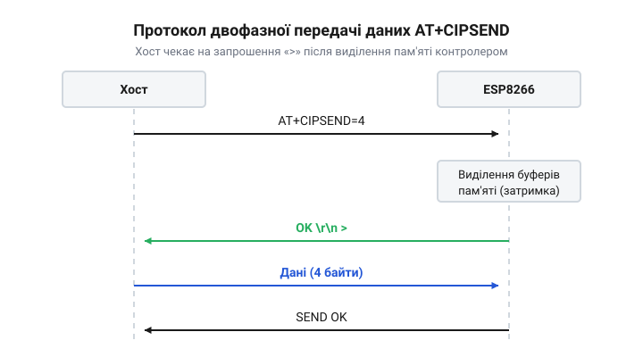

# Еволюція протоколу AT+CIPSEND: від текстових модемних команд до двофазного мережевого хендшейку ESP8266

<preknowlist>
- [Огляд базової системи AT-команд мікроконтролера ESP8266](root:cat-hw-boards/esp8266-at-command-set-overview) — загальний синтаксис AT-команд, роль термінаторів \r\n у розділенні повідомлень.
</preknowlist>

## Проблема прозорого передавання даних

Історично інтерфейс модемних команд розробляли виключно для текстового спілкування між терміналом та пристроєм зв'язку. Класичний стандарт Hayes, створений ще у вісімдесятих роках, передбачає, що модем приймає рядки тексту, які обов'язково закінчуються символами повернення каретки та переведення рядка `\r\n`. Коли інженери Espressif створювали [базову систему AT-команд](root:cat-hw-boards/esp8266-at-command-set-overview) для мікроконтролера ESP8266, вони природно обрали цей звичний інтерфейс для керування підключенням до точок доступу та конфігурації мережі. Проте передавання через єдиний послідовний канал не лише службового тексту, а й довільних бінарних мережевих пакетів виявилося значно складнішим завданням.

Перші спроби реалізувати обмін даними спиралися на прозорий режим передавання (від англ. transparent transmission, де корінь вказує на «прозорість» потоку без втручання). У цьому режимі мікроконтролер переходить у стан, коли він просто бере кожен байт, отриманий через інтерфейс @@en|UART@@, і пересилає його безпосередньо у відкритий мережевий сокет. Щоб повернути пристрій назад до режиму приймання команд, керуючий хост мав надіслати спеціальну послідовність символів `+++` із певними паузами до і після неї.

Проблема цього підходу полягала в тому, що потік бінарних даних — наприклад, зашифрований трафік, зображення або скомпільований код — міг містити будь-які комбінації байтів. Якщо такий бінарний пакет випадково містив послідовність `+++` або збігався з текстовими відповідями модема на кшталт `OK` чи `ERROR`, система ставала нестабільною. Внутрішній парсер команд міг хибно сприйняти ці байти як сигнал до завершення передачі та несподівано перервати сесію. Відрізнити керуючий текст від корисного навантаження мережевого пакета у єдиному потоці було математично неможливо. Розробникам став потрібен новий надійний механізм, який гарантовано відокремив би бінарні дані від командного текстового потоку.

## Оголошення розміру мережевого пакета

Щоб остаточно розв'язати проблему конфлікту між даними та командами, інженери вирішили повністю відмовитися від спроб знайти символи закінчення рядка під час активного передавання мережевого трафіку. Вони застосували інженерну ідею попереднього оголошення розміру повідомлення. Замість того, щоб безперервно вливати потік даних у інтерфейс @@en|UART@@ і сподіватися, що там не трапиться заборонених символів, керуючий пристрій має заздалегідь повідомити мікроконтролеру точний обсяг наступної порції інформації.

Ця ідея втілилася у вдосконаленій команді `AT+CIPSEND`, до якої додали обов'язковий параметр довжини. Отримавши таку команду, прошивка ESP8266 перемикає свій внутрішній стан. Вона тимчасово вимикає парсер AT-команд і припиняє аналізувати вхідні символи на наявність послідовностей `\r\n` або керуючих слів. Натомість мікроконтролер просто відраховує заявлену кількість байтів, що надходять, розглядаючи їх виключно як корисне навантаження. Лише після того, як лічильник прийнятих байтів досягне заявленого числа, парсер знову активується і повертається до командного режиму.

Цей підхід пояснює першу фазу сучасного двофазного протоколу обміну. Завдяки ізоляції парсера за лічильником байтів, керуючий пристрій отримав змогу безпечно передавати через єдиний послідовний порт будь-які бінарні послідовності. Навіть якщо всередині корисного навантаження траплятимуться символи повернення каретки або послідовності виходу, вони гарантовано пройдуть через мікроконтролер у мережу без хибних спрацьовувань.

## Запрошення і контроль потоку

Попереднього оголошення розміру пакета виявилося достатньо для розрізнення команд і даних, але недостатньо для стабільної роботи без втрат. Мікроконтролер ESP8266 має дуже обмежені [апаратні FIFO-буфери інтерфейсу UART](root:cat-hw-boards/esp8266-uart-hardware-fifo), які вміщують лише кількадесят байтів. Водночас виділення оперативної пам'яті для формування мережевого пакета у внутрішньому [стеку lwIP](root:cat-hw-boards/lwip-architecture-esp8266) потребує певного часу.

Якби зовнішній процесор міг миттєво відправити команду `AT+CIPSEND` із довжиною і одразу ж почати безперервно передавати великий масив даних на високій швидкості послідовного порту, сталася б розсинхронізація. Апаратний буфер @@en|UART@@ переповнився б ще до того, як операційна система мікроконтролера встигла б підготувати пам'ять для прийому мережевого пакета. Швидкі дані з інтерфейсу почали б перезаписувати ті, які процесор ще не встиг вичитати, що призвело б до невідворотної втрати частини інформації.

Щоб запобігти переповненням і втратам, розробники Espressif ввели програмний механізм контролю потоку на основі спеціального символу-запрошення `>`. Тепер взаємодія перетворилася на справжній контрольований двофазний хендшейк. Спочатку зовнішній пристрій надсилає команду з вказанням розміру `AT+CIPSEND` і обов'язково зупиняється. ESP8266 приймає команду, звертається до стека @@en|lwIP@@ і виділяє потрібну кількість пам'яті для заявленого обсягу байтів. Лише тоді, коли пам'ять успішно зарезервована і буфери готові до прийому, мікроконтролер відправляє хосту символ-запрошення `>`.

*Діаграма послідовності двофазного обміну показує затримку між відправкою команди та отриманням символу запрошення, що дає мікроконтролеру час на виділення пам'яті і запобігає переповненню буферів.*

Цей символ слугує чітким сигналом готовності до приймання. Тільки після того, як керуючий пристрій отримує `>`, він розпочинає безпосередню передачу масиву даних. Такий механізм асинхронного узгодження швидкостей дозволив надійно працювати з мережевими протоколами і уникати втрат навіть без використання апаратних ліній контролю потоку, спираючись виключно на логіку двофазного обміну.