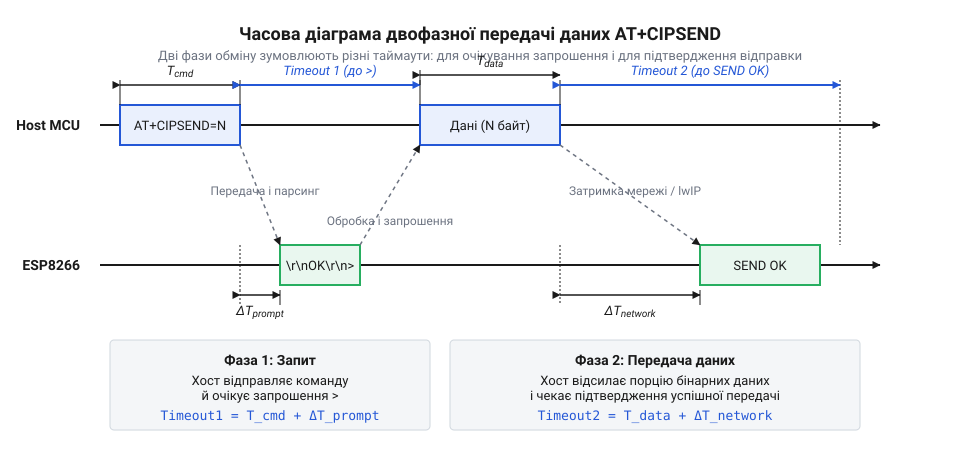

# Математика часових затримок UART, обчислення накладних витрат та таймаутів двофазного хендшейку AT+CIPSEND

<preknowlist>
- [Огляд базової системи AT-команд мікроконтролера ESP8266](root:cat-hw-boards/esp8266-at-command-set-overview) — загальний формат запитів, відповідей та поняття командного режиму.
- [Апаратні FIFO-буфери інтерфейсу UART в ESP8266](root:cat-hw-boards/esp8266-uart-hardware-fifo) — концепція передачі даних через UART та обмеження буферів, що спричиняють затримки.
</preknowlist>

## Проблема сліпого відправлення потоку даних

Під час передавання даних через UART хост-мікроконтролер надсилає байти у вигляді послідовного електричного сигналу, не маючи зворотного зв'язку про стан приймача. Якщо хост почне неперервно відправляти великий масив даних модулю ESP8266, апаратний буфер UART у модулі швидко заповниться. Стек [lwIP](file:///lwip-architecture-esp8266) модуля потребує часу, щоб забрати ці байти з буфера, запакувати їх у TCP-сегмент і віддати радіотракту. Поки цей процес триває, модуль не може приймати нові дані. Будь-які байти, що надходять у цей момент по UART, просто перезапишуть незчитані дані в переповненому FIFO-буфері, що призведе до незворотної втрати інформації. 

Саме тому процес відправлення масиву даних не може бути суцільним потоком. Хост не може покластися виключно на апаратний контроль потоку (RTS/CTS): хоча ці сигнали й здатні призупинити передачу байтів при заповненні апаратного FIFO, вони діють лише на фізичному рівні і не вирішують проблеми розподілу пам'яті в мережевому стеку. Якщо стек не знає розміру майбутнього пакета і не зможе заздалегідь виділити під нього буфери, зупинка UART через RTS/CTS просто заблокує канал зв'язку. Щоб запобігти цьому, розробники AT-прошивки реалізували відправлення через механізм двофазного узгодження, відомого як @@en|handshake@@. Замість того, щоб сліпо сипати даними, хост спочатку надсилає модулю коротку команду-намір: «я хочу передати ось таку кількість байтів». Після цього він зупиняється і чекає. Модуль розбирає команду, готує внутрішні буфери стеку lwIP під заявлений об'єм і, коли він справді готовий прийняти ці дані, повертає хосту символ-запрошення `>`. Лише після цього хост відправляє саме корисне навантаження. Цей поділ на фазу узгодження наміру та фазу передачі навантаження гарантує, що модуль завжди має достатньо пам'яті для прийому наступного блоку без ризику заблокувати інтерфейс або втратити дані.

## Час запиту та затримка запрошення

Фізичний час передавання команди через UART прямо залежить від обраного бітрейту (швидкості порту) та довжини самої команди. Команда `AT+CIPSEND=<length>\r\n` має змінну довжину залежно від значення `length`. Кожен байт, що передається по UART у стандартному режимі 8N1 (8 біт даних, без паритету, 1 стоп-біт), містить 10 біт: 1 стартовий, 8 біт корисного навантаження та 1 стоп-біт. 

Час передавання одного байта `T_byte` обчислюється як:

    T_byte
    = 10 / BaudRate      [час передачі 10 біт на обраній швидкості]

Тоді час передавання самої команди запиту `T_cmd` довжиною `L_cmd` байтів становить:

    T_cmd
    = L_cmd × T_byte      [множимо кількість байтів на час одного байта]

Після того, як останній біт команди пішов у лінію, хост починає чекати на запрошення `>`. Цей час очікування `T_prompt_delay` не є константою. Він складається з часу, який потрібен модулю для розбору команди в прошивці, перевірки поточного стану мережевого з'єднання, виділення пам'яті в стеку lwIP для майбутнього пакета, і, нарешті, часу на відправлення символу `>` разом із попереднім текстом (зазвичай `\r\nOK\r\n> `) назад до хоста. 

Базовий таймаут очікування першої фази `Timeout_1` повинен враховувати як фізичний час передачі запиту і відповіді, так і затримку обробки всередині модуля. Цю внутрішню затримку `T_processing_max` на практиці визначають експериментально: хост відправляє серію тестових запитів під максимальним очікуваним мережевим навантаженням і заміряє найдовший час до появи запрошення. Для вільного модуля ESP8266 типовий час обробки становить 20–50 мілісекунд, проте якщо він паралельно приймає вхідний трафік, виконує криптографічні операції або відновлює підключення до Wi-Fi, затримка може зростати до 200–500 мілісекунд через зайнятість стека lwIP. З урахуванням цих меж загальний таймаут розраховується як сума всіх часових затрат:

    Timeout_1
    = T_cmd + T_processing_max + T_response      [сума фізичних затримок та максимального часу обробки]

Тут `T_processing_max` — емпірична величина, що залежить від завантаженості ESP8266. Якщо хост не отримує `>` протягом цього таймауту, він повинен вважати спробу відправлення невдалою і не починати передачу навантаження, оскільки модуль не готовий.

## Час навантаження та підтвердження доставки

Щойно хост отримав символ `>`, він починає другу фазу — проштовхування корисного навантаження у канал UART. Якщо хост заявив довжину `L_payload` байтів, він повинен передати рівно цю кількість. 

Час, потрібний на передачу корисного навантаження `T_payload`, розраховується аналогічно:

    T_payload
    = L_payload × 10 / BaudRate      [фізичний час передачі масиву байтів]

*Дві фази відправлення даних: спочатку надсилання команди й очікування готовності, потім передача навантаження і чекання на фінальний результат.*

Після передачі останнього байта хост знову зупиняється. Тепер він очікує фінального підтвердження `SEND OK`. Затримка до появи цієї відповіді `T_send_ok_delay` має зовсім іншу природу, ніж затримка запрошення. Модуль вже має дані, і тепер його завдання — передати їх по Wi-Fi. Стек TCP/IP пакує дані, відправляє їх у радіоефір і чекає на TCP ACK від віддаленого сервера. Відповідь `SEND OK` генерується AT-прошивкою лише тоді, коли дані успішно покинули модуль (а в багатьох версіях прошивки — коли вони успішно підтверджені приймаючою стороною).

Тому динамічний таймаут другої фази `Timeout_2` значно більший і залежить як від швидкості порту, так і від стану мережі:

    Timeout_2
    = T_payload + T_network_rtt_max + T_response_ok      [час передачі плюс максимальний час підтвердження мережею]

Тут `T_network_rtt_max` — максимальний очікуваний час кругового пінг-запиту в поточній мережі, який може складати від десятків мілісекунд у локальній мережі до кількох секунд при повільному інтернет-з'єднанні. Хост повинен динамічно розраховувати `Timeout_2` перед кожною відправкою, враховуючи поточний розмір порції даних `L_payload` та встановлену швидкість UART.

## Накладні витрати й пропускна здатність

Кожна відправка даних через AT-команду несе з собою накладні витрати у вигляді службових байтів самої команди, повернень каретки та символів підтвердження. Коефіцієнт корисного використання каналу UART `Efficiency` можна обчислити як відношення розміру корисного навантаження до загальної кількості байтів, що пройшли через порт в обох напрямках протягом повного циклу відправки:

    Efficiency
    = L_payload / (L_cmd + L_response_prompt + L_payload + L_response_ok)      [відношення корисних даних до загального трафіку]

Якщо ми відправляємо дані дуже дрібними порціями (наприклад, по 10 байт), довжина команди `AT+CIPSEND=10\r\n` (15 байт) та відповідей `\r\nOK\r\n> ` (7 байт) і `\r\nSEND OK\r\n` (11 байт) сумарно складе 33 службових байти. У цьому випадку `Efficiency` дорівнюватиме `10 / (33 + 10) ≈ 23%`. Більша частина часу UART витрачається на передачу тексту протоколу, а не самих даних.

Щоб максимізувати пропускну здатність, потрібно збільшувати розмір блоку `L_payload`. Однак існує верхня межа — максимальний сегмент TCP (@@en|TCP MSS@@, Maximum Segment Size), який зазвичай становить 1460 байт для стандартного MTU 1500 байт. Якщо запросити `AT+CIPSEND` розміром, що перевищує 2048 байт (типове обмеження буфера в AT-прошивці ESP8266), модуль поверне помилку. 

Оптимальний розмір блоку балансує між зменшенням частки накладних витрат на UART та обмеженнями буферів стека lwIP. Відправка блоками по 1460 байт (або 2048, залежно від підтримки прошивкою фрагментації) забезпечує `Efficiency` понад 98%, дозволяючи максимально повно використовувати пропускну здатність UART-каналу для корисних даних.