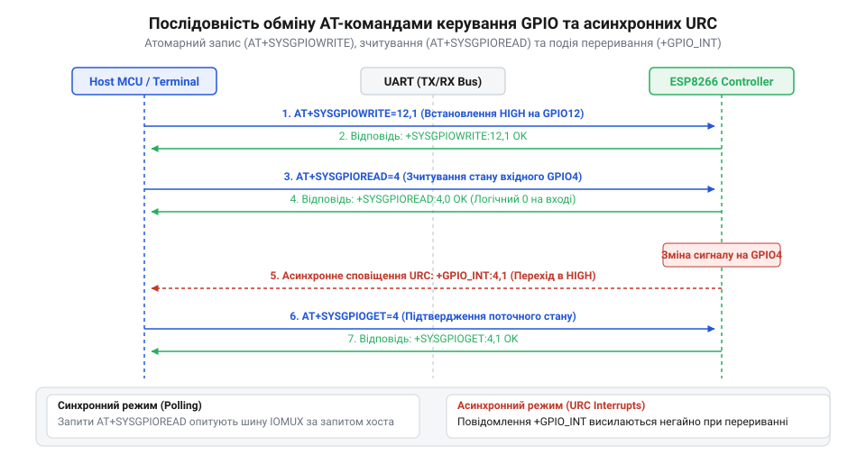

# Програмний довідник AT-команд керування виводами GPIO та конфігурації IOMUX

<preknowlist>
- [ESP-01 (Wi-Fi, ESP8266)](root:cat-hw-boards/esp-01) — призначення фізичних виводів GPIO0, GPIO2 та UART
- [Конфігураційні виводи завантаження ESP8266](root:cat-hw-boards/esp8266-boot-strapping-pins) — обмеження на зміну стану виводів завантаження під час старту
</preknowlist>

## Призначення AT-інтерфейсу керування GPIO

При побудові розподілених систем вбудованої автоматики керуючий хост-контролер підключається до бездротового модуля через послідовний порт @@en|UART@@ (англ. @@en|Universal Asynchronous Receiver-Transmitter@@, від *universal* — універсальний, *asynchronous* — асинхронний, *receiver* — приймач та *transmitter* — передавач; @@en|послідовний порт UART@@). Спроба реалізувати пряме керування периферійними пристроями — реле, світлодіодами чи кнопковими датчиками — зазвичай вимагає написання кастомної прошивки в середовищі C SDK та її збереження у Flash-пам'яті. Щоб уникнути перекомпіляції коду на самих бездротових модулях, як-от [модулі ESP-01](root:cat-hw-boards/esp-01), використовують заводську прошивку @@en|ESP-AT@@. Вона надає стандартизований програмний інтерфейс @@en|AT-команд@@ (від англ. @@en|Attention@@, від *attention* — увага; @@en|команди серії AT@@), який перетворює текстові інструкції, отримані по UART, у безпосередні маніпуляції фізичними виводами МК. Проте надійний запуск зв'язку вимагає врахування часової затримки ініціалізації: після подачі живлення завантажувач МК спочатку виводить службові дамп-логи на нестандартній швидкості `74880 біт/с`, і лише через `200`–`500 мс` парсер `ESP-AT` переходить на робочу швидкість `115200 біт/с`, сигналізуючи про готовність текстом `ready`. Крім того, за замовчуванням увімкнено режим відлуння `ATE1` (англ. @@en|Command Echo@@; @@en|відлуння команд ATE1@@), при якому інтерпретатор дублює кожен отриманий символ назад у лінію transmission; для спрощення автоматичного парсингу відповідей у коді хоста цей режим вимикають за допомогою команди `ATE0`, що прибирає дубльоване ехо та залишає в потоці даних лише рядок відповіді та підтвердження `OK`.

Для запобігання втраті даних при інтенсивному обміні `AT`-командами використовують апаратний потоковий контроль (від англійського *flow* — потік та *control* — управління; англ. *Hardware Flow Control*; @@en|апаратний потоковий контроль RTS/CTS@@). Оскільки внутрішній апаратний буфер FIFO послідовного порту має обмежений обсяг 128 байтів, швидка відправка довгих текстових інструкцій або високочастотне опитування виводів може призвести до його переповнення у моменти, коли ядро зайняте обробкою Wi-Fi стеків. Для синхронізації передачі задіюють додаткові сигнальні лінії: лінію `RTS` (від латинського *requirere* — запитувати; англ. *Request to Send*; @@en|лінію RTS@@) та лінію `CTS` (від англійського *clear* — вільний; англ. *Clear to Send*; @@en|лінію CTS@@). Коли заповнення вхідного буфера досягає критичної позначки, контролер `ESP8266` автоматично піднімає потенціал на лінії `RTS`, примусово призупиняючи передачу байтів із боку керуючого хоста до моменту вивільнення пам'яті парсером, що повністю виключає спотворення команд та втрату символів у потоці.

Серія команд керування вводом-виводом дозволяє налаштовувати виводи @@en|GPIO@@ (англ. @@en|General-Purpose Input/Output@@, від *general* — загальний, *purpose* — призначення, *input* — вхід та *output* — вихід; @@en|виводи GPIO@@) без зупинки мережевого стека Wi-Fi. Кожна текстова команда, потрапляючи до UART-інтерпретатора прошивки, розпізнається внутрішнім парсером і транслюється у записи регістрів конфігурації апаратного блоку @@en|IOMUX@@ (англ. @@en|Input/Output Multiplexer@@, від *input* — вхід, *output* — вихід та *multiplexer* — мультиплексор; @@en|мультиплексор IOMUX@@) і контролера портів МК.


_*Схема проходження AT-команди через UART-інтерпретатор до регістрів IOMUX та GPIO контролера ESP8266._*

Фізичне використання виводів МК `ESP8266` обмежене електричними інваріантами кристала. Номінальна робоча напруга логічних рівнів становить `3.3 В`; МК не має виводів, стійких до напруги `5 В` (англ. *5V tolerant*), тому підключення до 5-вольтових хостів вимагає зовнішніх конвертерів рівнів. Максимальний струм витоку або втікання (англ. *sink/source current*) для кожного виводу `GPIO` становить `12 мА` (рекомендоване робоче значення — не більше `6 мА`), а сумарний струмовий ліміт усіх задіяних портів не повинен перевищувати `120 мА`. Недотримання цих меж призводить до деградації напівпровідникового кристала та перезавантаження чипа під дією падіння напруги. Детальніше будову периферійних ліній описано в огляді [архітектури SoC ESP8266](root:cat-hw-boards/esp8266-soc-architecture-overview).

## Конфігурування IOMUX та підтяжок через AT+SYSIOSETCFG

Кожен фізичний контакт кристала `ESP8266` підключено до матриці мультиплексування `IOMUX`, яка дозволяє призначати виводу одну з кількох альтернативних функцій: апаратний інтерфейс `UART`, шину `SPI` для роботи з Flash-пам'яттю чи цифровий порт `GPIO`. За замовчуванням після скидання МК більшість контактів зафіксовані у режимах спеціалізованої периферії. Спроба подати команду запису рівня чи змінити напрямок виводу без попереднього вилучення контактів із матриці специфічних функцій викликає відмову інтерпретатора або апаратне перезавантаження чипа через конфлікт із шиною Flash-пам'яті.

При перекомутації виводів `GPIO12` (MISO), `GPIO13` (MOSI) та `GPIO14` (SCLK) ключовим параметром команди є селектор функцій (від латинського *selectio* — вибір; англ. *function selector*; @@en|селектор функцій IOMUX@@) `<func>`. Значення `<func> = 3` переводить контакти у звичайний режим цифрового вводу-виводу, тоді як значення `<func> = 2` призначає виводам апаратний інтерфейс HSPI (від англійського *Hardware Secondary Serial Peripheral Interface*; англ. *Hardware Secondary SPI*; @@en|апаратний інтерфейс HSPI@@). Це підключає виводи напряму до внутрішнього зсувного регістра другого контролера SPI в обхід програмних регістрів GPIO, що забезпечує високошвидкісний шинний обмін із зовнішньою периферією на частотах до 40 МГц без навантаження центрального процесора.

Для конфігурування функціонального призначення контакта та увімкнення внутрішніх підтягувальних резисторів використовують команду `AT+SYSIOSETCFG`. При цьому апаратна архітектура `ESP8266` накладає суворі обмеження на типи підтяжок: основні виводи `GPIO0`–`GPIO15` мають лише внутрішні підтягувальні резистори до лінії живлення (англ. *Pull-up*; @@en|підтяжка Pull-up@@) і позбавлені апаратної підтримки підтяжки до землі (англ. *Pull-down*; @@en|підтяжка Pull-down@@), що вимагає встановлення зовнішніх дискретних резисторів для притягування ліній до нульового потенціалу. Окремим винятком є контакт `GPIO16`, який належить до периферійного домену @@en|RTC@@ і призначений для виведення МК із режиму глибокого сну: його внутрішні резистори керуються силовим блоком RTC і не підтримують стандартного конфігурування підтяжок через `IOMUX` у системі `AT+SYSIOSETCFG`.

```text
AT+SYSIOSETCFG=<pin_id>,<func>,<pullup>
```

Параметри команди визначають фізичний режим роботи контакта:

| Параметр | Тип | Опис та допустимі значення |
| :--- | :--- | :--- |
| `<pin_id>` | Ціле число | Номер виводу `GPIO` (`0`, `2`, `4`, `5`, `12`, `13`, `14`, `15`). |
| `<func>` | Ціле число | Селектор функції `IOMUX`: `0` — функція за замовчуванням (UART/SPI), `3` або `2` — режим цифрового порту `GPIO`. |
| `<pullup>` | Ціле число | Стан внутрішньої підтяжки: `0` — підтяжка вимкнена, `1` — увімкнено внутрішній підтягувальний резистор @@en|Pull-up@@ (3.3 В, 30–50 кОм). |

Приклад перемикання виводу `GPIO4` у режим цифрового вводу-виводу з увімкненням підтягувального резистора до лінії `3.3 В`:

```text
AT+SYSIOSETCFG=4,3,1
OK
```

Під час конфігурування необхідно враховувати [конфігураційні виводи завантаження ESP8266](root:cat-hw-boards/esp8266-boot-strapping-pins) (англ. @@en|strapping pins@@: `GPIO0`, `GPIO2`, `GPIO15`). Зміна режимів цих контактів під час роботи дозволена, проте вимкнення внутрішніх підтяжок чи встановлення низьких рівнів на `GPIO0` або `GPIO2` під час старту МК призведе до переходу мікроконтролера в режим прошивки замість звичайного запуску програми.

## Команди напрямку та рівня AT+SYSGPIODIR і AT+SYSGPIOWRITE

Після переведення контакта в режим `GPIO` за допомогою `IOMUX` вивод необхідно сконфігурувати як вхід або вихід. Для керування напрямком передачі даних призначена команда `AT+SYSGPIODIR`:

```text
AT+SYSGPIODIR=<pin_id>,<dir>
```

Параметри команди налаштування напрямку:
- `<pin_id>` — номер виводу `GPIO` (від `0` до `15`, за винятком системних портів Flash-пам'яті `GPIO6`–`GPIO11`);
- `<dir>` — режим напрямку: `0` — конфігурація як цифровий вхід (англ. *input*), `1` — конфігурація як цифровий вихід (англ. *output*).

Сконфігурований у режим виходу контакт дозволяє встановлювати високий (`3.3 В`) або низький (`0 В`) логічний рівень за допомогою команди `AT+SYSGPIOWRITE`. Проте при динамічній зміні напрямку через `AT+SYSGPIODIR` та перемиканні виводу у режим входу (`<dir> = 0`) вихідний драйвер вимикається, переводячи контакт у стан високого імпедансу (англ. *High Impedance*; @@en|стан високого імпедансу Hi-Z@@). У цьому стані вивід не керує логічним потенціалом і стає чутливим до зовнішніх наведень: якщо на лінії відсутні внутрішні підтягувальні резистори `@@en|Pull-up@@` або зовнішні фізичні резистори, плаваючий потенціал у стані @@en|стан високого імпедансу Hi-Z@@ спричиняє помилкові спрацьовування тригерів Шмітта вхідного буфера та некоректне зчитування рівнів.

```text
AT+SYSGPIOWRITE=<pin_id>,<target_level>
```

Параметри команди запису цифрового рівня:
- `<pin_id>` — номер виводу `GPIO`;
- `<target_level>` — логічний рівень: `0` — низький рівень (англ. *low level*, `GND`), `1` — високий рівень (англ. *high level*, `VDD` `3.3 В`).


_*Часова діаграма обміну AT-командами між керуючим хостом та ESP8266 при записі й зчитуванні стану виводу з обробкою сигналів OK/ERROR._*

Послідовність команд для налаштування виводу `GPIO5` як виходу та подачі на нього високого рівня виглядає так:

```text
AT+SYSGPIODIR=5,1
OK
AT+SYSGPIOWRITE=5,1
OK
```

Якщо контакт не був попередньо переключений у режим `GPIO` через `AT+SYSIOSETCFG`, інтерпретатор відхиляє команду й повертає статус помилки `ERROR`.

## Зчитування стану виводів та обробка помилок

Опитування стану цифрових датчиків, кнопкових фіксаторів чи зовнішніх сигналізаторів виконується командою зчитування `AT+SYSGPIOREAD`:

```text
AT+SYSGPIOREAD=<pin_id>
```

Параметр `<pin_id>` вказує номер опитуваного виводу. У разі успішного виконання інтерпретатор повертає відповідь із поточним логічним рівнем виводу та підтвердженням `OK`:

```text
+SYSGPIOREAD:<pin_id>,<level>

OK
```

Значення `<level>` дорівнює `0`, якщо на виводі зафіксовано низький рівень (напруга нижче `0.8 В`), та `1`, якщо зафіксовано високий рівень (напруга вище `2.0 В`).

Приклад опитування входу `GPIO12` із увімкненою внутрішньою підтяжкою при відпущеній кнопці демонструє повернення високого логічного рівня:

```text
AT+SYSGPIOREAD=12
+SYSGPIOREAD:12,1

OK
```

При роботі з механічними кнопками виникає брязкіт контактів (англ. *contact bounce*; @@en|брязкіт контактів@@), який створює послідовність хибних перехідних імпульсів тривалістю від 1 до 10 мілісекунд. Для апаратного фільтрування завад паралельно контактам кнопки підключають керамічний конденсатор ємністю 0.1 мікрофарада, утворюючи захисний `@@en|RC-фільтр@@`. Для програмного пригнічення брязкоту керуючий хост після виявлення першого перепаду `AT+SYSGPIOREAD` робить паузу 15–20 мілісекунд і повторно опитує стан виводу перед прийняттям рішення.

```text
AT+SYSGPIOREAD=12
+SYSGPIOREAD:12,1

OK
```

Якщо під час виконання команд керування виводами виникають помилки синтаксису чи апаратні конфлікти, прошивка `ESP-AT` повертає коди помилок. Основні причини виникнення статусу `ERROR`:

| Код помилки | Фізична причина збою | Спосіб усунення |
| :--- | :--- | :--- |
| `ERR CODE: 0x01` | Некоректний синтаксис або вихід параметра за допустимий діапазон (наприклад, `pin_id > 15`). | Перевірити діапазон номерів `GPIO` та наявність роздільних ком. |
| `ERR CODE: 0x02` | Спроба доступу до виводу без попередньої конфігурації `IOMUX` або використання системних портів `GPIO6`–`GPIO11`. | Викликати `AT+SYSIOSETCFG=<pin_id>,3,1` перед зміною напрямку; не використовувати виводи Flash-пам'яті. |
| `ERR CODE: 0x04` | Спроба запису стану `AT+SYSGPIOWRITE` у контакт, сконфігурований як вхід (`dir = 0`). | Встановити напрямок виходу `AT+SYSGPIODIR=<pin_id>,1`. |

При розробці керуючих алгоритмів слід зважати на [режими завантаження мікроконтролера ESP8266](root:cat-hw-boards/esp8266-boot-modes): використання виводів `GPIO0`, `GPIO2` та `GPIO15` як входів вимагає встановлення зовнішніх гарнітурних підтяжок, які гарантують правильні логічні рівні під час подачі живлення на модуль.
