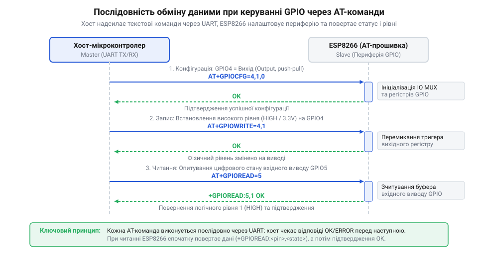

# Програмний синтаксис та параметри AT-команд керування виводами GPIO

<preknowlist>
- [Огляд сімейства Wi-Fi модулів ESP-01 та ESP-01S](root:cat-hw-boards/esp-01-module-family-overview) — призначення та фізичне розведення виводів GPIO модулів ESP8266
- [Конфігураційні виводи завантаження ESP8266](root:cat-hw-boards/esp8266-boot-strapping-pins) — обмеження на використання GPIO0, GPIO2 та GPIO15 під час старту чипа
</preknowlist>

## Архітектура AT-керування виводами GPIO

Автоматизація периферійних пристроїв та читання цифрових датчиків за допомогою стороннього контролера вимагає зручного інструментарію без необхідності перепрошивки основного мікроконтролера. Сучасний [огляд мікроконтролера та архітектури SoC ESP8266](root:cat-hw-boards/esp8266-soc-architecture-overview) демонструє наявність внутрішньої підсистеми периферії, до складу якої входить матриця @@en|GPIO@@ (від @@en|General Purpose Input/Output@@ — виводи загального призначення). Кожен фізичний контакт чипа комутується через внутрішній мультиплексор вводу-виводу @@en|IO MUX@@ (від @@en|Input/Output Multiplexer@@ — мультиплексор вводу-виводу), який визначає, який саме периферійний блок керує конкретною ніжкою.

У стандартній прошивці командного інтерфейсу @@en|AT@@ (від @@en|Attention@@ — увага) керування апаратними виводами реалізовано у вигляді текстових команд, що надсилаються через послідовний інтерфейс @@en|UART@@ (від @@en|Universal Asynchronous Receiver-Transmitter@@ — універсальний асинхронний приймач-передавач). Програмний шар AT-інтерфейсу приймає текстовий рядок, виконує перевірку аргументів та здійснює прямий запис у 32-бітні апаратні регістри в просторі пам'яті SoC ESP8266 (базова адреса `0x60000300`). Зміна вихідних рівнів виконується маскуванням бітів у регістрі запису `GPIO_OUT` (та регістрах атомарного встановлення/скидання `GPIO_OUT_W1TS` / `GPIO_OUT_W1TC`), а зчитування фізичного стану ліній дістає значення безпосередньо з регістра прямого вводу `GPIO_IN`. За замовчуванням більшість змін режимів діють лише у оперативній пам'яті до скидання чипа, однак окремі команди підтримують енергонезалежне збереження конфігурації у системному секторі зовнішньої мікросхеми @@en|Flash@@ (від @@en|Flash memory@@ — флеш-пам'ять). При знеструмленні модуля первинні налаштування напрямку та підтяжки зчитуються з @@en|Flash@@ під час старту, що запобігає невизначеним станам периферії. Такий підхід дозволяє використовувати компактні [модулі ESP-01 (Wi-Fi, ESP8266)](root:cat-hw-boards/esp-01) або [модулі ESP-01S (Wi-Fi, ESP8266)](root:cat-hw-boards/esp-01s) як інтелектуальні розширювачі портів для зовнішніх систем.

## Синтаксис конфігурації та режиму виводів

Перед зміною або зчитуванням логічних рівнів вивід мікроконтролера необхідно перевести у відповідний режим роботи — ввід або вивід. Для первинної конфігурації напрямку передачі даних в AT-прошивці використовується команда `AT+GPIODIR`, яка має наступний синтаксис запису:

`AT+GPIODIR=<pin>,<dir>`

Аргумент `<pin>` вказує на фізичний номер виводу @@en|GPIO@@ (наприклад, `0`, `2`, `4`, `5`, `12`, `13`, `14`, `15`). Параметр `<dir>` визначає напрямок роботи: значення `1` встановлює режим виводу @@en|output@@ (від @@en|output@@ — вивід даних), а значення `0` призначає режим вводу @@en|input@@ (від @@en|input@@ — ввід даних). При успішному виконанні модуль повертає текстовий рядок `OK`.

Параметр `<mode>` визначає апаратну конфігурацію виводу: `0` вимикає підтяжку (режим @@en|float@@ — плаваючий вивід), `1` вмикає внутрішній резистор підтяжки до лінії живлення 3.3 В (режим @@en|pull-up@@ — підтяжка догори), а `2` вмикає підтяжку до землі (режим @@en|pull-down@@). Якщо вивід налаштовано у режим вводу без зовнішнього резистора, увімкнення підтяжки @@en|pull-up@@ є обов'язковим для запобігання наведенню завад. Внутрішні підтягувальні резистори ESP8266 мають опір у діапазоні 30–50 кОм, що належить до слабкої підтяжки. Коли зовнішнє коло встановлює на виводі з активним `pull-up` низький рівень, через внутрішній резистор постійно протікає струм витоку (близько 66–110 мкА при живленні 3.3 В). У автономних пристроях це створює паразитно високе статичне споживання енергії, а високий опір підтяжки не дає змоги формувати круті крутизни фронтів на швидкісних шинах, тому для них застосовують зовнішні резистори 2.2–10 кОм. Слід враховувати апаратну особливість виводу @@en|GPIO16@@: на відміну від основних виводів @@en|GPIO0@@–@@en|GPIO15@@, які підпорядковані матриці @@en|IO MUX@@ і мають лише підтяжку до живлення, вивід @@en|GPIO16@@ підключено до домену @@en|RTC@@. Саме на @@en|GPIO16@@ режим `mode=2` спирається на апаратний внутрішній резистор підтяжки до землі @@en|pull-down@@, що використовується при виході з режимів сну, тоді як на інших виводах спроба увімкнути `pull-down` ігнорується чи викликає помилку.

`AT+IOSETCFG=<pin>,<mode>`

Параметр `<mode>` визначає апаратну конфігурацію виводу: `0` вимикає підтяжку (режим @@en|float@@ — плаваючий вивід), `1` вмикає внутрішній резистор підтяжки до лінії живлення 3.3 В (режим @@en|pull-up@@ — підтяжка догори), а `2` вмикає підтяжку до землі (режим @@en|pull-down@@). Якщо вивід налаштовано у режим вводу без зовнішнього резистора, увімкнення підтяжки @@en|pull-up@@ є обов'язковим для запобігання наведенню завад. Слід враховувати апаратну особливість виводу @@en|GPIO16@@: на відміну від основних виводів @@en|GPIO0@@–@@en|GPIO15@@, які підпорядковані матриці @@en|IO MUX@@ і мають лише підтяжку до живлення, вивід @@en|GPIO16@@ підключено до домену @@en|RTC@@. Саме на @@en|GPIO16@@ режим `mode=2` спирається на апаратний внутрішній резистор підтяжки до землі @@en|pull-down@@, що використовується при виході з режимів сну, тоді як на інших виводах спроба увімкнути `pull-down` ігнорується чи викликає помилку.


*Схема послідовності надсилання команд AT+IOSETCFG та AT+SYSIOSET для ініціалізації напрямку та зчитування стану виводів.*

## Читання та встановлення логічних рівнів

Після налаштування напрямку та режимів підтяжки виводів система готова до виконання операцій читання та запису цифрових сигналів. Зміна вихідного логічного стану виводу здійснюється за допомогою команди `AT+SYSIOSET`:

`AT+SYSIOSET=<pin>,<val>`

Параметр `<pin>` вказує номер виводу @@en|GPIO@@, а параметр `<val>` визначає встановлюваний напруговий рівень. Значення `1` відповідає високому логічному рівню @@en|high level@@ (напруга 3.3 В), а значення `0` — низькому логічному рівню @@en|low level@@ (напруга 0 В). Якщо вивід попередньо не конфігуровано як вивід @@en|output@@, команда повертає відповідь `ERROR`.

Оперативне опитування стану зовнішнього датчика або кнопки реалізується командним запитом `AT+SYSIOGET`. У прикладних алгоритмах цифрове опитування через послідовний порт @@en|UART@@ вимагає врахування затримки передачі кадру та фізичних явищ перехідного процесу. Повний цикл обміну складається з надсилання запиту `AT+SYSIOGET=<pin>\r\n` (обсяг `N_req = 15` байтів) та отримання відповіді `+SYSIOGET:<val>\r\nOK\r\n` (обсяг `N_resp = 20` байтів). У форматі 8N1 кожен байт містить 10 бітів (з урахуванням стартового та стопового бітів), що дає сумарний обсяг транзакції `B = 350` бітів. Час затримки передачі `T` обчислюється діленням кількості бітів `B` на швидкість передачі `Baud` (у бодах):

    T = B ÷ Baud
    = 350 ÷ 9600              [для швидкості 9600 бод]
    ≈ 0.0365                  [час у секундах, або 36.5 мс]

Для стандартної швидкості 115200 бод обчислення має вигляд:

    T = 350 ÷ 115200          [для швидкості 115200 бод]
    ≈ 0.00304                 [час у секундах, або 3.04 мс]

При швидкості 9600 бод затримка транзакції (36.5 мс) перевищує тривалість апаратного брязкоту контактів @@en|bouncing@@ (від @@en|contact bouncing@@ — брязкіт контактів), який при натисканні механічних кнопок чи герконів триває 5–20 мілісекунд. На вищій швидкості 115200 бод затримка обміну зменшується до 3.04 мс, що дозволяє частіше опитувати стан, однак для усунення хибних спрацьовувань керуючий контролер застосовує алгоритм програмного усунення брязкоту @@en|debouncing@@: після виявлення зміни стану через `AT+SYSIOGET` виконується витримка паузи у 10–20 мс з наступним повторним контрольним зчитуванням.

`AT+SYSIOGET=<pin>`

У відповідь на цей запит модуль надсилає інформаційний рядок із поточним станом виводу, після чого видає підтвердження завершення операції:

```text
+SYSIOGET:<val>

OK
```

Де значення `<val>` приймає `1` (при наявності високого рівня на виводі) або `0` (при низькому рівні). У системах автоматизації керуючий контролер надсилає запит через порт @@en|UART@@ та виконує парсинг повертуваного рядка для прийняття рішень у циклі керування.

## Діагностика помилок та апаратні обмеження

Невдале виконання AT-команд керування виводами супроводжується поверненням строки `ERROR`. Найпоширенішими причинами відмови є спроба звернутися до неіснуючого або зарезервованого виводу @@en|GPIO@@, помилка в синтаксисі розділових знаків чи передача від'ємних числових параметрів. Виводи від @@en|GPIO6@@ до @@en|GPIO11@@ жорстко зарезервовані під внутрішню мікросхему пам'яті @@en|Flash@@, тому спроба змінити їхній режим через `AT+GPIODIR` викликає негайне блокування операції.

Окрему увагу слід приділити роботі з конфігураційними виводами завантаження. Детальний [огляд сімейства Wi-Fi модулів ESP-01 та ESP-01S](root:cat-hw-boards/esp-01-module-family-overview) показує, що на цих платах доступні лише лінії @@en|GPIO0@@ та @@en|GPIO2@@. Як описано в матеріалі про [конфігураційні виводи завантаження ESP8266](root:cat-hw-boards/esp8266-boot-strapping-pins), виводи @@en|GPIO0@@, @@en|GPIO2@@ та @@en|GPIO15@@ є так званими @@en|strapping pins@@ (від англ. @@en|strap@@ — фіксувати рівень).

Рівні напруги на цих виводах опитуються в момент апаратного скидання чипа. Якщо команда `AT+SYSIOSET` встановила на виводі @@en|GPIO0@@ низький рівень `0`, а під час роботи відбулося перезавантаження живлення, мікроконтролер перейде в [режими завантаження мікроконтролера ESP8266](root:cat-hw-boards/esp8266-boot-modes) для прошивки @@en|bootloader@@ замість звичайного запуску програми. Крім загрози блокування завантажувача, при передачі серії команд `AT+SYSIOSET` на високих швидкостях обміну понад 115200 бод виникає апаратне обмеження внутрішнього кільцевого буфера @@en|UART@@ (місткістю 128 байт). Якщо хост надсилає пакети без очікування відповіді `OK` або без затримки на обробку таймауту інтерпретатора AT-команд, вхідний буфер переповнюється, викликаючи втрату символів та збої виконання. Для запобігання апаратним конфліктам зовнішні кола розв'язують через буферні ключі, а в командному потоці застосовують апаратну синхронізацію @@en|RTS/CTS@@ або паузи між запитами.
