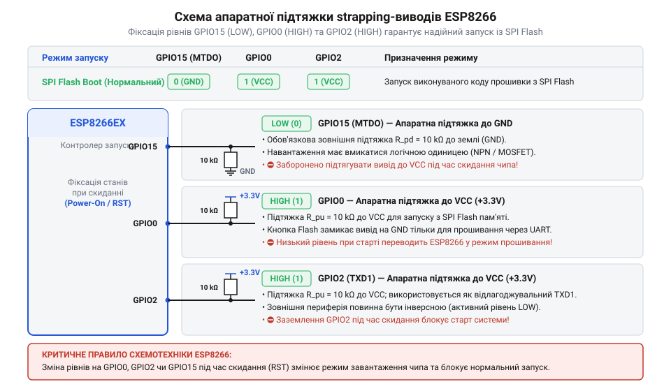

# Апаратна розпіновка, електричні параметри та обмеження GPIO ESP8266

<preknowlist>
- [ESP-01 (Wi-Fi, ESP8266)](root:cat-hw-boards/esp-01) — Базове розуміння форм-фактора та підключення модуля.
- [Конфігураційні виводи завантаження ESP8266](root:cat-hw-boards/esp8266-boot-strapping-pins) — Розуміння логічних рівнів на виводах при виборі режиму завантаження.
- [Огляд мікроконтролера та архітектури SoC ESP8266](root:cat-hw-boards/esp8266-soc-architecture-overview) — Базові знання апаратної організації SoC ESP8266.
</preknowlist>

## Архітектура вводу-виводу та мультиплексор IOMUX

При проєктуванні компактних систем на мікроконтролерах обмежена кількість фізичних контактів корпусу вимагає гнучкого розподілу їхніх функцій між периферійними блоками. Якби кожен периферійний модуль чипа — @@en|UART@@, @@en|SPI@@, @@en|PWM@@ чи інтерфейс вводу-виводу загального призначення (англ. @@en|General Purpose Input/Output@@, @@en|GPIO@@) — мав власні виділені виводи на кристалі, це призвело б до невиправданого збільшення розмірів корпусу мікроконтролера. Для вирішення цієї проблеми в [архітектурою SoC ESP8266](root:cat-hw-boards/esp8266-soc-architecture-overview) інтегровано програмно керований апаратний мультиплексор вводу-виводу (англ. @@en|IOMUX@@, від @@en|Input/Output@@ — ввід/вивід та @@en|Multiplexer@@ — мультиплексор).

Модуль @@en|IOMUX@@ являє собою матрицю комутації, яка зв'язує внутрішні лінії периферійних контролерів процесорного ядра із фізичними контактними майданчиками чипа. Кожен контактний вивід має власну комірку конфігураційного регістра `PERIPHS_IO_MUX_x` (наприклад, `PERIPHS_IO_MUX_GPIO2_U` для лінії `GPIO2`), у якій програміст може вибрати одну з п'яти можливих функцій (від `FUNC_0` до `FUNC_4`). За замовчуванням більшість виводів призначені для апаратних периферійних функцій, проте перемикання бітів конфігурації переводять вивід у режим прямого керування через регістри @@en|GPIO@@.


*Схема внутрішньої архітектури блоку IOMUX та GPIO контролера ESP8266.*

Окрім вибору апаратної функції, регістри @@en|IOMUX@@ керують внутрішньою аналоговою обв'язкою виводу. Більшість контактів мають програмно вимикаємі внутрішні підтягувальні резистори (англ. @@en|pull-up resistors@@ — підтягувальні резистори) номіналом близько 30–50 кОм, а притягувальний резистор (англ. @@en|pull-down resistors@@ — притягувальні резистори) доступний лише на виводі GPIO16. Також конфігураційні біти дозволяють переводити вивід у режим високоімпедансного стану під час сна (англ. @@en|Sleep Mode@@), що критично важливо для мінімізації струмів витоку в автономних пристроях.

Вибір конкретного функціонального призначення у регістрах `PERIPHS_IO_MUX_x` здійснюється за допомогою 3-бітового поля маски функцій (англ. @@en|Function Selection Bitmask@@ — бітова маска вибору функції). Кодування від `FUNC_0` (`0b000`) до `FUNC_4` (`0b100`) перемикає внутрішній мультиплексор між апаратними периферійними блоками: наприклад, значення `FUNC_0` призначає на вивід первинну апаратну шину (як-от тактову лінію @@en|SPI@@ чи трансивер @@en|UART@@), тоді як `FUNC_3` (`0b011`) є стандартним значенням для переведення піна в режим вводу-виводу загального призначення @@en|GPIO@@. При виклику макросів на кшталт `PIN_FUNC_SELECT` розробник записує відповідну бітову маску в біти 4–5 регістра `PERIPHS_IO_MUX_x`, підключаючи фізичний контакт безпосередньо до системних регістрів напрямку `GPIO_ENABLE` та стану `GPIO_OUT`. Якщо не переключити бітову маску у стан `FUNC_3`, спроби програмного запису в регістр виходу ігноруватимуться апаратурою чипа [мікроконтролера ESP8266](root:cat-hw-boards/esp8266-soc-architecture-overview), оскільки лінія залишатиметься прив'язаною до свого первинного периферійного контролера.

## Фізична розпіновка модулів ESP-01 та ESP-12

Залежно від вимог до габаритів та кількості необхідних периферійних ліній, розробники обирають модулі у різних форм-факторах. Найпопулярнішими представниками на ринку є ультракомпактні [модулях ESP-01](root:cat-hw-boards/esp-01) та повнорозмірні плати серії @@en|ESP-12E/12F@@, які висвітлює [сімейства плат ESP-01](root:cat-hw-boards/esp-01-module-family-overview).

У модулі @@en|ESP-01@@ виведено лише 8 фізичних контактів на дворядну гребінку:
- `VCC` та `GND` — лінії живлення 3.3 В та спільного проводу.
- `TXD` (`GPIO1`) та `RXD` (`GPIO3`) — лінії послідовного порту @@en|UART0@@ для зв'язку та прошивання.
- `CH_PD` (`EN`) — дозвіл роботи чипа (потрібен високий рівень `3.3V`).
- `RST` — лінія апаратного скидання (активна низьким рівнем `GND`).
- `GPIO0` та `GPIO2` — два вільних виводи загального призначення.

В оновленій версії [модулі ESP-01S](root:cat-hw-boards/esp-01s) схемотехніку покращено шляхом встановлення вбудованих підтягувальних резисторів на лінії `EN`, `RST`, `GPIO0` та `GPIO2`, що дозволяє запускати модуль без зовнішніх навісних опорів.

Повнорозмірні модулі @@en|ESP-12E/12F@@ мають крайній замок контактів (англ. @@en|castellated holes@@) і надають доступ до розширеного набору ліній від `GPIO0` до `GPIO15`. Проте при розробці важливо враховувати апаратну пастку: лінії `GPIO6`–`GPIO11` внутрішньо розведені на платі для зв'язку з мікросхемою флеш-пам'яті @@en|SPI Flash@@. Спроба переконфігурувати або задіяти `GPIO6`–`GPIO11` у користувацькій програмі негайно блокує зчитування інструкцій з Flash-пам'яті й викликає циклічний перезапуск мікроконтролера (англ. @@en|Crash Reboot Loop@@).

Внутрішня топологія підключення пам'яті опирається на чотирипровідну шину @@en|Quad-SPI@@, де кожен із виводів `GPIO6`–`GPIO11` виконує жорстко зафіксовану апаратну роль: `GPIO6` слугує тактовим сигналом `SD_CLK`, `GPIO7` та `GPIO8` передають основні лінії даних `SD_DATA0` (`SPI_D0`) і `SD_DATA1` (`SPI_D1`), `GPIO9` та `GPIO10` виконують функції додаткових шин даних `SD_DATA2` (`SPI_HD`) і `SD_DATA3` (`SPI_WP`) у режимах @@en|QIO/QOUT@@, а `GPIO11` працює сигналом вибору чипа `SD_CMD` (`SPI_CS`). За винятком вузькоспеціалізованих режимів двопровідного зчитування @@en|DIO/DOUT@@, у яких лінії `GPIO9` та `GPIO10` лишаються підтягнутими до живлення, будь-яка спроба підключити зовнішні датчики або переключити функції виводів `GPIO6`–`GPIO11` через модуль @@en|IOMUX@@ порушує цілісність шинних транзакцій та миттєво фатально зупиняє вибірку інструкцій процесорним ядром.

## Конфігураційні виводи завантаження та апаратні обмеження

Специфікою мікроконтролера @@en|ESP8266@@ є наявність трьох виводів конфігурації завантаження (англ. @@en|strapping pins@@, від англ. @@en|strap@@ — ремінь, прив'язка — конфігураційні виводи). Під час подачі живлення або апаратного скидання внутрішній завантажувач ROM оцінює логічні рівні на виводах `GPIO0`, `GPIO2` та `GPIO15`. Зчитовані значення визначають, з якого джерела ядро почне виконання коду, про що детально кажуть [режими завантаження мікроконтролера](root:cat-hw-boards/esp8266-boot-modes) та описує [архітектурою завантажувача ESP8266](root:cat-hw-boards/esp8266-bootloader-architecture).

Для забезпечення коректної роботи системи зовнішні кола мають гарантувати наступні комбінації напруг у момент старту:

1. **Нормальне завантаження з Flash (Flash Boot)**:
   - `GPIO15` = LOW (`GND`)
   - `GPIO0` = HIGH (`3.3V`)
   - `GPIO2` = HIGH (`3.3V`)
2. **Режим програмування по UART (UART Download)**:
   - `GPIO15` = LOW (`GND`)
   - `GPIO0` = LOW (`GND`)
   - `GPIO2` = HIGH (`3.3V`)
3. **Завантаження з SD-карти (SDIO Boot)**:
   - `GPIO15` = HIGH (`3.3V`)


*Схема підключення конфігураційних виводів GPIO0, GPIO2 та GPIO15 із зовнішніми підтягувальними резисторами.*

Якщо зовнішня периферія (наприклад, кнопку чи оптичне реле) підключено до `GPIO0` або `GPIO15` без урахування цих вимог, при примусовому затягуванні лінії `GPIO15` до високого рівня або `GPIO2` до землі під час увімкнення чип переходить у непідтримуваний режим і застрягає. Ключовим апаратним фактором є таймінг утримання сигналів: завантажувач @@en|ROM@@ зчитує логічні рівні на виводах у момент наростаючого фронту сигналу скидання `RST` і вимагає їхньої суворої фіксації протягом щонайменше 1–10 мс до завершення стабілізації напруги живлення. Використання надмірних фільтруючих конденсаторів чи повільних оптопар на цих лініях затримує наростання напруги, спричиняючи зчитування невизначеного стану у вікні вибірки. Щоб запобігти збоям, на лінії `GPIO0` та `GPIO2` обов'язково ставлять зовнішні підтягувальні резистори 10 кОм до `3.3V`, а на `GPIO15` — притягувальний резистор 10 кОм до `GND`. Більш детальні правила проектування цих кіл описують [конфігураційні виводи завантаження](root:cat-hw-boards/esp8266-boot-strapping-pins).

## Електричні параметри та схемотехніка узгодження рівнів

Мікроконтролер @@en|ESP8266@@ виконаний за технологією @@en|CMOS@@ із робочою напругою живлення ядра та периферії 3.3 В (припустимий діапазон від 3.0 В до 3.6 В). Слід чітко пам'ятати: виводи @@en|GPIO@@ мікроконтролера не мають захисту від напруги 5 В (англ. @@en|not 5V tolerant@@). Подача напруги вище 3.6 В на будь-який вхід спричиняє пробій тонкого підзатворного діелектрика транзисторів та незворотне пошкодження кристала.

Електричні граничні параметри виводів @@en|GPIO@@:
- Порогова напруга логічного нуля `V_IL`: від 0 В до `0.25 × VDD` (до 0.82 В).
- Порогова напруга логічної одиниці `V_IH`: від `0.75 × VDD` (від 2.47 В) до `VDD + 0.3V`.
- Максимальний вихідний струм одного виводу `I_OH` / `I_OL`: 12 мА (рекомендований робочий струм — не більше 6–8 мА).
- Сумарний граничний струм усіх виводів @@en|GPIO@@: 24 мА.

Через обмеження вихідного струму 12 мА виводи мікроконтролера не можуть напряму живити потужні світлодіоди або обмотки електромагнітних реле. Керування навантаженням виконують через проміжні транзисторні ключі або оптичні розв'язки.

Для підключення датчиків або контролерів із 5-вольтовими виходами (наприклад, класичних плат Arduino) необхідно застосовувати схеми узгодження логічних рівнів (англ. @@en|Level Shifting@@). Найпростішим розв'язком для однонаправлених сигналів є резистивний дільник напруги.

Розрахунок вихідної напруги дільника `V_out` з вхідної напруги `V_in` здійснюється за формулою взаємного опору пліч дільника, де для однонаправлених ліній обирають резистори `R1 = 1.8 кОм` та `R2 = 3.3 кОм`. Проте для двонаправлених шин (наприклад @@en|I2C@@ або @@en|UART@@) пасивний дільник непридатний через неможливість передачі сигналу від 3.3 В до 5 В сторони, тому застосовують активний двонаправлений конвертер на n-канальному польовому транзисторі (англ. @@en|MOSFET@@, наприклад @@en|BSS138@@). Затвор транзистора підключають до шини `3.3V`, витік (англ. @@en|source@@) — до виводу @@en|GPIO@@ мікроконтролера @@en|ESP8266@@ з підтяжкою `R_LV` до `3.3V`, а стік (англ. @@en|drain@@) — до периферійного пристрою з підтяжкою `R_HV` до `5V`. Номінал підтягувальних резисторів обирають залежно від частоти шини: для стандартних послідовних ліній застосовують `10 кОм` задля економії енергії, а для швидкісного режиму @@en|I2C Fast Mode@@ (400 кГц) номінал зменшують до `2.2–4.7 кОм`, щоб швидко перезаряджати паразитну ємність лінії та забезпечити тривалість фронту `t_r ≤ 300 нс`.

```
V_out = V_in × (R2 ÷ (R1 + R2))
      = 5.0 × (3300 ÷ (1800 + 3300))      [підстановка значень опорів 1.8 кОм та 3.3 кОм]
      = 3.235 В                            [отриманий безпечний рівень напруги]
```

Отримане значення `3.235 В` є абсолютно безпечним для входу @@en|GPIO@@ та впевнено сприймається кристалом як логічна одиниця. Для двонаправлених високошвидкісних шин (наприклад, @@en|I2C@@ або @@en|UART@@) використовують активні конвертери рівнів на польових n-канальних транзисторах (наприклад, @@en|BSS138@@) із зовнішніми підтяжками до ліній 3.3 В та 5 В.
