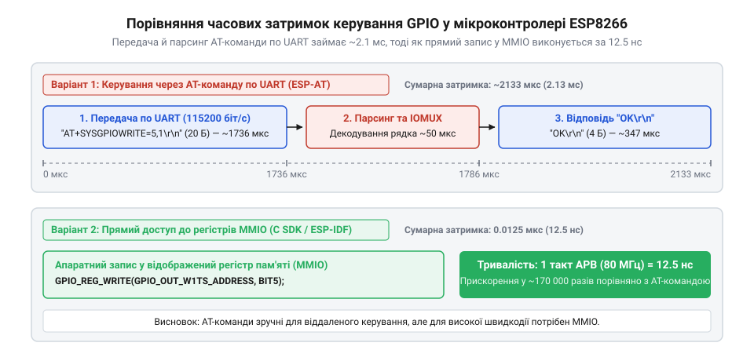
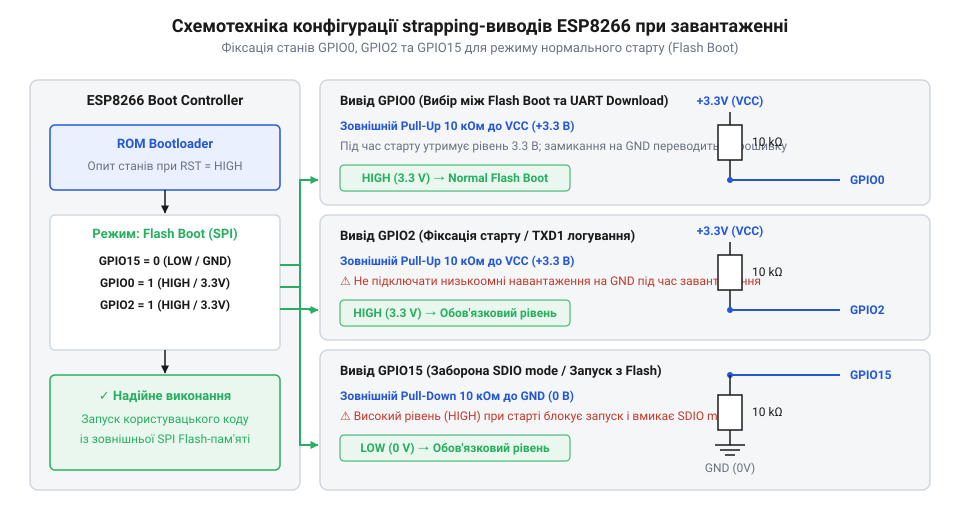
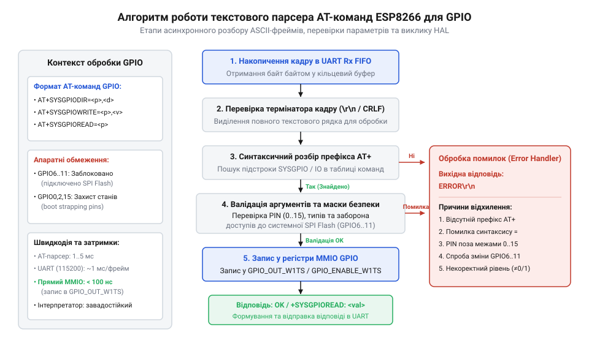
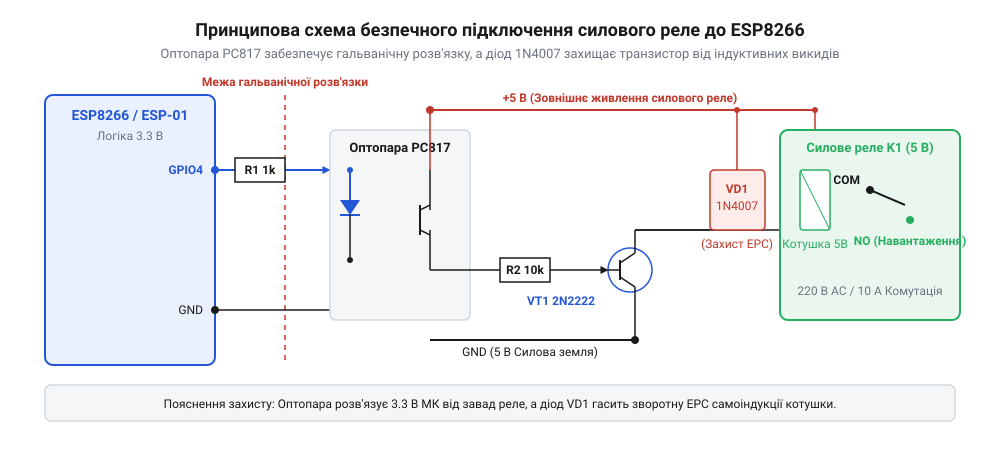
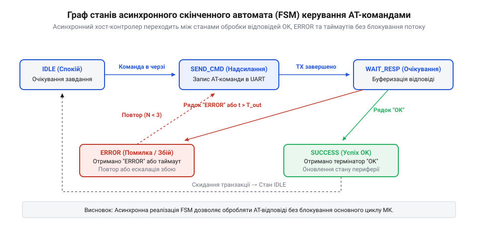

# Керування GPIO виводами ESP8266 через AT-команди

<preknowlist>
- [Огляд мікроконтролера та архітектури SoC ESP8266](root:cat-hw-boards/esp8266-soc-architecture-overview) — Розуміння загальної архітектури чипа ESP8266, блоку периферії IOMUX та регістрів GPIO.
- [Конфігураційні виводи завантаження ESP8266](root:cat-hw-boards/esp8266-boot-strapping-pins) — Знання функціонального призначення виводів GPIO0, GPIO2 та GPIO15 під час початкового скидання системи.
- [Огляд сімейства Wi-Fi модулів ESP-01 та ESP-01S](root:cat-hw-boards/esp-01-module-family-overview) — Уявлення про розпіновку та конструктивні відмінності популярних модулів ESP-01.
</preknowlist>

## Проблема повільного керування виводами

Під час розробки вбудованих систем із відокремленим мережевим контролером виникає потреба перемикати логічні рівні цифрових ліній для керування зовнішніми виконавчими пристроями — силовими реле, світлодіодними індикаторами чи живильними ключами. Якщо хост-мікроконтролер взаємодіє з Wi-Fi чипом @@en|ESP8266@@ через послідовний порт @@en|UART@@ (від англ. @@en|Universal Asynchronous Receiver-Transmitter@@ — універсальний асинхронний приймач-передавач), природним шляхом здається надсилання текстових @@en|AT@@-команд (від англ. @@en|Attention@@ — увага). Проте спроба реалізувати таким чином швидке перемикання прапорців або високочастотну генерацію сигналів наражається на суттєві часові затримки, які роблять цей підхід непридатним для динамічних процесів.

В автономному мікроконтролері пряма зміна стану цифрового виводу відбувається через ввід-вивід, відображений у пам'ять (англ. @@en|memory-mapped I/O@@; @@en|MMIO@@). Процесорне ядро виконує інструкцію запису в регістр керування GPIO за один тактовий імпульс. При частоті ядра 80 МГц тривалість цієї операції становить лише 12.5 нс. Натомість при передачі команди через послідовний інтерфейс шлях сигналу подовжується на кілька порядків через фізичні та програмні проміжні ланки.

Перша затримка виникає на етапі фізичного транспортування даних через шину @@en|UART@@. Стандартна текстова команда налаштування або запису стану виводу має вигляд символьного рядка `AT+CIOWRITE=4,1\r\n`, який складається з 16 символів @@en|ASCII@@ (від англ. @@en|American Standard Code for Information Interchange@@ — американський стандартний код для обміну інформацією). При поширеній швидкості передачі 115200 біт/с кожен символ передається у кадрі з 1 стартового біта, 8 бітів даних та 1 стопового біта (загалом 10 бітів на символ). Математичний розрахунок тривалості передачі текстового пакета показує мінімальний часовий інтервал:

t_tx = (16 × 10) / 115200
= 160 / 115200          [множення кількості символів на розмір кадру]
≈ 0.001388 с            [ділення на швидкість шини UART]
≈ 1.39 мс               [переведення у мілісекунди]

Друга й найбільш суттєва затримка зумовлена функціонуванням внутрішнього інтерпретатора прошивки Espressif AT. Приймальний апаратний буфер @@en|FIFO@@ (від англ. @@en|First In, First Out@@ — першим зайшов, першим вийшов) накопичує байтовий потік і ґенерує апаратне переривання. Програмний парсер зчитує байтовий потік у кільцевий буфер пам'яті, де очікує на керівний термінатор @@en|CRLF@@ (від англ. @@en|Carriage Return / Line Feed@@ — повернення каретки та переведення рядка, `\r\n`). Отримавши кінцеві символи, інтерпретатор виконує лексичний аналіз рядка, перевіряє синтаксичну коректність текстових аргументів та звертається до підсистеми @@en|SDK@@ (від англ. @@en|Software Development Kit@@ — набір засобів розробки програмного забезпечення) для запису значення в регістри периферії.

Після виконання командного запису чип @@en|ESP8266@@ має сформувати та відправити хосту підтвердження у вигляді рядка `\r\nOK\r\n` (6 символів), що додає ще близько 0.52 мс на зворотну передачу. У результаті повний цикл опитування чи перемикання виводу (англ. @@en|round-trip time@@; @@en|RTT@@) становить від 2 до 5 мс.

*Часова діаграма затримок передачі та обробки AT-команди керування GPIO через UART у порівнянні з прямим записом у регістри MMIO.*

Такий значний розрив між тривалістю прямого запису в регістри (12.5 нс) та часом виконання текстової команди (~2–5 мс) наочно демонструє, що @@en|AT@@-інтерфейс створений для низькочастотних системних команд, а не для швидкої маніпуляції виводами. Для глибокого аналізу часових характеристик та розрахунку джитера корисно опрацювати [розрахунок затримок UART та часу виконання AT-команд](root:cat-hw-boards/esp8266-at-gpio-control/math-esp8266-at-gpio-timing-and-latency.md).

З огляду на це, керування цифровими лініями через @@en|AT@@-команди доцільно застосовувати виключно для повільних операцій з частотою оновлення не більше кількох герц: увімкнення силового реле, перезавантаження зовнішнього давача або подача сигналу скидання периферійного модуля. При тривалій безперервній передачі символьних команд критичним обмеженням стає часовий джитер (англ. @@en|jitter@@ — тремтіння фази), амплітуда якого під навантаженням мережевого стека @@en|Wi-Fi@@ коливається в межах від 0.5 до 2 мс. Фонові апаратні переривання радіомодуля та обробка сокетів передачі даних мають вищий пріоритет за обробник послідовного порту, тому при активній мережевій обробці парсер прошивки вимушено призупиняє розбір вхідних символів. Якщо хост інтенсивно завантажує шину @@en|UART@@ під час активного передавання мережевого трафіку, приймальний кільцевий буфер виявляється переповненим, а повний час кругового затримання (англ. @@en|round-trip time@@; @@en|RTT@@) зростає від базових 2–5 мс до десятків мілісекунд через конкуренцію за процесорний час. Крім того, гранична завадостійкість послідовного інтерфейсу знижується у промислових умовах: високочастотні імпульсні завади на лінії @@en|UART@@ можуть спотворити окремі байти символьного кадру, викликаючи помилки декодування та вимагаючи повторної передачі інструкцій. Наявний синтаксис команд формувався в процесі розширення функціоналу прошивки, про що детально розповідає [еволюція команд керування GPIO в прошивці Espressif AT](root:cat-hw-boards/esp8266-at-gpio-control/hist-esp8266-at-gpio-evolution.md). Для завдань, що вимагають формування імпульсів мікросекундного діапазону або програмної реалізації протоколів зв'язку, слід звертатися безпосередньо до [архітектури SoC ESP8266](root:cat-hw-boards/esp8266-soc-architecture-overview) та розробляти власну прошивку з прямою модифікацією регістрів.

Отже, вибір між використанням готового текстового інтерфейсу та розробкою власного низькорівневого коду визначається жорсткістю вимог до швидкодії системи. Для базових задач автоматики на модулях [ESP-01](root:cat-hw-boards/esp-01), де частота перемикання виводів не перевищує одного раза на секунду, текстовий інтерфейс додає мінімальну програмну складність і не потребує власного середовища збірки. Якщо ж розробка передбачає суворі часові рамки або обробку подій у реальному часі, спроби компенсувати затримки послідовного порту складними алгоритмами на стороні хоста виявляються неефективними, тому єдиним надійним розв'язком стає перехід до безпосереднього керування периферією через регістри мікроконтролера.

## Апаратна розпіновка та strapping-виводи

Безпечне керування зовнішнім навантаженням вимагає чіткого розуміння апаратної структури портів чипа. Мікроконтролер @@en|ESP8266@@ містить периферійний блок мультиплексувальника вводу-виводу (англ. @@en|Input/Output Multiplexer@@; @@en|IOMUX@@), який перемикає внутрішні лінії контролерів між 17 фізичними виводами. На популярних компактних платах, зокрема при аналізі [сімейства Wi-Fi модулів ESP-01](root:cat-hw-boards/esp-01-module-family-overview), читачеві доступна лише обмежена частина контактів: `GPIO0`, `GPIO2`, `RX` (`GPIO3`) та `TX` (`GPIO1`).

Критичною особливістю архітектури є наявність конфігураційних виводів завантаження (англ. @@en|strapping pins@@). Під час подачі живлення або апаратного скидання при ввімкненні живлення (англ. @@en|Power-On Reset@@; @@en|POR@@) внутрішній завантажувач мікроконтролера виконує зчитування логічних рівнів на трьох ключових виводах: `GPIO0`, `GPIO2` та `GPIO15`. Залежно від зафіксованої комбінації напруг система вибирає режим старту пристрою.

Логіка вибору режимів завантаження підпорядковується жорстким апаратним правилам:

1. **Режим завантаження з SPI Flash (нормальна робота):** вивід `GPIO15` повинен мати низький логічний рівень (підтяжка до `GND`), а виводи `GPIO0` та `GPIO2` — високий логічний рівень (підтяжка до 3.3 В).
2. **Режим прошивання через UART (завантаження коду):** вивід `GPIO15` утримується в низькому стані (`GND`), `GPIO0` примусово заземлюється (низький рівень), а `GPIO2` залишається у високому стані (3.3 В).
3. **Режим завантаження з SDIO (пасивний модуль):** вивід `GPIO15` перебуває у високому логічному стані (3.3 В), що перемикає чип у режим віддаленого накопичувача й блокує виконання внутрішньої прошивки.

*Схема підтяжки конфігураційних виводів GPIO0, GPIO2 та GPIO15 для вибору нормального режиму завантаження з SPI Flash.*

Нехтування цими обмеженнями під час проективання схемотехніки призводить до непередбачуваних апаратних заблокувань. Якщо підключити силове реле або цифровий давач безпосередньо до виводу `GPIO0` так, що зовнішнє коло притягує лінію до землі в момент увімкнення живлення, чип перейде в режим прошивання й припинить реагувати на текстові команди. Аналогічно, низький рівень на `GPIO2` або високий рівень на `GPIO15` перешкоджають нормальному старту завантажувача з Flash-пам'яті. Вибір номіналу підтягувальних резисторів вимагає точного розрахунку: при надмірно високому опорі внутрішній струм витоку (від англ. @@en|leakage current@@ — струм витоку) вхідного каскаду @@en|IOMUX@@, який досягає `I_leakage = 10 μA`, створює спад напруги `ΔV = I_leakage · R`. Це знижує потенціал виводу нижче порогу високої логічної одиниці `V_IH_min = 2.475 V` (`0.75 · V_DD`), через що верхній допустимий опір обмежений величиною `R_max = (3.3 V - 2.475 V) / 10 μA = 82.5 kΩ`. З іншого боку, занадто малий опір (менше 1 кОм) призводить до невиправдано високого споживання струму під час примусового заземлення виводу при прошиванні. Рекомендований вибір номіналу в діапазоні від 4.7 до 10 кОм гарантує стабільний логічний рівень із запасом завадостійкості без ризику просідання напруги від струмів витоку. Крім того, при швидких циклах вимкнення та ввімкнення живлення транзитні струми через зовнішні резистори підтяжки (англ. @@en|pull-up@@) уповільнюють розряд згладжувальних конденсаторів шини 3.3 В. Залишковий потенціал 0.8–1.4 В на шині утримує внутрішні цифрові засувки в невизначеному стані та перешкоджає спрацьовуванню схеми скидання при ввімкненні живлення (англ. @@en|Power-On Reset@@; @@en|POR@@), що викликає збій апаратного зчитування рівня strapping-виводів. Повні електричні характеристики й навантажувальну здатність портів наведено у [довіднику схемотехніки та strapping-виводів GPIO ESP8266](root:cat-hw-boards/esp8266-at-gpio-control/api-esp8266-gpio-hardware-pinout-and-boot-strapping.md).

Для забезпечення завадостійкого запуску системи конфігураційні виводи потребують встановлення зовнішніх резисторів підтяжки номіналом 10 кОм: `GPIO0` та `GPIO2` підтягуються до шини живлення 3.3 В (англ. @@en|pull-up@@), а `GPIO15` підтягується до загального проводу `GND` (англ. @@en|pull-down@@). Докладний розбір апаратної обв'язки містить спеціалізована стаття про [конфігураційні виводи завантаження ESP8266](root:cat-hw-boards/esp8266-boot-strapping-pins).

Під час підключення потужних навантажень необхідно враховувати обмеження максимального струму одного виводу, який для чипа @@en|ESP8266@@ становить 12 мА. Спроба безпосередньо керувати обмоткою реле спричинить пробій вихідного каскаду @@en|IOMUX@@. Схемотехнічне розв'язання цієї проблеми полягає в застосуванні узгоджувальних транзисторних ключів або оптичних розв'язок (англ. @@en|optocoupler@@), що гарантують високий логічний опір на етапі старту й унеможливлюють шунтування конфігураційних напруг `POR`.

## Синтаксис та команди керування GPIO

Програмна парадигма текстового інтерфейсу @@en|AT@@-команд (від англ. @@en|Attention@@ — увага) прошивки Espressif побудована на чіткій командно-відповідній моделі. Для налаштування напрямку роботи та цифрових рівнів фізичних ніжок чипа використовується виділена група викликів розширення. Взаємодія з парсером відбувається шляхом надсилання стандартних текстових інструкцій через послідовний порт із завершальними символами кінця рядка.

Першим кроком перед маніпулюванням цифровим станом є визначення конфігурації порту в периферійному блоці. Команда налаштування режиму виводу має синтаксис `AT+PINMODE=<pin>,<mode>`, де параметрами є номер фізичної лінії та числовий ідентифікатор режиму. Режим `0` перемикає вивід у стан високого імпедансу для вводу даних (вхід), режим `1` активує вихідний каскад для генерації цифрових рівнів (вихід), а режим `2` включає внутрішній резистор підтяжки (англ. @@en|pull-up@@).

Запис логічного стану у конфігурований вихідний порт виконується інструкцією `AT+PINWRITE=<pin>,<level>`. Значення `1` аргументу `<level>` встановлює на ніжці високий потенціал (напруга живлення 3.3 В), а значення `0` притягує вивід до потенціалу землі (`GND`, 0 В). Зчитування поточного рівня цифрового сигналу на вхідній лінії реалізовано через команду `AT+PINREAD=<pin>`. У відповідь на запит парсер повертає статусний рядок формату `+PINREAD:<pin>,<level>`, після чого відправляє підтвердження успішного завершення операції `OK`.

*Блок-схема роботи внутрішнього текстового парсера AT-команд під час обробки викликів конфігурації та запису станів GPIO.*

Формування правильних послідовностей символів вимагає суворого дотримання порядку виконання: спочатку виводиться інструкція ініціалізації режиму, і лише після отримання термінатора `OK` хост передає команди запису або зчитування. Якщо передати команду запису на вивід, не налаштований як вихід, парсер поверне помилку `ERROR`. Аналогічно сувора перевірка застосовується до параметрів усередині викликів: якщо в команді `AT+PINWRITE=<pin>,<level>` передати недопустимий номер виводу, від'ємне значення чи нечисловий тип аргументу (наприклад, `AT+PINWRITE=4,HIGH`), синтаксичний аналізатор перериває обробку та миттєво повертає `ERROR`. Так само при надсиланні невідомих або помилково сформованих команд (наприклад, `AT+PINWRIT=4,1`) парсер порівнює префікс із таблицею підтримуваних команд і при відсутності збігу відхиляє запит відповіддю `ERROR`, унеможливлюючи непередбачувані зміни стану периферії. Окремою пасткою є надходження незавершеного символьного рядка без термінатора @@en|CRLF@@ (`\r\n`): у цьому випадку внутрішній буфер прошивки залишається в стані очікування кінця рядка, і наступна передана команда склеюється з попереднім уривком у єдиний спотворений потік (наприклад, `AT+PINWRITE=4,1AT+PINREAD=4\r\n`), що викликає помилку синтаксису `ERROR` або повне ігнорування запиту до скидання буфера по тайм-ауту. Детальні варіанти параметрів та специфіку роботи для різних версій прошивки описує [програмний довідник AT-команд керування виводами GPIO](root:cat-hw-boards/esp8266-at-gpio-control/api-esp8266-at-gpio-command-set.md).

*Принципова схема підключення модуля ESP8266 до силового реле через оптопару та транзисторний ключ із захисним діодом.*

При керуванні зовнішніми виконавчими пристроями, такими як силові реле чи дискретні давачі, обов'язковим елементом апаратної обв'язки є використання узгоджувальних оптопар та захисних діодів. Наведена принципова схема гарантує гальванічну розв'язку між цифровими виводами контролера та високовольтними кола навантаження.

Отже, під час побудови практичних схем керування хост-процесор мусить не лише формувати синтаксично коректні текстові рядки, а й впроваджувати суворий контроль підтверджень. Перемикання оптопари чи опитування давача вважається завершеним лише після отримання відповіді `OK`, тоді як будь-яка відповідь `ERROR` свідчить про спробу запису в неконфігуровану лінію або спотворення каду в послідовному порту. У разі виникнення збою керувальний алгоритм хоста зобов'язаний виконати повторну передачу конфігураційної інструкції `AT+PINMODE`, щоб синхронізувати внутрішній стан парсера прошивки з фізичним станом зовнішньої периферії.

## Апаратний FSM-драйвер та обробка

Прямолінійне використання блокуючих функцій очікування символів від порту @@en|UART@@ (від англ. @@en|Universal Asynchronous Receiver-Transmitter@@ — універсальний асинхронний приймач-передавач) під час обміну @@en|AT@@-командами призводить до зависання основного циклу хост-процесора. Оскільки виконання однієї команди триває кілька мілісекунд, блокуюча затримка унеможливлює своєчасну обробку переривань, опитування системних датчиків та підтримку інтерфейсу користувача. 

Розв'язанням цієї проблеми є побудова неблокуючого драйвера зв'язку на основі асинхронного скінченного автомата (англ. @@en|Finite State Machine@@; @@en|FSM@@). Логіка роботи драйвера розбивається на послідовність дискретних станів, де перехід між етапами здійснюється при настанні подій у приймальному буфері або за сигналами системного таймера.

*Граф станів асинхронного скінченного автомата (FSM) хост-процесора для надсилання AT-команд та обробки термінаторів OK і ERROR.*

Архітектурно FSM-драйвер складається з п'яти базових станів:

1. **`STATE_IDLE` (очікування):** автомат перебуває в стані спокою до появи нової задачі на зміну стану виводу або зчитування рівня.
2. **`STATE_SEND_CMD` (надсилання):** хост передає послідовність байтів команди в апаратний буфер @@en|UART@@ без затримки виконання коду та скидає програмний таймер зворотного відліку.
3. **`STATE_WAIT_RESP` (прийом):** у кожному такті основного циклу драйвер перевіряє наявність нових символів у приймальному кільцевому буфері (англ. @@en|ring buffer@@) й накопичує їх у рядку відповіді. Окрім перевірки апаратних прапорців помилок кадру (від англ. @@en|framing error@@ — відсутність стопового біта) та парності (від англ. @@en|parity error@@ — спотворення біта парності), цей стан розбирає часткові термінатори відповіді. Якщо у байтовому потоці надходить лише фрагмент послідовності (наприклад, поодинокий `\r` або уривок `\r\nO`), автомат залишається у стані `STATE_WAIT_RESP` і відстежує лічильник збігу символів. При надходженні наступного байта, що порушує шаблон термінатора, лічильник збігу скидається, а накопичення рядка продовжується; якщо ж довжина рядка перевищує розмір буфера без отримання повного кадру `\r\nOK\r\n` або `\r\nERROR\r\n`, драйвер очищає буфер і переходить до обробки збою.
4. **`STATE_PARSE` (аналіз):** отримавши термінатор `\r\nOK\r\n` або `\r\nERROR\r\n`, автомат розбирає вміст відповіді, фіксує результати виконання або витягує дані команд зчитування.
5. **`STATE_TIMEOUT` (тайм-аут):** якщо модуль @@en|ESP8266@@ не відповів протягом заданого часу (наприклад, 1000 мс) через апаратний збій чи втрату зв'язку, FSM переходить у стан обробки помилки та виконує повторну спробу ініціалізації.

1. **`STATE_IDLE` (очікування):** автомат перебуває в стані спокою до появи нової задачі на зміну стану виводу або зчитування рівня.
2. **`STATE_SEND_CMD` (надсилання):** хост передає послідовність байтів команди в апаратний буфер @@en|UART@@ без затримки виконання коду та скидає програмний таймер зворотного відліку.
3. **`STATE_WAIT_RESP` (прийом):** у кожному такті основного циклу драйвер перевіряє наявність нових символів у приймальному кільцевому буфері (англ. @@en|ring buffer@@) й накопичує їх у рядку відповіді. Окрім очікування кінцевих термінаторів, цей стан виконує критичну функцію контролю цілісності фізичного рівня шини @@en|UART@@: він зчитує прапорці апаратних помилок периферії приймача. При відхиленні частоти тактування (англ. @@en|baud rate@@) або електромагнітних завадах могут виникати помилки невідповідності кадру (від англ. @@en|framing error@@ — відсутність стопового біта в належній позиції) або порушення контролю парності (від англ. @@en|parity error@@ — втрата або спотворення біта парності). Якщо автомат ігноруватиме ці апаратні сигнали, у буфер потраплять викривлені байти-«сміття», що призведе до тривалого очікування або хибного синтаксичного аналізу. Тому при виявленні помилки кадру чи парності стан `STATE_WAIT_RESP` негайно очищає приймальний буфер, скасовує накопичення поточного рядка й примусово переводить автомат у стан обробки збою, не чекаючи вичерпання повного часового інтервалу.
4. **`STATE_PARSE` (аналіз):** отримавши термінатор `\r\nOK\r\n` або `\r\nERROR\r\n`, автомат розбирає вміст відповіді, фіксує результати виконання або витягує дані команд зчитування.
5. **`STATE_TIMEOUT` (тайм-аут):** якщо модуль @@en|ESP8266@@ не відповів протягом заданого часу (наприклад, 1000 мс) через апаратний збій чи втрату зв'язку, FSM переходить у стан обробки помилки та виконує повторну спробу ініціалізації.

1. **`STATE_IDLE` (очікування):** автомат перебуває в стані спокою до появи нової задачі на зміну стану виводу або зчитування рівня.
2. **`STATE_SEND_CMD` (надсилання):** хост передає послідовність байтів команди в апаратний буфер @@en|UART@@ без затримки виконання коду та скидає програмний таймер зворотного відліку.
3. **`STATE_WAIT_RESP` (прийом):** у кожному такті основного циклу драйвер перевіряє наявність нових символів у приймальному кільцевому буфері й накопичує їх у рядку відповіді.
4. **`STATE_PARSE` (аналіз):** отримавши термінатор `\r\nOK\r\n` або `\r\nERROR\r\n`, автомат розбирає вміст відповіді, фіксує результати виконання або витягує дані команд зчитування.
5. **`STATE_TIMEOUT` (тайм-аут):** якщо модуль @@en|ESP8266@@ не відповів протягом заданого часу (наприклад, 1000 мс) через апаратний збій чи втрату зв'язку, FSM переходить у стан обробки помилки та виконує повторну спробу ініціалізації.

Така структура гарантує, що хост-мікроконтролер витрачає на обробку зв'язку лише кілька мікросекунд у кожному циклі `loop()`. Для розуміння внутрішньої організації приймального парсера модуля корисно вивчити, як влаштована [архітектура прошивки Espressif AT](root:cat-hw-boards/esp8266-at-firmware-architecture). Готові практичні приклади програмної реалізації неблокуючого керування силовою платою реле наведено у [проєкті асинхронного драйвера керування силовим реле та давачами](root:cat-hw-boards/esp8266-at-gpio-control/proj-esp8266-at-gpio-relay-controller.md).

## Практичне керування реле та давачами

Побудова довговічних пристроїв автоматики на базі чипа @@en|ESP8266@@ вимагає ретельного дотримання правил електричного узгодження портів та ізоляції кіл живлення. Найпоширенішою практичною задачею є комутація силового релейного модуля та зчитування сигналів від зовнішніх дискретних давачів (наприклад, інфрачервоних датчиків руху, герконів чи сенсорів протікання).

Основна загроза при керуванні індуктивним навантаженням — котушкою електромагнітного реле — полягає у виникненні сплесків зворотної електрорушійної сили (англ. @@en|electromotive force@@; @@en|EMF@@). У момент вимкнення струму швидкий розпад магнітного поля в індуктивності ґенерує імпульс високої напруги зворотної полярності, амплітуда якого може сягати сотень вольт. Без належного захисту цей сплеск пробиває вихідний каскад виводу контролера або викликає електромагнітні завади, що призводять до перезавантаження процесорного ядра.

Для нейтралізації реактивних сплесків паралельно обмотці реле обов'язково підключають зустрічно-паралельний захисний діод (англ. @@en|flyback diode@@). Оскільки цифровий вивід чипа забезпечує максимум 12 мА струму при напрузі 3.3 В, а котушка 5-вольтового реле споживає від 70 до 100 мА, керування виконують через NPN-транзистор або польовий транзистор зі структурою метал-оксид-напівпровідник (англ. @@en|Metal-Oxide-Semiconductor Field-Effect Transistor@@; @@en|MOSFET@@). 

З метою максимального захисту контролера від високовольтних завад використовують оптичні розв'язки. Оптопара ізолює електричне коло мікроконтролера від силового кола комутації. При цьому живлення котушок реле здійснюється від окремого джерела 5 В, а чип @@en|ESP8266@@ живиться від стабільного лінійного регулятора з малою різницею напруг (англ. @@en|Low Dropout Regulator@@; @@en|LDO@@) на 3.3 В з обов'язковим встановленням шунтувальних керамічних конденсаторів ємністю 100 нФ поблизу виводів живлення.

Підключення цифрових давачів із 5-вольтовим виходом вимагає узгодження логічних рівнів. Пряма подача напруги 5 В на вхідний вивід чипа може пошкодити кристал. Для безпечного зниження амплітуди сигналу до допустимих 3.3 В застосовують дільник напруги на двох резисторах (наприклад, 10 кОм та 20 кОм) або двонапрямлені електронні перетворювачі рівнів. При виборі узгоджувального вузла вирішальним критерієм є швидкодія: пасивний резистивний дільник разом із паразитною ємністю входу образує додаткове запізнення фронтів, що обмежує максимальну частоту сигналу сотнями кілогерц і робить його придатним лише для повільних датчиків. Натомість активні перетворювачі на польових транзисторах (англ. @@en|MOSFET@@) забезпечують низький опір каналу при перемиканні, що дозволяє передавати високочастотні імпульси мегагерцового діапазону без спотворення форми хвилі. При роботі з механічними контактами (кнопковими вимикачами, герконами) також слід ураховувати явище дребезгу контактів (англ. @@en|contact bounce@@). Під час замкнення або розімкнення пружинні пластини вимикача декілька разів відскакують, ґенеруючи пачку завадових імпульсів тривалістю від 5 до 20 мс, що спричиняє множинні хибні спрацьовування вхідного переривання. Для апаратного згладжування цих сплесків використовують резисторно-конденсаторний фільтр (англ. @@en|Resistor-Capacitor@@; @@en|RC@@), часову сталу (англ. @@en|time constant@@) якого `τ` розраховують за формулою `τ = R · C`. Для надійного пригнічення дребезгу високовольтних кнопкувальних вимикачів часову сталу добирають у межах `τ = 10 мс` (`10 · 10⁻³ с`), що повністю перекриває тривалість механічного перехідного процесу. Наприклад, при використанні підтягувального резистора `R = 10 кОм` ємність шунтувального конденсатора обирають `C = 1 мкФ`. Така величина плавно загладжує фронт сигналу, усуваючи високочастотні імпульси без створення відчутної затримки спрацьовування, тоді як занадто велике значення `τ` позбавило б систему здатності фіксувати швидкі повторні натискання.

Коректне проєктування схемотехніки вузла живлення та вибір безпечних портів гарантує, що під час старту системи пристрій не увійде в хибний режим завантаження, як описує [архітектура завантажувача та режими старту ESP8266](root:cat-hw-boards/esp8266-bootloader-architecture). Для перевірки електричних параметрів ліній та допустимих навантажень слід використовувати [довідник схемотехніки та strapping-виводів GPIO ESP8266](root:cat-hw-boards/esp8266-at-gpio-control/api-esp8266-gpio-hardware-pinout-and-boot-strapping.md), а готові алгоритми обробки подій реалізовано в [проєкті асинхронного драйвера керування силовим реле](root:cat-hw-boards/esp8266-at-gpio-control/proj-esp8266-at-gpio-relay-controller.md).

У підсумку, грамотна комбінація оптичної розв'язки, захисних діодів, апаратного пригнічення дребезгу та роздільних ліній живлення перетворює мікроконтролерний модуль на завадостійкий вузол промислової автоматики. Комплексний підхід до схемотехнічного захисту гарантує тривалу безперебійну роботу пристрою без хибних спрацьовувань вхідних давачів та непередбачуваних перезавантажень процесорного ядра під час комутації потужних індуктивних навантажень.
