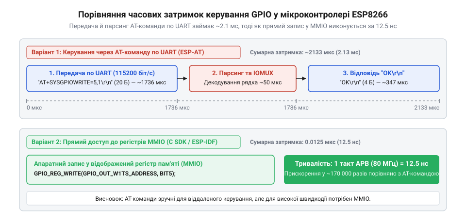
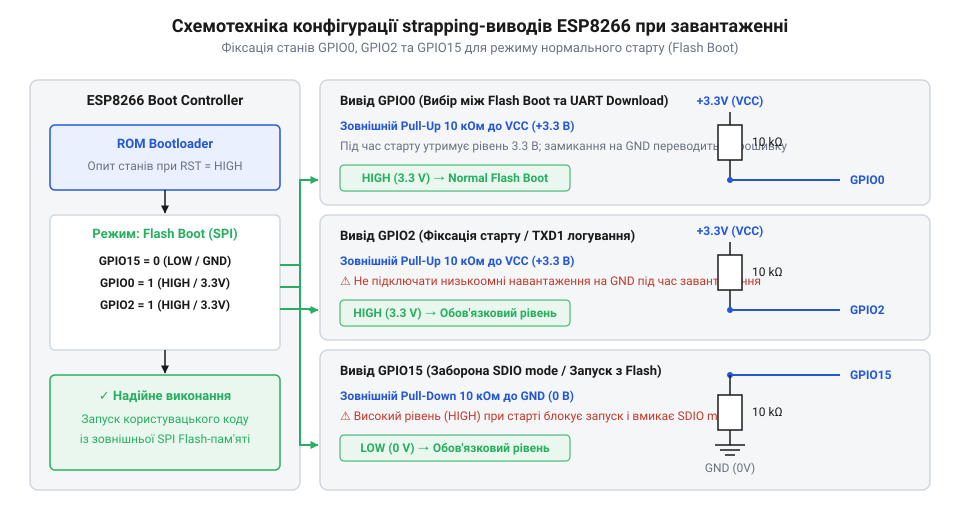
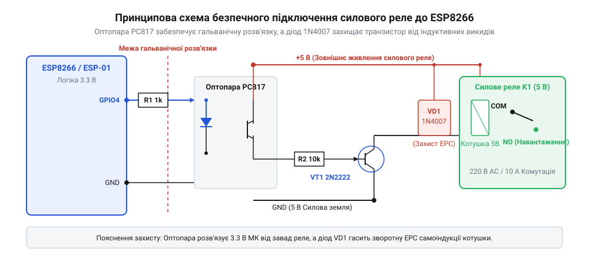

# Керування GPIO виводами ESP8266 через AT-команди

<preknowlist>
- [Огляд мікроконтролера та архітектури SoC ESP8266](root:cat-hw-boards/esp8266-soc-architecture-overview) — Розуміння загальної архітектури чипа ESP8266, блоку периферії IOMUX та регістрів GPIO
- [Конфігураційні виводи завантаження ESP8266](root:cat-hw-boards/esp8266-boot-strapping-pins) — Знання функціонального призначення виводів GPIO0, GPIO2 та GPIO15 під час початкового скидання системи
- [Огляд сімейства Wi-Fi модулів ESP-01 та ESP-01S](root:cat-hw-boards/esp-01-module-family-overview) — Уявлення про розпіновку та конструктивні відмінності популярних модулів ESP-01
</preknowlist>

## Обмеження швидкодії AT-інтерфейсу UART

Керування цифровими виводами мікроконтролера через послідовний порт суттєво поступається за швидкістю прямому запису в регістри @@en|MMIO (Memory-Mapped I/O)|ввід-вивід із відображенням у пам'ять@@. Передача текстової команди @@en|AT-команда|AT command@@ через порт @@en|UART (Universal Asynchronous Receiver-Transmitter)|універсальний асинхронний приймач-передавач@@ на стандартній швидкості 115200 бод вимагає передавання понад 15 символів, що займає близько 1.5 мс лише на фізичному рівні.

*Часова діаграма затримок передачі та парсингу AT-команди керування виводом GPIO через UART.*

Додаткова обробка рядків в інтерпретаторі прошивки Espressif AT та формування відповіді створюють сумарну затримку в 2–5 мс на одну операцію. У цьому часовому розкладі 1.5 мс витрачається на фізичну передачу символів, 0.3–0.5 мс — на очікування накопичення даних в апаратному буфері @@en|RX FIFO|приймальний буфер FIFO@@ ємністю 128 байтів до генерації переривання, а 0.7–2.0 мс займає програмний парсинг токенів та виділення розділювачів у головному циклі. Через це керування виводами через AT-інтерфейс застосовують виключно для повільних процесів автоматики з частотою перемикання до кількох герц.

## Конфігураційні strapping-виводи завантаження

Під час подачі живлення або апаратного скидання мікроконтролер зчитує логічні рівні на спеціальних виводах завантаження @@en|strapping pins|конфігураційні виводи завантаження@@: GPIO0, GPIO2 та GPIO15. Для штатного запуску управляючої програми з зовнішньої пам'яті виводи GPIO0 і GPIO2 мусять бути підтягнуті до високого рівня 3.3 В, а GPIO15 — до землі GND.

*Схема підключення зовнішніх підтягувальних резисторів до виводів GPIO0, GPIO2 та GPIO15 для нормального завантаження.*

Якщо зовнішнє навантаження або периферійний давач затягне GPIO0 до низького рівня під час вмикання, чип перейде в режим прошивання. Щоб запобігти збоям, ці виводи підключають через зовнішній @@en|pull-up resistor|підтягувальний резистор@@ номіналом 10 кОм, як детальніше описано в статті [Конфігураційні виводи завантаження ESP8266](root:cat-hw-boards/esp8266-boot-strapping-pins).

## Команди налаштування та керування виводами

Для конфігурування режимів роботи виводів та зміни їхніх логічних станів в AT-прошивці передбачено три базові інструкції. Команда `AT+PINMODE=<pin>,<mode>` визначає напрямок роботи виводу, де значення `0` відповідає входу, `1` — виходу, а `2` — входу з внутрішнім підтягувальним резистором.

Зміна стану цифрового виводу виконується інструкцією `AT+PINWRITE=<pin>,<level>`, де `level` набуває значень `0` (LOW) або `1` (HIGH). Для зчитання логічного рівня застосовують команду `AT+PINREAD=<pin>`, у відповідь на яку модуль повертає рядок `+PINREAD:<pin>,<level>` та підтвердження `OK`. Виклик непідтримуваного номера виводу повертає повідомлення `ERROR`.

## Схемотехніка безпечного підключення навантаження

Максимальний вихідний струм одного виводу ESP8266 обмежений значенням 12 мА, що унеможливлює пряме живлення індикаторів або реле. Індуктивне навантаження при вимиканні генерує сплески зсуву @@en|counter-EMF|зворотна ЕРС@@, які здатні миттєво пробити вихідний каскад мікроконтролера.

*Схема безпечного підключення реле та давача до виводів ESP8266 через оптопару та транзисторний ключ.*

Комутацію електромагнітних реле виконують через транзисторні ключі із обов'язковим шунтуючим захисним діодом (англ. @@en|flyback diode|захисний діод@@) або гальванічну розв'язку на базі @@en|optocoupler|оптопара@@. При підключенні механічних кнопок застосовують RC-фільтри пригнічення дребезгу контактів, що забезпечує стабільну роботу таких модулів, як [ESP-01 (Wi-Fi, ESP8266)](root:cat-hw-boards/esp-01).
