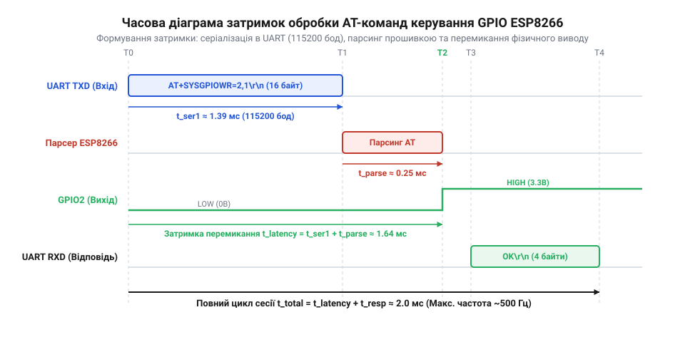

# Розрахунок затримок синтаксичного розбору та граничної частоти перемикання GPIO через AT-команди

<preknowlist>
- [ESP-01 (Wi-Fi, ESP8266)](root:cat-hw-boards/esp-01) — апаратна організація виводів GPIO та характеристики послідовного порту UART.
- [Керування GPIO виводами ESP8266 через AT-команди](root:cat-hw-boards/esp8266-at-gpio-control) — базовий синтаксис команд AT+CIOWRITE для змінення стану логічних рівнів.
- [Огляд мікроконтролера та архітектури SoC ESP8266](root:cat-hw-boards/esp8266-soc-architecture-overview) — тактова частота ядра Tensilica L106 та буферизація периферії UART.
</preknowlist>

## Фізична парадигма та часові затримки UART

Спроба сформувати швидке перемикання логічних рівнів чи згенерувати імпульсні сигнали керування на виводах [модулів серії ESP-01](root:cat-hw-boards/esp-01) за допомогою стандартних текстових AT-команд упирається у суворі фізичні межі послідовного інтерфейсу. Кожен запит на зміну стану виводу (наприклад, `AT+CIOWRITE=2,1\r\n`) передається від хост-контролера до прошивки у вигляді послідовності символів коду @@en|ASCII@@ (англ. *American Standard Code for Information Interchange*, від *American* — американський, *standard* — стандартний, *code* — код, *information* — інформація, *interchange* — обмін). Фізична серіалізація кожного байта на лінії @@en|UART@@ (англ. *universal asynchronous receiver-transmitter*, від *universal* — універсальний, *asynchronous* — асинхронний, *receiver* — приймач, *transmitter* — передавач) підпорядковується кадровому часовому квантуванню: у стані спокою лінія утримується на високому рівні 3.3 В, а передача починається із спаду до 0 В на тривалість одного стартового біта, після чого послідовно передаються 8 інформаційних бітів починаючи з молодшого біта LSB, біт парності та один чи кілька стопових бітів повернення до 3.3 В. У найпоширенішому кадровому форматі 8-N-1 кожен 8-бітний інформаційний символ обгортається одним стартовим бітом (потенціал 0 В) та одним стоповим бітом (потенціал 3.3 В), формуючи кадр у 10 бітів та 20 % апаратних накладних витрат. При використанні режимів із контролем парності або розширеною синхронізацією, таких як 8-E-1 (із додатковим бітом парності @@en|parity bit@@) чи 8-N-2 (із двома стоповими бітами), довжина кадру зростає до 11 бітів, що піднімає службові витрати до 27.27 % від загального обсягу переданих даних (або 37.5 % відносно корисного байта) та ще більше сповільнює обмін. Оскільки асинхронна передача позбавлена окремої лінії тактування, приймач розраховує моменти вибірки бітів відносно спадного фронту стартового біта, виконуючи заміри у центрі кожного кванту `t_sample = (N + 0.5) × t_bit` (де `N` — номер біта в кадрі). При 10-бітному кадрі 8-N-1 точка вибірки останнього стопового біта припадає на момент `9.5 × t_bit`. Якщо частота генератора тактування приймача `f_RX` відхиляється від частоти передавача `f_TX` на величину відносної розсинхронізації `δ = (f_RX - f_TX) ÷ f_TX`, накопичений часовий зсув на останньому біті становить `Δt_drift = 9.5 × t_bit × δ`. Теоретична межа стійкості досягається при зсуві вибірки за межі стопового біта `|Δt_drift| ≥ 0.5 × t_bit`:

```
|δ_max| = 0.5 ÷ 9.5
        = 1 ÷ 19           [гранична частка відхилення частот]
        ≈ 0.0526           [переведення в десятковий дріб]
        = 5.26%            [максимальне допустиме розходження тактування]
```

З урахуванням шуму лінії та апаратного 16-кратного оверсемплінгу (англ. @@en|oversampling@@ — від *over* — понад, *sampling* — вибірка) безпечний допуск відхилення швидкості `BaudRate` становить не більше `2.5%`. Якщо дробовий коефіцієнт ділення внутрішнього дільника APB-шини ESP8266 або температурне відхилення кварцового резонатора перевищують цю межу, замикаючий стоповий біт зчитується в момент фронту переходу і виникає помилка кадрування (англ. @@en|framing error@@, від *framing* — кадрування, *error* — помилка), що призводить до спотворення текстових команд та блокування виводів.

Таким чином, для передачі одного байта корисного навантаження фізичний шар послідовної шини вимагає надсилання загальної кількості бітів `N_frame = 10`. У форматі кадрування 8-N-1 на кожні 8 інформаційних бітів корисного навантаження припадає 2 службові біти (один стартовий та один стоповий), що створює апаратні накладні витрати кадрування у 20 % від загального обсягу переданих даних або 25 % відносно обсягу корисного байта. Це обмежує ефективну пропускну здатність шини коефіцієнтом корисної дії 80 %, оскільки п'ята частина кожного фізичного кадру витрачається на синхронізацію приймача. Збільшення швидкості обміну @@en|baud rate@@ (від англ. @@en|baud rate@@ — швидкість передачі бітів, названо на честь Еміля Бодо) до вищих стандартних значень `BaudRate = 230400` бод або `460800` бод пропорційно скорочує тривалість передачі фізичного біта `t_bit`. На швидкості `230400` бод час передачі біта зменшується удвічі:

```
t_bit_230400 = 1 ÷ BaudRate
             = 1 ÷ 230400        [підстановка підвищеної швидкості 230400 бод]
             = 4.340278 × 10⁻⁶ с [обчислення тривалості біта]
             ≈ 4.34 мкс          [округлення до двох знаків]
```

При подальшому підвищенні швидкості до `460800` бод тривалість біта скорочується у чотири рази відносно базової:

```
t_bit_460800 = 1 ÷ BaudRate
             = 1 ÷ 460800        [підстановка максимальної стабільної швидкості 460800 бод]
             = 2.170139 × 10⁻⁶ с [обчислення тривалості біта]
             ≈ 2.17 мкс          [округлення до двох знаків]
```

Проте пропорційне прискорення серіалізації обмежується працездатністю буферного каскаду. Якщо апаратне керування потоком (англ. @@en|Hardware Flow Control@@, лінії @@en|RTS/CTS@@ — від *Request to Send* — запит на відправку, *Clear to Send* — готовність до прийому) вимкнене, при високих швидкостях передачі приймальний буфер @@en|FIFO@@ мікроконтролера в [архітектурі SoC ESP8266](root:cat-hw-boards/esp8266-soc-architecture-overview) ризикує переповнитися під час тривалих переривань процесора, що призводить до втрати символів або помилок кадрування. Увімкнення сигналів @@en|RTS/CTS@@ вирішує проблему переповнення: при досягненні порогу заповнення буфера чип піднімає лінію @@en|RTS@@, примушуючи хост тимчасово призупинити передачу. Це вносить додаткові апаратні затримки очікування `t_wait_rts`, які динамічно збільшують реальний час серіалізації кадру при високій завантаженості процесорного ядра. При базовій же швидкості обміну `BaudRate = 115200` бод тривалість передачі одного фізичного біта `t_bit` розраховується за формулою:

```
t_bit = 1 ÷ BaudRate
= 1 ÷ 115200             [підстановка стандартної швидкості UART]
= 8.680556 × 10⁻⁶ с      [обчислення тривалості передачі одного біта]
≈ 8.68 мкс               [округлення до двох знаків]
```

Знаючи тривалість одного біта, можна визначити абсолютний час передачі одного повного ASCII-символу `t_char`:

```
t_char = N_frame × t_bit
= 10 × 8.680556 × 10⁻⁵ с [підстановка 10 біт кадру та тривалості біта]
= 8.680556 × 10⁻⁵ с      [обчислення часу передачі одного ASCII-символу]
≈ 86.81 мкс              [округлення до двох знаків]
```

Типова команда установки логічної одиниці на виводі `GPIO2` має вигляд `AT+CIOWRITE=2,1\r\n`, що разом із символами повернення каретки `\r` та переведення рядка `\n` становить довжину в `N_cmd = 17` ASCII-байтів. Час серіалізації текстового рядка командного запису `t_tx_cmd` обчислюється як добуток кількості символів на час передачі одного кадру:

```
t_tx_cmd = N_cmd × t_char
= 17 × 8.680556 × 10⁻⁵ с [підстановка 17 символів текстової команди]
= 1.475694 × 10⁻³ с      [обчислення часу серіалізації команди]
≈ 1.476 мс               [округлення до трьох знаків]
```

Отримане значення `t_tx_cmd ≈ 1.476` мс показує, що лише на фізичне випихання байтів текстової команди по лінії UART витрачається близько 1.48 мілісекунди ще до того, як мікроконтролер почне синтаксичний розбір запиту.

## Математична модель розбору та затримок відгуку

Після завершення фізичної серіалізації рядка у послідовному порту байти потрапляють у вхідний буфер @@en|FIFO@@ (англ. *first in, first out*, від *first* — перший, *in* — вхід, *out* — вихід) пристрою. У базі [архітектури SoC ESP8266](root:cat-hw-boards/esp8266-soc-architecture-overview) функціонує 32-бітне процесорне ядро Tensilica L106 на тактовій частоті 80 МГц, яке обробляє надходження нових байтів через апаратні переривання. Часовий бюджет обробки команди складається із чотирьох послідовних фаз: затримки переривання FIFO `t_rx_fifo`, часу синтаксичного розбору парсером `t_parse`, часу безпосереднього запису у регістр GPIO `t_gpio_write` та часу серіалізації зворотної відповіді `t_tx_resp`.


*Часова діаграма фаз передачі та синтаксичного розбору AT-команди керування GPIO з виділенням часових затримок серіалізації в послідовному порті UART, обробки в інтерпретаторі та генерації відповіді OK.*

Перед початком розбору надходження останнього байта команди в апаратне @@en|FIFO@@ викликає апаратне переривання @@en|ISR@@ (англ. *interrupt service routine*, від *interrupt* — переривання, *service* — обслуговування, *routine* — програма), де накладні витрати на збереження контексту ядра, зчитування регістрів та копіювання даних у програмний @@en|ring buffer@@ (англ. *ring buffer*, від *ring* — кільце, *buffer* — буфер) формують базову затримку `t_isr_base ≈ 25` мкс. У однозадачному середовищі Non-OS SDK обробка відбувалася безпосередньо у контексті переривання, проте у сучасній багатозадачній архітектурі під керуванням операційної системи @@en|FreeRTOS@@ обробник переривання лише надсилає сповіщення задачі парсера (англ. @@en|task notification@@), викликаючи примусове перемикання контексту задач (англ. @@en|context switch@@ — від context — контекст, switch — перемикання). Якщо в цей момент ядро [архітектури SoC ESP8266](root:cat-hw-boards/esp8266-soc-architecture-overview) виконує вищопріоритетні процедури Wi-Fi стека, затримка перемикання додає від `50` до `120` мкс (`t_ctx_switch ≈ 75` мкс), через що реальна затримка обробки вхідного переривання зростає до `t_isr_rtos = t_isr_base + t_ctx_switch ≈ 25 + 75 = 100` мкс. Додаткове запізнення виникає через використання критичних секцій @@en|FreeRTOS@@ (англ. *critical section*, від *critical* — критичний, *section* — секція): примусове маскування переривань під час атомарного запису в регістр `GPIO_OUT` чи оновлення системних таймерів вносить додаткову затримку блокування `t_crit_sect ≈ 15–45` мкс, яка відтерміновує початок виконання @@en|ISR@@. Загальна затримка вхідного буферизування `t_rx_fifo` лінійно залежить від порогу заповнення кільцевого буфера `N_thresh` (кількості накопичуваних байтів до сповіщення парсера) та часу серіалізації одного символу `t_char`:

```
t_rx_fifo = t_isr_base + (N_thresh - 1) × t_char
= 25 × 10⁻⁶ с + (N_thresh - 1) × 8.680556 × 10⁻⁵ с  [підстановка базової затримки та часу символу]
```

Для мінімального порогу `N_thresh = 1` затримка відповідає базовому значенню `t_rx_fifo = 25` мкс. Однак при збільшенні глибини накопичення буфера до `N_thresh = 16` байтів затримка очікування зростає до `t_rx_fifo = 25 + 15 × 86.80556 ≈ 1327.08` мкс (понад `1.32` мс), що суттєво уповільнює реагування інтерпретатора. Під час фази `t_parse` інтерпретатор прошивки Espressif AT виконує порівняння префікса `AT+`, шукає текстовий слуг у таблиці команд, вилучає параметри виводу та конвертує текстові символи `'2'` і `'1'` у числові індекси та логічні бітові маски. У типових релізах прошивки цей парсинг займає близько `t_parse ≈ 350` мкс. Запис у фізичний регістр керування виводами `GPIO_OUT` здійснюється практично миттєво (`t_gpio_write ≈ 1` мкс). Після перемикання виводу прошивка формує підтвердження у вигляді рядка `\r\nOK\r\n` обсягом `N_resp = 6` @@en|ASCII@@-символів, час серіалізації якого `t_tx_resp` обчислюється наступним чином:

```
t_tx_resp = N_resp × t_char
= 6 × 8.680556 × 10⁻⁵ с  [підстановка 6 символів відповіді OK]
= 5.208333 × 10⁻⁴ с      [обчислення часу серіалізації відповіді]
≈ 520.83 мкс             [округлення до двох знаків]
```

Загальна затримка повного транзакційного циклу `T_cycle` від моменту початку передачі першого біта команди до моменту завершення прийому стопового біта відповіді OK дорівнює сумі всіх фазових складників:

```
T_cycle = t_tx_cmd + t_rx_fifo + t_parse + t_gpio_write + t_tx_resp
= 1.476 мс + 0.025 мс + 0.350 мс + 0.001 мс + 0.521 мс [підстановка фазових затримок]
= 2.373 мс               [обчислення тривалості повного циклу виконання]
```

Розрахована величина `T_cycle = 2.373` мс задає абсолютну нижню межу затримки реагування системи при синхронному опитуванні та підтвердженні кожної команди перемикання.

## Гранична частота перемикання та обмеження ШІМ

Для формування одного повного періоду меандру (періодичного прямокутного сигналу зі зміною стану з високого рівня на низький і назад) хост-контролер повинен послідовно надіслати дві команди: увімкнення `AT+CIOWRITE=2,1\r\n` та вимкнення `AT+CIOWRITE=2,0\r\n`. Через велику тривалість транзакцій низька підсумкова частота перемикання призводить до деградації спектральних гармонік сигналу, збільшуючи коефіцієнт гармонійних спотворень (від англ. @@en|total harmonic distortion@@, від *total* — загальне, *harmonic* — гармонійне, *distortion* — спотворення): низькочастотні гармоніки зміщуються в область звукових і теплових резонансів, а фазовий джиттер створює стохастичну несиметрію півперіодів. Це викликає додаткові динамічні теплові втрати на силовому ключі (від англ. @@en|switching losses@@, від *switching* — перемикання, *losses* — втрати), оскільки під час тривалих і розсинхронованих фаз комутації прохідний транзистор довше перебуває у лінійному режимі з високим виділенням потужності `P_heat = I_D² × R_DS(on)`, що призводить до перевитрати енергії та перегріву ключа. За таких умов мінімальний період прямокутного імпульсу `T_period` дорівнює подвоєній тривалості транзакційного циклу:

```
T_period = 2 × T_cycle
= 2 × 2.373 мс           [підстановка часу двох транзакцій перемикання]
= 4.746 мс               [обчислення періоду мінімального симетричного меандру]
```

Гранично можлива частота перемикання логічного стану `f_toggle` визначається як обернена величина до періоду `T_period`:

```
f_toggle = 1 ÷ T_period
= 1 ÷ 0.004746 с         [підстановка тривалості періоду меандру]
= 210.7037 Гц            [обчислення граничної частоти перемикання]
≈ 210.7 Гц               [округлення до одного знака]
```

Математичне виведення показує, що теоретичний максимум частоти генерації прямокутного сигналу через AT-команди на швидкості 115200 бод становить лише `210.7` Гц. Це робить принципово неможливим реалізацію широтно-імпульсної модуляції — @@en|PWM@@ (англ. *pulse-width modulation*, від *pulse* — імпульс, *width* — ширина, *modulation* — модуляція) для керування силовими ключами, сервоприводами чи яскравістю світлодіодів, де потрібні робочі частоти від 1 до 20 кГц. Для несиметричного меандру з тривалістю активного стану `t_ON = N_ON × T_cycle` та пасивного стану `t_OFF = N_OFF × T_cycle` (де `N_ON, N_OFF ∈ ℕ⁺`), дискретність регулювання коефіцієнта заповнення @@en|duty cycle@@ становить `ΔD = T_cycle ÷ T_period = 1 ÷ (N_ON + N_OFF)`. При мінімальному періоді `N_ON = N_OFF = 1` єдиним досяжним значенням є `D = 50%`. Щоб отримати регулювання скважності з дискретним кроком `ΔD = 10%`, мінімальна сума квантів має становити `N_total = N_ON + N_OFF = 10`, що розтягує період сигналу до `T_period = 10 × T_cycle = 23.73` мс і знижує робочу частоту до `f_PWM = 1 ÷ 0.02373 с ≈ 42.13` Гц. При такій низькій частоті квантування світлодіоди помітно миготять, а обмотки двигунів видають відчутне акустичне гудіння, що підтверджує непридатність командного інтерфейсу UART для задач ШІМ-регулювання.

Крім того, плаваючі затримки виконання операційної системи реального часу в прошивці викликають часовий джиттер (від англ. @@en|jitter@@ — фазовий тремтіння сигналу) амплітудою до 100–300 мкс, що руйнує стабільність коефіцієнта заповнення. Підвищення швидкості послідовного порту до 921600 бод скорочує тривалість передачі біта `t_bit = 1 ÷ 921600 ≈ 1.085 мкс`, що дозволяє зменшити час серіалізації 17-байтної команди `t_tx_cmd` та 6-байтної відповіді `t_tx_resp`:

        T_cycle = t_tx_cmd + t_rx_fifo + t_parse + t_gpio_write + t_tx_resp
                = 0.1845 мс + 0.020 мс + 0.050 мс + 0.010 мс + 0.0651 мс   [підстановка затримок при 921600 бод]
                = 0.3296 мс                                                [обчислення мінімального транзакційного циклу]

        T_period = 2 × T_cycle
                 = 2 × 0.3296 мс                                           [підстановка двох транзакцій меандру]
                 = 0.6592 мс                                               [період сигналу при 921600 бод]

        f_toggle = 1 ÷ T_period
                 = 1 ÷ 0.0006592 с                                         [обчислення частоти перемикання]
                 ≈ 1517 Гц                                                 [граничний теоретичний максимум]

Для асинхронного режиму керування без очікування підтверджень `OK` від прошивки час транзакції скорочується, виключаючи складову `t_tx_resp`. Оскільки обчислювальні накладні витрати мікроконтролера `t_mcu = t_rx_fifo + t_parse + t_gpio_write = 80` мкс менші за тривалість передачі команди `t_tx_cmd = 184.46` мкс при 921600 бод, вузьким місцем стає швидкість послідовної лінії. Теоретична гранична частота асинхронного перемикання `f_toggle,async` обчислюється наступним чином:

```
T_period,async = 2 × t_tx_cmd
= 2 × 1.8446 × 10⁻⁴ с     [підстановка часу передачі двох команд ON та OFF]
= 3.6892 × 10⁻⁴ с         [тривалість періоду в асинхронному режимі]
≈ 0.3689 мс               [переведення в мілісекунди]

f_toggle,async = 1 ÷ T_period,async
= 1 ÷ 0.00036892 с        [обчислення асинхронної граничної частоти]
≈ 2710.6 Гц               [теоретична стеля без підтверджень]
```

Проте навіть при підвищенні теоретичної межі до `f_toggle,async ≈ 2.71` кГц апаратні затримки обробки переривань — @@en|interrupt latency@@ (від *interrupt* — переривання, *latency* — латентність) у прошивці викликають додаткові непередбачувані паузи від 20 до 150 мкс при виконанні фонових задач Wi-Fi стеку. Стохастичне додавання латентності `Δt_lat ∈ [20, 150]` мкс до кожного напівперіоду `T_half` спричиняє нелінійний зсув фази та спотворює коефіцієнт заповнення імпульсів @@en|duty cycle@@ (англ. *duty cycle*, від *duty* — робота, *cycle* — цикл) `D_real = T_half,ON ÷ (T_half,ON + T_half,OFF)`: за умов `T_half,ON = 184.5 + 150 = 334.5` мкс та `T_half,OFF = 184.5 + 20 = 204.5` мкс коефіцієнт заповнення відхиляється від симетричних 50% до `D_real ≈ 62.1%`, а фазовий зсув досягає `Δφ = 2π × (Δt_lat ÷ T_period) ≈ 1.6` рад (`~92°`). Додавання латентності переривань до `T_cycle` збільшує реальний період до `T_period,real ≈ 0.833 мс`, що обмежує практичну частоту перемикання величиною `f_toggle ≈ 1.2 кГц`. При цьому паразитна індуктивність доріжок та накладні витрати переривань спричиняють помилки кадрування — @@en|framing error@@ (від *framing* — кадрування, *error* — помилка). Для генерації високочастотних імпульсів або апаратного ШІМ необхідно відмовитися від AT-прошивки та переходити на пряме програмування ядра на мовах C/C++ через SDK із використанням апаратних таймерів. Для формування високочастотних сигналів та точного керування тривалістю імпульсів застосовують [апаратні таймери мікроконтролера](root:hw-arch/esp8266-hardware-pwm-timers), які генерують ШІМ без затримок послідовного порту.
