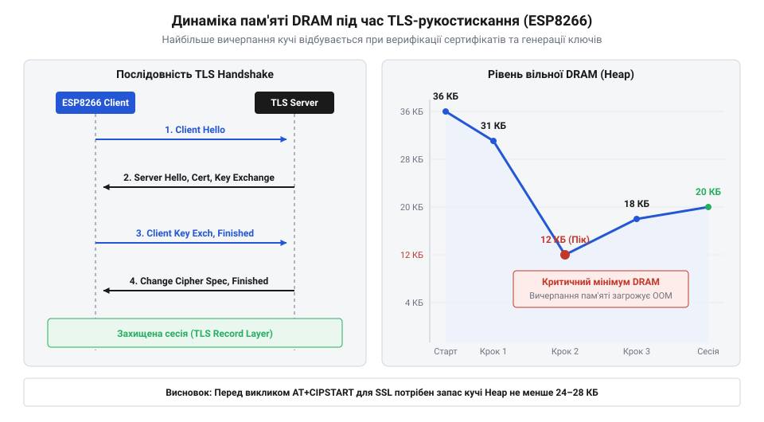

# Програмний довідник AT-команд SSL/TLS та кодів помилок прошивки ESP8266

<preknowlist>
- [Мережеві сокети TCP/UDP на модулі ESP-01](root:cat-hw-boards/esp01-tcp-udp-sockets) — базові принципи сокетного зв'язку, IP-адресація та TCP-з'єднання через AT-команди
- [Оновлення прошивки ESP8266 по повітрю (FOTA)](root:cat-hw-boards/esp8266-fota-update) — загальний механізм FOTA-оновлення прошивки ESP8266
</preknowlist>

## Захист незахищених TCP-каналів у ESP-AT

Передача даних у бездротових мережах через відкриті [мережеві сокети TCP/UDP](root:cat-hw-boards/esp01-tcp-udp-sockets) відправляє пакети у формі відкритого тексту. Будь-який проміжний вузол або аналізатор мережевого трафіку може перехопити токени автентифікації, паролі до хмарних сервісів чи модифікувати пакети безпосередньо під час передачі. Для запобігання підробці сервера та витоку інформації в прошивці @@en|ESP-AT@@ для [мікроконтролера ESP8266](root:cat-hw-boards/esp8266-soc-architecture-overview) інтегровано криптографічний стек @@en|mbedTLS@@ (англ. *mbed Transport Layer Security*, від *Transport Layer Security* — безпека транспортного рівня).

Стек @@en|SSL/TLS@@ (англ. *Secure Sockets Layer / Transport Layer Security*, від *Secure Sockets Layer* — шар захищених сокетів) створює зашифровану тунельну структуру поверх базового @@en|TCP@@-з'єднання. Авторизація та шифрування базуються на криптографічних сертифікатах стандарту @@en|X.509@@. Під час процедури рукостискання (англ. *handshake*, від *hand* — рука, *shake* — стискання) пристрій та видалений сервер узгоджують сеансові симетричні ключі шифрування та верифікують цифрові підписи.

У прошивці @@en|ESP-AT@@ вибір версії криптографічного протоколу залежить від випуску системного ПЗ: базові збірки за замовчуванням використовують @@en|TLS 1.2@@, повністю блокуючи застарілі вразливі стандарти @@en|TLS 1.0@@ та @@en|TLS 1.1@@. Сучасні версії прошивки підтримують також розширення @@en|TLS 1.3@@, яке скорочує тривалість рукостискання з двох кругових затримок (англ. *round-trip time*, @@en|RTT@@) до однієї фази 1-RTT. Однак через обмежену продуктивність процесора @@en|ESP8266@@ при обчисленні алгоритмів еліптичних кривих @@en|ECDHE@@, саме протокол @@en|TLS 1.2@@ забезпечує оптимальний баланс швидкодії та сумісності з хмарними сервісами.

Використання криптографії на обчислювально обмеженому чіпі @@en|ESP8266@@ із невеликим обсягом динамічної пам'яті @@en|DRAM@@ (англ. *dynamic random-access memory*, від *dynamic* — динамічна, *random-access* — з довільним доступом, *memory* — пам'ять) ставить суворі вимоги до конфігурування буферів та перевірки ланцюжка довіри. Окрім обмежень пам'яті, виконання алгоритмів симетричного шифрування @@en|AES-128@@ та @@en|AES-256@@ (англ. @@en|Advanced Encryption Standard@@ — розширений стандарт шифрування) створює відчутне обчислювальне навантаження на одноядерний процесор @@en|Xtensa LX106@@. Оскільки мікроконтролер не має апаратного прискорювача AES, програмне кодування та дешифрування блоків даних під час передачі великих масивів потокового трафіку значно завантажує процесорний час, знижує реальну пропускну здатність шифрованого каналу та підвищує енергоспоживання. Без належного налаштування криптографічних параметрів системний сокет або піддається ризику перехоплення даних, або викликає аварійне перезавантаження через вичерпання пам'яті під час обробки великих сертифікатів.

## Конфігурування SSL-параметрів, SNI та пам'яті

Для вибору режиму перевірки сертифікатів у прошивці @@en|ESP-AT@@ застосовується команда `AT+CIPSSLCCONF`. Вона визначає рівень автентифікації — від повністю відкритого зв'язку до суворого двостороннього шифрування @@en|mutual TLS@@ (англ. *mutual Transport Layer Security*, від *mutual* — взаємний).

Синтаксис команди конфігурації:
```text
AT+CIPSSLCCONF=<link_ID>,<auth_mode>
```

Параметр `<link_ID>` задає номер сокета при багатопотоковому режимі. Параметр `<auth_mode>` приймає значення:
- `0`: верифікація сертифіката сервера вимкнена (шифрування працює, але автентичність сервера не перевіряється);
- `1`: проводиться обов'язкова перевірка сертифіката сервера;
- `2`: проводиться перевірка сертифіката клієнта на боці сервера;
- `3`: виконується двостороння автентифікація @@en|mutual TLS@@, де і клієнт, і сервер перевіряють сертифікати один одного.

При використанні режимів із перевіркою клієнтських сертифікатів (значення `2` та `3`) прошивці @@en|ESP-AT@@ потрібні три криптографічні компоненти: кореневий сертифікат центру авторизації @@en|CA@@, власний сертифікат клієнта та його приватний RSA-ключ. На мікроконтролері @@en|ESP8266@@ ці бінарні структури зберігаються у заздалегідь розмінних секторах флеш-пам'яті (згідно з таблицею розділів `partition_table.bin`, де під сертифікати виділяються адреси `esp_ca.bin`, `esp_cert.bin` та `esp_key.bin`). Завантаження сертифікатів у флеш-пам'ять здійснюється через AT-команду `AT+PKSLOAD` або під час прошивки пристрою. Якщо обрано двосторонню автентифікацію @@en|mutual TLS@@, але потрібний сектор флеш-пам'яті порожній чи пошкоджений, рушій @@en|mbedTLS@@ перериває з'єднання ще до відправки відповіді Client Certificate.

При виборі режимів зі збереженням довіри сервер зобов'язаний надати сертифікат, підписаний авторизованим центром сертифікації @@en|CA@@ (англ. *certificate authority*, від *certificate* — сертифікат, *authority* — орган). Корневий сертифікат @@en|CA@@ має бути заздалегідь записаний у флеш-пам'ять пристроїв, таких як компактні модулі [модуля ESP-01S](root:cat-hw-boards/esp-01s).

Сучасні хмарні веб-сервери часто використовують віртуальний хостинг, де сотні доменів розміщуються на одній фізичній @@en|IP@@-адресі. Щоб TLS-сервер визначив, який саме сертифікат слід повернути клієнту ще на стадії Client Hello, застосовується розширення @@en|SNI@@ (англ. *server name indication*, від *server* — сервер, *name* — ім'я, *indication* — вказування).

Синтаксис команди налаштування @@en|SNI@@:
```text
AT+CIPSSLCSNI=<link_ID>,<sni_name>
```

Передане доменне ім'я вказує серверу цільовий хост. Якщо з'єднання встановлюється без передачі @@en|SNI@@, хмарна платформа може повернути дефолтний сертифікат іншого домену, що спричинить відмову верифікації на боці рушія @@en|mbedTLS@@.

Декодування криптографічних ключів та обробка сертифікатів вимагають виділення оперативної пам'яті під мережевий буфер. Розмір входного SSL-буфера регулюється командою `AT+CIPSSLCSIZE`:
```text
AT+CIPSSLCSIZE=<buffer_size>
```

Розмір буфера вказується в байтах у діапазоні від 2048 до 16384 байтів (дефолтне значення становить 4096 байтів). Якщо розмір сертифіката сервера перевищує значення `<buffer_size>`, рукостискання зупиняється через помилку переповнення. Проте виділення 16 КБ пам'яті під один сокет суттєво зменшує вільний обсяг @@en|DRAM@@, тому розмір буфера обирається виходячи з довжини сертифіката конкретного веб-сервера.


*Послідовність конфігурування режимів SSL, передачі SNI та динамічного виділення буфера пам'яті перед ініціалізацією криптографічного сеансу.*

## Встановлення SSL-з'єднань та FOTA-оновлення

Після визначення параметрів шифрування пристрій ініціює захищений мережевий канал командою `AT+CIPSTART`. Для створення шифрованого сокета тип транспортного протоколу вказується як `"SSL"` або `"HTTPS"`.

Синтаксис команди створення з'єднання:
```text
AT+CIPSTART=<link_ID>,"SSL",<remote_host>,<remote_port>
```

Після виконання цієї команди прошивка виконує розпізнавання домену через @@en|DNS@@ (англ. *domain name system*, від *domain* — домен, *name* — ім'я, *system* — система), відкриває базовий @@en|TCP@@-сокет і розпочинає діалог рукостискання @@en|mbedTLS@@. Якщо верифікація сертифіката та обмін ключами пройшли успішно, модуль повертає статусні повідомлення `CONNECT` та `OK`. Подальше відправлення даних командою `AT+CIPSEND` виконується в захищеному режимі.

Приклад типової сесії встановлення SSL-з'єднання з хмарним сервером:
```text
AT+CIPSSLCCONF=0,1
OK

AT+CIPSSLCSNI=0,"example.com"
OK

AT+CIPSSLCSIZE=8192
OK

AT+CIPSTART=0,"SSL","example.com",443
CONNECT
OK
```

Криптографічний захист є обов'язковим під час завантаження нових версій системного програмного забезпечення. Процедура [оновлення прошивки FOTA](root:cat-hw-boards/esp8266-fota-update) (англ. *firmware over-the-air*, від *firmware* — прошивка, *over-the-air* — по повітрю) запускає автоматичний захищений процес завантаження бінарних файлів із видаленого сервера.

Запуск процесу оновлення здійснюється командою:
```text
AT+CIUPDATE
```

Під час виконання `AT+CIUPDATE` мікроконтролер послідовно проходить чотири фіксовані етапи [оновлення прошивки FOTA](root:cat-hw-boards/esp8266-fota-update), що супроводжуються виводом відповідних статусних службових повідомлень у порт:
- `+CIPUPDATE:1`: ініціалізація захищеного SSL-з'єднання з виділеним сервером оновлень та проходження рукостискання;
- `+CIPUPDATE:2`: надсилання запиту версії та отримання таблиці розміщення бінарних образів від сервера;
- `+CIPUPDATE:3`: послідовне завантаження блоків прошивки та їхній запис у тимчасовий сектор флеш-пам'яті;
- `+CIPUPDATE:4`: фінальна перевірка контрольної суми бінарного образу, оновлення вказівника завантажувача та підготовка до перезавантаження.

Збій криптографічного рукостискання або відмова верифікації сертифіката перериває процес на першому чи другому кроці з виводом `ERROR`, захищаючи пристрій від встановлення пошкоджених чи підроблиних образів.

## Розшифрування кодів помилок mbedTLS і сеансу

Під час встановлення захищеного з'єднання або передачі даних у прошивці @@en|ESP-AT@@ можуть виникати статусні коди помилок рушія @@en|mbedTLS@@. Вони виводяться в термінал у десятковому або шістнадцятковому виразі із мінусовим значенням.

Найбільш поширені статусні коди криптографічного стека:
- `-0x2700` (`MBEDTLS_ERR_X509_CERT_VERIFY_FAILED`): помилка перевірки сертифіката сервера. Виникає при невідповідності дати дії сертифіката, відсутності кореневого сертифіката @@en|CA@@ у пам'яті мікроконтролера або невдалій перевірці доменного імені через @@en|SNI@@.
- `-0x7080` (`MBEDTLS_ERR_SSL_BUFFER_TOO_SMALL`): недостатній розмір SSL-буфера. Повертається під час рукостискання, якщо отриманий від сервера сертифікат або фрагмент даних перевищує значення, встановлене командою `AT+CIPSSLCSIZE`.
- `-0x7F00` (`MBEDTLS_ERR_SSL_ALLOC_FAILED`): помилка виділення динамічної пам'яті. Виникає, коли в системному блоці @@en|DRAM@@ недостатньо вільного місця для розгортання контексту @@en|mbedTLS@@.
- `-0x7880` (`MBEDTLS_ERR_SSL_PEER_CLOSE_NOTIFY`): видалений сервер примусово закрив захищену сесію, надіславши сповіщення про завершення TLS-сеансу.

При локалізації відмови з кодом `-0x2700` спочатку перевіряють актуальний системний час пристрою командою `AT+CIPSNTPTIME`, оскільки розходження в часі призводить до помилкового визначення сертифіката як простроченого. Якщо виникає код `-0x7080`, розмір буфера збільшують командою `AT+CIPSSLCSIZE=8192` або `16384`. У випадку помилки виділення пам'яті `-0x7F00` (`MBEDTLS_ERR_SSL_ALLOC_FAILED`) слід зменшити кількість одночасних мережевих з'єднань або закрити неактивні сокети.

Для коректного відновлення роботи при виникненні помилки `-0x7F00` замало просто повторити виклик з'єднання: необхідно повністю скинути внутрішній SSL-контекст. Спочатку надсилають команду примусового закриття сокета `AT+CIPCLOSE=<link_ID>`, яка звільняє прив'язані буфери в купі, після чого повторно викликають `AT+CIPSSLCCONF` для перезапущення структур рушія @@en|mbedTLS@@. У разі критичної фрагментації динамічної пам'яті @@en|DRAM@@ мікроконтролера виконують перезапуск модуля командою `AT+RST` перед ініціалізацією нового захищеного сеансу.


*Алгоритм покрокової локалізації та усунення збоїв SSL-з'єднання на основі статусних кодів mbedTLS і стану системних ресурсів ESP8266.*
