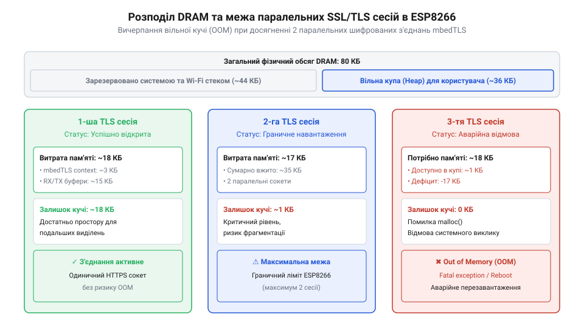
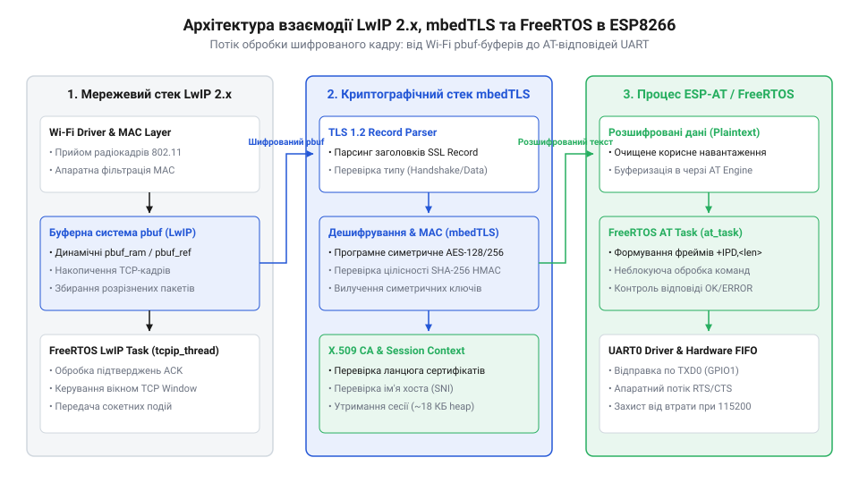
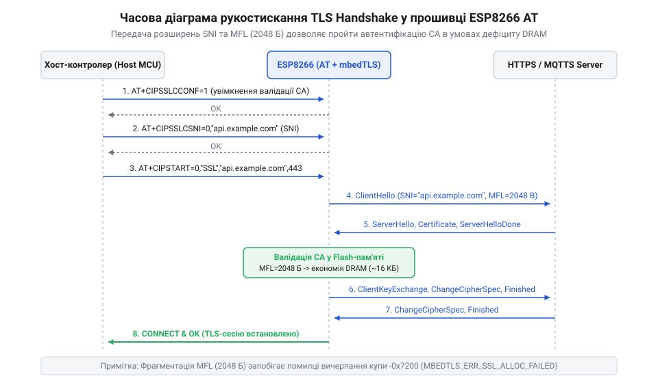

# Захищені SSL/TLS з'єднання в AT-прошивці ESP8266

<preknowlist>
- [Мережеві сокети TCP/UDP на модулі ESP-01](root:cat-hw-boards/esp01-tcp-udp-sockets) — Принципи відкриття базових незахищених сокетів TCP, обробку команд AT+CIPSTART/AT+CIPSEND та структуру мережевих пакувальних буферів.
- [Оновлення прошивки ESP8266 по повітрю (FOTA)](root:cat-hw-boards/esp8266-fota-update) — Базовий механізм двобанківської перерозмітки флеш-пам'яті та процедуру бездротового завантаження бінарних образів прошивки.
- [Огляд мікроконтролера та архітектури SoC ESP8266](root:cat-hw-boards/esp8266-soc-architecture-overview) — Організацію оперативної пам'яті DRAM, розподіл кучі та роботу системних шин мікроконтролера ESP8266.
</preknowlist>

## Проблема дефіциту DRAM при шифруванні

Спроба захистити мережевий обмін у пристроях на базі мікроконтролера `ESP8266` шляхом переходу від відкритих TCP-з'єднань до шифрованого протоколу `SSL/TLS` (англ. @@en|SSL/TLS@@, від @@en|Secure Sockets Layer / Transport Layer Security@@ — шар захищених сокетів / безпека транспортного рівня) упертається у критичний апаратний бар'єр пам'яті. У той час як відкриті [незахищені сокети TCP](root:cat-hw-boards/esp01-tcp-udp-sockets) вимагають мінімальних ресурсів для збереження поточного стану, налаштування шифрованого каналу змушує систему розгортати повнофункціональний криптографічний контекст. Загальний обсяг оперативної пам'яті `DRAM` (англ. @@en|DRAM@@, від @@en|Dynamic Random-Access Memory@@ — динамічна оперативна пам'ять з довільним доступом, від лат. @@la|dynamicus@@ — рухомий) у фізичній [архітектурі чипа ESP8266](root:cat-hw-boards/esp8266-soc-architecture-overview) становить `80 кБ`. З урахуванням системних потреб операційної системи реального часу `FreeRTOS` (англ. @@en|FreeRTOS@@) та стека Wi-Fi, під динамічну кучу (англ. @@en|heap@@ — куча, нагромадження) залишається не більше `36–45 кБ` вільного простору. Щоб уникнути повторного виділення близько `18 кБ` кучі при кожному новому підключенні, у [стеку mbedTLS](root:cat-hw-boards/mbedtls-embedded-crypto-library) застосовують механізми відновлення сесій @@en|TLS Session Resumption@@ (англ. @@en|Session Resumption@@ — відновлення сесії), які дозволяють пропустити ресурсомісткі асиметричні обчислення рукостискання. При використанні ідентифікаторів сесій @@en|Session IDs@@ (англ. @@en|Session ID@@ — ідентифікатор сесії) сервер зберігає стан шифрованого каналу у власній пам'яті, а клієнт кешує лише короткий 32-байтний ключ, що вимагає всього `256–512 байтів` оперативної пам'яті на стороні мікроконтролера. Більш гнучкий підхід із квитками сесій @@en|Session Tickets@@ (англ. @@en|Session Ticket@@ — квиток сесії, за стандартом @@en|RFC 5077@@) виноситься на сторону клієнта: сервер передає зашифрований контекст сесії у вигляді квитка розміром `300–800 байтів`, який `ESP8266` зберігає у кучі та повертає під час повторного запиту. Це знижує пікове споживання пам'яті під час повторного встановлення з'єднання з `18 кБ` до `2–3 кБ`, однак створює критичну пастку: якщо термін дії квитка вичерпано або сервер скинув сесійний стан, система змушена раптово виконати повноцінне рукостискання, що при дефіциті вільної кучі призводить до миттєвої відмови за вичерпанням пам'яті.


*Діаграма розподілу оперативної пам'яті DRAM ESP8266 під час відкриття шифрованих сокетів mbedTLS, що демонструє поріг вичерпання кучі OOM при досягненні 2 паралельних сесій.*

Для ініціалізації кожного шифрованого з'єднання криптографічна бібліотека виділяє у кучі понад 18 кБ суцільного адресного простору, де левову частку витрат визначає обраний криптоалгоритм. Використання асиметричних ключів @@en|RSA@@ з довжиною 2048 бітів вимагає збереження монументальних структур ключів з 256-байтних багаторозрядних чисел, що разом із розбором X.509 сертифікатів забирає понад 4 кБ пам'яті лише під криптоконтекст. Натомість перехід на еліптичні криві @@en|ECC@@ (наприклад, @@en|secp256r1@@) скорочує розмір ключових координат з 256 до 32 байтів, заощаджуючи до 3 КБ кучі на кожній сесії. Математичне підґрунтя цих обчислень у [криптографічному стеку mbedTLS](root:cat-hw-boards/mbedtls-embedded-crypto-library) пояснює суттєву різницю в навантаженні на процесор: виведення спільного сесійного секрету за схемою Діффі-Геллмана для `@@en|RSA-2048@@` спирається на модульне піднесення до степеня над 256-байтними багаторозрядними цілими числами у структурі `@@en|mbedtls_mpi@@` (англ. @@en|Multi-Precision Integer@@ — багаторозрядне ціле число). Під час виконання алгоритму Монтгомері для модульного піднесення до степеня стек змушений динамічно виділяти до 6–8 проміжних `@@en|MPI@@`-буферів під тимчасові лимби (англ. @@en|limb@@ — розряд багаторозрядного числа), що створює піковий сплеск споживання пам'яті до 2–3 КБ кучі в момент розрахунку. На тактовій частоті `80 МГц` [процесора ESP8266](root:cat-hw-boards/esp8266-soc-architecture-overview), позбавленого апаратного Монтгомері-помножувача для 2048-бітних чисел, програмна реалізація цих математичних циклів викликає монопольну обчислювальну затримку тривалістю `150–300 мс`. Застосування еліптичних кривих `@@en|ECDHE@@` (англ. @@en|ECDHE@@, від @@en|Elliptic Curve Diffie-Hellman Ephemeral@@ — ефемерний протокол Діффі-Геллмана на еліптичних кривих) замінює громіздкі модульні ділення та піднесення до степеня на скалярне множення точок кривої за допомогою драбини Монтгомері або методом подвоєння та додавання точок з 32-байтними координатами. Це дозволяє утримувати тимчасові математичні координати точок кривої у компактних буферах розміром усього `256–512 байтів`, скорочуючи процесорну паузу до `30–70 мс` і мінімізуючи фрагментацію кучі тимчасовими алокаційними сплесками. Решта обсягу витрачається на покажчики сесії, симетричні ключі шифрування та проміжні буфери обміну. Якщо розробник намагається відкрити більше ніж 2 паралельні захищені сесії з @@en|RSA@@-сертифікатами на [модулях ESP-01](root:cat-hw-boards/esp-01), вільний обсяг кучі падає нижче критичної межі, що на етапі обміну сертифікатами спричиняє фатальну помилку вичерпання пам'яті @@en|OOM@@ (англ. @@en|OOM@@, від @@en|Out of Memory@@ — вичерпання пам'яті) та неконтрольоване аварійне перезавантаження пристрою.

Аналіз [еволюції криптографічного стека](root:cat-hw-boards/esp8266-at-ssl-tls/hist-esp8266-at-ssl-tls-evolution.md) показує, що перехід від застарілих спрощених бібліотек до повноцінного захищеного стека зробив планування пам'яті обов'язковою умовою стабільності. При виконанні процедури мережевого рукостискання (англ. @@en|handshake@@ — рукостискання) асиметричні обчислення ключів `RSA` або `ECC` створюють короткочасні сплески споживання пам'яті, що вимагає ретельного аналітичного розрахунку. Точний [розрахунок бюджету DRAM](root:cat-hw-boards/esp8266-at-ssl-tls/math-esp8266-ssl-memory-budget-and-fragmentation.md) дозволяє заздалегідь визначити допустимі розміри криптографічних кадрів і відновити стабільність системи за допомогою оптимізації параметрів.

Пік споживання пам'яті під час етапу @@en|TLS Handshake@@ припадає на обробку асиметричної криптографії при перевірці підписів та обміні ключами. Використання традиційних алгоритмів @@en|RSA@@ з довжиною ключа 2048 бітів вимагає від стека @@en|mbedTLS@@ динамічного виділення додаткових тимчасових структур для багаторозрядних цілих чисел @@en|MPI@@ (англ. @@en|Multi-Precision Integer@@), що додає понад 4–6 КБ до поточного витрачання кучі в момент обчислень. Натомість застосування криптографії на еліптичних кривих @@en|ECC@@ (англ. @@en|Elliptic Curve Cryptography@@) та схем обміну ключами @@en|ECDHE@@ (англ. @@en|Elliptic Curve Diffie-Hellman Ephemeral@@) на базі 256-бітних кривих (наприклад, @@en|secp256r1@@) суттєво зменшує обсяг математичних буферів, скорочуючи пікове навантаження на кучу @@en|DRAM@@ під час рукостискання та знижуючи ризик виникнення помилок вичерпання пам'яті.

## Архітектура стека mbedTLS і LwIP

Причиною суворих обмежень пам'яті при роботі з шифрованими сокетами є пошарова архітектура мережевої підсистеми середовища `ESP-IDF` (англ. @@en|ESP-IDF@@). Внутрішній транспортний рівень спирається на мережевий стек `LwIP` (англ. @@en|LwIP@@, від @@en|Lightweight IP@@ — легковаговий мережевий протокол IP), поверх якого надбудовується криптографічна бібліотека `mbedTLS` (англ. @@en|mbedTLS@@). Коли прикладний шар надсилає запит через прошивку `AT`-команд (англ. @@en|AT@@, від @@en|Attention@@ — увага), дані проходять крізь два незалежні рівні буферизації. Для узгодженої роботи цих рівнів ключове значення має налаштування розміру ковзного TCP-вікна `TCP_WND` (англ. @@en|TCP_WND@@, від @@en|TCP Window Size@@ — розмір вікна TCP) у [стеку LwIP](root:cat-hw-boards/lwip-stack-architecture-in-embedded), яке визначає максимальний обсяг непідтверджених даних, що сервер може надіслати без очікування підтвердження @@en|ACK@@. Якщо значення `TCP_WND` залишено занадто великим (понад `5.7–8 кБ`), віддалений вузол заповнює вхідні мережеві буфери швидше, ніж [бібліотека mbedTLS](root:cat-hw-boards/mbedtls-embedded-crypto-library) встигає обробити та розшифрувати кадри TLS, що спричиняє подвійні витрати кучі `DRAM` під накопичений трафік і криптоконтекст. Обмеження та гармонізація `TCP_WND` до розміру зменшеного TLS-кадру (наприклад, до `2048–4096 байтів`) примушує сервер передавати дані порціями, які точно відповідають виділеному криптографічному буферу. Це гарантує стабільний бюджет пам'яті та запобігає переповненню кучі, хоча й обмежує максимальну пропускну здатність з'єднання на мережевих каналах з високою круговою затримкою `RTT` (англ. @@en|RTT@@, від @@en|Round-Trip Time@@ — час кругової затримки).


*Схема взаємодії мережевих pbuf-буферів LwIP 2 та криптоконтекстів mbedTLS у внутрішній оперативній пам'яті DRAM.*

Мережевий стек `@@en|LwIP@@` оперує пакетами за допомогою лінійних буферних структур `@@en|pbuf@@`, ліміт яких регулюється параметрами пул-пам'яті `@@en|MEMP_NUM_NETBUF@@`. Передача даних між транспортним шаром `@@en|LwIP@@` та криптографічним стеком `@@en|mbedTLS@@` виконується через спеціалізовані функції зворотного виклику введення-виведення, які прагнуть використати механізм нульового копіювання (англ. @@en|zero-copy@@) для уникнення дублювання байтів у пам'яті. У свою чергу, стек `@@en|mbedTLS@@` вимагає утримання в кучі розпакованих вхідних і вихідних TLS-кадрів для розшифрування блоків. За замовчуванням специфікація TLS передбачає максимальний розмір кадру у 16 кБ (плюс службові заголовки та підписи коду автентифікації повідомлень). Спроба виділити два суцільні масиви по 16 кБ для прийому та передачі в умовах, коли вся доступна куча `@@en|DRAM@@` не перевищує 36 кБ, миттєво блокує виконання коду. Для подолання цього обмеження стек `@@en|mbedTLS@@` налаштовується на фрагментацію кадрів та узгоджується з механізмом керування пам'яттю `@@en|LwIP@@`.

Функціонування стека детально [досліджує mbedTLS-стек](root:cat-hw-boards/mbedtls-embedded-crypto-library), а взаємодія з транспортним рівнем спирається на спеціалізовані алгоритми [мережевого стека LwIP](root:cat-hw-boards/lwip-stack-architecture-in-embedded). Під час ініціалізації сесії бібліотека `mbedTLS` узгоджує з сервером зменшений розмір фрагмента, що дозволяє скоротити розмір внутрішніх буферів з `16 кБ` до `2 кБ` або `4 кБ`. Окремий виклик команд, наведений у [командному довіднику SSL](root:cat-hw-boards/esp8266-at-ssl-tls/api-esp8266-at-ssl-tls-commands-and-config.md), дає змогу розробнику вручну обмежувати максимальну довжину TLS-кадру, зберігаючи баланс між швидкодією та вільним обсягом кучі `DRAM`.

Додатковим ускладнювальним фактором є фрагментація кучі (англ. @@en|heap fragmentation@@), яка виникає через різнорідний характер виділення пам'яті двома стеками. У той час як криптографічний стек @@en|mbedTLS@@ вимагає виділення великих суцільних блоків кучі @@en|DRAM@@ для розпакування TLS-кадрів, мережевий стек @@en|LwIP@@ постійно створює та знищує дрібніші динамічні буфери `@@en|pbuf@@` для вхідних TCP-сегментів Wi-Fi. Оскільки ці два процеси виконуються паралельно в єдиній кучі середовища @@en|FreeRTOS@@, оперативна пам'ять швидко розбивається на численні ізольовані фрагменти. У результаті виникає критичний стан: навіть коли сумарний обсяг вільної пам'яті становить 10 КБ, система не може знайти жодного суцільного блоку розміром 2–4 КБ для `@@en|mbedTLS@@`, що спричиняє відмову виділення буфера та обрив шифрованого з'єднання.

Для усунення ризику фрагментації розробники відмовляються від динамічного виділення пам'яті через функцію `@@en|pvPortMalloc@@` на користь статичних пулів `@@en|memp@@` (англ. @@en|memp@@, від @@en|memory pools@@ — пули пам'яті) у [мережевому стеку LwIP 2.x](root:cat-hw-boards/lwip-stack-architecture-in-embedded). Обсяг цих пулів жорстко задається на етапі компіляції прошивки за допомогою двох конфігураційних параметрів: `@@en|MEMP_NUM_TCP_PCB@@` та `@@en|MEMP_NUM_NETBUF@@`. Параметр `@@en|MEMP_NUM_TCP_PCB@@` обмежує граничну кількість керуючих блоків протоколу `@@en|TCP_PCB@@`, виділяючи фіксовану область обсягом `400–600 байтів` на кожне активне з'єднання. Обмеження цього параметра до 2–3 елементів гарантує, що система не резервуватиме оперативну пам'ятять під незадіяні сокети. Своєю чергою, параметр `@@en|MEMP_NUM_NETBUF@@` лімітує кількість дескрипторів мережевих буферів `@@en|NETBUF@@` значенням 4–6 об'єктів, що зупиняє розростання дрібних службових структур у кучі. Перенесення метаданих мережевих сокетів у статичні масиви ізолює дрібні службові об'єкти від загального простору кучі `@@en|FreeRTOS@@`. Це запобігає її хаотичному розбиттю, фіксує питомі витрати на один сокет і залишає основну частину оперативної пам'яті `@@en|DRAM@@` суцільним монолітним блоком, необхідним для [криптографічної бібліотеки mbedTLS](root:cat-hw-boards/mbedtls-embedded-crypto-library) при виділенні великих криптографічних буферів.

Для захисту від неконтрольованої динамічної алокації у [мережевому стеку LwIP 2.x](root:cat-hw-boards/lwip-stack-architecture-in-embedded) розгортають статичні пули пам'яті `@@en|memp@@` (англ. @@en|memp@@, від @@en|memory pools@@ — пули пам'яті), розмір яких обмежують параметрами конфігурації `@@en|MEMP_NUM_TCP_PCB@@` та `@@en|MEMP_NUM_NETBUF@@`. Перший параметр фіксує граничну кількість керуючих блоків сокетів `@@en|TCP_PCB@@` (англ. @@en|TCP_PCB@@, від @@en|TCP Protocol Control Block@@ — блок керування протоколом TCP), а другий — максимум мережевих буферних дескрипторів `@@en|NETBUF@@` (англ. @@en|NETBUF@@, від @@en|network buffer descriptor@@ — дескриптор мережевого буфера). Замість виклику динамічного алокатора кучі `@@en|pvPortMalloc@@` при кожному запиті, `@@en|LwIP@@` виділяє для дескрипторів фіксовані масиви пам'яті ще на етапі компіляції. Суворе обмеження кількості `@@en|TCP_PCB@@` до 2–3 елементів запобігає марному резервуванню ресурсів під незадіяні сокети, виділяючи фіксований обсяг близько `400–600 байтів` на кожен активний шифрований сокет, а лімітування `@@en|MEMP_NUM_NETBUF@@` до 4–6 об'єктів блокує розростання дрібних службових структур. Ізоляція мережевої метаінформації у статичних пулах виключає дрібну фрагментацію загальної кучі `@@en|FreeRTOS@@`, що дозволяє заздалегідь розрахувати пікові витрати [стека mbedTLS](root:cat-hw-boards/mbedtls-embedded-crypto-library) та гарантує наявність великих суцільних блоків `@@en|DRAM@@` для розпакування криптографічних кадрів.

Для захисту від неконтрольованої динамічної алокації у [мережевому стеку LwIP 2.x](root:cat-hw-boards/lwip-stack-architecture-in-embedded) розгортають статичні пули пам'яті `@@en|memp@@`, розмір яких обмежують параметрами конфігурації `@@en|MEMP_NUM_TCP_PCB@@` та `@@en|MEMP_NUM_NETBUF@@`. Перший параметр фіксує граничну кількість керуючих блоків сокетів `@@en|TCP_PCB@@` (англ. @@en|TCP_PCB@@, від @@en|TCP Protocol Control Block@@ — блок керування протоколом TCP), а другий — максимум мережевих буферних дескрипторів `@@en|NETBUF@@`. Суворе обмеження кількості `@@en|TCP_PCB@@` до 2–3 масивів у конфігурації прошивки запобігає резервуванню зайвої оперативної пам'яті під незадіяні сокети, виділяючи фіксований обсяг близько `400–600 байтів` на кожен активний шифрований сокет. Це дозволяє заздалегідь розрахувати пікові витрати [стека mbedTLS](root:cat-hw-boards/mbedtls-embedded-crypto-library) та гарантує, що нерозподілена частина `@@en|DRAM@@` залишатиметься монолітним блоком кучі, захищеним від хаотичного виїдання дрібними мережевими дескрипторами.

## Оптимізація MFL, валідація CA та SNI

Спроба встановити стандартне захищене з'єднання з хмарним сервером без додаткового конфігурування розширень @@en|TLS@@ на мікроконтролері @@en|ESP8266@@ часто завершується раптовим скиданням сесії або фатальною помилкою вичерпання пам'яті @@en|OOM@@ (англ. @@en|Out of Memory@@, «нестача пам'яті»). Причина полягає у специфікації @@en|TLS@@, за якою за замовчуванням максимальний розмір кадру шифрованих даних становить 16384 байти (16 КБ). Для прийому та дешифрування такого пакета криптографічний стек @@en|mbedTLS@@ змушений виділяти у кучі (від англ. @@en|heap@@) @@en|DRAM@@ (англ. @@en|Dynamic RAM@@, «динамічне ОЗП») відповідні статичні буфери для вхідного й вихідного потоків. Коли на мікроконтролері з обмеженим обсягом пам'яті виконується обробка кількох сокетів або паралельних задач у середовищі @@en|FreeRTOS@@, оперативної пам'яті для виділення 16 КБ послідовного блоку не залишається.

Для вирішення цієї проблеми застосовують стандартизоване розширення @@en|MFL@@ (англ. @@en|Max Fragment Length@@, «максимальна довжина фрагмента»). Воно дозволяє клієнту на самому початку рукостискання (від англ. @@en|handshake@@) запропонувати серверу обмежити максимальний розмір кадрів даних значеннями 512, 1024, 2048 або 4096 байтів. Сервер, підтримуючи @@en|MFL@@, підтверджує цей параметр у відповіді й надалі розбиває всі криптографічні рекорди на менші фрагменти. Завдяки цьому стек @@en|mbedTLS@@ виділяє буфери лише під узгоджений розмір фрагмента, скорочуючи споживання кучі @@en|DRAM@@ на одне з'єднання з 18 КБ до 2–4 КБ. Окремий матеріал [навчає розраховувати MFL-буфери](root:cat-hw-boards/esp8266-at-ssl-tls/math-esp8266-ssl-memory-budget-and-fragmentation.md) залежно від обраного розміру фрагмента та типу шифронабору.

Другим критичним фактором при взаємодії з сучасними мережами є ідентифікація віртуальних хостів. Сучасні хмарні платформи та сервіси доставляння контенту розміщують тисячі вебсайтів на єдиній зовнішній @@en|IP@@-адресі (англ. @@en|Internet Protocol@@). Якщо мікроконтролер надсилає запит на встановлення з'єднання, сервер на етапі ініціалізації не знає, який саме сертифікат слід повернути, оскільки ім'я домену згадується лише у @@en|HTTP@@-заголовку вже після завершення рукостискання. Для усунення цієї невизначеності використовують розширення @@en|SNI@@ (англ. @@en|Server Name Indication@@, «вказівка імені сервера»). Узгодження імені домену відбувається на найпершому кроці обміну пакетами.


*Послідовність передачі повідомлень рукостискання TLS із передачею параметрів SNI і MFL у пакеті ClientHello та перевіркою ланцюжка сертифікатів CA.*

Як показано на діаграмі, модуль @@en|ESP8266@@ передає текстове ім'я цільового домену в розширенні @@en|SNI@@ та бажаний граничний розмір кадру в розширенні @@en|MFL@@ у першому ж пакеті `@@en|ClientHello@@`. Сервер перевіряє зазначене ім'я хоста, обирає відповідний цифровий сертифікат і підтверджує параметр @@en|MFL@@ у відповіді `@@en|ServerHello@@`. Без передачі @@en|SNI@@ сервер повертає дефолтний сертифікат шлюзу, що призводить до помилки неспівпадіння імен доменів під час перевірки автентичності.

Безпека з'єднання залишається неповноцінною без перевірки автентичності сервера за допомогою кореневих сертифікатів @@en|CA@@ (англ. @@en|Certificate Authority@@ — центр сертифікації). За замовчуванням незахищений режим дозволяє встановити шифрований канал із будь-яким вузлом, але залишає пристрій уразливим до атак @@en|MitM@@ (англ. @@en|Man-in-the-Middle@@ — людина посередині), де зловмисник може перехопити й підмінити ключі. Ввімкнення суворої валідації вимагає завантаження у флеш-пам'ять `ESP8266` кореневого сертифіката @@en|CA@@ у текстовому форматі @@en|PEM@@ або бінарному @@en|DER@@ в окрему партицію системних даних та активації перевірки через [систему AT-команд](root:cat-hw-boards/esp8266-at-command-set-overview). Особливу складність становить валідація ланцюжка довіри за наявності проміжних центрів сертифікації @@en|Intermediate CA@@ (англ. @@en|Intermediate CA@@ — проміжний центр сертифікації). Під час рукостискання сервер передає послідовний ланцюг цифрових сертифікатів у повідомленні `@@en|Certificate@@`, який [стек mbedTLS](root:cat-hw-boards/mbedtls-embedded-crypto-library) розгортає в оперативній пам'яті у зв'язаний список динамічних структур `@@en|mbedtls_x509_crt@@` стандарту `@@en|X.509@@`. Порядок обробки вимагає послідовного виділення пам'яті під кожен елемент отриманого ланцюга: для кожного сертифіката бібліотека виділяє у кучі сирий `@@en|DER@@`-буфер, парсить атрибути видавця та суб'єкта `@@en|DN@@` (англ. @@en|Distinguished Name@@ — розпізнавальне ім'я), ініціалізує контекст відкритого ключа `@@en|mbedtls_pk_context@@` та зчитує часові межі дійсності `@@en|notBefore@@` і `@@en|notAfter@@`. Кожен розібраний елемент ланцюга вимагає від `1.5` до `2.5 кБ` кучі `@@en|DRAM@@` (де біля `1 кБ` іде під сам `DER`-буфер, а решта — під розпаковану `@@en|ASN.1@@`-структуру та криптоконтекст ключа). Тому обробка довгого ланцюга з 3–4 проміжних ланок створює додаткове навантаження на кучу від `4.5` до `10 кБ` (чисте додаткове споживання `4–6 кБ`), що на [модулях ESP-01](root:cat-hw-boards/esp-01) з вкрай обмеженим ресурсом `DRAM` спричиняє раптовий `OOM`-збій. Завантаження конкретного сертифіката `Intermediate CA` безпосередньо у системну партицію пристрою дозволяє обрізати перевірку довіри на проміжній ланці: під час перевірки `mbedTLS` зіставляє видавця поточного сертифіката з локально збереженим `Intermediate CA`, підтверджує підпис і негайно припиняє обробку та виділення пам'яті для вищестоящих ланок ланцюга, заощаджуючи `3–4 кБ` динамічної пам'яті. Додатково, для успішного проходження перевірки меж `@@en|notBefore@@` і `@@en|notAfter@@` обов'язково потрібен поточний час. Оскільки мікроконтролер `ESP8266` не має апаратного годинника реального часу `@@en|RTC@@` (англ. @@en|Real-Time Clock@@ — годинник реального часу), відсутність попередньої синхронізації системного часу через протокол `@@en|SNTP@@` (англ. @@en|Simple Network Time Protocol@@ — простий мережевий протокол часу) призводить до порівняння часових міток сертифіката з нульовим системним часом (1970 рік) та хибного відхилення сертифіката як простроченого з помилкою `@@en|MBEDTLS_ERR_X509_CERT_VERIFY_FAILED@@`, що вимагає обов'язкової ініціалізації часу через `@@en|SNTP@@` перед відкриттям сокета.

Налаштування цих розширень у прошивці @@en|ESP8266@@ @@en|AT@@ здійснюється спеціалізованими командами перед відкриттям мережевого сокета: окрім вибору розміру кадру та домену, критичним кроком є конфігурування списку допустимих наборів шифрів @@en|Cipher Suites@@ (англ. @@en|Cipher Suite@@ — набір алгоритмів шифрування) у [системі AT-команд](root:cat-hw-boards/esp8266-at-command-set-overview). За допомогою параметрів явного виключення застарілих шифрів розробник може повністю заборонити використання вразливих або ресурсоємних алгоритмів (наприклад, @@en|3DES@@, @@en|RC4@@ чи важких варіантів @@en|DHE@@ із великими простими числами), які вимагають підвищеного тактів процесора та значного обсягу пам'яті для зберігання проміжних криптоконтекстів. Фіксація списку пропонованих шифрів у повідомленні `@@en|ClientHello@@` лише легковаговими комбінаціями на базі еліптичних кривих (зокрема `@@en|TLS_ECDHE_RSA_WITH_AES_128_GCM_SHA256@@` або `@@en|TLS_ECDHE_ECDSA_WITH_AES_128_GCM_SHA256@@`) гарантує, що [стек mbedTLS](root:cat-hw-boards/mbedtls-embedded-crypto-library) розгортатиме мінімально можливий криптографічний контекст і не спричинить раптового вичерпання кучі під час узгодження параметрів безпеки.

```text
AT+CIPSSLCCONF=3,1,1
AT+CIPSSLCSNI="example.com"
AT+CIPSSLCSZ=2048
```

У цьому прикладі команда `@@en|AT+CIPSSLCCONF@@` вмикає перевірку сертифіката @@en|CA@@ та перевірку доменного імені, `@@en|AT+CIPSSLCSNI@@` встановлює значення @@en|SNI@@ для віртуального хостингу, а `@@en|AT+CIPSSLCSZ@@` фіксує максимальний розмір фрагмента @@en|MFL@@ у 2048 байтів. Практичні [сценарії HTTPS-клієнта](root:cat-hw-boards/esp8266-at-ssl-tls/proj-esp8266-at-secure-https-client.md) демонструють застосування цих налаштувань для взаємодії з REST-сервісами.

Під час передачі великих обсягів криптотрафіку через послідовний порт важливо запобігти переповненню внутрішніх буферів. Застосування [апаратного контролю RTS/CTS](root:cat-hw-boards/esp8266-at-ssl-tls/api-esp8266-uart-hardware-interface-and-flow-control.md) дозволяє залізно призупиняти потік даних від керуючого мікроконтролера на час, поки @@en|ESP8266@@ виконує обчислювально місткі операції дешифрування кадру в @@en|mbedTLS@@. Окрему увагу приділено процедурам безпечного оновлення, де надійність перевірки сертифікатів критична для запобігання завантаженню модифікованого бінарного коду при виконанні [захищеного оновлення FOTA](root:cat-hw-boards/esp8266-at-ssl-tls/proj-esp8266-https-fota-update.md) по протоколу @@en|HTTPS@@. Повну хронологію впровадження цих криптографічних функцій можна відстежити в [історії розвитку AT-стека](root:cat-hw-boards/esp8266-at-ssl-tls/hist-esp8266-at-ssl-tls-evolution.md).

## Буферизація UART та безпечний трафік FOTA

Передача зашифрованого мережевого трафіку через послідовний інтерфейс створює суттєве навантаження на систему буферизації. На відміну від незахищених сокетів, де дані з послідовного порту напряму огортаються у мережеві пакети, шифрований простір вимагає виконання ресурсоємних математичних обчислень у криптографічному стеку @@en|mbedTLS@@. Під час виконання обчислень розшифрування кадру або перевірки цифрових підписів центральний процесор @@en|CPU@@ (англ. @@en|Central Processing Unit@@, «центральний процесор») мікроконтролера @@en|ESP8266@@ задействований на повну потужність. У ці моменти обробка переривань послідовного інтерфейсу @@en|UART@@ (англ. @@en|Universal Asynchronous Receiver-Transmitter@@, «універсальний асинхронний приймач-передавач») може затримуватися, що при високих швидкостях обміну призводить до переповнення апаратного буфера @@en|FIFO@@ (англ. @@en|First In, First Out@@, «першим зайшов — першим вийшов») обсягом 128 байтів та втрати байтів трафіку.

Для запобігання втраті даних на стику між зовнішнім хост-контролером та прошивкою @@en|ESP8266@@ @@en|AT@@ застосовують залізний механізм апаратного контролю потоку даних. Сигнали `@@en|RTS/CTS@@` (англ. @@en|Request to Send / Clear to Send@@, «запит на передачу / готовий до передачі») синхронізують швидкість передачі на фізичному рівні. Коли рівень заповнення вхідного буфера @@en|UART@@ досягає критичної позначки або стек @@en|mbedTLS@@ входить у викликову блокуючу фазу криптографічної обробки, модуль @@en|ESP8266@@ деактивує лінію `@@en|RTS@@`. Зовнішній мікроконтролер, зчитуючи стан цієї лінії через свій вивід `@@en|CTS@@`, миттєво призупиняє відправку наступних байтів до відновлення готовності буфера. Детальні специфікації підключення виводів наведено в описі [апаратного контролю RTS/CTS](root:cat-hw-boards/esp8266-at-ssl-tls/api-esp8266-uart-hardware-interface-and-flow-control.md).

Особливо критичною надійність буферизації та криптографічної перевірки стає під час бездротового оновлення прошивки по повітрю @@en|FOTA@@ (англ. @@en|Firmware Over-The-Air@@ — безпровідне оновлення прошивки) по захищеному протоколу @@en|HTTPS@@ (англ. @@en|Hypertext Transfer Protocol Secure@@ — захищений протокол передачі гіпертексту). На відміну від звичайних мережевих запитів, завантаження бінарного образу прошивки обсягом у сотні кілобайтів вимагає безперервного потокового дешифрування та послідовного запису даних у флеш-пам'ять пристрою. Щоб запобігти вичерпанню кучі `@@en|DRAM@@`, у [стеку mbedTLS](root:cat-hw-boards/mbedtls-embedded-crypto-library) реалізовано обчислення контрольної суми `@@en|SHA256@@` «на льоту» (англ. @@en|on-the-fly@@ — у процесі потокової обробки). Замість накопичення бінарного образу в оперативній пам'яті для підсумкової перевірки цілісності, дешифровані блоки даних по 4 кБ відразу передаються у потоковий контекст хешування `@@en|mbedtls_sha256_context@@`, який підтримує попотокове оновлення стану функцією `@@en|mbedtls_sha256_update@@` порціями по 64 байти. Внутрішня структура контексту утримує лише 8 внутрішніх 32-бітних регістрів стану, лічильник пройдених байтів та 64-байтний накопичувальний буфер блоку, що вимагає всього близько 100 байтів кучі. Одразу після передачі чергової 4-кілобайтної сторінки у функцію хешування блок атомарно записується у неактивний банк флеш-пам'яті, який розглядає [архітектура завантажувача ESP8266](root:cat-hw-boards/esp8266-bootloader-architecture). Це повністю усуває потребу в подвійній буферизації у кучі, зменшуючи системні витрати пам'яті під час виконання [процедури оновлення FOTA](root:cat-hw-boards/esp8266-fota-update) до компактного 100-байтного буфера стану контексту `@@en|SHA256@@` замість виділення додаткових 4–8 кБ RAM під тимчасове зберігання бінарних секторів.

```text
AT+CIUPDATE
```

Під час виконання команди `@@en|AT+CIUPDATE@@` модуль @@en|ESP8266@@ ініціалізує захищене сокетне з'єднання з сервером оновлень. Перевірка кореневого сертифіката @@en|CA@@ на цьому етапі є обов'язковою: вона запобігає завантаженню шкідливого бінарного образу під час підміни сервера або атаки перехоплення. Процес оновлення опирається на двобанківську структуру флеш-пам'яті, яку розглядає [архітектуру завантажувача ESP8266](root:cat-hw-boards/esp8266-bootloader-architecture). Новий бінарний образ записується в альтернативний неактивний банк блоками по 4 КБ із попереднім атомарним стиранням відповідних секторів. У разі обриву @@en|HTTPS@@-з'єднання посеред завантаження запис негайно припиняється, а цільовий банк позначається як недійсний, що гарантує збереження працездатності поточного активного банку. Після успішного прийому всіх кадрів стек обчислює контрольну суму @@en|MD5@@ або @@en|SHA256@@ отриманого образу і порівнює її із заголовочним значенням; лише при повній збігу хешу системний завантажувач `@@en|rtc_boot@@` оновлює прапор активного банку і дозволяє безпечний старт нової прошивки.

Оскільки процес запису у флеш-пам'ять є атомарним і блокує виконання коду з флешу на час стирання сектора, апаратний контроль потоку `@@en|RTS/CTS@@` утримує хост від передчасного надсилання нових @@en|AT@@-команд. Однак під час прокачування бінарних криптоданих на високих швидкостях (до `921600 бод`) лише апаратного сигналу `@@en|RTS@@` може бути недостатньо через часову затримку реакції хоста: 128-байтний апаратний буфер переповнюється за лічені мілісекунди, поки процесор зайнятий обчисленнями. Для гарантованого запобігання втратам байтів у прошивці розширюють розмір програмного буфера прийому `@@en|UART RX Buffer@@` (англ. @@en|UART RX Buffer@@ — буфер прийому послідовного порту) до `2048 байтів` та впроваджують обов'язкову міжсимвольну затримку між командами. Після завершення завантаження бінарного образу [стек mbedTLS](root:cat-hw-boards/mbedtls-embedded-crypto-library) завершує перевірку контрольної суми, а системний [завантажувач ESP8266](root:cat-hw-boards/esp8266-bootloader-architecture) перемикає активний банк прошивки та виконує перезавантаження. Практичні аспекти описує [процедура оновлення FOTA](root:cat-hw-boards/esp8266-fota-update), а повний набір керуючих системних інструкцій надає [система AT-команд](root:cat-hw-boards/esp8266-at-command-set-overview). Такий підхід забезпечує абсолютну відмовостійкість: навіть у разі обриву з'єднання або збою живлення попередній робочий банк прошивки залишається неушкодженим.
