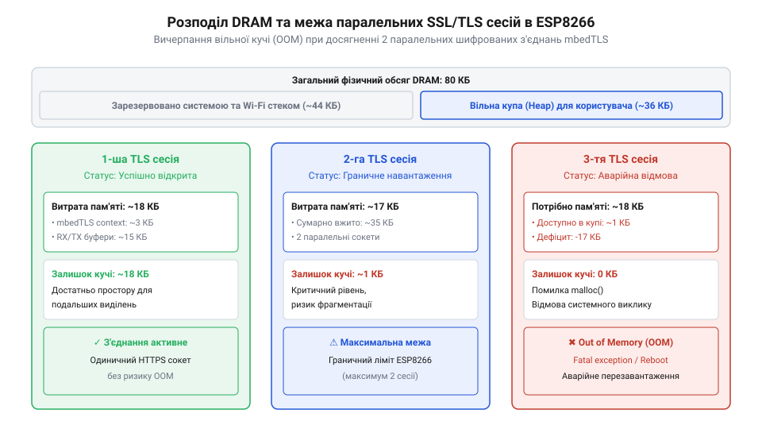
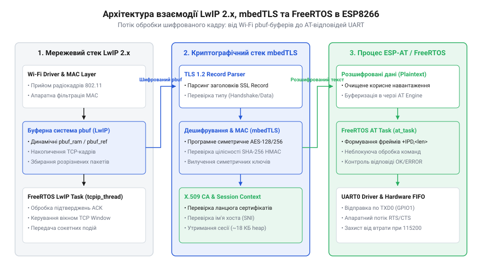
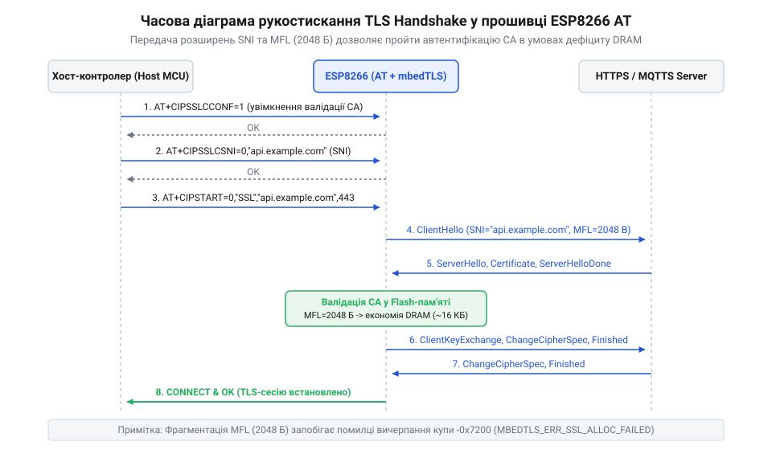

# Захищені SSL/TLS з'єднання в AT-прошивці ESP8266

<preknowlist>
- [Мережеві сокети TCP/UDP на модулі ESP-01](root:cat-hw-boards/esp01-tcp-udp-sockets) — Принципи відкриття базових незахищених сокетів TCP, обробку команд AT+CIPSTART/AT+CIPSEND та структуру мережевих буферів.
- [Оновлення прошивки ESP8266 по повітрю (FOTA)](root:cat-hw-boards/esp8266-fota-update) — Механізм двобанківської перерозмітки флеш-пам'яті та процедуру бездротового завантаження бінарних образів.
- [Огляд мікроконтролера та архітектури SoC ESP8266](root:cat-hw-boards/esp8266-soc-architecture-overview) — Організацію оперативної пам'яті DRAM, розподіл кучі та роботу системних шин мікроконтролера.
</preknowlist>

## Проблема дефіциту DRAM при шифруванні

Спроба захистити мережевий обмін на мікроконтролері `ESP8266` шляхом переходу від відкритих TCP-з'єднань до шифрованого протоколу @@en|SSL/TLS@@ зустрічає суворе апаратне обмеження пам'яті. У той час як базові [мережеві сокети TCP/UDP](root:cat-hw-boards/esp01-tcp-udp-sockets) вимагають мінімальних ресурсів, налаштування шифрованого каналу вимагає розгортання криптографічного контексту в оперативній пам'яті. Загальний обсяг @@en|DRAM@@ у [архітектурі чипа ESP8266](root:cat-hw-boards/esp8266-soc-architecture-overview) становить `80 кБ`, з яких після запуску системних служб під динамічну кучу залишається всього `36–45 кБ`.

*Діаграма розподілу оперативної пам'яті DRAM ESP8266 під час відкриття шифрованих сокетів mbedTLS, що демонструє поріг вичерпання кучі OOM при досягненні 2 паралельних сесій.*

За замовчуванням специфікація @@en|TLS@@ передбачає максимальний розмір кадру у `16 кБ`. Для прийому та передачі даних криптографічна бібліотека виділяє у кучі понад `18 кБ` суцільного простору на кожне з'єднання. Використання асиметричних ключів @@en|RSA@@ з довжиною 2048 бітів забирає ще понад `4 кБ` під збереження багаторозрядних чисел та розбір сертифікатів. Якщо відкрити більше двох паралельних захищених сесій, вільний обсяг кучі вичерпується, що викликає фатальну помилку @@en|OOM@@ (від англ. @@en|Out of Memory@@ — вичерпання пам'яті) та перезавантаження модуля.

## Архітектура стека mbedTLS і LwIP

Мережева підсистема прошивки спирається на мережевий стек @@en|LwIP@@, поверх якого надбудовується криптографічна бібліотека @@en|mbedTLS@@. Коли прикладний шар надсилає дані, вони проходять крізь два незалежні рівні буферизації. Стек @@en|LwIP@@ оперує пакетами за допомогою буферних структур @@en|pbuf@@, прагнучи використати механізм нульового копіювання @@en|zero-copy@@ для уникнення дублювання байтів у пам'яті.

*Схема взаємодії мережевих pbuf-буферів LwIP 2 та криптоконтекстів mbedTLS у внутрішній оперативній пам'яті DRAM.*

Для узгодженої роботи цих рівнів ключове значення має налаштування розміру ковзного вікна `TCP_WND`. Якщо розмір вікна залишено занадто великим, віддалений сервер заповнює вхідні мережеві буфери швидше, ніж бібліотека @@en|mbedTLS@@ встигає розшифрувати кадри, що викликає подвійні витрати кучі @@en|DRAM@@ під накопичений трафік і криптоконтекст. Обмеження `TCP_WND` примушує сервер передавати дані порціями, які відповідають виділеному криптографічному буферу, запобігаючи вичерпанню пам'яті.

## Оптимізація MFL, валідація CA та SNI

Для зменшення споживання пам'яті використовують стандартизоване розширення @@en|MFL@@ (від англ. @@en|Max Fragment Length@@ — максимальна довжина фрагмента). Воно дозволяє запропонувати серверу обмежити розмір кадрів до `2048` або `4096` байтів, скорочуючи витрати кучі на один сокет з `18 кБ` до `2–4 кБ`. Для ідентифікації домену на віртуальних хостингах застосовують розширення @@en|SNI@@ (від англ. @@en|Server Name Indication@@ — вказівка імені сервера), яке передає ім'я хоста у пакеті рукостискання.

*Послідовність передачі повідомлень рукостискання TLS із передачею параметрів SNI і MFL у пакеті ClientHello та перевіркою ланцюжка сертифікатів CA.*

Безпека з'єднання вимагає перевірки автентичності сервера за допомогою кореневих сертифікатів @@en|CA@@. Перехід від важкого криптоалгоритму @@en|RSA@@ до еліптичних кривих @@en|ECC@@ додатково заощаджує до `3 кБ` кучі за рахунок коротких 32-байтних ключів. Перед відкриттям сокета налаштування режимів автентифікації, домену @@en|SNI@@ та розміру фрагмента @@en|MFL@@ виконують за допомогою відповідних @@en|AT@@-команд.

## Буферизація UART та трафік FOTA

Передача захищеного трафіку через послідовний порт створює суттєве навантаження на систему буферизації. Під час виконання обчислень розшифрування кадру в @@en|mbedTLS@@ процесор задействований на повну потужність, через що обробка переривань послідовного порту може затримуватися, спричиняючи переповнення апаратного буфера @@en|FIFO@@ на 128 байтів. Застосування апаратного контролю потоку `RTS/CTS` синхронізує передачу на фізичному рівні: модуль деактивує лінію `RTS`, призупиняючи потік байтів від хоста.

Надійність криптографічної перевірки є критичною під час процедури [новлення прошивки ESP8266 по повітрю (FOTA)](root:cat-hw-boards/esp8266-fota-update) за протоколом @@en|HTTPS@@. Щоб уникнути накопичення бінарного образу в кучі, дешифровані блоки даних по 4 кБ відразу передаються у потоковий контекст хешування @@en|SHA256@@ «на льоту» та атомарно записуються у неактивний банк флеш-пам'яті, збереження якого контролює [архітектура завантажувача ESP8266](root:cat-hw-boards/esp8266-bootloader-architecture). Це усуває потребу в подвійній буферизації та забезпечує захист пристрою від збоїв у разі обриву зв'язку.
