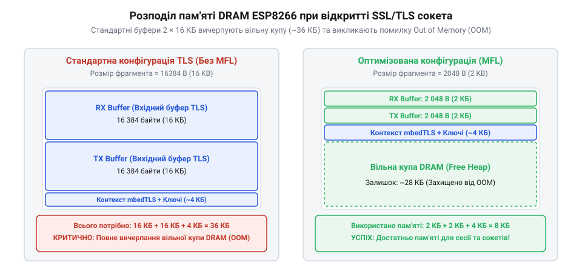

# Розрахунок бюджету оперативної пам'яті DRAM та оптимізація буферів TLS

<preknowlist>
- [ESP-01 (Wi-Fi, ESP8266)](root:cat-hw-boards/esp-01) — розуміння апаратних обмежень обсягу пам'яті модуля ESP-01
- [Мережеві сокети TCP/UDP на модулі ESP-01](root:cat-hw-boards/esp01-tcp-udp-sockets) — базові принципи роботи з сокетами та стеком TCP/IP
- [Огляд мікроконтролера та архітектури SoC ESP8266](root:cat-hw-boards/esp8266-soc-architecture-overview) — розуміння розподілу карти пам'яті DRAM та Heap в ESP8266
</preknowlist>

## Обмеження DRAM та проблема спонтанних збоїв TLS

Оперативна пам'ять @@en|DRAM@@ (англ. @@en|Dynamic RAM@@, динамічна оперативна пам'ять) у [мікроконтролері ESP8266](root:cat-hw-boards/esp8266-soc-architecture-overview) обмежена загальним фізичним обсягом 80 КБ. Після завантаження прошивки значна частина цієї пам'яті статично розподіляється на системні потреби: підсистема @@en|Wi-Fi@@ виділяє фіксовані буфери подій та черги кольбеків (англ. @@en|callback queues@@), а мережевий стек @@en|LwIP@@ (англ. @@en|Lightweight IP@@) резервує керівні блоки з'єднань @@en|TCP PCB@@ та пакети кадрових буферів @@en|PBUF@@. Виділення цих системних ресурсів відбирає близько 35–45 КБ DRAM, унаслідок чого під динамічну купу @@en|Heap@@ (англ. @@en|Heap@@, купа, від *heap* — купа) для прикладного коду та криптографічних сесій залишається лише стартовий обсяг `Heap_init` від 35 до 45 КБ вільної пам'яті.

При спробі встановити захищене з'єднання @@en|SSL/TLS@@ (англ. @@en|Secure Sockets Layer / Transport Layer Security@@) на модулях [ESP-01](root:cat-hw-boards/esp-01) стандартний протокол TLS передбачає розмір кадрового буфера даних до 16384 байтів (`16` КБ). Для повнодуплексного обміну потрібні два окремі буфери — для прийому `M_rx_buf` та передачі `M_tx_buf`. Разом із накладними витратами криптографічних контекстів фази рукостискання @@en|Handshake@@ (англ. @@en|Handshake@@, рукостискання, від *hand* — рука та *shake* — потиск) загальна потреба в пам'яті може перевищувати 40 КБ. Додатковим деструктивним чинником є фрагментація купи (англ. @@en|heap fragmentation@@), коли при багаторазовому виділенні великих кадрових буферів та дрібних мережевих пакетів загальний вільний обсяг `Heap_free` розбивається на непослідовні блоки. Коефіцієнт фрагментації `K_frag` визначається через відношення найбільшого суцільного блоку `Heap_max_block` до загального вільного обсягу: `K_frag = 1 - (Heap_max_block ÷ Heap_free)`. Якщо при загальному обсязі `Heap_free = 25` КБ (25600 байтів) найбільший суцільний блок через проміжні виділення становить лише `Heap_max_block = 10` КБ (10240 байтів), коефіцієнт фрагментації сягає `K_frag = 1 - (10240 ÷ 25600) = 0.6` (60%), що унеможливлює виділення навіть 12-кілобайтового суцільного буфера та призводить до збою з'єднання.

Коли доступний обсяг купи `Heap_free` стає меншим за сумарний криптографічний оверхед `M_tls_peak`, виклик динамічного виділення пам'яті повертає нульовий вказівник. Це викликає фатальну помилку вичерпання пам'яті @@en|OOM@@ (англ. @@en|Out of Memory@@), яка призводить до аварійного перезавантаження мікроконтролера або аварійного розриву захищеного [мережевого сокета TCP](root:cat-hw-boards/esp01-tcp-udp-sockets).

## Математична модель витрат пам'яті mbedTLS та Handshake

Загальний обсяг оперативної пам'яті `M_tls_total`, необхідний для підтримання сесії криптографічної бібліотеки @@en|mbedTLS@@, описується алгебраїчною сумою базового контексту, двох кадрових буферів та динамічного контексту криптографії:

```
M_tls_total
= M_base + M_rx_buf + M_tx_buf + M_crypto_ctx
```

Де параметри мають такі значення:
- `M_base` — базовий обсяг управляючих структур сесії @@en|mbedTLS@@ (`M_base ≈ 1.6` КБ або 1600 байтів);
- `M_rx_buf` — розмір вхідного буфера кадрів (за замовчуванням 16384 байти);
- `M_tx_buf` — розмір вихідного буфера кадрів (за замовчуванням 16384 байти);
- `M_crypto_ctx` — обсяг динамічних арифмометрів для довгої арифметики (англ. @@en|Bignum@@) під час обчислення ключів.


*Співвідношення обсягу купи DRAM, стандартних буферів TLS та зменшених буферів MFL під час фази Handshake.*

Обсяг `M_crypto_ctx` залежить від обраного криптографічного алгоритму. Для асиметричних ключів @@en|RSA@@ (англ. @@en|Rivest-Shamir-Adleman@@) довжиною 2048 біт розмір обчислювального контексту досягає 6144 байтів, тоді як для ключів RSA 4096 біт він зростає до 14336 байтів. Використання еліптичних кривих @@en|ECC@@ (англ. @@en|Elliptic Curve Cryptography@@), зокрема специфікації @@en|SECP256R1@@, зменшує витрати криптоконтексту до 2560 байтів.

Математична залежність обсягу пам'яті арифмометра @@en|Bignum@@ від розрядності модуля `N` алгоритму @@en|RSA@@ визначається довжиною байтового представлення модуля `k_bytes = N ÷ 8` та кількістю тимчасових змінних у процедурі модульного піднесення до степеня. У бібліотеці @@en|mbedTLS@@ для виконання операцій за алгоритмом Монтгомері виділяється `c_num` робочих регістрів (англ. @@en|multi-precision integer@@, далі @@en|MPI@@), де для розрядності 2048 біт коефіцієнт становить `c_num = 24`, а для 4096 біт — `c_num = 28` з урахуванням таблиць попередніх обчислень. Обчислимо залежність `M_crypto_rsa(N)` для розрядності модуля `N = 2048` біт:

```
M_crypto_rsa2048
= (N ÷ 8) × c_num         [визначення обсягу через байтову довжину та кількість MPI регістрів]
= (2048 ÷ 8) × 24         [підстановка розрядності 2048 біт та 24 регістрів]
= 256 × 24                [обчислення байтової довжини модуля]
= 6144                    [динамічний обсяг криптоконтексту у байтах]
```

Збільшення розрядності модуля до `N = 4096` біт подвоює довжину байтового слова `k_bytes = 512` байтів і розширює таблицю Монтгомері до `c_num = 28` регістрів, піднімаючи обсяг `M_crypto_rsa4096 = 512 × 28 = 14336` байтів (14 КБ), що демонструє лінійно-квадратичне зростання накладних витрат пам'яті при подвоєнні довжини ключа.

Кардинальним способом зниження витрат оперативної пам'яті є перехід від алгоритму @@en|RSA@@ до криптографії на еліптичних кривих @@en|ECC@@ (англ. @@en|Elliptic Curve Cryptography@@) зі специфікацією @@en|SECP256R1@@. Для кривої розрядністю `N_ecc = 256` біт довжина векторного слова становить `k_bytes = 256 ÷ 8 = 32` байти, а виконання точки скалярного множення у якобієвих координатах вимагає масиву з `c_ecc = 80` регістрів `MPI`. Алгебраїчний розрахунок обсягу криптоконтексту `M_crypto_ecc256` та порівняння з ключами @@en|RSA@@ визначається виразом:

```
M_crypto_ecc256
= (N_ecc ÷ 8) × c_ecc     [визначення обсягу через довжину ключа та регістри еліптичної кривої]
= (256 ÷ 8) × 80          [підстановка розрядності 256 біт та 80 регістрів MPI]
= 32 × 80                 [байтова довжина ключа SECP256R1]
= 2560                    [динамічний обсяг контексту еліптичної кривої у байтах]

Ratio_rsa2048_ecc
= M_crypto_rsa2048 ÷ M_crypto_ecc256
= 6144 ÷ 2560             [кратність скорочення криптоконтексту порівняно з RSA-2048]
= 2.4                     [економія пам'яті у 2.4 раза]
```

Зменшення обсягу обчислювального контексту з `6144` до `2560` байтів дає виграш у `3584` байти (`3.5` КБ), а порівняно з ключем RSA-4096 — у `11776` байтів (`11.5` КБ або скорочення у `5.6` раза). Це вивільняє критичний запас оперативної пам'яті кучі в [архітектурі SoC ESP8266](root:cat-hw-boards/esp8266-soc-architecture-overview), проте при збереженні стандартних 16-кілобайтових кадрових буферів загальне споживання `M_peak_ecc256 = 1600 + 16384 + 16384 + 2560 = 36928` байтів (`36.06` КБ) все одно перевищує поріг вільної кучі [модуля ESP-01](root:cat-hw-boards/esp-01), що вимагає додаткового обрізання довжини кадру.

Обчислимо пікове споживання пам'яті `M_peak_rsa2048` для стандартного з'єднання TLS із ключем RSA-2048 без оптимізації буферів:

```
M_peak_rsa2048
= M_base + M_rx_buf + M_tx_buf + M_crypto_rsa2048 [сумування всіх компонентів TLS сесії]
= 1600 + 16384 + 16384 + 6144                      [підстановка значень для RSA-2048]
= 40512                                           [сумарний обсяг в байтах]
≈ 39.56 КБ                                        [переведення в кілобайти]
```

При наявній вільній купі `Heap_free = 35` КБ потреба в 39.56 КБ гарантовано призводить до помилки @@en|OOM@@.

## Оптимізація буферів MFL та розрахунок ліміту сокетів

Для усунення збоїв вичерпання пам'яті застосовують механізм розширення @@en|MFL@@ (англ. @@en|Max Fragment Length Negotiation@@, узгодження максимальної довжини фрагмента, стандартизовано в @@en|RFC 6066@@). Він дозволяє клієнту узгодити з сервером зменшений розмір кадрового буфера `L_frag` із множини допустимих значень `{512, 1024, 2048, 4096}` байтів замість стандартних 16384 байтів.

При активації @@en|MFL@@ розмір кожного з буферів `M_rx_buf` та `M_tx_buf` обчислюється з урахуванням службового заголовка та вектора ініціалізації `L_overhead = 256` байтів:

```
M_buf_mfl
= L_frag + L_overhead                             [розрахунок розміру одного буфера з оверхедом]
```

Розрахуємо пікове споживання пам'яті `M_peak_mfl1024` при використанні `L_frag = 1024` байтів та криптографії @@en|ECC@@ (SECP256R1):

```
M_peak_mfl1024
= M_base + 2 × (L_frag + L_overhead) + M_crypto_ecc [підстановка параметрів MFL 1024 та ECC]
= 1600 + 2 × (1024 + 256) + 2560                  [обчислення виразу]
= 1600 + 2560 + 2560                              [додавання компонентів]
= 6720                                            [пікове споживання у байтах]
≈ 6.56 КБ                                         [переведення в кілобайти]
```

Зменшення пікових витрат одного з'єднання з 39.56 КБ до 6.56 КБ дозволяє розрахувати максимально допустиму кількість паралельних захищених сокетів `N_sockets_max` за наявної вільної купи `Heap_free` та резерву для системних потреб `Heap_reserve = 8` КБ (8192 байти):

```
N_sockets_max
= (Heap_free - Heap_reserve) ÷ M_peak_mfl1024    [ділення доступного обсягу купи на витрати сокета]
= (40960 - 8192) ÷ 6720                          [підстановка 40 КБ купи та 8 КБ резерву]
= 32768 ÷ 6720                                   [ділення доступної пам'яті]
≈ 4.876                                          [дробове значення]
= 4                                              [закруглення до меншого цілого]
```

Таким чином, на мікроконтролері ESP8266 з вільною купою 40 КБ використання розширення @@en|MFL@@ 1024 байти у поєднанні з криптографією @@en|ECC@@ забезпечує стабільну роботу до 4 паралельних захищених сокетів без ризику вичерпання пам'яті.

Однак агресивне зменшення розміру кадрового буфера `L_frag` до 512 байтів призводить до значного зростання частки службових оверхедів транспортного рівня (англ. @@en|Transport Layer Overhead@@). Кожен сесійний кадр огортається в заголовок протоколу @@en|TLS@@ (5 байтів), вектор ініціалізації з аутентифікаційним тегом (29 байтів), а також заголовки @@en|TCP@@ (20 байтів) та @@en|IP@@ (20 байтів), що сумарно створює фіксований службовий оверхед `L_hdr_total = 74` байти на пакет. При використанні прикладного протоколу @@en|MQTT@@ (англ. @@en|Message Queuing Telemetry Transport@@, від грец. *tele* — далеко, *metron* — вимірювати та англ. *transport* — переносити, транспорт телеметрії з чергою повідомлень) передача короткого показання датчика з корисним навантаженням 64 байти та заголовком пакета 2 байти створює загальний мережевий кадр обсягом `64 + 2 + 74 = 140` байтів. За такого співвідношення ефективна частка корисних даних `η_telemetry` становить лише `64 ÷ 140 ≈ 45.71%`, тобто понад 54% переданого трафіку припадає на накладні витрати заголовків. Навіть при повному заповненні кадру `L_frag = 512` байтів коефіцієнт пропускної здатності `η_payload` досягає лише `512 ÷ (512 + 74) = 512 ÷ 586 ≈ 87.37%`. Для порівняння, стандартний буфер `L_frag = 4096` байтів забезпечує `4096 ÷ (4096 + 74) ≈ 98.23%`, що означає втрату 10.86% ефективності каналу зв'язку на [модулях ESP-01](root:cat-hw-boards/esp-01) при переході на MFL 512 для повних кадрів та падіння ефективності нижче 50% для поодиноких телеметричних повідомлень. Розрахуємо коефіцієнт корисної пропускної здатності мережевого тунелю `η_payload` для розміру фрагмента 512 байтів:

```
η_payload
= L_frag ÷ (L_frag + L_hdr_total)              [відношення корисного навантаження до повного кадру]
= 512 ÷ (512 + 74)                            [підстановка розміру фрагмента 512B та 74B заголовків]
= 512 ÷ 586                                   [обчислення загального обсягу пакета]
≈ 0.8737                                      [частка корисних даних у трафіку]
≈ 87.37%                                      [відсотковий показник ефективності]
```

При стандартному розмірі `L_frag = 4096` байтів частка корисних даних становить `4096 ÷ (4096 + 74) ≈ 98.23%`, що означає падіння ефективності передачі даних на 10.86% при переході до 512-байтових фрагментів на [модулях ESP-01](root:cat-hw-boards/esp-01). Отримане зниження пропускної здатності вимагає передачі більшої кількості фізичних пакетів для того самого обсягу корисного навантаження, тому режим `L_frag = 512` доцільно застосовувати виключно в умовах критичного дефіциту динамічної купи для передачі коротких телеметричних повідомлень.
