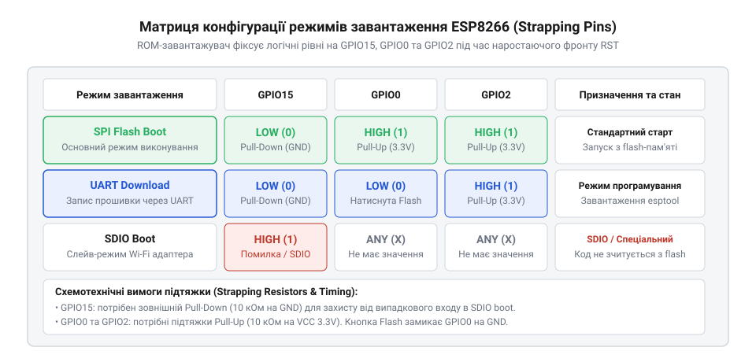
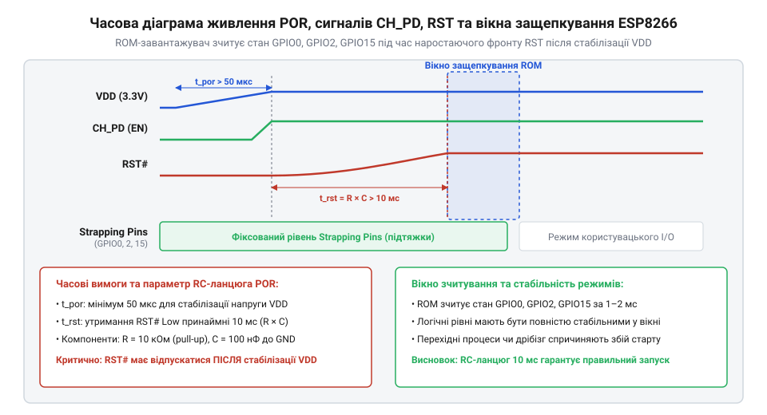

# Специфікація конфігураційних виводів, матриця режимів та часові параметри завантаження ESP8266

<preknowlist>
- [Огляд мікроконтролера та архітектури SoC ESP8266](root:cat-hw-boards/esp8266-soc-architecture-overview) — призначення системних виводів, організацію живлення та загальну структуру системної шини SoC ESP8266
- [Архітектура завантажувача та режими старту ESP8266](root:cat-hw-boards/esp8266-bootloader-architecture) — послідовність виконання первинного ROM-завантажувача та логіку вибору джерела виконання коду
</preknowlist>

## Невизначений стан виводів під час скидання

Під час подачі живлення або апаратного скидання мікроконтролера [SoC ESP8266](root:cat-hw-boards/esp8266-soc-architecture-overview) розробники нерідко стикаються з непередбачуваними перезавантаженнями, зависанням системи або відмовою старту прошивки з внутрішньої пам'яті. Причина такої поведінки полягає у функціональному подвійному призначенні трьох конфігураційних виводів (англ. @@en|strapping pins@@, від *strap* — обв'язувати, затискати; @@en|конфігураційні виводи strapping pins@@): GPIO0, GPIO2 та GPIO15. У момент виходу з режиму скидання внутрішній первинний [ROM-завантажувач](root:cat-hw-boards/esp8266-bootloader-architecture) зчитує логічні рівні на цих виводах для визначення джерела виконання коду. Якщо вхідні потенціали є плаваючими через високоімпедансний стан (англ. @@en|Hi-Z@@, від *high* — високий та *impedance* — імпеданс; @@en|високоімпедансний стан Hi-Z@@) або спотворені зовнішньою периферією, мікроконтролер переходить у помилковий режим роботи.

Апаратне скидання при включенні живлення (англ. @@en|Power-On Reset@@, @@en|POR@@) вимагає суворого фіксування напруги на лініях завантаження. Якщо до виводів GPIO0, GPIO2 чи GPIO15 підключено зовнішні давачі, світлодіоди або послідовні шини без урахування їхнього електричного стану при старті, напруга на них може опинитися у невизначеній зоні між логічним нулем та одиницею. У результаті завантажувач інтерпретує випадковий шум як команду переходу у режим програмування або завантаження з зовнішнього інтерфейсу, що блокує нормальний запуск пристрою. Щоб забезпечити стабільний старт, схемотехніка плати повинна забезпечувати жорстке защепкування логічних рівнів за допомогою зовнішніх резисторів підтяжки до моменту завершення ініціалізації первинного завантажувача. Окремою критичною ситуацією є вихід із режиму глибокого сну (англ. @@en|Deep Sleep@@, від *deep* — глибокий та *sleep* — сон; @@en|режим глибокого сну Deep Sleep@@), де за пробудження відповідає вивід GPIO16, з'єднаний із лінією скидання RST. Під час сну більшу частину систем знеструмлено, а вивід GPIO16 утримує високий рівень за рахунок живленого домену годинника реального часу (англ. @@en|Real-Time Clock@@, @@en|RTC@@); після завершення відліку таймера RTC внутрішній драйвер короткочасно примусово заземлює вивід GPIO16, формуючи низький імпульс на вході RST для ініціалізації повного апаратного перезапуску SoC. Під час цього скидання ROM-завантажувач повторно зчитує стан виводів завантаження так само, як при первинному включенні живлення. Якщо під час сну зовнішня периферія змінює імпеданс або створює витік струму, що зміщує потенціал GPIO0 до нуля або GPIO15 до одиниці, мікроконтролер після пробудження з Deep Sleep помилково завантажується у режим програмування чи SDIO замість виконання коду з флешпам'яті, що повністю блокує відновлення роботи пристрою. Тому при проектуванні схем із глибоким сном необхідно гарантувати стабільне утримання логічних рівнів на [конфігураційних виводах завантаження](root:cat-hw-boards/esp8266-boot-strapping-pins) як у робочому режимі, так і під час пасивного стану в Deep Sleep.

## Матриця логічних рівнів режимів завантаження

Вибір режиму роботи мікроконтролера визначається комбінацією логічних станів трьох конфігураційних ліній під час скидання. Таблиця істинності охоплює три основні апаратні режими: штатне виконання коду з Flash-пам'яті (SPI Flash Boot), режим оновлення прошивки по послідовному порту (UART Download) та завантаження через шину SDIO (SDIO Boot).


*Матриця логічних рівнів завантаження ESP8266 залежно від стану strapping-виводів.*

Ключовим контролером вибору системи є вивід GPIO15: якщо під час скидання на ньому утримується логічна одиниця (3.3 В), мікроконтролер незалежно від стану інших виводів переходить у режим завантаження через шину SDIO (англ. @@en|Secure Digital Input Output@@; @@en|інтерфейс SDIO@@). У режимі SDIO Boot чип виступає відомим апаратним пристроєм (англ. @@en|Secure Digital Input Output Slave@@; @@en|пристрій SDIO Slave@@) та працює як мережевий со-процесор під управлінням зовнішнього головного процесора. Внутрішній первинний завантажувач ROM ініціалізує шину SDIO на виводах `GPIO12` (лінія даних `DATA2`), `GPIO13` (`DATA3`), `GPIO14` (`CLK`) та `GPIO15` (`CMD`), очікуючи завантаження прошивки в IRAM з можливістю подальшої сигналізації переривань хосту через `GPIO4`. Для всіх інших режимів вивід GPIO15 обов'язково повинен бути підтягнутий до логічного нуля (0 В). Вивід GPIO2 відповідає за активацію діагностики та нормальний старт: під час скидання він завжди повинен перебувати у високому логічному стані (1). Лінія GPIO0 визначає безпосередній режим роботи: високий рівень (1) ініціалізує штатне виконання коду з пам'яті SPI Flash, а низький рівень (0) переводить чип у режим прошивання через UART0. Помилкова комбінація, де GPIO2 опущені в 0, блокує завантаження чипа. Орієнтуючись у цій матриці, розробники розводять плати підключення [модулів серії ESP-01](root:cat-hw-boards/esp-01) для забезпечення безперебійного [оновлення прошивки ESP-01](root:cat-hw-boards/esp01-firmware-flashing) та надійного автономного запуску.

## Електричні параметри та розрахунок підтяжки

Зчитування рівнів на виводах завантаження здійснюється вхідними буферами з тригерами Шмітта (англ. @@en|Schmitt trigger@@, від прізвища винахідника Отто Шмітта; @@en|тригер Шмітта@@), які забезпечують гістерезис для захисту від завад. Електричні характеристики входів визначаються відносно напруги живлення `V_DD = 3.3 В` (допустимий робочий діапазон від 3.0 В до 3.6 В).

Максимальна напруга логічного нуля `V_IL` становить 25% від напруги живлення:

```
V_IL = 0.25 · V_DD
= 0.25 · 3.3    [підстановка напруги живлення 3.3 В]
= 0.825         [максимальний поріг логічного нуля в вольтах]
```

Мінімальна напруга логічної одиниці `V_IH` становить 75% від напруги живлення:

```
V_IH = 0.75 · V_DD
= 0.75 · 3.3    [підстановка напруги живлення 3.3 В]
= 2.475         [мінімальний поріг логічної одиниці в вольтах]
```

Для створення стійких рівнів використовують зовнішні підтягуючі (англ. @@en|pull-up@@) та підтягувально-знижувальні (англ. @@en|pull-down@@) резистори. Вивід GPIO15 вимагає зовнішнього резистора підтяжки до землі `R_pd = 10 кОм`. При витоковому струмі входу `I_Lkg ≈ 1 мкА` падіння напруги на резисторі складає `V_R = I_Lkg · R_pd = 1 мкА · 10 кОм = 0.01 В`, що значно нижче за поріг `V_IL = 0.825 В`.

Для виводів GPIO0 та GPIO2 застосовують зовнішні підтягуючі резистори `R_pu` номіналом від `3.3 кОм` до `10 кОм` до шини 3.3 В. Вибір номіналу `4.7 кОм` забезпечує струм підтяжки близько `0.7 мА`, що гарантовано перебиває паразитивні ємності монтажу та внутрішні струми витоку, зберігаючи високий рівень `V > 3.0 В > V_IH`. На вибір оптимального номіналу зовнішнього підтягування безпосередньо впливають внутрішні слабострумові підтяжки (англ. @@en|pull-up@@) SoC ESP8266 опірністю `R_int ≈ 30–50 кОм`, які під час скидання підключені паралельно до зовнішнього резистора `R_pu`, зменшуючи результуючий опір схеми до `R_eq = (R_pu · R_int) / (R_pu + R_int)`. Особливо критичним цей розрахунок є на [модулях ESP-01](root:cat-hw-boards/esp-01), де до виводу GPIO2 послідовно підключено вбудований синій світлодіод з обмежувальним резистором номіналом `1 кОм` до шини живлення 3.3 В. Така схемотехніка утворює додаткове жорстке підтягування GPIO2 до високого рівня, через що при намаганні зовнішньо підтягнути лінію до землі для спеціальних режимів створюється дільник напруги між резистором світлодіода `R_led = 1 кОм` та зовнішнім нижнім резистором `R_pd`. Якщо обрати номінал `R_pd = 1 кОм`, напруга на виводі обчислюється як `V_GPIO2 = V_DD · R_pd / (R_led + R_pd) = 3.3 · 1 / 2 = 1.65 В`, що значно перевищує граничний поріг `V_IL = 0.825 В` і спричиняє апаратний збій старту. Для надійного встановлення логічного нуля на виводі GPIO2 з урахуванням вбудованого світлодіода та внутрішніх підтяжок `R_int` опір зовнішнього притягувача `R_pd` мусить не перевищувати `330 Ом`, що забезпечує рівень `V_GPIO2 ≈ 0.81 В < V_IL`. На [адаптерах програмування](root:cat-hw-boards/esp-01-programmer-adapters) лінії GPIO0 та RST підключають до транзисторних пар авто-скидання DTR/RTS, де розраховані підтягуючі резистори запобігають самовільному переходу в режим прошивки при зміні станів послідовного порту. Детальніше про правила підтяжки читайте в матеріалі про [конфігураційні виводи завантаження](root:cat-hw-boards/esp8266-boot-strapping-pins).

## Часові затримки скидання та керування живленням

Стабільність защепкування логічних рівнів ROM-завантажувачем залежить від часової послідовності подачі живлення та сигналів керування CH_PD (Chip Enable) і RST (Reset). Вивід CH_PD активує внутрішній регулятор напруги та тактовий генератор чипа, тому напруга на ньому мусить наростати раніше або одночасно з сигналом скидання.


*Часова діаграма живлення та защепкування логічних рівнів при апаратному скиданні POR.*

Мінімальна тривалість активного низького імпульсу скидання на лінії RST становить `t_RST = 100 мкс`. Після переходу сигналу RST у високий рівень первинний завантажувач очікує стабілізації тактового кварцового генератора протягом 1–3 мс, після чого відкривається вікно защепкування логічних рівнів тривалістю `t_latch ≈ 5 мс`. Протягом цього вікна рівні на виводах GPIO0, GPIO2 та GPIO15 повинні лишатися незмінними.

Для формування необхідної часової затримки на лінії RST застосовують зовнішній RC-ланцюг (резистор `R = 10 кОм`, конденсатор `C = 100 нФ`). Постійна часу RC-кола обчислюється як:

```
τ = R · C
= 10000 · 100 · 10⁻⁹    [підстановка 10 кОм та 100 нФ]
= 0.001                 [постійна часу в секундах, або 1 мс]
```

Час затримки наростання напруги до порогу спрацювання `V_IH = 0.75 · V_DD` визначається рівнянням:

```
t_delay = -τ · ln(1 - 0.75)
= -0.001 · ln(0.25)     [підстановка постійної часу 1 мс]
= -0.001 · (-1.386)     [обчислення натурального логарифма]
≈ 0.001386              [затримка в секундах, або 1.39 мс]
```

Затримка у 1.39 мс гарантує, що шина живлення 3.3 В встигає повністю стабілізуватися після подачі напруги, а конфігураційні виводи надійно защепковуються завантажувачем. Згідно з описом із [огляду сімейства ESP-01](root:cat-hw-boards/esp-01-module-family-overview), дотримання цих часових затримок усуває збої перезавантаження при повільному наростанні напруги джерела живлення.

Проте при повільному або нелінійному наростанні напруги живлення `V_DD` — наприклад, під час розряджання акумулятора чи при завадах джерела живлення — пасивний RC-ланцюг не здатний тривалий час утримувати сигнал скидання. Якщо напруга `V_DD` не досягає мінімальної робочої межі 3.0 В на момент переходу `RST` через поріг `V_IH`, виникає провал живлення (англ. @@en|brown-out reset@@, @@en|BOR@@; від англ. *brownout* — частковий провал напруги; @@en|коричневе вимкнення BOR@@), що спричиняє хаотичне виконання коду ROM або некоректне защепкування логічних рівнів на виводах GPIO0, GPIO2 та GPIO15. Для захисту від таких просідань напруги у схемотехніку інтегрують спеціалізований супервізор живлення (англ. @@en|supply voltage supervisor@@, від лат. *supervidere* — наглядати; @@en|супервізор живлення supervisor@@), такий як MCP130 або APX809. Цей компонент примусово утримує лінію `RST` у низькому стані до моменту, поки `V_DD` не перевищить заданий поріг (наприклад, 2.93 В), після чого витримує додаткову фіксовану затримку в межах 140–200 мс, що гарантує надійний старт згідно з [архітектурними вимогами завантаження](root:cat-hw-boards/esp8266-bootloader-architecture).

Проте при повільному або нелінійному наростанні напруги живлення `V_DD` — наприклад, під час розряджання акумулятора чи пульсаціях джерела живлення — пасивне RC-коло не здатне тривалий час утримувати сигнал скидання. Якщо напруга `V_DD` не досягає мінімальної робочої межі 3.0 В на момент переходу `RST` через поріг `V_IH`, настає коричневе вимкнення (англ. @@en|brown-out reset@@, @@en|BOR@@; від англ. *brownout* — частковий провал напруги), що спричиняє хаотичне виконання коду ROM або некоректне защепкування логічних рівнів на виводах GPIO0, GPIO2 та GPIO15. Для захисту від таких просідань напруги у схемотехніку інтегрують спеціалізований супервізор живлення (англ. @@en|supply voltage supervisor@@, від лат. *supervidere* — наглядати), такий як MCP130 або APX809. Цей компонент примусово утримує лінію `RST` у низькому стані до моменту, поки `V_DD` не перевищить заданий поріг (наприклад, 2.93 В), після чого витримує додаткову фіксовану затримку в межах 140–200 мс, що гарантує надійний старт згідно з [архітектурними вимогами завантаження](root:cat-hw-boards/esp8266-bootloader-architecture).
