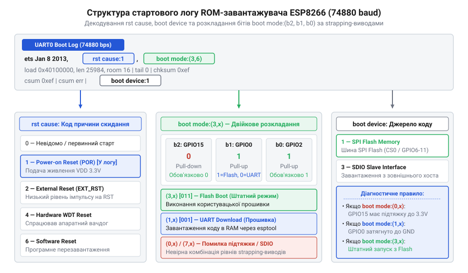
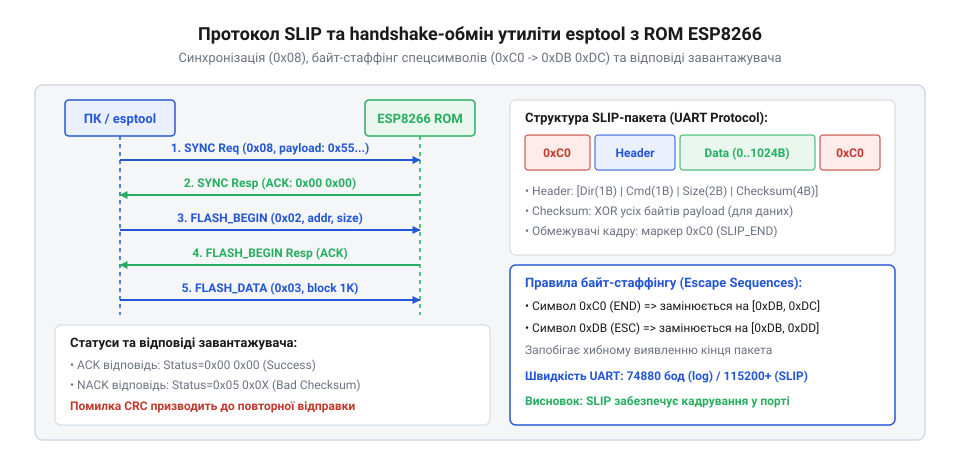

# Довідник системних логів та протоколу зв'язку ROM-завантажувача ESP8266

<preknowlist>
- [Конфігураційні виводи завантаження ESP8266](root:cat-hw-boards/esp8266-boot-strapping-pins) — логічні рівні виводів GPIO0, GPIO2 та GPIO15 для вибору режимів старту мікроконтролера
- [Архітектура завантажувача та режими старту ESP8266](root:cat-hw-boards/esp8266-bootloader-architecture) — поетапний процес завантаження ROM-коду та перехід до виконання основного образу прошивки
</preknowlist>

## Нечитабельні символи послідовного порту після скидання

Під час подачі живлення або апаратного скидання мікроконтролера `ESP8266` розробники часто спостерігають появу хаотичного набору нечитабельних символів у моніторі послідовного порту. Ця ситуація виникає тоді, коли термінальна програма на комп'ютері налаштована на стандартні швидкості обміну `115200` або `9600` бод, у той час як вбудований первинний завантажувач у постійному запам'ятовувальному пристрої (англ. @@en|ROM@@, від @@en|Read-Only Memory@@ — постійний запам'ятовувальний пристрій) передає свій стартовий діагностичний лог на специфічній апаратній швидкості `74880` бод.

Фізична причина появи цієї нестандартної швидкості полягає в особливій тактовій частоті опорного кварцового резонатора (англ. @@en|Crystal Oscillator@@) чипа, яка становить `26 МГц`. Апаратний дільник частоти послідовного інтерфейсу @@en|UART0@@ (англ. @@en|Universal Asynchronous Receiver-Transmitter@@) у фірмовому коді завантажувача ROM розрахований на базову частоту тактування `40 МГц`. Коли кристал працює на частоті `26 МГц`, реальна швидкість передачі бітів пропорційно зміщується:

```text
74880 бод = 115200 бод × (26 МГц / 40 МГц)
```

Оскільки швидкість `74880` бод відрізняється від стандартних `115200` бод майже на `35%`, приймач @@en|UART@@ персонального комп'ютера не може правильно розпізнати межі бітових інтервалів і відображає вхідні байти як хаотичні символи. Проте якщо на платі встановлено кварцовий резонатор із частотою `40 МГц` замість стандартного `26 МГц`, коефіцієнт апаратного дільника завантажувача ROM точно відповідає базовому і виведення стартового логу відбувається на стандартній швидкості `115200` бод без будь-якого зсуву. Після завершення роботи завантажувача ROM та переходу до основного образу прошивки системний кристаловий помножувач @@en|PLL@@ (від англ. @@en|Phase-Locked Loop@@ — фазове автопідлаштування частоти) переконфігуровує частоту шини під обрану швидкість обміну. Якщо ж лінії порту @@en|UART0@@ виявляються зайняті зовнішньою периферією, первинні діагностичні повідомлення завантажувача можна перенаправити на вивід `GPIO2` додаткового інтерфейсу @@en|UART1@@ (англ. @@en|Universal Asynchronous Receiver-Transmitter 1@@; @@en|послідовний порт UART1@@), забезпечуючи відображення системного стану пристрою на платах [ESP-01](root:cat-hw-boards/esp-01). Щоб прочитати початковий лог завантаження при опорній частоті `26 МГц`, термінал переключають саме на швидкість `74880` бод, що дає змогу повністю контролювати апаратний запуск модуля.

## Структура логу завантаження та коди скидання

Після перемикання швидкості послідовного порту на `74880` бод у терміналі з'являється чітко структурований текстовий лог завантаження. Вивчення цього повідомлення дозволяє точно визначити причину останнього перезавантаження та апаратну конфігурацію сигнальних ліній пристрою.


*Структурна схема стартового логу ROM-завантажувача із зазначенням позицій rst cause, boot mode та boot device.*

Типове стартове повідомлення завантажувача має наступний вигляд:

```text
ets Jan  8 2013,rst cause:1, boot mode:(3,6)
```

Перше критичне поле — це код причини скидання `rst cause` (від англ. @@en|reset cause@@ — причина скидання), який повертає числовий ідентифікатор події:

- `rst cause:1` — нормальний холодний старт при подачі живлення @@en|Power-On Reset@@ (англ. @@en|Power-On Reset@@ — скидання при подачі живлення).
- `rst cause:2` — зовнішнє апаратне скидання через імпульс низького рівня на виводі `RST` (від англ. @@en|Reset pin@@).
- `rst cause:4` — аварійне перезавантаження від програмного сторожового таймера @@en|Watchdog Reset@@ (від англ. @@en|Watchdog Reset@@ — скидання сторожовим таймером), коли ядро заблоковане тривалими обчисленнями.
- `rst cause:5` — перезавантаження від апаратного сторожового таймера, викликане критичним просіданням напруги живлення або падінням системного стека.

Друге важливе поле — статус завантаження `boot mode:(b2, b1)` (від англ. @@en|boot mode@@ — режим завантаження), де у дужках передаються два номери. Перша цифра у дужках `b2` відображає десяткове значення 3-бітового числа, зчитаного завантажувачем ROM з [конфігураційних виводів завантаження](root:cat-hw-boards/esp8266-boot-strapping-pins) у момент зняття сигналу скидання. Три біти відповідають логічним рівням на виводах `GPIO15`, `GPIO0` та `GPIO2`:

- `boot mode:(3,x)` — у двійковому коді `011` (`GPIO15=0`, `GPIO0=1`, `GPIO2=1`), що відповідає штатному режиму запуску прошивки з зовнішньої пам'яті `SPI Flash`.
- `boot mode:(1,x)` — у двійковому коді `001` (`GPIO15=0`, `GPIO0=0`, `GPIO2=1`), що означає перехід у режим завантаження прошивки через послідовний порт @@en|UART Download@@.
- `boot mode:(7,x)` — у двійковому коді `111` (`GPIO15=1`, `GPIO0=1`, `GPIO2=1`), що означає спробу завантаження через SDIO-інтерфейс (невизначений стан для автономних модулів).

Значення другого параметра `b1` у дужках логу `boot mode:(b2, b1)` розшифровує апаратну конфігурацію зв'язку з зовнішньою мікросхемою пам'яті @@en|SPI Flash@@, де перші байти заголовка образу визначають режим читання та тактову частоту шини. Цифра `b1` відображає обрану схему передачі адреси й даних: значення `0` відповідає режиму чотирибітового обміну @@en|QIO@@ (англ. @@en|Quad I/O@@), значення `1` — режиму @@en|QOUT@@ (англ. @@en|Quad Output@@), `2` означає двобітовий режим @@en|DIO@@ (англ. @@en|Dual I/O@@), а `3` відповідає режиму @@en|DOUT@@ (англ. @@en|Dual Output@@). Якщо під час прошивання обрано режим `QIO` для компактних платок, у яких виводи `SD2` та `SD3` мікросхеми Flash не розведені або використані під інші потреби, ROM-завантажувач зчитає помилковий статус `b1`, що призведе до збою завантаження коду `flash read err` на [модулях серії ESP-01S](root:cat-hw-boards/esp-01s).

## SLIP-протокол синхронізації режиму UART Download

Коли поле `boot mode` показує режим `(1,x)`, завантажувач ROM зупиняє виконання коду з пам'яті @@en|Flash@@ і переходить в очікування команд прошивання через послідовний порт @@en|UART0@@. Взаємодія між комп'ютерною утилітою @@en|esptool@@ та мікроконтролером здійснюється за допомогою кадрованого протоколу @@en|SLIP@@ (від англ. @@en|Serial Line Internet Protocol@@ — міжмережевий протокол для послідовних ліній).


*Схема послідовності обміну SLIP-пакетами між ПК та ROM-завантажувачем під час синхронізації та передачі команд запису во флешпам'ять.*

Протокол @@en|SLIP@@ обрамляє кожен двонаправлений кадр спеціальними байтами-роздільниками `0xC0` на початку та в кінці пакета. Якщо у тілі кадру трапляється сам байт `0xC0`, він замінюється на ескейп-послідовність `0xDB 0xDC`, а байт `0xDB` замінюється на `0xDB 0xDD`.

Кожен пакет містить 8-байтний заголовок команди, що має таку структуру:

- `Direction` (1 байт) — напрямок пакета: `0x00` для запиту від ПК, `0x01` для відповіді завантажувача.
- `Command Code` (1 байт) — код інструкції (наприклад, `0x08` — синхронізація, `0x02` — початок запису у Flash, `0x03` — передача блоку даних).
- `Size` (2 байти) — довжина корисного навантаження кадру.
- `Checksum` (4 байти) — контрольна сума обчислюється як побайтове виключне АБО (@@en|XOR@@) для всіх байтів даних.

Процедура [оновлення прошивки та прошивання ESP-01](root:cat-hw-boards/esp01-firmware-flashing) починається з серії команд синхронізації `0x08`. Утиліта @@en|esptool@@ надсилає понад 36 однакових кадрів з байтами `0x07 0x07 0x12 0x20...`. Завантажувач ROM, підлаштовуючи свій генератор під швидкість ПК, повертає підтвердження `0x00`, після чого сторони узгоджують підвищену швидкість обміну (наприклад, `921600` бод) і переходять до стирання та запису секторів пам'яті блоками по 4 КБ. Для прискорення обміну та обходу обмежень вбудованого ROM-коду утиліта @@en|esptool@@ попередньо завантажує у динамічну пам'ять мікроконтролера компактну програмну заглушку @@en|RAM stub@@ (англ. @@en|RAM stub@@, від *stub* — заглушка; @@en|заглушка в оперативній пам'яті RAM stub@@), яка перебирає на себе керування шиною SPI та драйверами прямого запису. Після завершення прошивання секторів RAM stub виконує апаратне зчитування записаних даних із Flash-пам'яті та обчислює 128-бітний криптографічний хеш @@en|MD5@@ (англ. @@en|MD5@@, від *Message Digest 5* — дайджест повідомлень 5; @@en|алгоритм хешування MD5@@). Отриманий контрольний відбиток надсилається утиліті по протоколу SLIP і порівнюється з MD5-хешем локального бінарного файла на комп'ютері: це дозволяє миттєво підтвердити цілісність запису кожної секції прошивки без повільного побайтового вичитування всього обсягу пам'яті через UART.

## Діагностика збоїв за первинним логом завантажувача

Аналіз стартового логу на швидкості `74880` бод є основним інструментом діагностики апаратних несправностей та некоректних режимів роботи [мікроконтролера ESP8266](root:cat-hw-boards/esp8266-soc-architecture-overview).

Найчастіші патерни апаратних збоїв та методи їх усунення:

Окремою категорією апаратних збоїв є помилки контрольної суми @@en|csum err@@ або @@en|csum mismatch@@, які виникають під час ініціалізації виконання сегментів @@en|irom0_text@@ з [архітектури завантажувача ESP8266](root:cat-hw-boards/esp8266-bootloader-architecture). Коли вторинний завантажувач зчитує виконуваний код програми, що відображається крізь апаратний кеш інструкцій @@en|ICACHE@@ (англ. @@en|ICACHE@@, від *instruction cache* — кеш інструкцій; @@en|кеш інструкцій ICACHE@@), він обчислює побайтову суму контрольного блоку та порівнює її з байтом, закладеним у заголовку образу прошивки. Невідповідність значень @@en|csum mismatch@@ вказує на викривлення бітів під час зчитування по шині SPI через наведення завад, просідання живлення, некоректно вибраний режим роботи флешпам'яті (наприклад, вибір швидкісного режиму @@en|QIO@@ замість підтримуваного @@en|DIO@@) або пошкодження образу при перерваному записі. Для усунення цієї відмови виконують [оновлення прошивки та прошивання ESP-01](root:cat-hw-boards/esp01-firmware-flashing) із примусовим зниженням частоти шини до 40 МГц, переведенням інтерфейсу в режим @@en|DIO@@ та попереднім повним стиранням секторів Flash.

1. **Постійне циклювання `rst cause:4` або `rst cause:2` з некоректним `boot mode:(7,6)`.**
   Свідчить про відсутність підтяжки на лінії `GPIO15` до землі (`GND`). Оскільки під час старту `GPIO15` виявляється підтягнутим до високого рівня через внутрішній шум, мікроконтролер намагається завантажитися з неіснуючого SDIO-інтерфейсу, завершується помилкою та перезавантажується сторожовим таймером. Опис правильного підключення наведено у специфікаціях [конфігураційних виводів завантаження](root:cat-hw-boards/esp8266-boot-strapping-pins).

2. **Зависання у режимі `boot mode:(1,6)` без реагування на утиліту esptool.**
   Вказує на те, що лінія `GPIO0` примусово затягнута до землі, але лінія `RXD0` має обрив або замкнена на сусідній провідник. Завантажувач очікує синхронізацію `SLIP`, але не отримує байтів від адаптера [esp-01-programmer-adapters](root:cat-hw-boards/esp-01-programmer-adapters).

3. **Лог повідомляє `flash read err, cause:1` або `flash read err, cause:2`.**
   Означає, що мікроконтролер правильно зчитав режим `boot mode:(3,6)`, але первинний завантажувач ROM не може зчитати заголовок образу з зовнішньої пам'яті `SPI Flash`. Причиною є погане живлення (просідання напруги 3.3 В нижче критичної межі `2.7 В` під час пікового струму), пошкодження файлу прошивки або несправність самої мікросхеми Flash.

4. **Лог `rst cause:5` з нескінченним перезавантаженням.**
   Вказує на сильні пульсації джерела живлення в момент включення високочастотного Wi-Fi блок-передавача, що детально описує [архітектура завантажувача ESP8266](root:cat-hw-boards/esp8266-bootloader-architecture). Установка керамічного конденсатора ємністю `0.1 мкФ` та електролітичного ємністю `10–100 мкФ` безпосередньо біля виводів живлення модуля вирішує цю проблему.

Правильна інтерпретація статусних рядків дозволяє миттєво локалізувати схемотехнічні помилки та забезпечити стабільний старт пристрою.
