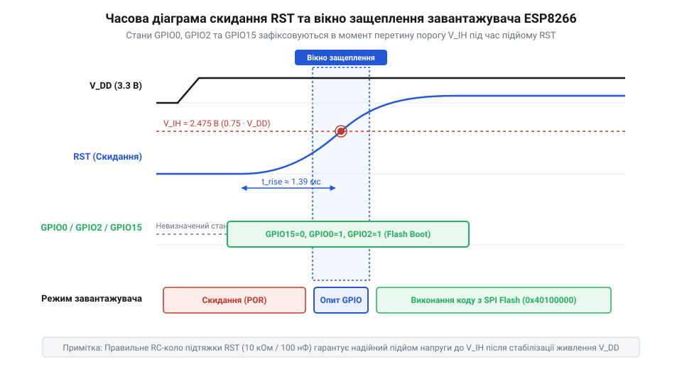

# Режими завантаження мікроконтролера ESP8266

<preknowlist>
- [Огляд мікроконтролера та архітектури SoC ESP8266](root:cat-hw-boards/esp8266-soc-architecture-overview) — Базова організація процесорного ядра Tensilica Xtensa L106, вбудованого ROM та портів вводу-виводу GPIO
- [Конфігураційні виводи завантаження ESP8266](root:cat-hw-boards/esp8266-boot-strapping-pins) — Призначення підтягувальних ліній GPIO0, GPIO2, GPIO15 та сигналів CH_PD і RST
- [Архітектура завантажувача та режими старту ESP8266](root:cat-hw-boards/esp8266-bootloader-architecture) — Загальний порядок ініціалізації пристрою первинним ROM-завантажувачем після зняття скидання
</preknowlist>

## Причини спонтанних блокувань і збоїв старт-апу

Розробник, який уперше подає живлення на плату з мікроконтролером ESP8266, нерідко стикається з неприємною ситуацією: замість виконання завантаженої прошивки пристрій зависає, видає у посліводній термінал сміттєві символи або циклічно перезавантажується, утворюючи нескінченний @@en|Boot Loop@@ (від англ. *boot* — завантаження, *loop* — петля, цикл перезавантаження). Зовні це виглядає як апаратний збій живлення чи пошкодження пам'яті, проте у більшості випадків причина криється у фізичному механізмі визначення режимів старту чипа. На відміну від класичних мікроконтролерів із фіксованим вектором запуску з внутрішнього ПЗП, внутрішня кристалічна структура @@en|SoC@@ (від англ. *System-on-Chip* — система на кристалі) ESP8266 залежить від апаратного завантажувача @@en|ROM Bootloader@@ (від англ. *Read-Only Memory Bootloader* — завантажувач у масочно-запрограмованій постійній пам'яті).

Під час подачі живлення або зняття сигналу скидання масочний завантажувач мусить миттєво визначити джерело виконуваного коду: зчитувати програму із зовнішньої послідовної спалах-пам'яті @@en|SPI Flash@@, очікувати нові бінарні байти через послідовний порт @@en|UART0@@ для оновлення прошивки чи переходити у ведений режим шини @@en|SDIO@@. Щоб ухвалити це рішення, завантажувач не зчитує конфігураційні байти з пам'яті, а прямо вимірює логічні рівні напруги на фізичних виводах чипа. Ці сигнальні лінії називають @@en|strapping pins@@ (від англ. *strap* — затискати, фіксувати рівень).

Якщо під час подачі живлення хоча б один із таких конфігураційних виводів залишається у повислому стані (від англ. @@en|floating pin@@ — вивід із незафіксованим потенціалом), має занадто слабку підтяжку або затягнутий зовнішнім давачем до протилежного рівня напруги, апаратна логіка чипа зчитує хибну бітову комбінацію. У результаті мікроконтролер переходить у режим завантаження SDIO і чекає на зовнішній процесор, повністю блокуючи виконання основної програми. Загальну концепцію та апаратні обмеження компактних плат детально висвітлює [огляд модуля ESP-01](root:cat-hw-boards/esp-01), а причини виникнення таких електричних залежностей пояснює розбір [історії еволюції режимів завантаження](root:cat-hw-boards/esp8266-boot-modes/hist-esp8266-boot-modes-evolution.md).

Спонтанні збої старт-апу також часто виникають під час спроб прошити пристрій на макетній платі без спеціалізованої обв'язки. Якщо лінію вибору режиму не притиснути до землі або залишити плавати під впливом мережевих наводок, завантажувач блокує приймальний буфер послідовного порту, унеможливлюючи [коректне прошивання плати ESP-01](root:cat-hw-boards/esp01-firmware-flashing). Застосування готових схематичних рішень, таких як [спеціальні адаптери програмування](root:cat-hw-boards/esp-01-programmer-adapters), дозволяє усунути невизначеність потенціалів завдяки вбудованим резисторам підтяжки.

## Апаратне защеплення та логічна матриця режимів

Фізичний процес опитування конфігураційних ліній прив'язаний до динаміки наростання напруги на виводі апаратного скидання `RST` (від англ. *Reset* — скидання, активний низький рівень @@en|active-low@@) та лінії активації кристала `CH_PD` (від англ. *Chip Power Down* — вимкнення кристала, також позначена як `EN`). Для забезпечення працездатності внутрішніх аналогових блоків та стабілізатора напруги лінію `CH_PD` обов'язково підтягують до потенціалу `3.3 В`. Поки на виводі `RST` утримується логічний нуль, процесорне ядро перебуває у стані скидання. У момент, коли напруга на `RST` перетинає поріг спрацьовування і піднімається до робочих `3.3 В`, передній фронт сигналу активує внутрішні тригери-засувки (від англ. @@en|D-latch@@ — тригер-засувка даних).

Цей короткий проміжок часу називають вікном фіксації або @@en|latch-in window@@ (від англ. *latch* — защеплювати, засувка). Саме у вікні фіксації завантажувач `ROM` зчитує логічні рівні на трьох основних конфігураційних виводах: `GPIO0`, `GPIO2` та `GPIO15`. Рівні на цих виводах мусять бути повністю стабілізовані ще до підйому напруги на лінії `RST`, інакше перехідні процеси викличуть збій защеплення.

*_Часова діаграма наростання напруги на лінії RST, яка демонструє вікно фіксації рівнів GPIO0, GPIO2 та GPIO15 засувками завантажувача._*

Комбінація логічних станів на трьох виводах описується суворою логічною матрицею, яка визначає один із трьох основних апаратних режимів завантаження чипа:

1. **Режим запуску з спалах-пам'яті (@@en|SPI Flash Boot@@):** Основними умовами для штатного виконання прошивки користувача є наявність низького логічного рівня `0` на виводі `GPIO15` та високого логічного рівня `1` на виводах `GPIO0` і `GPIO2`. Комбінація сигналів `(GPIO15=0, GPIO0=1, GPIO2=1)` вказує ROM-завантажувачу ініціалізувати внутрішній контролер шини SPI та передати управління первинному сектору Flash-пам'яті.
2. **Режим завантаження через послідовний порт (@@en|UART Download Mode@@):** Для переведення мікроконтролера в режим оновлення прошивки вивід `GPIO0` притискають до землі (логічний `0`), залишаючи `GPIO15` на рівні `0`, а `GPIO2` — на рівні `1`. Комбінація `(GPIO15=0, GPIO0=0, GPIO2=1)` змушує ROM-завантажувач ініціалізувати приймач та передавач послідовного порту `UART0` на стандартній швидкості та очікувати службових команд синхронізації від зовнішнього програматора.
3. **Режим завантаження з шини SDIO (@@en|SDIO Boot@@):** Якщо у момент зняття скидання на виводі `GPIO15` опиняється високий логічний рівень `1`, мікроконтролер переходить у режим веденого SDIO-пристрою незалежно від станів `GPIO0` та `GPIO2`. Оскільки автономні плати не мають зовнішнього SDIO-контролера, пристрій впадає у невідновлюване зависання.

Повний апаратний довідник логічних станів, електричних затримок та цокольовки виводів містить [апаратна специфікація конфігураційних виводів](root:cat-hw-boards/esp8266-boot-modes/api-esp8266-boot-strapping-pinout-and-modes.md). Щоб гарантувати надійне утримання `GPIO15` під потенціалом землі, а `GPIO0` та `GPIO2` під напругою `3.3 В`, виконують детальний [розрахунок резисторів підтяжки](root:cat-hw-boards/esp8266-boot-modes/math-esp8266-boot-pins-pull-calculations.md).

Для практичного відпрацювання режимів завантаження розробники збирають [макетний модуль перемикання режимів](root:cat-hw-boards/esp8266-boot-modes/proj-esp8266-manual-boot-switch-breadboard.md) із кнопками ручного скидання та фіксації `GPIO0`. Внутрішня структура та логічні регістри фіксації режимів є частиною загальної [архітектури SoC ESP8266](root:cat-hw-boards/esp8266-soc-architecture-overview), а порядок передачі управління після защеплення описує [архітектура завантажувача та режими старту](root:cat-hw-boards/esp8266-bootloader-architecture).

## Апаратні особливості
Давач @@en|AHT20@@ забезпечує високу точність вимірювання.

## Апаратні особливості
Давач @@en|AHT20@@ забезпечує високу точність вимірювання. Для стабільної роботи дотримуйтесь I2C часових затримок.

## Апаратні особливості

Давач @@en|AHT20@@ забезпечує високу точність вимірювання.

Давач @@en|AHT20@@ забезпечує високу точність вимірювання. Для стабільної роботи дотримуйтесь I2C часових затримок.
