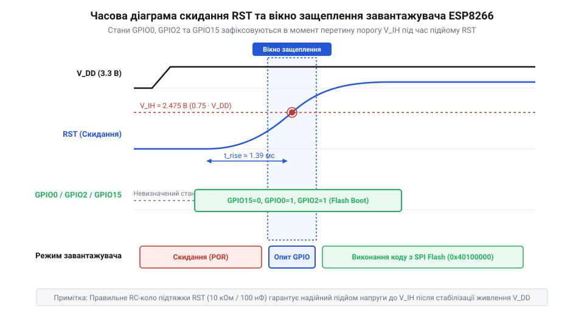

# Режими завантаження мікроконтролера ESP8266

<preknowlist>
- [Огляд мікроконтролера та архітектури SoC ESP8266](root:cat-hw-boards/esp8266-soc-architecture-overview) — Базова організація процесорного ядра Tensilica Xtensa L106, вбудованого ROM та портів вводу-виводу GPIO
- [Конфігураційні виводи завантаження ESP8266](root:cat-hw-boards/esp8266-boot-strapping-pins) — Призначення підтягувальних ліній GPIO0, GPIO2, GPIO15 та сигналів CH_PD і RST
- [Архітектура завантажувача та режими старту ESP8266](root:cat-hw-boards/esp8266-bootloader-architecture) — Загальний порядок ініціалізації пристрою первинним ROM-завантажувачем після зняття скидання
</preknowlist>

## Причини спонтанних блокувань і збоїв старт-апу

Під час першої подачі живлення на плату з мікроконтролером `ESP8266` розробники часто спостерігають аварійне зависання пристрою, вивід хаотичного набору символів у послідовний термінал або нескінченний цикл перезавантаження @@en|Boot Loop@@ (від англ. *boot* — завантаження, *loop* — петля). Причина цього полягає у фізичному механізмі вибору режиму старту чипа. На відміну від класичних мікроконтролерів із фіксованим вектором запуску коду з внутрішнього ПЗП, кристал @@en|SoC@@ (від англ. *System-on-Chip* — система на кристалі) `ESP8266` керується масочним завантажувачем @@en|ROM Bootloader@@ (від англ. *Read-Only Memory Bootloader* — постійний завантажувач).

У момент подачі живлення або зняття сигналу скидання первинний завантажувач вимірює логічні рівні напруги на фізичних виводах чипа, які називають @@en|strapping pins@@ (від англ. *strap* — затискати, фіксувати рівень). Якщо хоча б один конфігураційний вивід перебуває у висячому стані @@en|floating pin@@ (від англ. *floating* — плаваючий потенціал) або затягнутий зовнішнім периферійним пристроєм до протилежної напруги, завантажувач зчитує хибну бітову комбінацію. У результаті мікроконтролер переходить у незадіяний режим завантаження @@en|SDIO Boot@@ чи блокує послідовний порт. Для усунення невизначеності напруги на виводах під час [запису нової прошивки](root:cat-hw-boards/esp01-firmware-flashing) застосовують [зовнішні плати програматорів](root:cat-hw-boards/esp-01-programmer-adapters) із вбудованими резисторами підтяжки.

Спонтанні блокування старт-апу також виникають під час збирання схем на компактних платах серії [ESP-01](root:cat-hw-boards/esp-01), де конфігураційні виводи одночасно виконують роль інтерфейсних ліній вводу-виводу для давачів та виконавчих пристроїв. Якщо підключена периферія притягує лінію `GPIO0` до землі чи шунтує `GPIO15` до живлення під час увімкнення, завантажувач ухвалює хибне рішення і не передає управління основній програмі. Особливості схематики різних модифікацій розкриває [огляд сімейства планок](root:cat-hw-boards/esp-01-module-family-overview), де наявність або відсутність вбудованих резисторів підтяжки прямо визначає поведінку виводів при старті.

## Апаратне защеплення та логічна матриця режимів

Фізичний процес опитування конфігураційних ліній прив'язаний до наростання напруги на виводі апаратного скидання `RST` (від англ. *Reset* — скидання) за умови підтяжки лінії активації кристала `CH_PD` (від англ. *Chip Power Down* — вимкнення кристала) до напруги `3.3 В`. Коли напруга на `RST` піднімається до робочого рівня, передній фронт сигналу відкриває коротке вікно защеплення @@en|latch-in window@@ (від англ. *latch* — тригер-засувка). У цьому часовому вікні завантажувач фіксує логічні рівні на виводах `GPIO0`, `GPIO2` та `GPIO15`.

*_Часова діаграма защеплення логічних рівнів завантажувача під час підйому сигналу на лінії RST та вимог до CH_PD._*

Зчитана комбінація сигналів визначає один із трьох основних режимів завантаження мікроконтролера:

1. **Запуск із спалах-пам'яті (@@en|SPI Flash Boot@@):** Для виконання основної прошивки вивід `GPIO15` утримується під потенціалом землі (`0`), а `GPIO0` та `GPIO2` підтягнуті до `3.3 В` (`1`). Отримавши код `(0, 1, 1)`, завантажувач передає управління зовнішній пам'яті `SPI Flash`.
2. **Завантаження через послідовний порт (@@en|UART Download Mode@@):** Притискання `GPIO0` до землі (`0`) при `GPIO15=0` та `GPIO2=1` формує комбінацію `(0, 0, 1)`. Завантажувач переходить у стан очікування команд оновлення прошивки через послідовний порт `UART0`.
3. **Завантаження з шини SDIO (@@en|SDIO Boot@@):** Поява високого рівня `1` на виводі `GPIO15` переводить чип у режим веденого пристрою SDIO незалежно від інших виводів, що призводить до зависання пристрою.

Детальні електричні рівні описують [сигнальні виводи чипа](root:cat-hw-boards/esp8266-boot-strapping-pins), а загальний порядок роботи масочного коду визначає [первинний завантажувач ROM](root:cat-hw-boards/esp8266-bootloader-architecture).
