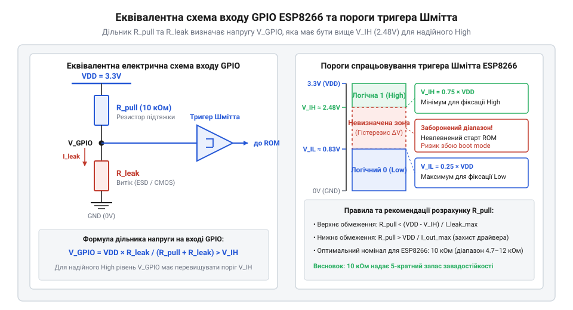
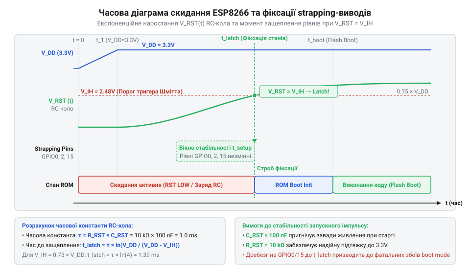

# Математичний розрахунок опорів підтяжки та RC-затримок завантажувальних виводів ESP8266

<preknowlist>
- [Огляд мікроконтролера та архітектури SoC ESP8266](root:cat-hw-boards/esp8266-soc-architecture-overview) — вхідні електричні параметри та будова тригерів Шмітта GPIO
- [ESP-01 (Wi-Fi, ESP8266)](root:cat-hw-boards/esp-01) — схемотехніка розводки виводів та обмеження виводів GPIO
- [Конфігураційні виводи завантаження ESP8266](root:cat-hw-boards/esp8266-boot-strapping-pins) — логіка станів виводів GPIO15, GPIO0 та GPIO2 під час старту
</preknowlist>

## Проблема ненадійного старту ESP8266

Під час подачі живлення або апаратного скидання мікроконтролер ESP8266 опитує стан трьох конфігураційних ліній: `GPIO0`, `GPIO2` та `GPIO15`. Залежно від зчитаної комбінації логічних рівнів внутрішній завантажувач обирає режим запуску системи — виконання програми із зовнішньої флеш-пам'яті, режим прошивання через послідовний порт або режим завантаження через шину SDIO. Якщо потенціали на цих виводах під час включення знаходяться в невизначеному стані або зазнають впливу високочастотних імпульсних наведень, мікроконтролер довільно змінює вектор старту, що призводить до спонтанних зависань пристрою. Ключовим фактором чутливості до наведень є власна паразитна ємність вхідних буферів `GPIO` (англ. @@en|parasitic capacitance@@, від грецького *parasitos* — нахлібник та латинського *capacitas* — місткість; @@en|паразитна ємність parasitic capacitance@@) величиною 5–10 пФ, яка разом із ємністю друкованого монтажу утворює ємнісний дільник із сусідніми сигнальними трасами. Через ємнісний зв'язок (англ. @@en|capacitive coupling@@; @@en|ємнісний зв'язок capacitive coupling@@) високочастотні перехідні процеси з амплітудою `V_n` на сусідній трасі викликають стрибки потенціалу. Амплітуда наведеної напруги `V_ind` обчислюється з відношення паразитної ємності зв'язку між трасами `C_c` та сумарної вхідної ємності лінії `C_in` відносно амплітуди завади `V_n`:

    V_ind
    = V_n · C_c ÷ (C_c + C_in)      [формула ємнісного дільника напруги]
    = 3.3 · 2 ÷ (2 + 8)             [підстановка параметрів C_c = 2 пФ, C_in = 8 пФ, V_n = 3.3 В]
    = 0.66 В                        [розрахунок наведеної імпульсної напруги]

З отриманого співвідношення видно, що навіть незначна ємність зв'язку `C_c = 2 пФ` створює наведений імпульс `V_ind = 0.66 В`, а високий імпеданс непідтягнутого входу перешкоджає швидкому розряджанню накопиченого заряду, змушуючи потенціал хаотично перетинати пороги спрацьовування саме в момент опитування завантажувачем.

Фізична причина нестабільності полягає в будові вхідних буферів вводу-виводу. Кожен сигнальний вивід мікроконтролера оснащений тригером Шмітта (англ. @@en|Schmitt trigger@@, від прізвища винахідника *Schmitt* — Шмітт та *trigger* — заскочка, тригер; @@en|тригер Шмітта Schmitt trigger@@), який має чіткі пороги спрацьовування. При напрузі живлення `V_DD = 3.3 В` максимальний поріг логічного нуля становить `V_IL = 0.25 × V_DD = 0.825 В`, а мінімальний поріг логічної одиниці — `V_IH = 0.75 × V_DD = 2.475 В`. Потенціали в проміжку від 0.825 В до 2.475 В утворюють ненадійну зону невизначеності. Ситуація ускладнюється тим, що у робочому температурному діапазоні від -40 °C до +85 °C порогові напруги зазнають температурного дрейфу (англ. @@en|temperature drift@@, від латинського *temperatura* — належне співвідношення та нідерландського *drijven* — гнати; @@en|температурний дрейф temperature drift@@): при охолодженні до -40 °C поріг `V_IH` зростає до `0.80 × V_DD` (2.64 В), вимагаючи вищого потенціалу для розпізнавання одиниці, а при нагріванні до +85 °C поріг `V_IL` знижується до `0.20 × V_DD` (0.66 В), звужуючи допустимий запас напруги для логічного нуля. Цей тепловий зсув розширює ефективну зону невизначеності на межах температурного діапазону, тому якщо плаваючий вивід потрапляє в цей проміжок, завантажувач не здатний коректно зафіксувати логічний стан, що унеможливлює надійний запуск [SoC ESP8266](root:cat-hw-boards/esp8266-soc-architecture-overview).

## Розрахунок межевих опорів підтяжки

Для фіксації рівнів використовують зовнішні підтягувальні резистори до живлення (англ. @@en|pull-up resistor@@, від *pull* — тягнути, *up* — вгору та *resistor* — резистор; @@en|підтяжка до живлення pull-up@@) або до землі (англ. @@en|pull-down resistor@@, від *pull* — тягнути, *down* — вниз; @@en|підтяжка до землі pull-down@@). Вибір опору `R_pull` обмежений двома межами: верхньою `R_max`, яка гарантує вихід із зони невизначеності з урахуванням струму витоку входу (англ. @@en|leakage current@@, від *leakage* — витік та *current* — струм; @@en|струм витоку leakage current@@) `I_leak`, та нижньою `R_min`, яка захищає вихідні транзистори від перевантаження за струмом.


*Схема дільника напруги з урахуванням струму витоку входу та порогів тригера Шмітта.*

Максимально припустимий опір підтяжки `R_max` обчислюється з умови, що падіння напруги від струму витоку `I_leak = 2 мкА` не змістить потенціал лінії нижче порогу `V_IH` для підтяжки вгору або вище порогу `V_IL` для підтяжки вниз.

Обчислення верхнього граничного опору підтяжки `R_max`:

```
R_max = (V_DD - V_IH) / I_leak
= (3.3 - 2.475) / (2 × 10⁻⁶)             [підстановка порогової напруги та струму витоку]
= 0.825 / (2 × 10⁻⁶)                    [обчислення допустимого спаду напруги]
= 412500                                [Ом]
```

Нижня межа опору `R_min` визначається максимальним допустимим струмом виводу `I_max = 12 мА`, коли вивід у програмі переключається в протилежний стан (наприклад, логічний нуль на лінії з підтяжкою до 3.3 В).

Обчислення нижнього граничного опору підтяжки `R_min`:

```
R_min = V_DD / I_max
= 3.3 / 0.012                           [підстановка напруги живлення та граничного струму]
= 275                                   [Ом]
```

Діапазон допустимих номіналів `275 Ом ≤ R_pull ≤ 412.5 кОм` показує широкі межі вибору. Стандартне значення `R_pull = 10 кОм`, яке застосовується на [модулях серії ESP-01](root:cat-hw-boards/esp-01), викликає спад напруги лише `ΔV = 10000 × 2 × 10⁻⁶ = 0.02 В`, що створює величезний запас завадостійкості та споживає всього `0.33 мА` під час активного перемикання лінії. Це пояснює, чому [конфігураційні виводи завантаження](root:cat-hw-boards/esp8266-boot-strapping-pins) повсюдно обв'язують резисторами 10 кОм. Додатковою перевагою такого номіналу є низьке тепловиділення: при тривалому притисканні лінії до землі (наприклад, у режимі прошивання через `GPIO0`) розсіювана потужність (англ. @@en|dissipated power@@, від латинського *dissipare* — розсіювати; @@en|розсіювана потужність dissipated power@@) обчислюється як `P = V_DD² / R_pull` і становить лише `P = (3.3)² / 10000 = 1.089 мВт`. Це абсолютно безпечно для стандартних чип-резисторів із номінальною потужністю 62.5–100 мВт, тоді як при встановленні гранично малого опору `R_min = 275 Ом` виділення тепла зросло б до `39.6 мВт`, викликаючи невиправданий нагрів елементів та марне витрачання енергії джерела живлення. При використанні виводу у режимі високочастотної широтно-імпульсної модуляції (англ. @@en|Pulse-Width Modulation@@, @@en|PWM@@; @@en|широтно-імпульсна модуляція PWM@@) окрім статичного нагріву виникають динамічні втрати потужності `P_dyn` на перезаряджання сумарної паразитної ємності лінії `C_total` з частотою перемикання `f_pwm`. Динамічна потужність розраховується за формулою:

    P_dyn
    = C_total · V_DD² · f_pwm                   [формула динамічних втрат на перезаряджання ємності]
    = (15 × 10⁻¹²) · (3.3)² · (1 × 10⁶)         [підстановка ємності 15 пФ, напруги 3.3 В та частоти 1 МГц]
    = (15 × 10⁻¹²) · 10.89 · 10⁶                [обчислення квадрата напруги 3.3 В]
    = 0.16335 мВт                               [розрахунок динамічної потужності]

Отримані `P_dyn ≈ 0.163 мВт` при частоті `f_pwm = 1 МГц` показують, що навіть на високих частотах динамічні втрати на перезаряд ємності є значно меншими за статичне розсіювання потужності `P_stat = 1.089 мВт`, підтверджуючи оптимальність номіналу підтяжки `R_pull = 10 кОм`. Окрім того, опір `R_pull` разом із ємністю `C_total` визначають тривалість фронту наростання сигналу (англ. @@en|rise time@@, від *rise* — підйом та *time* — час; @@en|тривалість фронту rise time@@) `t_rise ≈ 2.2 · R_pull · C_total`, що накладає фізичне обмеження на граничну частоту перемикання фронту (англ. @@en|maximum switching frequency@@, від *maximum* — максимальний, *switching* — перемикання та *frequency* — частота; @@en|гранична частота перемикання maximum switching frequency@@) `f_max`:

    f_max
    = 1 ÷ (2.2 · R_pull · C_total)              [формула граничної частоти за тривалістю фронту]
    = 1 ÷ (2.2 · 10000 · 15 × 10⁻¹²)            [підстановка R_pull = 10 кОм та C_total = 15 пФ]
    = 1 ÷ (330 × 10⁻⁹)                          [обчислення тривалості фронту t_rise]
    = 3030303                                   [Гц]
    ≈ 3.03 МГц                                  [гранична частота перемикання фронту]

Значення `f_max ≈ 3.03 МГц` показує, що підтяжка 10 кОм забезпечує достатню швидкість фронту для імпульсних сигналів до кількох мегагерц, але для високошвидкісних шин вимагатиме зменшення опору `R_pull` задля уникнення завалювання фронтів.

Отримані `P_dyn ≈ 0.163 мВт` при частоті `f_pwm = 1 МГц` показують, що навіть на високих частотах динамічні втрати на перезаряд ємності є значно меншими за статичне розсіювання потужності `P_stat = 1.089 мВт`, підтверджуючи оптимальність номіналу підтяжки `R_pull = 10 кОм`.

## Математика RC-затримок лінії RST

Для забезпечення стабільного старту [архітектури завантажувача ESP8266](root:cat-hw-boards/esp8266-bootloader-architecture) недостатньо лише встановити статичні рівні на лініях `GPIO0`, `GPIO2` та `GPIO15`. Процесорне ядро та периферійні тригери зчитують стан конфігураційних виводів у момент переходу сигналу скидання `RST` (англ. @@en|Reset@@ — скидання) через верхній поріг `V_IH` тригера Шмітта @@en|Schmitt trigger@@. Щоб внутрішній генератор тактування та стабілізатори живлення встигли перейти у робочий режим, лінія `RST` утримується в нулі за допомогою затримувального @@en|RC-ланцюга@@ (англ. @@en|resistor-capacitor circuit@@ — резистивно-ємнісна схема).


*Часова діаграма експоненційного наростання напруги на виводі RST та защеплення рівнів strapping pins при досягненні порогової напруги V_IH.*

Процес заряду ємності на лінії `RST` від джерела живлення `V_DD = 3.3 В` описується класичним експоненційним законом. Часова константа `τ` обчислюється як добуток опору підтяжки `R_pull` та сумарної ємності лінії `C_total`, яка складається з номіналу конденсатора `C_rst` та паразитної ємності друкованих провідників `C_trace ≈ 5–15 пФ`:

```
C_total = C_rst + C_trace
= 100·10⁻⁹ + 10·10⁻¹²                   [додавання ємності конденсатора 100 нФ та траси 10 пФ]
= 100.01·10⁻⁹                           [Ф]

τ = R_pull · C_total
= 10·10³ · 100.01·10⁻⁹                  [множення підтяжки 10 кОм на сумарну ємність 100 нФ]
= 1.0001·10⁻³                           [с = 1.0 мс]
```

Напруга на виводі `RST` у довільний момент часу `t` після зняття первинного заземлення визначається виразом `V_rst(t) = V_DD · (1 - e⁻ᵗ/ᵀ)`. На підсумкову часову константу `τ` впливає не лише зовнішній підтягувальний резистор `R_ext`, а й внутрішній опір вхідного буфера лінії скидання (англ. @@en|internal pull-up resistor@@ — внутрішній резистор підтяжки) `R_int ≈ 35–100 кОм`. Оскільки внутрішній та зовнішній резистори утворюють паралельне з'єднання до лінії живлення `V_DD`, еквівалентний опір завантаження обчислюється як `R_eff = (R_ext · R_int) ÷ (R_ext + R_int)`. Додавання паралельної внутрішньої гілки зменшує підсумковий опір `R_eff` відносно зовнішнього номіналу `R_ext`, що пропорційно зменшує еквівалентну часову константу `τ_eff = R_eff · C_total` та дещо прискорює наростання потенціалу. Для номіналу `R_ext = 10 кОм` та типового значення `R_int ≈ 35 кОм` еквівалентний опір становить `R_eff ≈ 7.78 кОм`, що знижує часову константу з `1.0 мс` до `τ_eff ≈ 0.778 мс`. Час наростання `t_rise` до порогового значення спрацьовування `V_IH = 0.75 · V_DD = 2.475 В` знаходять шляхом логарифмування рівняння:

```
V_rst(t_rise) = V_DD · (1 - e⁻ᵗʳⁱˢᵉ/ᵀ) = 0.75 · V_DD
1 - e⁻ᵗʳⁱˢᵉ/ᵀ = 0.75                    [скорочення живлення V_DD]
e⁻ᵗʳⁱˢᵉ/ᵀ = 0.25                        [ізоляція експоненціального члена]
-t_rise / τ = ln(0.25)                  [взяття натурального логарифма від обох частин]
t_rise = -τ · ln(0.25)
= τ · ln(4)                             [властивість логарифма ln(1/x) = -ln(x)]
≈ 1.386 · τ                             [значення ln(4) ≈ 1.3863]
= 1.386 · 1.0·10⁻³                      [підстановка часової константи τ = 1.0 мс]
≈ 1.39                                  [мс]
```

Отримане значення `t_rise ≈ 1.39 мс` забезпечує достатню затримку для повного згасання перехідних процесів у джерелі живлення. Для надійного защеплення станів [конфігураційних виводів завантаження](root:cat-hw-boards/esp8266-boot-strapping-pins) завантажувач утримує зчитувальні регістри активними протягом імпульсу `t_latch ≥ 50 мкс` навколо точки перетину `V_IH`, що повністю усуває ризик зчитування невизначених рівнів на [платах ESP-01](root:cat-hw-boards/esp-01). Під час короткочасних просідань напруги живлення внутрішня схема моніторингу скидання задіює розрядний транзистор із малим опором відкритому каналу `R_on ≈ 50 Ом`. Час розряджання ємності `C_rst = 100 нФ` від початкового потенціалу `V_DD` до порогу логічного нуля `V_IL = 0.25 · V_DD` обчислюється через розрядну часову константу `τ_dis = R_on · C_rst` за рівнянням:

    V_rst(t_dis) = V_DD · e⁻ᵗᵈⁱˢ/ᵀᵈⁱˢ = 0.25 · V_DD
    e⁻ᵗᵈⁱˢ/ᵀᵈⁱˢ = 0.25                           [скорочення напруги живлення V_DD]
    t_dis = -τ_dis · ln(0.25)                   [логарифмування розрядного рівняння]
    = τ_dis · ln(4)                             [властивість логарифма ln(1/x) = -ln(x)]
    ≈ 1.386 · (50 · 100·10⁻⁹)                   [підстановка опору каналу 50 Ом та ємності 100 нФ]
    ≈ 6.93                                      [мкс]

Отриманий час розряджання `t_dis ≈ 6.93 мкс` показує, що навіть при короткочасних мікросекундних просіданнях живлення відкритий розрядний транзистор швидко розряджає конденсатор `C_rst` нижче порогу `V_IL`, гарантуючи повноцінний перезапуск завантажувача замість утворення напівперехідного зависання.

У результаті поєднання тривалої затримки наростання `t_rise ≈ 1.39 мс` та швидкого розряджання `t_dis ≈ 6.93 мкс` створює асиметричний захисний фільтр лінії скидання, що перешкоджає зависанню ядра при нестабільному живленні. Затримка в `1.39 мс` перекриває первинний інтервал стабілізації кварцового резонатора та внутрішніх генераторів тактування, гарантуючи, що в момент перетину порогової напруги `V_IH = 2.475 В` тактова частота чипа є фіксованою, а потенціали на конфігураційних виводах `GPIO0`, `GPIO2` та `GPIO15` надійно защеплені завантажувачем. При цьому швидке скидання заряду через внутрішній ключ запобігає накопиченню паразитної напруги під час серійних просідань живлення, що критично для автономної роботи [модулів ESP-01](root:cat-hw-boards/esp-01) при пікових струмах увімкнення Wi-Fi передавача.

## Вплив разбросу компонентів та завадостійкість

У реальних умовах серійного виробництва номінали резисторів та конденсаторів мають технологічні відхилення від номінальних значень. Для оцінки надійності схеми старту [модулів ESP-01S](root:cat-hw-boards/esp-01s) у промисловому температурному діапазоні від -40 °C до +85 °C застосовують аналіз найгіршого випадку @@en|Worst-Case Analysis@@ (від англ. *worst* — найгірший, *case* — випадок, *analysis* — аналіз). Допусками варіювання приймають розкид опорів `ΔR = ±5%`, ємностей `ΔC = ±10%` та дрейф напруги живлення `V_DD = 3.3 В ± 10%` (3.0 В ... 3.6 В). Однак аналіз найгіршого випадку дає надто песимістичну оцінку, оскільки ймовірність одночасного збігу всіх крайніх відхилень компонентів вкрай мала. Для точнішої статистичної оцінки у великосерійному виробництві застосовують метод симуляції Монте-Карло @@en|Monte Carlo Simulation@@ (від англ. *Monte Carlo* — назва міста, *simulation* — моделювання). У цьому підході параметри `R` та `C` розглядаються як випадкові величини з нормальним гауссовим розподілом, де границі технологічного допуску відповідають інтервалу трьох середньоквадратичних відхилень `3·σ` (від англ. @@en|Three-Sigma Rule@@ — правило трьох сигма). Моделювання тисяч випадкових вибірок компонентів показує, що ймовірність виходу часової константи `τ` за межі допустимого запускного вікна при збігу відхилень понад `3·σ` становить менше ніж `0.27%` (що відповідає рівню браку менше `2700` одиниць на мільйон випущених пристроїв @@en|PPM@@, від англ. *Parts Per Million* — частин на мільйон).

Найгірший сценарій швидкого заряду (найменша затримка `t_rise_min`) виникає при мінімальному опорі `R_min = 0.95 · R_nom`, мінімальній ємності `C_min = 0.90 · C_nom` та максимальній напрузі живлення `V_DD_max = 3.6 В`:

```
τ_min = R_min · C_min
= (0.95 · 10·10³) · (0.90 · 100·10⁻⁹)   [урахування мінімальних технологічних допусків -5% та -10%]
= 9500 · 90·10⁻⁹                        [Ом · Ф]
= 0.855·10⁻³                            [с = 0.855 мс]

t_rise_min = 1.386 · τ_min
= 1.386 · 0.855·10⁻³                    [множення на коефіцієнт логарифма]
≈ 1.18                                  [мс]
```

Натомість найповільніший сценарій (найбільша затримка `t_rise_max`) визначається максимальними відхиленнями `R_max = 1.05 · R_nom` та `C_max = 1.10 · C_nom`:

```
τ_max = R_max · C_max
= (1.05 · 10·10³) · (1.10 · 100·10⁻⁹)   [урахування максимальних технологічних допусків +5% та +10%]
= 10500 · 110·10⁻⁹                      [Ом · Ф]
= 1.155·10⁻³                            [с = 1.155 мс]

t_rise_max = 1.386 · τ_max
= 1.386 · 1.155·10⁻³                    [множення на коефіцієнт логарифма]
≈ 1.60                                  [мс]
```

Запас системної надійності @@en|Margin Safety@@ (від англ. *margin* — запас, *safety* — надійність) розраховується як різниця між найменшим розрахованим часом наростання `t_rise_min` та мінімально необхідним апаратним часом стабілізації тактування `t_osc_stable ≈ 500 мкс`. Утім, на розкид ємності `C` суттєво впливає тип керамічного діелектрика конденсатора у фільтрі скидання `RST`. Для стандартних конденсаторів типрозміру `X7R` температурний коефіцієнт ємності @@en|TCC@@ (від англ. *Temperature Coefficient of Capacitance* — температурний коефіцієнт ємності) спричиняє додатковий дрейф до `ΔC_temp = ±15%` у робочому діапазоні від -40 °C до +85 °C. Якщо застосувати конденсатор `X7R` з номіналом `C_nom = 100 нФ`, сукупна мінімальна ємність із урахуванням технологічного розкиду `±10%` та температурного дрейфу `-15%` вираховується так:

```
C_min_X7R = C_nom · (1 - ΔC_tol) · (1 - ΔC_temp)
= (100·10⁻⁹) · (1 - 0.10) · (1 - 0.15)   [урахування технологічного розкиду -10% та температурного дрейфу -15%]
= 100·10⁻⁹ · 0.90 · 0.85                 [множення допусків]
= 76.5·10⁻⁹                              [Ф = 76.5 нФ]

τ_min_X7R = R_min · C_min_X7R
= 9500 · 76.5·10⁻⁹                       [9500 Ом · 76.5 нФ]
= 0.72675·10⁻³                           [с = 0.727 мс]

t_rise_min_X7R = 1.386 · τ_min_X7R
= 1.386 · 0.72675·10⁻³                   [обчислення часу наростання до порогу V_IH]
≈ 1.007                                  [мс = 1007 мкс]
```

Це знижує найгірший запас надійності до значення `M_safety = 1.007 мс - 0.50 мс = 0.507 мс = 507 мкс`. Натомість високостабільні термокомпенсовані керамічні конденсатори класу `NP0` (також відомі як `C0G`) мають температурний дрейф не більше `ΔC_temp = ±0.3%` (`±30 ppm/°C`). Для ємності `NP0` мінімальний час наростання лишається майже незмінним `t_rise_min_NP0 ≈ 1.18 мс`, забезпечуючи стабільніший запас `M_safety = 680 мкс` у всьому промисловому діапазоні експлуатації [модулів ESP-01S](root:cat-hw-boards/esp-01s).

```
M_safety = t_rise_min - t_osc_stable
= 1.18·10⁻³ - 0.50·10⁻³                 [віднімання часу стабілізації кварцового резонатора]
= 0.68·10⁻³                             [с = 0.68 мс = 680 мкс]
```

Додатне значення `M_safety = 680 мкс > 0` гарантує, що навіть при найгіршій комбінації допусків компонентів та температурному дрейфі вхідного струму витоку `I_leak` на [апаратних виводах SoC ESP8266](root:cat-hw-boards/esp8266-soc-architecture-overview) сигнал `RST` перетне поріг `V_IH` лише після повної стабілізації кварцового резонатора. Це забезпечує 100% завадостійкість і стабільний вибір режимів завантаження у промисловому обладнанні.
