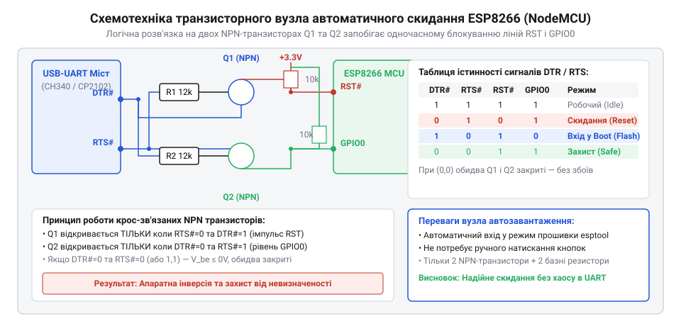
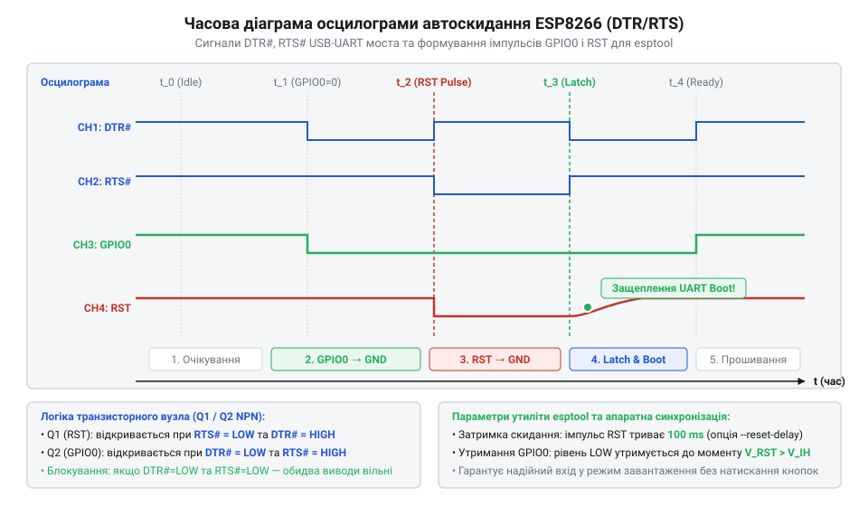

# Побудова схемотехнічного вузла автоскиду та перемикання режимів завантаження на транзисторах

<preknowlist>
- [Оновлення прошивки та прошивання ESP-01](root:cat-hw-boards/esp01-firmware-flashing) — базові команди та послідовність виклику esptool
- [Конфігураційні виводи завантаження ESP8266](root:cat-hw-boards/esp8266-boot-strapping-pins) — вимоги до логічних рівнів GPIO0 та GPIO15 під час старту
</preknowlist>

## Проблема ручного перемикання режимів завантаження

Часта перепрошивка @@en|мікроконтролера ESP8266@@ (від англ. @@en|microcontroller@@ — мікроконтролер; @@en|мікроконтролер ESP8266@@) під час розробки викликає відчутні труднощі через необхідність точного дотримання часових інтервалів між сигналами скидання та вибору режиму старту. Первинний [завантажувач ROM](root:cat-hw-boards/esp8266-bootloader-architecture) фіксує підключений режим роботи чипа лише в один короткий момент — на наростаючому фронті сигналу скидання `RST` (від англ. @@en|Reset@@; @@en|сигнал RST@@). Для переведення чипа у [режим прошивання через послідовний порт](root:cat-hw-boards/esp01-firmware-flashing) (від англ. @@en|UART Download Mode@@; @@en|режим UART Download Mode@@) критично важливо утримувати низький логічний рівень 0 В на виводі `GPIO0` безпосередньо у момент відпускання лінії `RST` з 0 В до 3.3 В, тоді як вивід `GPIO15` має бути притягнутий до землі, а `GPIO2` — підтягнутий до лінії живлення. Усі ці умови задають так звані [страпінг-виводи завантаження](root:cat-hw-boards/esp8266-boot-strapping-pins) (від англ. @@en|boot strapping pins@@; @@en|страпінг-виводи@@) [архітектури SoC ESP8266](root:cat-hw-boards/esp8266-soc-architecture-overview).

Ручне керування цими лініями за допомогою двох кнопкових перемикачів чи джамперів вимагає від розробника виконання чіткого апаратного акорду: затиснути кнопку `Flash` (`GPIO0` = 0 В), короткочасно натиснути та відпустити кнопку `Reset` (`RST` = 0 В -> 3.3 В), і лише після цього відпустити `Flash`. Будь-яка розсинхронізація у цій послідовності призводить до помилки. Якщо вивід `GPIO0` буде відпущено хоча б на кілька мілісекунд раніше, ніж зреагує внутрішня тригерна схема виводу `RST`, внутрішня мікропрограма чипа зчитає високий рівень і перейде у звичайний [автономний режим SPI Flash Boot](root:cat-hw-boards/esp8266-bootloader-architecture) (від англ. @@en|SPI Flash Boot@@; @@en|режим SPI Flash Boot@@). У такому разі утиліта прошивання (від англ. @@en|esptool@@; @@en|утиліта esptool@@) не зможе встановити зв'язок по [послідовному порту UART](root:cat-hw-boards/esp01-tcp-udp-sockets) (від англ. @@en|UART@@ — Universal Asynchronous Receiver-Transmitter; @@en|послідовний порт UART@@) та видасть критичну помилку синхронізації `Failed to connect to ESP8266: Timed out waiting for packet header`.

Окрім людського чинника та помилок таймінгу, ручне перемикання створює серйозну проблему апаратної надійності. Механічні тактові кнопки та джампери макетних плат піддаються інтенсивному зносу: під час активного налагодження розробник виконує десятки циклів прошивання на день, що призводить до дребезгу контактів (від англ. @@en|contact bounce@@; @@en|дребезг контактів@@). Спалахи паразитних імпульсів на лінії `RST` здатні викликати повторний перезапуск у найневідповідніший момент, перериваючи процес запису секторів флеш-пам'яті та призводячи до пошкодження таблиці розмітки. Також при використанні компактних модулів [сімейства ESP-01](root:cat-hw-boards/esp-01-module-family-overview) на специфічних [програмувальних адаптерах](root:cat-hw-boards/esp-01-programmer-adapters) фізичний доступ до кнопок часто обмежений або взагалі відсутній, що робить автоматизацію єдиним способом забезпечення безперервної розробки.

Для усунення механічного втручання та забезпечення 100% повторюваності завантажувального циклу виникає потреба в апаратному вузлі, який здатен автоматично маніпулювати рівнями `RST` та `GPIO0` безпосередньо з ПК. Будь-який послідовний [USB-UART міст](root:cat-hw-boards/esp-01) (від англ. @@en|USB-to-UART bridge@@; @@en|USB-UART міст@@) на мікросхемах `CH340`, `CP2102` або `FT232R` окрім ліній прийому та передачі даних `RX`/`TX` має допоміжні [сигнали керування DTR/RTS](root:hw-components/usb-uart-dtr-rts-flow-control) (від англ. @@en|Data Terminal Ready@@ — @@en|DTR@@ та @@en|Request To Send@@ — @@en|RTS@@; @@en|сигнали DTR/RTS@@). Проте пряме підключення ліній `DTR` до `GPIO0` та `RTS` до `RST` є неприпустимим: керуючі програми на комп'ютері при відкритті послідовного порту за замовчуванням притягують обидві лінії до низького рівня, що викликало б постійне утримання мікроконтролера в стані перезавантаження та блокування його автономного запуску. Отже, виникає необхідність створення спеціальної транзисторної схемотехніки логічної розв'язки.

## Принцип роботи транзисторного автозавантажувача

Розв'язання проблеми небажаного блокування ліній та забезпечення автоматичного перемикання режимів здійснюється за допомогою схемотехнічного вузла перехресного моста (від англ. @@en|Auto-Reset circuit@@; @@en|вузол автоскиду Auto-Reset@@), побудованого на двох біполярних [NPN-транзисторах](root:hw-components/esp8266-npn-transistor-switch-circuit) (від англ. @@en|NPN transistor@@; @@en|NPN-транзистор@@). Ця схема стала стандартом для плат розробки `NodeMCU` та `Wemos D1 mini`.

Принципова схемотехніка вузла працює за логікою взаємного блокування. Емітер першого транзистора `Q1` підключається до лінії `RTS`, його база через обмежувальний резистор `R1` з'єднується з лінією `DTR`, а колектор виводиться на `GPIO0`. Своєю чергою, емітер другого транзистора `Q2` підключається до лінії `DTR`, його база через резистор `R2` з'єднується з `RTS`, а колектор виводиться на лінію `RST`.


*Принципова схема транзисторного вузла автоскиду NodeMCU на двох NPN-транзисторах із позначенням сигналів DTR та RTS.*

Розглянемо функціонування моста через тригерні стани транзисторів при зміні логічних рівнів сигналів `DTR` та `RTS`. Оскільки керуючі лінії `USB-UART моста` мають інверсну логіку у програмних викликах (активний рівень — 0 В / High = 3.3 В, Low = 0 В), робота схеми описується такою таблицею істинності:

- Нейтральний стан (`DTR` = 0 В, `RTS` = 0 В): На базах `Q1` та `Q2` відсутня відімкнева напруга переходу база-емітер (`V_BE` = 0 В). Обидва транзистори перебувають у закритому стані (від англ. @@en|cutoff mode@@; @@en|режим відсічки@@). Лінії `RST` та `GPIO0` завдяки зовнішнім підтягувальним резисторам утримуються у високому логічному рівні 3.3 В, що забезпечує стабільний автономний запуск [прошивки з флеш-пам'яті](root:cat-hw-boards/esp8266-bootloader-architecture).
- Підготовка `GPIO0` (`DTR` = 3.3 В, `RTS` = 0 В): На базу `Q1` подається позитивний потенціал 3.3 В від `DTR`, а його емітер підключено до 0 В через `RTS`. Напруга база-емітер `V_BE1` ≈ 0.7 В відкриває транзистор `Q1`, і його колектор насичується, притягуючи лінію `GPIO0` до 0 В. Водночас `Q2` залишається закритим, оскільки на його базі (`RTS`) 0 В.
- Активний імпульс скидання (`DTR` = 3.3 В, `RTS` = 3.3 В): У цей момент потенціали на базі та емітері транзистора `Q1` вирівнюються (`V_BE1` = 3.3 В - 3.3 В = 0 В), що призводить до його негайного запирання. Аналогічно вирівнюються потенціали і на `Q2`. Обидва транзистори блокуються! Це критично важливий стан апаратного захисту (від англ. @@en|anti-locking protection@@; @@en|захист від одночасного блокування@@): схема не дозволяє одночасно притягнути `RST` і `GPIO0` до землі при випадковій установці двох сигналів у високий рівень.
- Скидання `RST` (`DTR` = 0 В, `RTS` = 3.3 В): На базу `Q2` через `RTS` надходить 3.3 В, а його емітер з'єднано з 0 В через `DTR`. Транзистор `Q2` відкривається та притягує лінію `RST` до 0 В, викликаючи апаратний перезапуск мікроконтролера. При цьому `Q1` залишається закритим, а лінія `GPIO0` утримується в низькому стані завдяки розрядженню паразитної ємності або комбінованому часовому інтервалу.


*Часова діаграма перемикання рівнів DTR, RTS, RST та GPIO0 під час ініціалізації завантажувача esptool.*

Для стабільного спрацьовування схеми транзистори мають переходити у глибокий [режим насичення](root:hw-components/esp8266-npn-transistor-switch-circuit) (від англ. @@en|saturation mode@@; @@en|насичення транзистора@@). Розрахуємо необхідний максимальний опір базних резисторів `R1` та `R2` (позначимо як `R_b`).

Спочатку визначимо струм колектора `I_c`, необхідний для притягнення лінії з підтягувальним резистором `R_pullup` опором 10 кОм до напруги живлення `V_CC` = 3.3 В при напрузі насичення колектор-емітер `V_CE_sat` = 0.1 В. Струм колектора обчислюється як:

```
I_c = (V_CC - V_CE_sat) ÷ R_pullup
    = (3.3 - 0.1) ÷ 10000                 [підстановка напруги живлення та опору підтяжки]
    = 0.00032                             [струм колектора 0.32 мА у режимі відкриття]
```

Для гарантованого введення транзистора з коефіцієнтом підсилення струму `h_FE` = 100 у стан насичення із коефіцієнтом перенасичення `S` = 3, мінімальний струм бази `I_b` має становити:

```
I_b = S × (I_c ÷ h_FE)
    = 3 × (0.00032 ÷ 100)                 [забезпечення коефіцієнта насичення S=3]
    = 0.0000096                           [мінімальний струм бази 9.6 мкА]
```

Враховуючи вихідну напругу сигналу `V_OH` = 3.3 В та напругу насичення база-емітер `V_BE_sat` = 0.7 В, граничний опір базного резистора `R_b` становить:

```
R_b = (V_OH - V_BE_sat) ÷ I_b
    = (3.3 - 0.7) ÷ 0.0000096              [розрахунок максимального опору резистора]
    ≈ 270833                              [граничний опір бази близько 270 кОм]
```

На практиці номінал `R_b` обирають у діапазоні від 10 кОм до 12 кОм. Це забезпечує струм бази близько 0.26 мА, що гарантує миттєве й надійне насичення транзистора `S8050` чи `2N3904` без перевантаження виходів керуючої мікросхеми `CH340`.

Нижче наведено програмну обгортку керування послідовними лініями `DTR`/`RTS` мовою Python для автоматизації виклику [утиліти esptool](root:cat-hw-boards/esp01-firmware-flashing):

:::tabs
@tab Python
:::code proj-esp8266-auto-reset-flashing-circuit/py/esp_reset_controller.py
:::code proj-esp8266-auto-reset-flashing-circuit/py/flasher_cli.py
:::

Після успішного прошивання автономний старт прошивки підтверджується за допомогою тестових програм контролю роботи `GPIO2`:

:::tabs
@tab C (ESP-IDF)
:::code proj-esp8266-auto-reset-flashing-circuit/c/CMakeLists.txt
:::code proj-esp8266-auto-reset-flashing-circuit/c/main/CMakeLists.txt
:::code proj-esp8266-auto-reset-flashing-circuit/c/main/main.c
@tab C++ (Arduino)
:::code proj-esp8266-auto-reset-flashing-circuit/cpp/arduino/boot_test_blink.ino
@tab C++ (ESP-IDF)
:::code proj-esp8266-auto-reset-flashing-circuit/cpp/esp-idf/boot_test_blink.cpp
:::

## Складання та розводка схемотехнічного вузла

При практичній реалізації схемотехнічного вузла автоматичного скидання на макетній платі (від англ. @@en|breadboard@@; @@en|макетна плата@@) розробники часто стикаються з непередбачуваними перезавантаженнями та помилками синхронізації. Причиною цього є недотримання правил підключення сигнальних ліній [адаптерів програматорів для ESP-01](root:cat-hw-boards/esp-01-programmer-adapters) на базі мікросхем @@en|CH340@@ або @@en|CP2102@@, а також наявність висячих потенціалів на високоелементній базі мікроконтролера.

Центральним елементом вузла є два @@en|NPN-транзистори@@ загального призначення (наприклад, @@en|S8050@@, @@en|2N3904@@ або @@en|BC547@@). Сигнали керування послідовним портом @@en|DTR@@ (від англ. @@en|Data Terminal Ready@@; @@en|DTR@@) та @@en|RTS@@ (від англ. @@en|Request to Send@@; @@en|RTS@@) від USB-UART моста подаються на бази транзисторів через струмообмежувальні резистори номіналом `10 kΩ` (допустимий діапазон від `4.7 kΩ` до `10 kΩ`). Це гарантує повний перехід транзисторів у режим насичення при вихідній напрузі логічної одиниці `3.3 V` або `5 V` без перевантаження виходів USB-чіпа. Колектор першого транзистора підключається до виводу `GPIO0`, а колектор другого — до лінії скидання `RST`. Емітери cross-перехресно з'єднуються з протилежними лініями керування: емітер першого транзистора підключено до `RTS`, а емітер другого — до `DTR`.


*Показано топологію розведення сигналів DTR, RTS, RST та GPIO0 з урахуванням базних та підтягувальних резисторів.*

Для забезпечення стабільної роботи [архітектури SoC ESP8266](root:cat-hw-boards/esp8266-soc-architecture-overview) під час подачі живлення критично важливо правильно підтягнути [конфігураційні виводи завантаження ESP8266](root:cat-hw-boards/esp8266-boot-strapping-pins) (від англ. @@en|strapping pins@@; @@en|конфігураційні виводи@@). На макетній платі необхідно встановити такі підтягувальні резистори (від англ. @@en|pull-up resistor@@; @@en|підтягувальний резистор до живлення@@) та притягувальні резистори (від англ. @@en|pull-down resistor@@; @@en|підтягувальний резистор до землі@@) номіналом `10 kΩ`:

- Лінія `RST`: підтяжка `10 kΩ` до шини `3.3 V`. Для захисту від високочастотних імпульсних завад паралельно додають керамічний фільтруючий конденсатор ємністю `100 nF` на землю (`GND`).
- Вивід `GPIO0`: підтяжка `10 kΩ` до шини `3.3 V`. Це утримує високий логічний рівень у нейтральному стані транзисторного вузла.
- Вивід `GPIO2`: підтяжка `10 kΩ` до шини `3.3 V` (вимога завантажувача ROM для старту з Flash).
- Вивід `CH_PD` / `EN` (від англ. @@en|Chip Enable@@; @@en|увімкнення чіпа@@): обов'язкова підтяжка `10 kΩ` до `3.3 V`. Без цього мікроконтролер перебуває у стані глибокого знеструмлення.
- Вивід `GPIO15`: притяжка `10 kΩ` до шини `GND` (для модулів ESP-12E/F). На платах [модуля ESP-01](root:cat-hw-boards/esp-01) цей вивід розведений внутрішньо.

Особливістю конфігурування [модулів ESP-01S](root:cat-hw-boards/esp-01s) є наявність інтегрованих на плату резисторів підтяжки номіналом `12 kΩ` для ліній `GPIO0`, `RST`, `EN` та `GPIO2`, що спрощує зовнішнє розведення. Детальні відмінності трасування описує огляд у статті про [огляді сімейства Wi-Fi модулів ESP-01 та ESP-01S](root:cat-hw-boards/esp-01-module-family-overview).

Найбільшою апаратною пасткою при розводці є виникнення паразитного живлення (від англ. @@en|parasitic powering@@ / @@en|phantom power@@; @@en|фантомне живлення@@). Коли основну шину `3.3 V` знеструмлено, але до адаптера @@en|CH340@@ під'єднано USB-кабель, струм з ліній @@en|TXD@@, @@en|DTR@@ та @@en|RTS@@ протікає через внутрішні захисні @@en|ESD-діоди@@ мікроконтролера у внутрішню шину живлення. В результаті ESP8266 переходить у невизначений стан часткового заживлення, що викликає зависання кристала. Для запобігання цьому на лініях @@en|RXD@@ та @@en|TXD@@ встановлюють послідовні резистори розв'язки `470 Ω`, а шину землі `GND` з'єднують першою.

Крім того, виходи `3V3` дешевих USB-UART адаптерів часто побудовані на слабких внутрішніх @@en|LDO-регуляторах@@ (від англ. @@en|Low Dropout Regulator@@; @@en|лінійний регулятор напруги@@), які видають не більше `30–50 mA`. В момент увімкнення та калібрування передавача ESP8266 споживає імпульсний струм до `350–500 mA`. Це призводить до просідання напруги (від англ. @@en|brownout reset@@; @@en|апаратна просічка живлення@@) та циклічних перезавантажень. Для живлення вузла обов'язково застосовують зовнішній регулятор (наприклад, @@en|AMS1117-3.3@@) із блокувальними конденсаторами `100 µF` (електролітичний) та `100 nF` (керамічний) безпосередньо біля виводів живлення модуля.

## Перевірка прошивання та діагностика збоїв

Після завершення монтажу схемотехнічного вузла виконують перевірку процедури [оновлення прошивки та прошивання ESP-01](root:cat-hw-boards/esp01-firmware-flashing) за допомогою утиліти @@en|esptool@@. Для автоматизації маніпуляцій лініями послідовного порту через бібліотеку @@en|pyserial@@ використовується Python-скрипт керування транзисторним ключем.

Нижче наведено реалізацію контролера автоскидання, який формує чітку часову діаграму переведення мікроконтролера у режим завантаження через UART (від англ. @@en|UART Download Mode@@; @@en|режим завантаження UART@@):

:::code proj-esp8266-auto-reset-flashing-circuit/py/esp_reset_controller.py

Робота контролера розбита на послідовні інтервали:
1. `DTR=1, RTS=0`: відкривається транзистор `Q1`, притягуючи вивід `GPIO0` до низького рівня (`0 V`).
2. `DTR=1, RTS=1`: відкривається транзистор `Q2`, подаючи імпульс низького рівня на лінію `RST` при збереженні `GPIO0=0`.
3. `time.sleep(0.1)`: затримка `100 ms` розряджає фільтруючий конденсатор на лінії `RST`.
4. `DTR=0, RTS=1`: транзистор `Q2` закривається, і лінія `RST` піднімається до високого рівня через резистор підтяжки `10 kΩ`. Вивід `GPIO0` залишається у низькому стані `0 V`.
5. `time.sleep(0.05)`: вікно затримки `50 ms` необхідне для того, щоб ROM-завантажувач (від англ. @@en|ROM bootloader@@; @@en|вбудований завантажувач ПЗУ@@) защепив (від англ. @@en|boot latching@@; @@en|фіксація стану виводів при скиданні@@) логічні рівні `strapping pins`.
6. `DTR=0, RTS=0`: повернення в нейтральний стан, коли обидва транзистори закриті.

Інтеграція даного модуля у консольну утиліту прошивання здійснюється через обгортку виклику @@en|esptool@@:

:::code proj-esp8266-auto-reset-flashing-circuit/py/flasher_cli.py

Після успішного запису бінарного образу у SPI Flash пам'ять необхідно перевірити автономний запуск програми у режимі завантаження з Flash (від англ. @@en|SPI Flash Boot@@; @@en|режим автономного старту з Flash@@). Для цього застосовують тестові прошивки миготіння світлодіодом. У середовищі @@en|ESP-IDF@@ конфігурація проєкту задається файлами @@en|CMake@@:

:::code proj-esp8266-auto-reset-flashing-circuit/c/CMakeLists.txt
:::code proj-esp8266-auto-reset-flashing-circuit/c/main/CMakeLists.txt

Вихідний код тестових програм для підтвердження автономного запуску подано у вкладках для мов @@en|C@@ та @@en|C++@@ під різні платформи:

:::tabs
```c|esp-idf
:::code proj-esp8266-auto-reset-flashing-circuit/c/main/main.c
```
```cpp|arduino
:::code proj-esp8266-auto-reset-flashing-circuit/cpp/arduino/boot_test_blink.ino
```
```cpp|esp-idf
:::code proj-esp8266-auto-reset-flashing-circuit/cpp/esp-idf/boot_test_blink.cpp
```
:::

Під час запуску автономної програми ROM-завантажувач видає системний лог у послідовний порт на швидкості `74880 baud` (що відповідає базовому системному кварцу `26 MHz`). Рядок `boot mode:(3,6)` у терміналі підтверджує успішний перехід до виконання коду з Flash-пам'яті.


*Показано часові інтервали затримки скидання та защеплення логічного нуля на ліній GPIO0 ROM-завантажувачем.*

Якщо при спробі прошивання утиліта повертає помилку `Fatal error occurred: Failed to connect to ESP8266: Timed out waiting for packet header`, проводять апаратну діагностику за допомогою інструментів спостереження — цифрового осцилографа (від англ. @@en|oscilloscope@@; @@en|осцилограф@@) або логічного аналізатора (від англ. @@en|logic analyzer@@; @@en|логічний аналізатор@@).

Основні апаратні несправності та методи їх усунення:

1. **Занадто велика ємність фільтра на RST**: якщо на лінію `RST` встановлено конденсатор ємністю `10 µF` замість `100 nF`, постійна часу $RC$-ланцюга обчислюється як:

```text
τ = R · C
  = 10000 Ω · 0.00001 F          [R_pullup = 10 kΩ, C_reset = 10 µF]
  = 0.1 s = 100 ms               [розрахунок постійної часу]
```

Повільний фронт наростання напруги призводить до того, що рівень `RST` залишається низьким навіть після того, як лінія `GPIO0` вже повернулася у високий стан, і мікроконтролер стартує у звичайному режимі замість завантажувача.
2. **Недостатнє насичення транзисторів**: при використанні резисторів бази понад `47 kΩ` струм бази стає недостатнім для повного відкриття транзистора. Залишкова напруга колектор-емітер `V_CE(sat)` перевищує `0.4 V`, що сприймається входом ESP8266 як логічна одиниця.
3. **Неправильний рівень на GPIO15 або EN**: якщо вивід `GPIO15` підтягнутий до `3.3 V` або `EN` залишається підвішеним, у системному лозі з'являється повідомлення `boot mode:(1,0)` або `boot mode:(7,6)`, що вказує на вибір некоректного джерела завантаження. Налаштування додаткових периферійних ліній можна адаптувати, вивчивши [керування GPIO виводами ESP8266 через AT-команди](root:cat-hw-boards/esp8266-at-gpio-control).
