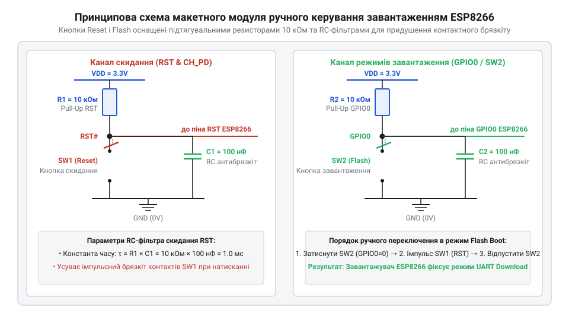
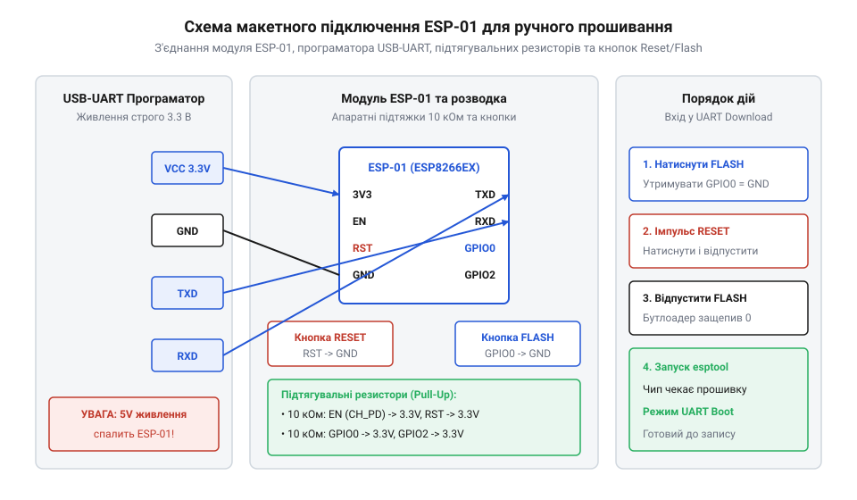

# Складання завадостійкого макетного модуля перемикання режимів завантаження

<preknowlist>
- [ESP-01 (Wi-Fi, ESP8266)](root:cat-hw-boards/esp-01) — цокольовка виводів та обмеження використання GPIO
- [Конфігураційні виводи завантаження ESP8266](root:cat-hw-boards/esp8266-boot-strapping-pins) — вимоги підтяжки сигнальних ліній старту
- [Оновлення прошивки та прошивання ESP-01](root:cat-hw-boards/esp01-firmware-flashing) — основи використання утиліти esptool
</preknowlist>

## Проблема брязкіту та помилок завантаження

Складання макетного модуля для розробки та програмування мікроконтролерів ESP8266 здається простим завданням, поки інженер не стикається зі спонтанними відмовами переходу в режим оновлення прошивки. Ви збираєте схему на безпаяльній макетній платі, затискаєте кнопку вибору режиму, подаєте короткий імпульс скидання, але замість очікуваного підтвердження готовності до запису через послідовний порт мікроконтролер зависає, починає циклічно перезавантажуватися або запускає попередню програму зі спільної пам'яті. Спроби завантажити нову прошивку на [компактний модуль ESP-01](root:cat-hw-boards/esp-01) перетворюються на лотерею, де кожен виклик консольної утиліти закінчується помилкою зв'язку та втратою синхронізації.

Головним винуватцем такої нестабільної поведінки є механічний контактний брязкіт (англ. *contact bounce* від *bounce* — «відскок»; @@en|contact bounce@@) кнопкових вимикачів, який у технічній літературі також називають чаттером (англ. *chatter*; @@en|switch chatter@@). Коли металеві контакти тактової кнопки замикаються або розмикаються, вони не переходять у новий стан миттєво. Пружні пластини перемикача мікроскопічно соваються та пружинять протягом 1–10 мілісекунд, породжуючи серію високочастотних хаотичних імпульсів. Замість одного чистого спадного чи наростаючого фронту напруги цифровий вхід мікроконтролера отримує десятки хибних перепадів логічних рівнів за кілька мілісекунд.

Ситуація ускладнюється плаваючими потенціалами (англ. *floating input* від *float* — «плавати»; @@en|floating input@@). Цифрові виводи CMOS-архітектури ESP8266 у високоімпедансному стані мають надзвичайно високий вхідний опір (понад 100 МОм). На безпаяльній макетній платі підключені довготривалі провідники та паразитна ємність між сусідніми контактними рейками працюють як антени, що збирають довколишні електромагнітні завади (англ. *electromagnetic interference*; @@en|electromagnetic interference@@) та сіткові наводки. Якщо сигнальна лінія скидання чи конфігурації завантаження позбавлена жорсткої підтяжки, напруга на ній довільно дрейфує між логічним нулем та одиницею, викликаючи хибні спрацьовування.

Щоб зрозуміти, чому контактний брязкіт і завади є фатальними для старту ESP8266, слід розглянути первинний завантажувач (англ. *bootloader* від *bootstrap loader*; @@en|bootloader@@) мікроконтролера. Під час виходу зі стану скидання (в момент переходу лінії RST із низького рівня у високий) первинний ROM-код зчитує фізичні логичні рівні на трьох спеціальних виводах. Ці [конфігураційні виводи завантаження](root:cat-hw-boards/esp8266-boot-strapping-pins) (англ. *strapping pins*; @@en|strapping pins@@) — GPIO15, GPIO0 та GPIO2 — визначають подальший вектор виконання системи:

1. **Режим завантаження UART** (англ. *UART Download mode*; @@en|UART Download mode@@): GPIO15 має перебувати під низьким рівнем (LOW), GPIO0 — під низьким рівнем (LOW), GPIO2 — під високим рівнем (HIGH).
2. **Режим нормального виходу з Flash** (англ. *Flash Boot mode*; @@en|Flash Boot mode@@): GPIO15 — низький (LOW), GPIO0 — високий (HIGH), GPIO2 — високий (HIGH).
3. **Режим завантаження з SD-карти** (англ. *SDIO Boot mode*; @@en|SDIO Boot mode@@): GPIO15 перебуває під високим рівнем (HIGH).

Окрім цього, для нормальної роботи системи лінія CH_PD (Chip Enable / EN) також вимагає обов'язкової фіксованої підтяжки до високого рівня 3.3 В. Якщо під час підйому напруги на лінії RST сигнал на GPIO0 зазнає контактного брязкіту або дрейфу через плаваючий потенціал, завантажувач зчитає випадковий логічний стан у момент защеплення (англ. *latch*; @@en|latch@@) даних. Програмне антибрязкітне придушення (англ. *software debouncing*; @@en|software debouncing@@) тут принципово неможливе, оскільки ROM-код виконується на апаратному рівні до запуску будь-яких користувацьких інструкцій чи ініціалізації периферії. Якщо в момент засусування даних рівень GPIO0 виявиться високим замість низького, внутрішня [архітектура режимів старту](root:cat-hw-boards/esp8266-bootloader-architecture) спрямує виконання у Flash-пам'ять, і з'єднання з програматором буде відхилено.

Єдиним надійним шляхом усунення відмов є апаратне формування сигналів за допомогою фіксуючих підтягувальних резисторів (англ. *pull-up resistor*; @@en|pull-up resistor@@) та апаратних пасивних RC-фільтрів. Вони гасять високочастотні брязкітні сплески і гарантують стабільну напругу в моменти аналізу станів чипа.

## Принципова схема та вибір компонентів

Для забезпечення стійкої роботи макетного модуля необхідно побудувати схемотехнічний вузол, який гарантує чіткі логичні рівні та фільтрацію високочастотних завад на лініях керування RST і GPIO0. Принципова електрична схема такого завадостійкого модуля містить підтягувальні резистори та інтегровані пасивні RC-ланцюжки.


*Принципова електрична схема макетного модуля з кнопками Reset/Flash, підтягувальними резисторами R_pull = 10 кОм та апаратними RC-ланцюжками.*

Основу схеми складають підтягувальні резистори R_pull = 10 кОм, увімкнені між сигнальними лініями (RST, GPIO0, CH_PD) та шиною живлення 3.3 В. Вибір номіналу 10 кОм обґрунтовано компромісом між струмоспоживанням та завадостійкістю. Занадто малий опір (наприклад, 100 Ом) призводить до невиправдано високого струму через замикаючу кнопку:
I = V_DD / R_pull = 3.3 В / 100 Ом = 33 мА, що створює зайве навантаження на джерело живлення та може пошкодити контакти. Натомість занадто великий опір (наприклад, 1 МОм) утворює слабке поле підтяжки, через яке струми витоку цифрового входу (близько 1 мкА) створюють відчутне просідання напруги ΔV = 1 мкА × 1 МОм = 1 В, порушуючи поріг логічної одиниці. Номінал 10 кОм дає струм споживання лише 0.33 мА під час натискання та надійно утримує потенціал 3.3 В у пасивному стані.

Для придушення контактного брязкіту паралельно кнопкам Reset та Flash встановлюються керамічні конденсатори ємністю C_f = 100 нФ разом із підтягувальними резисторами R_f = 10 кОм, створюючи апаратний RC-фільтр (від лат. *resistentia* — «опір» та *capacitas* — «ємність»; @@en|RC filter@@). Часова стала (англ. *time constant*; @@en|time constant@@) цього фільтра визначає швидкість наростання та спаду напруги на вході мікроконтролера. Обчислимо значення сталої часу τ за формулою:

```
τ = R_f × C_f
  = 10000 × 100 × 10⁻⁹    [підстановка значень R_f = 10 кОм та C_f = 100 нФ]
  = 1 × 10⁻³ с = 1 мс     [обчислення постійної часу RC-ланцюжка]
```

Отримана стала часу τ = 1 мс є оптимальною для придушення механічного брязкіту. Оскільки високочастотні імпульси брязкіту мають тривалість у сотні мікросекунд, конденсатор C_f не встигає істотно змінити свій заряд за час окремого відскоку контакту. Фільтр відсікає всі завади з частотою понад граничну частоту зрізу f_c = 1 / (2 × π × R_f × C_f) ≈ 160 Гц. Детальніший математичний розрахунок та схемотехніку фільтрації описує [апаратне придушення брязкіту контакторів](root:hw-digital/rc-debouncing-circuits).

Для захисту контактів тактових кнопок від пікового струму розряду розрядженого конденсатора C_f послідовно з кнопкою доцільно додавати низькоомний обмежувальний резистор R_lim = 100 Ом. Це усуває мікроіскріння та згладжує швидкоплинний сплеск струму.

Згладжений експоненційний сигнал з RC-фільтра подається на цифровий вхід ESP8266, обладнаний вхідним каскадом із гістерезисом — тригером Шмітта (англ. *Schmitt trigger*; @@en|Schmitt trigger@@). Порогові напруги спрацьовування входу визначаються співвідношеннями від напруги живлення V_DD = 3.3 В:
- Нижній поріг логічного нуля V_IL ≤ 0.25 × V_DD = 0.25 × 3.3 В = 0.825 В.
- Верхній поріг логічної одиниці V_IH ≥ 0.75 × V_DD = 0.75 × 3.3 В = 2.475 В.

Завдяки гістерезису ΔV = V_IH - V_IL ≈ 1.65 В тригер Шмітта перемикає свій вихідний стан миттєво лише тоді, коли напруга на конденсаторі перетинає відповідний поріг. Будь-які залишкові мікровольтні пульсації напруги на RC-ланцюжку в межах зони нечутливості повністю ігноруються, що виключає повторні генерації цифрових фронтів та забезпечує чисте одноразове перемикання логічного стану завантажувача. Детальніше принцип дії гістерезису та розрахунок порогових напруг розкрито у матеріалі про [тригери Шмітта у вхідних каскадах мікроконтролерів](root:hw-digital/schmitt-trigger-input-buffers).

## Складання модуля на макетній платі

Усі спроби зібрати макетну схему керування стартом на провідниках-"змійках" зіштовхуються з двома фізичними проблемами: неузгодженістю геометрії виводів та нестабільністю контактів. Компактний дворядний роз'єм 2×4 з кроком 2.54 мм, яким оснащено [модуль ESP-01](root:cat-hw-boards/esp-01), неможливо встановити безпосередньо у центральну канавку, яку має @@en|безпаяльна макетна плата@@ (від англ. *breadboard* від *bread* — «хліб» та *board* — «дошка»). Підключення через гнучкі провідники типу "мама-тато" без фіксації створює високий контактний опір та утворює антенні контури. Ці контури вловлюють високочастотні завади від імпульсних джерел живлення та радіомодуля Wi-Fi, наводячи хибні тригери на сигнальні лінії. Для побудови завадостійкого вузла компоненти схемотехнічної підтяжки й фільтрації розміщують на контактній матриці макетної плати із мінімальною довжиною з'єднувальних провідників.

Монтаж починають із формування системних шин живлення. Живлення мікроконтролера вимагає стабільної напруги 3.3 В із здатністю віддавати пікові струми до 500 mA під час передачі радіокадрів. USB-UART адаптери часто мають слабкий вбудований лінійний регулятор, тому шини живлення макетної плати підключають до зовнішнього джерела 3.3 В або розв'язують керамічними та електролітичними конденсаторами. Паралельно шинам VCC та GND біля самого виводу живлення модуля встановлюють керамічний конденсатор ємністю 100 nF для придушення високочастотних завад та електролітичний конденсатор ємністю 10–100 µF для компенсації просідань напруги при сплесках споживання. Об'єднання земляного провідника GND усіх елементів схеми та [адаптера USB-UART](root:cat-hw-boards/esp-01-programmer-adapters) у єдину точку є обов'язковою умовою для забезпечення спільного потенціалу відліку сигнальних рівнів.

Вивід увімкнення CH_PD (EN) та вивід GPIO2 потребують постійної високої підтяжки для нормального старту первинного завантажувача. Вивід CH_PD з'єднують із шиною 3.3 В через @@en|підтягувальний резистор@@ опором 10 kΩ. Пряме з'єднання CH_PD із шиною живлення без резистора допускається, але використання резистора захищає лінію від випадкового замикання на землю під час макетування. Вивід GPIO2 підтягують до 3.3 В окремим резистором 10 kΩ. Оскільки [конфігураційні виводи завантаження](root:cat-hw-boards/esp8266-boot-strapping-pins) опитуються чипом у момент виходу зі скидання, відсутність підтяжки на цих виводах призводить до випадкового блокування виконання коду через @@en|плаваючий потенціал@@.

Вузли керування скиданням (RST) та вибором режиму (GPIO0) збирають за однаковою схемою RC-фільтрації. Кнопку RESET підключають між лінією RST та шиною GND. Від лінії RST до шини 3.3 В встановлюють підтягувальний резистор 10 kΩ, а паралельно кнопці (між RST та GND) найближче до контактів виводу підключають керамічний конденсатор ємністю 100 nF. Аналогічно збирають вузол FLASH: кнопку підключають між GPIO0 та GND, підтягувальний резистор 10 kΩ — до 3.3 В, а керамічний конденсатор 100 nF — між GPIO0 та GND. Часову сталу RC-ланцюжка обчислюють для визначення швидкості заряджання конденсатора після відпускання кнопки:

tau = R · C
    = 10000 · 0.0000001    [підстановка R = 10 kΩ та C = 100 nF]
    = 0.001 s              [часова стала 1 мс для придушення брязкіту]

Керамічний конденсатор у момент натискання кнопки миттєво розряджається, а при відпусканні плавно заряджається через підтягувальний резистор із часовою сталою 1 мс. Це блокує високочастотний @@en|контактний брязкіт@@ та унеможливлює повторне спрацьовування вхідного тригера.

Під час фізичного розміщення елементів на макетній платі необхідно уникати паралельного прокладання довгих сигнальних провідників поруч із шинами живлення чи лініями TX/RX. Нехтування цим правилом викликає появу явищ, коли @@en|паразитна ємність@@ (від англ. *stray capacitance* від *stray* — «блукаючий» та *capacitance* — «ємність») наводить імпульсні перехідні завади з лінії передачі даних TX на чутливий вхід RST. Також важливо запобігати появі подій, коли випадкове @@en|коротке замикання@@ (від англ. *short circuit* від *short* — «короткий» та *circuit* — «коло») руйнує вихідні каскади GPIO. Повна монтажна схема розводки елементів та з'єднання з програматором представлена нижче:


*Монтажна схема розташування резисторів підтяжки, керамічних конденсаторів фільтрації та кнопок керування на макетній платі забезпечує відсутність плаваючих потенціалів і мінімізує паразитні індуктивності.*

## Ручне переключення та перевірка esptool

Навіть ідеально зібрана схема не увійде у режим програмування, якщо порушити часову послідовність маніпуляцій кнопками. Внутрішній апаратний @@en|завантажувач@@ мікроконтролера фіксує рівні на strapping-виводах виключно в момент переходу сигналу RST з низького рівня в високий (на зростаючому фронті). Якщо лінія GPIO0 повернеться до високого потенціалу раніше, ніж завершиться внутрішнє скидання чипа, мікроконтролер почне звичайне виконання прошивки з флеш-пам'яті (@@en|Flash Boot mode@@) замість активації приймача команд UART.

Для надійного входження в @@en|режим завантаження UART@@ використовують чіткий алгоритм трьох кроків:
1. Затиснути й утримувати кнопку FLASH (GPIO0 примусово замикається на GND, формуючи низький логічний рівень).
2. Короткочасно натиснути та відпустити кнопку RESET (лінія RST примусово розряджається на GND і повертається до 3.3 В через RC-ланцюжок). На зростаючому фронті лінії RST чип виконує @@en|защеплення@@ стану GPIO0=LOW, GPIO2=HIGH та GPIO15=LOW.
3. Відпустити кнопку FLASH (лінія GPIO0 повертається до високого рівня підтяжкою 10 kΩ).

Оскільки первинний завантажувач уже зафіксував конфігураційні виводи у своїх внутрішніх регістрах під час зростаючого фронту RST, подальше відпускання кнопки FLASH не змінює поточний режим роботи. Вузол входу переходить у стан очікування службових кадрів по лінії RX на швидкості 115200 біт/с.

Після переведення модуля в режим завантаження перевірку стану hardware та зв'язку здійснюють за допомогою [утиліти esptool](root:cat-hw-boards/esp01-firmware-flashing). Утиліта надсилає послідовність синхронізаційних пакетів для узгодження частоти та перевірки готовності ROM-завантажувача. Комплексна перевірка працездатності зібраного макетного модуля та зчитування системної інформації реалізується за допомогою автоматизованого скрипту bash:

:::code proj-esp8266-manual-boot-switch-breadboard/sh/check_esp8266_chip.sh

Скрипт виконує послідовне опитування трьох ключових характеристик мікроконтролера. На першому кроці команда `chip_id` зчитує унікальний ідентифікатор SoC з внутрішніх регістрів [мікроконтролера ESP8266](root:cat-hw-boards/esp8266-soc-architecture-overview). На другому кроці команда `read_mac` звертається до одноразово програмованої пам'яті eFuse та виводить фізичну MAC-адресу мережевого інтерфейсу Wi-Fi. На третьому кроці команда `flash_id` виконує запит до зовнішньої мікросхеми Flash-пам'яті по інтерфейсу SPI, зчитуючи ідентифікатор виробника, тип мікросхеми та її ємність. Отримання коректних відповідей на всі три запити підтверджує надійну роботу системних шин, відсутність збоїв через брязкіт контактів та повну готовність модуля до завантаження нової прошивки.

Помилки при виконанні скрипту безпосередньо вказують на схемотехнічні чи часові огріхи макетування. Якщо консоль видає повідомлення `Fatal error: Failed to connect to ESP8266: Timed out waiting for packet header`, це означає, що завантажувач не увійшов у режим завантаження UART (кнопку FLASH не було затиснуто під час скидання), або відсутнє спільне заземлення GND між платою та адаптером. Якщо під час опитування виникають помилки зчитування даних чи хаотичні символи, причиною є нестабільна @@en|швидкість передачі@@ (від англ. *baud rate* від прізвища *Baudot* — «Бодо» та *rate* — «швидкість») або імпульсні просідання напруги живлення 3.3 В через відсутність фільтруючих конденсаторів. Вивчення внутрішньої [архітектури завантажувача](root:cat-hw-boards/esp8266-bootloader-architecture) дозволяє швидко відрізнити апаратні проблеми підтяжки сигнальних ліній від помилок послідовного порту OS.
