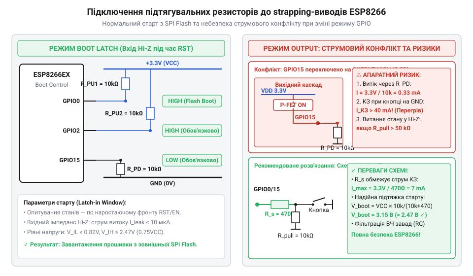

# Електричний та фізичний інтерфейс конфігураційних виводів ESP8266

<preknowlist>
- [Режими завантаження мікроконтролера ESP8266](root:cat-hw-boards/esp8266-boot-modes) — Базовий перелік режимів запуску чипа та призначення конфігураційних виводів
- [Архітектура завантажувача та режими старту ESP8266](root:cat-hw-boards/esp8266-bootloader-architecture) — Послідовність виконання первинного ROM-завантажувача
</preknowlist>

## Проблема старту та електричні пороги

Під час подачі живлення або зняття сигналу скидання мікроконтролер має визначити, звідки саме виконувати первинний програмний код. Оскільки вхідні каскади виводів загального призначення перебувають у неініціалізованому стані, відсутність чітко зафіксованих електричних потенціалів призводить до появи плаваючих рівнів напруги. У результаті чип може хибно розпізнати режим завантаження, заблокувати запуск із зовнішньої Flash-пам'яті або зависнути в непередбачуваному стані.

Фізично вхідний каскад кожного виводу GPIO містить двопороговий тригер Шмітта @@en|Schmitt trigger@@ (від прізвища винахідника Отто Шмітта — компаратор із гістерезисом) та пару комплементарних польових транзисторів, що комутують вбудовані слаботочні резистори підтяжки опором близько `30`–`50` кОм. Детальніше будову кристаллу можна вивчити в матеріалах про [архітектури SoC ESP8266](root:cat-hw-boards/esp8266-soc-architecture-overview).

Для надійного зчитування станів конфігураційних виводів напруги на лініях повинні чітко відповідати специфікаціям електричних порогів вхідного каскаду ESP8266 при робочій напрузі живлення `V_DD = 3.3` В. Мінімальна напруга високого логічного рівня становить `V_IH_min = 0.75 × V_DD = 2.475` В, а максимальна напруга низького логічного рівня обмежена значенням `V_IL_max = 0.25 × V_DD = 0.825` В. Потенціали у проміжному діапазоні від `0.825` В до `2.475` В є невизначеними і спричиняють збої опитування.

Окрім чутливості до наводків, використання високоомних зовнішніх резисторів підтяжки (понад `50` кОм чи `100` кОм) призводить до критичного падіння потенціалу через струм витоку входу @@en|leakage current@@ (від англ. *@@en|leakage current@@* — струм витоку вхідного каскаду) `I_leak = 10` мкА (`10⁻⁵` А). При напрузі живлення `V_DD = 3.3` В підключення резистора `R_pull = 100` кОм спричиняє спад напруги `V_drop`:

```text
V_drop = I_leak × R_pull
       = 0.00001 × 100000                       [підстановка струму витоку 10 мкА та опору 100 кОм]
       = 1.0 В                                  [перемноження струму на опір]
```

У результаті напруга на самому виводі знижується до `V_pin = V_DD - V_drop = 3.3 - 1.0 = 2.3` В, що стає нижчою за мінімальний поріг високого логічного рівня `V_IH_min = 0.75 × V_DD = 2.475` В. З цієї причини розробники застосовують низькоомні підтяжки номіналом `4.7`–`10` кОм, при яких спад напруги не перевищує `0.1` В, утримуючи надійний потенціал на рівні `3.2` В.

Окрім вибору опору резисторів, на стабільність вхідних рівнів суттєво впливають пульсації на шині живлення `V_DD` під час стрибків споживання струму при запуску @@en|Wi-Fi@@-трансивера. Якщо в момент зняття скидання напруга живлення тимчасово просідає нижче `2.7` В через недостатню фільтрацію, абсолютний поріг `V_IH_min` зсувається вниз, що в поєднанні з імпульсними завадами на сигнальних доріжках створює ризик хибного розпізнавання конфігурації. Для запобігання цьому розробники встановлюють керамічні блокиратори ємністю `100` нФ безпосередньо біля виводів живлення чипа, гарантуючи чистоту опорного потенціалу під час опитування станів.

Окремою апаратною небезпекою при знеструмленому мікроконтролері є ефект паразитного заживлення @@en|parasitic powering@@ (від англ. *@@en|parasitic powering@@* — паразитне заживлення через захисні кола). Якщо основна напруга `V_DD = 0` В вимкнена, але на один із конфігураційних виводів від зовнішньої периферії або USB-UART конвертера подається позитивний потенціал, струм починає текти через внутрішній захисний діод @@en|ESD diode@@ (від англ. @@en|Electrostatic Discharge diode@@ — діод захисту від електростатичного розряду) безпосередньо на знеструмлену шину живлення кристала. Це піднімає шину `V_DD` до проміжної напруги `1.5`–`2.0` В, внаслідок чого внутрішній регістр скидання не може повністю очиститися, а при наступній подачі штатного живлення чип зависає у хаотичному стані через порушення логічних порогів `V_IH` і `V_IL`.

## Часові інтервали та защепкування станів

Сигнал апаратного скидання `RST` є входом із логічно активним низьким рівнем @@en|active-low@@ (від англ. *@@en|active-low@@* — активний низький рівень). Момент розблокування процесорного ядра визначається наростаючим фронтом напруги на лінії `RST`. На швидкість цього наростання суттєво впливає паразитна ємність доріжок друкованої плати @@en|parasitic capacitance@@ (від англ. *@@en|parasitic capacitance@@* — паразитна ємність монтажу), яка разом із підтягувальним резистором формує RC-ланцюг затримки. Якщо загальна паразитна ємність довгої сигнальної доріжки `RST` перевищує `20`–`50` пФ, крутість фронту завалюється, а перехід від `V_IL_max` до `V_IH_min` уповільнюється на кілька мікросекунд. Саме під час цього наростаючого переходу апаратна логіка внутрішнього ROM-завантажувача опитує керуючі лінії, які називаються @@en|strapping pins@@ (від англ. *@@en|strapping pins@@* — конфігураційні виводи фіксації режимів): `GPIO0`, `GPIO2` та `GPIO15`. Розглянути перелік конфігурацій можна у статті про [режимів завантаження мікроконтролера](root:cat-hw-boards/esp8266-boot-modes) та описі [первинного завантажувача](root:cat-hw-boards/esp8266-bootloader-architecture).

Окрім напруги, критичним параметром є часове вікно фіксації рівнів — @@en|latching window@@ (від англ. *@@en|latching window@@* — вікно защепкування станів). Зі схеми часових інтервалів видно, що період попередньої стабілізації сигналів `t_setup` має становити щонайменше `10` мкс до моменту перевищення сигналом `RST` порогу `V_IH_min`. Після перетину порогу вхідні логічні рівні фіксуються у внутрішніх регістрах-засувках за час утримання `t_hold ≥ 50` мкс.


*Схема часових інтервалів защепкування станів конфігураційних виводів при скиданні.*

При роботі мікроконтролера в умовах низьких температур (до -40 °C) параметри вхідних каскадів зазнають температурного дрейфу через підвищення порогової напруги відкривання КМОН-транзисторів та можливе просідання напруги живлення `V_DD`. Оскільки абсолютні рівні порогів прямо залежать від напруги шини (`V_IH_min = 0.75 × V_DD`), температурний дрейф вихідної напруги лінійного стабілізатора @@en|LDO@@ (від @@en|Low-Dropout Regulator@@ — стабілізатор з низьким падінням напруги) звужує запас завадостійкості. Якщо при від'ємних температурах напруга `V_DD` просідає до `3.0` В, порогове значення складає `V_IH_min = 2.25` В, проте через зростання внутрішнього опору підтяжок уповільнюється фронт наростання сигналу на виводах. У результаті потенціал на виводах `GPIO0` чи `GPIO2` може не встигнути досягти порогу `V_IH_min` за час `t_setup` (10 мкс), що призводить до хибного зчитування логічного нуля та зриву старту із флеш-пам'яті. Для відвернення таких відмов у схемотехніці застосовують низькодрейфові джерела живлення та жорсткі підтягувальні резистори номіналом 4.7–10 кОм, які гарантують перекриття електричних порогів у всьому робочому діапазоні температур.

## Таблиця режимів та резистивна обв'язка

Внутрішнє масочне ПЗП @@en|ROM@@ (від англ. *@@en|Read-Only Memory@@* — постійний запам'ятовувальний пристрій) розкодовує трибітну комбінацію напруг на виводах `GPIO15`, `GPIO0` та `GPIO2` одразу після зняття сигналу скидання:

Під час виконання процедури защепкування вхідні каскади мультиплексора виводів @@en|IOMUX@@ (від англ. @@en|input/output multiplexer@@ — мультиплексор введення-виведення) переводять вихідні драйвери `GPIO0`, `GPIO2` та `GPIO15` у високоомний стан @@en|High-Z@@ (від англ. @@en|high impedance@@ — стан високого імпедансу). Це відключає активні вихідні транзистори буферів та унеможливлює виникнення міжвузлових коротких замикань із зовнішніми резисторами підтяжки або сигналами програматора. Внутрішній апаратний контролер завантажувача зчитує виключно потенціали вхідних шин, після чого передає керування периферійним модулям [архітектури SoC ESP8266](root:cat-hw-boards/esp8266-soc-architecture-overview), які переконфігуровують буфери `IOMUX` відповідно до обраного режиму старту.

- **SPI Flash Boot** (основний режим виконання коду з зовнішньої пам'яті): `GPIO15 = 0` (LOW), `GPIO0 = 1` (HIGH), `GPIO2 = 1` (HIGH).
- **UART Download Mode** (режим запису прошивки через послідовний порт): `GPIO15 = 0` (LOW), `GPIO0 = 0` (LOW), `GPIO2 = 1` (HIGH). Детальніше процедура описана в матеріалі про [прошивання ESP-01](root:cat-hw-boards/esp01-firmware-flashing).
- **SDIO Boot** (завантаження через інтерфейс SD-карти): `GPIO15 = 1` (HIGH). При `GPIO15 = 1` завантажувач повністю ігнорує стани `GPIO0` та `GPIO2` й очікує ініціалізації зовнішньої картки пам'яті.

Для ввімкнення кристала використовується вивід дозволу роботи `CH_PD` або `EN` — @@en|chip enable@@ (від англ. *@@en|chip enable@@* — дозвіл роботи кристала).

Для забезпечення основного режиму виконання прошивки схемотехніка обв'язки будується за фіксованою схемою:
- Виводи `GPIO0` та `GPIO2` підключаються до шини живлення `VDD33` через резистори upper pull — @@en|pull-up@@ (від англ. *@@en|pull-up@@* — підтяжка до живлення) номіналом `10` кОм.
- Вивід `GPIO15` підключається до спільної шини землі GND через резистор lower pull — @@en|pull-down@@ (від англ. *@@en|pull-down@@* — підтяжка до землі) номіналом `10` кОм.
- Лінія `CH_PD` (`EN`) підтягується до `VDD33` резистором `10` кОм для постійної активації кристала.


*Принципова схема підключення зовнішніх резисторів підтяжки та кнопок керування режимами завантаження.*

Під час основного запуску з зовнішньої пам'яті @@en|SPI Flash@@ (від англ. *@@en|Serial Peripheral Interface Flash@@* — послідовна флеш-пам'ять) завантажувач зчитує конфігураційний заголовок розміром `4` байти по зміщенню `0x00000`, де зафіксовано обсяг мікросхеми (від `512` кБ до `16` МБ) та режим роботи чотирипровідної шини (QIO, QOUT, DIO або DOUT). У цей момент вивід `GPIO2` додатково транслює первинну системну налагоджувальну інформацію на швидкості `74880` бод, тому його примусове замикання на землю блокує внутрішній передавач та зупиняє виконання коду.

## Захист від завад та схема автоматичного скидання

Механічні кнопки натискання створюють брязкіт контактів @@en|contact bounce@@ (від англ. *@@en|contact bounce@@* — брязкіт контактів) тривалістю від десятків мікросекунд до кількох мілісекунд, що генерує серію паразитних імпульсів скидання. Для пригнічення цих завад резистор підтяжки `R_pull = 10` кОм та фільтруючий конденсатор `C_rst = 100` нФ утворюють апаратний фільтр низьких частот @@en|low-pass filter@@ (від англ. *@@en|low-pass filter@@* — фільтр низьких частот) з постійною часу `τ_rst`:

```text
τ_rst = R_pull × C_rst
      = 10000 × (1 × 10⁻⁷)                     [підстановка опору 10 кОм та ємності 100 нФ]
      = 1 × 10⁻³ с                             [перемноження величин]
      = 1 мс                                   [переведення у мілісекунди]
```

Часова стала `τ_rst = 1` мс гарантує, що високочастотні сплески від брязкоту загладжуються RC-колами, а повна розрядка конденсатора при замиканні кнопки триває близько `3`–`5` мс. Це утримує потенціал лінії `RST` нижче порогу `V_IL_max = 0.825` В протягом часу, достатнього для надійного скидання процесорного ядра, і виключає повторні хибні спрацьовування завантажувача. Для захисту від високочастотних завад паралельно до кнопки скидання `RST` встановлюється керамічний фільтруючий конденсатор `C_rst = 100` нФ, а для виводів `GPIO0` додається кнопка замикання на землю `SW_prog`.

Для автоматизації перемикання режимів у програматорах [esp-01-programmer-adapters](root:cat-hw-boards/esp-01-programmer-adapters) застосовується схема на двох NPN-транзисторах, яка керується сигналами DTR та RTS від USB-UART адаптера. При подачі DTR=0 та RTS=1 схема короткочасно формує імпульс `RST=0` при одночасному утриманні `GPIO0=0`, що дозволяє прошивати чип без фізичного натискання механічних кнопок.
