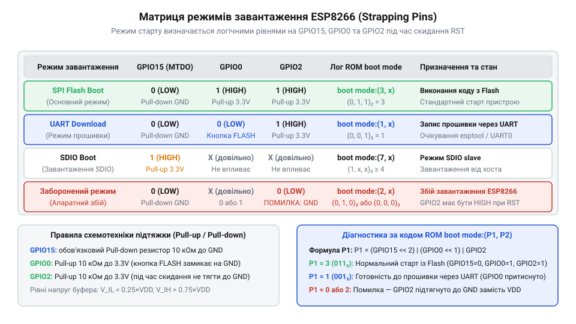
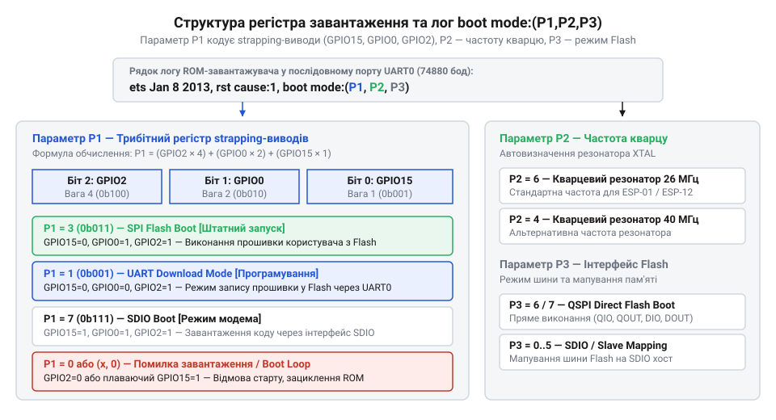

# Апаратна специфікація strapping-виводів, матриця режимів та регістри стану завантаження ESP8266

<preknowlist>
- [Огляд мікроконтролера та архітектури SoC ESP8266](root:cat-hw-boards/esp8266-soc-architecture-overview) — призначення системних виводів, організацію живлення та загальну структуру системної шини SoC ESP8266
- [Архітектура завантажувача та режими старту ESP8266](root:cat-hw-boards/esp8266-bootloader-architecture) — послідовність виконання первинного ROM-завантажувача та логіку вибору джерела виконання коду
</preknowlist>

## Невизначений стан виводів під час скидання

Під час апаратного скидання (англ. @@en|Power-On Reset@@, @@en|POR@@; @@en|скидання при включенні живлення POR@@) та при пробудженні з режиму глибокого сну (англ. @@en|Deep Sleep@@, від *deep* — глибокий та *sleep* — сон; @@en|режим глибокого сну Deep Sleep@@) внутрішній первинний ROM-завантажувач мікроконтролера ESP8266 опитує рівні напруги на трьох спеціальних конфігураційних виводах (англ. @@en|strapping pins@@, від *strap* — обв'язувати, затискати; @@en|конфігураційні виводи strapping pins@@): `GPIO0`, `GPIO2` та `GPIO15`. Значення цих сигналів фіксуються в момент утримання активного імпульсу скидання `RST` і визначають, з якого джерела процесор почне зчитувати виконання прошивки.

Якщо під час старту виводи опиняються у високоімпедансному стані (англ. @@en|Hi-Z@@, від *high* — високий та *impedance* — імпеданс; @@en|високоімпедансний стан Hi-Z@@) або на них діють плаваючі потенціали наводок периферії, мікроконтролер не може однозначно визначити потрібний режим завантаження. Наприклад, випадкова завада чи відсутність фізичної підтяжки на лініях `GPIO0` або `GPIO15` призводить до того, що замість штатного запуску з зовнішньої флеш-пам'яті чип самовільно переходить у режим програмування через послідовний порт або в режим мережевого со-процесора. Щоб гарантувати детермінований старт системи при кожному ввімкненні живлення, конфігураційні лінії вимагають фіксованих зовнішніх підтягуючих резисторів, які формують чіткі логічні рівні до моменту ініціалізації вхідно-вихідних портів SoC. Архітектурні особливості системної шини висвітлює [огляд мікроконтролера та архітектури SoC ESP8266](root:cat-hw-boards/esp8266-soc-architecture-overview), а послідовність стадій старту описує [архітектура завантажувача та режими старту ESP8266](root:cat-hw-boards/esp8266-bootloader-architecture).

Додатковим дестабілізуючим чинником є паразитна ємність монтажних доріжок друкованої плати та тривалий час наростання напруги живлення: якщо рівень `V_DD` виходить на робоче значення повільніше за спад імпульсу скидання, конфігураційні виводи можуть зафіксувати проміжний логічний стан. Для запобігання збоям тривалість активного низького сигналу на лінії `RST` обирають із запасом (не менше `100 мкс`), що дає змогу апаратному домену живлення повністю стабілізуватися, а паразитним ємностям зарядитися до фіксації логічних рівнів завантажувачем.

Для захисту лінії `RST` від високочастотних імпульсних завад вхідний каскад скидання мікроконтролера містить внутрішній фільтр низьких частот, а у зовнішньому обв'язуванні застосовують інтегрувальний конденсатор `C_rst ≈ 100 нФ` у паралель із підтягувальним резистором `R_rst = 10 кОм`. Утворений RC-ланцюг визначає сталу часу `τ = R_rst × C_rst = 10 кОм × 100 нФ = 1 мс`, яка сповільнює наростання напруги на лінії `RST` при ввімкненні живлення. Це гарантує, що розблокування процесора відбувається з затримкою близько `1 мс` після досягнення `V_DD` номінального значення `3.3 В`, забезпечуючи повне завершення перехідних процесів на конфігураційних лініях та усуваючи ризик помилкового зчитування логічних рівнів.

## Матриця логічних рівнів режимів завантаження

Вибір джерела завантаження та режиму роботи мікроконтролера ESP8266 задається комбінацією логічних рівнів на трьох конфігураційних лініях у момент скидання. Внутрішній завантажувач розрізняє три основні режими: завантаження з зовнішньої SPI-флеш-пам'яті (англ. @@en|SPI Flash Boot@@; @@en|завантаження з SPI Flash Boot@@), режим прошивки через послідовний порт (англ. @@en|UART Download@@; @@en|режим прошивки UART Download@@) та режим виведеного со-процесора (англ. @@en|SDIO Boot@@; @@en|режим SDIO Boot@@).

Основною умовою для нормальної роботи пристрою є утримання виводу `GPIO15` на рівні логічного нуля (`0`). Якщо під час скидання на `GPIO15` діє логічна одиниця (`1`), мікроконтролер незалежно від стану інших виводів переключається у режим `SDIO Boot`, очікуючи зовнішніх команд від головного хост-процесора. При підтягнутому до нуля `GPIO15` стан виводу `GPIO0` визначає напрямок старту: рівень `1` на `GPIO0` і `GPIO2` ініціює звичайний запуск `SPI Flash Boot` з виконання прошивки, тоді як рівень `0` на `GPIO0` переводить чип у стан `UART Download` для запису нової програми інструментом `esptool`.

*Матриця логічних рівнів на виводах GPIO0, GPIO2 та GPIO15 для конфігурування режимів завантаження ESP8266.*

Комбінації, у яких вивід `GPIO2` примусово підтягнуто до нуля (`GPIO2 = 0`), є зарезервованими або недійсними для стандартної роботи й викликають падіння завантажувача. Окремі схемотехнічні нюанси підключення зовнішніх виводів описують [режими завантаження мікроконтролера ESP8266](root:cat-hw-boards/esp8266-boot-modes) та [посібник з прошивальних адаптерів](root:cat-hw-boards/esp-01-programmer-adapters).

При фіксації заборонених комбінацій (наприклад, `GPIO2 = 0` або `GPIO15 = 1` при спробі автономного старту) скінченний автомат первинного завантажувача копіює помилковий маскувальний код у внутрішній регістр стану завантаження та переходить у тупиковий цикл очікування або виконання непідтримуваних тестових інструкцій ROM. У цей момент внутрішній контролер шини вимикає інтерфейс SPI Flash, а в послідовний порт надсилається аварійне повідомлення про збій режиму, після чого виконання коду зупиняється до спрацьовування сторожового таймера або подачі повторного сигнального імпульсу `RST`.

Для виходу з нештатних тупикових станів задіяно апаратний сторожовий таймер (англ. @@en|Watchdog Timer@@, @@en|WDT@@; @@en|сторожовий таймер WDT@@), який починає відлік часу відразу після зняття імпульсу скидання. Оскільки тупиковий цикл ROM-завантажувача не здійснює періодичного скидання лічильника WDT, через `~1.6–3.2 секунди` таймер генерує системний імпульс перезапуску. Це ініціює новий цикл опитання strapping-виводів; якщо апаратна помилка підтяжки на платі лишається неусунутою, мікроконтролер потрапляє у циклічний перезапуск (англ. @@en|bootloop@@; @@en|циклічний перезапуск bootloop@@), регулярно надсилаючи коди збоїв у послідовний порт.

## Електричні параметри та розрахунок підтяжки

Зчитування потенціалів на конфігураційних виводах здійснюється вхідними буферами з тригерами Шмітта (англ. @@en|Schmitt trigger@@, від прізвища винахідника Отто Шмітта; @@en|тригер Шмітта@@), які забезпечують апаратний гістерезис для захисту від шумів. Електричні межі спрацьовування розраховуються відносно напруги живлення `V_DD = 3.3 В`.

Максимальний поріг напруги логічного нуля `V_IL` становить 25% від напруги живлення:

    V_IL = 0.25 × V_DD
         = 0.25 × 3.3             [підстановка напруги живлення 3.3 В]
         = 0.825                  [В]

Мінімальний поріг напруги логічної одиниці `V_IH` становить 75% від напруги живлення:

    V_IH = 0.75 × V_DD
         = 0.75 × 3.3             [підстановка напруги живлення 3.3 В]
         = 2.475                  [В]

Для надійного встановлення логічних рівнів застосовують зовнішні підтягуючі резистори до живлення (англ. @@en|pull-up@@; @@en|підтяжка pull-up@@) та підтягувально-знижувальні резистори до землі (англ. @@en|pull-down@@; @@en|підтяжка pull-down@@). При розрахунку номіналів необхідно враховувати струм витоку входу `I_Lkg ≈ 1 мкА` та внутрішні слабострумові підтяжки SoC `R_int ≈ 30–50 кОм`.

Для виводу `GPIO15`, який вимагає логічного нуля, зовнішній знижувальний резистор `R_pd = 10 кОм` утворює падіння напруги за рахунок витоку:

    V_Rpd = I_Lkg × R_pd
          = (1 × 10⁻⁶) × (10 × 10³) [підстановка струму витоку 1 мкА та опору 10 кОм]
          = 0.01                  [В]

Отримане значення `0.01 В` значно менше за допустиму межу `V_IL = 0.825 В`, що стверджує надійне фіксування нуля. Для виводів `GPIO0` та `GPIO2`, де потрібна логічна одиниця, зовнішній резистор `R_pu = 10 кОм` працює паралельно з внутрішньою підтяжкою `R_int ≈ 40 кОм`:

    R_eq = (R_pu × R_int) ÷ (R_pu + R_int)
         = (10 × 40) ÷ (10 + 40)  [розрахунок еквівалентного опору паралельних резисторів]
         = 8                      [кОм]

Падіння напруги від витоку становить `V_drop = 1 мкА × 8 кОм = 0.008 В`, тому підсумкова напруга на виводі складає `V_pin = 3.3 - 0.008 = 3.292 В`, що суттєво перевищує поріг `V_IH = 2.475 В`.

При підвищенні температури навколишнього середовища (наприклад, до +85 °C) струм витоку вхідних напівпровідникових структур зростає і може досягати `I_Lkg_max ≈ 10 мкА`. Для збереження логічного нуля на виводі `GPIO15` падіння напруги `V_Rpd` не повинно перевищувати порогове значення `V_IL = 0.825 В`, що визначає гранично припустимий опір знижувального резистора `R_pd_max = V_IL ÷ I_Lkg_max = 0.825 В ÷ 10 мкА = 82.5 кОм`. Використання стандартного номіналу `R_pd = 10 кОм` дає понад восьмикратний запас міцності (`82.5 кОм >> 10 кОм`), що повністю усуває ризик температурного збою фіксації режиму завантаження.

## Регістри завантаження та розшифровка логів ROM

Під час подачі живлення або скидання первинний ROM-завантажувач зчитує апаратний стан виводів і копіює фіксовані біти у системний регістр стану завантаження (англ. @@en|boot mode register@@; @@en|регістр стану завантаження boot mode register@@). Зчитані значення транслюються у первинний текстовий лог, який надсилається у послідовний порт `UART0` на нестандартній швидкості `74880` бод у вигляді рядка `boot mode:(P1,P2,P3)` (англ. @@en|boot mode@@; @@en|режим завантаження boot mode@@).

Перший параметр `P1` являє собою числове значення трьох молодших бітів, де кожен біт відповідає фізичному рівню на відповідній конфігураційній лінії: біт 0 відображає `GPIO15`, біт 1 — `GPIO0`, а біт 2 — `GPIO2`. Значення `P1 = 3` (двійкове `0b011`) означає, що `GPIO15 = 0`, `GPIO0 = 1`, `GPIO2 = 1`, що відповідає штатному режиму `SPI Flash Boot`. Значення `P1 = 1` (`0b001`) свідчить про підтяжку `GPIO0` до нуля і вхід у режим `UART Download`. Другий і третій параметри `P2` та `P3` містять службові прапори розпізнавання частоти кварцового резонатора та внутрішніх режимів Flash-контролера.

*Структура регістра стану завантаження та розшифровка коду boot mode:(P1,P2,P3) ROM-завантажувача.*

Аналіз значення `P1` у консольному лозі є головним інструментом діагностики апаратних помилок старту. Наприклад, поява коду `boot mode:(7,x)` вказує на помилкову підтяжку `GPIO15` до живлення, а код `boot mode:(0,x)` свідчить про недопустиме заземлення `GPIO2`. Подальші кроки налаштування плати описано у матеріалах про [прошивання модуля ESP-01](root:cat-hw-boards/esp01-firmware-flashing) та [особливості плати ESP-01S](root:cat-hw-boards/esp-01s).

Параметри `P2` та `P3` відповідають за вибір системного тактування та режимів роботи Flash-контролера. Другий параметр `P2` відображає автовизначену частоту кварцового резонатора (значення `6` відповідає частоті `26 МГц`, а `4` — `40 МГц`), що дає змогу виявити апаратну невідповідність запаяного кварцу. Третій параметр `P3` визначає ширину шини та режим зчитування Flash-пам'яті (`QIO`, `QOUT`, `DIO`, `DOUT`). Помилкові значення у `P2` або `P3` призводять до розсинхронізації швидкості `UART0` при передачі даних або до неможливості зчитати другу стадію завантажувача з Flash-пам'яті.
