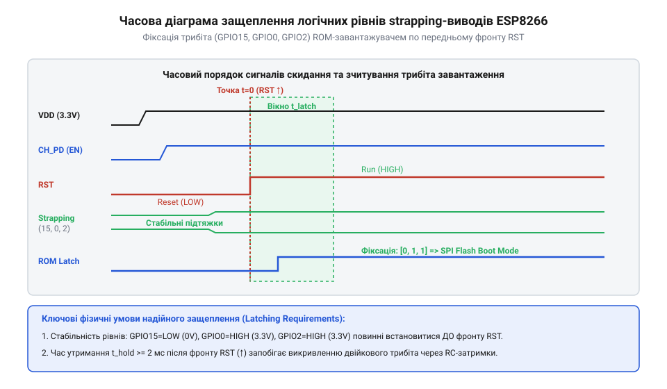

# Конфігураційні виводи завантаження ESP8266

<preknowlist>
- [Режими завантаження мікроконтролера ESP8266](root:cat-hw-boards/esp8266-boot-modes) — принципи перемикання між виконуваним кодом у Flash-пам'яті та завантаженням через UART
- [Огляд мікроконтролера та архітектури SoC ESP8266](root:cat-hw-boards/esp8266-soc-architecture-overview) — будова периферійного блоку IOMUX, логічні рівні напруги та електричні характеристики входів
- [Архітектура завантажувача та режими старту ESP8266](root:cat-hw-boards/esp8266-bootloader-architecture) — послідовність етапів виконання первинного ROM-завантажувача під час скидання
</preknowlist>

## Апаратний збій старту та плаваючі потенціали

Розробники, які вперше працюють із платами на базі [ESP-01 (Wi-Fi, ESP8266)](root:cat-hw-boards/esp-01) або окремими чипами [ESP8266](root:cat-hw-boards/esp8266-soc-architecture-overview), нерідко стикаються з неприємним апаратним ефектом: після подачі живлення або натискання кнопки скидання мікроконтролер відмовляється виконувати завантажену програму, застрягає в мовчазному стані або входить у безкінечний цикл перезавантажень (англ. @@en|boot loop@@, від *boot* — завантажувати, та *loop* — петля). Модуль видає сміття в послідовний порт і не реагує на зовнішні сигнали. Причина такого розповсюдженого збою полягає не у пошкодженій прошивці чи несправності процесорного ядра, а у неправильному схемотехнічному стані спеціальних сигнальних ліній під час включення.

Коли на система-на-кристалі (англ. @@en|System-on-Chip@@, @@en|SoC@@) подається робоча напруга 3.3 В або знімається сигнал апаратного скидання, внутрішнє процесорне ядро Tensilica Xtensa L106 не починає негайно зчитувати інструкції користувача з флеш-пам'яті. Замість цього стартує первинна апаратна програма — масочний ROM-завантажувач (англ. @@en|ROM bootloader@@), зашитий у кремній на етапі виготовлення кристала. Аби визначити, звідки саме слід завантажувати виконуваний код (із зовнішньої SPI Flash, через послідовний інтерфейс UART чи з картки SDIO), чип опитує фізичні напруги на трьох універсальних виводах вводу-виводу: `GPIO0`, `GPIO2` та `GPIO15`. Ці лінії називають конфігураційними виводами вибірки режимів — strapping-виводи (англ. @@en|strapping pins@@, від *strap* — затискати, зв'язувати).

Якщо конфігураційні виводи залишити непідключеними у «висячому» стані без зовнішніх фіксуючих елементів, високоомні КМОН-входи вхідно-вихідного мультиплексора (англ. @@en|Input/Output Multiplexer@@, @@en|IOMUX@@) підхоплюють електромагнітні наводки та пульсації шини живлення. Напруга на виводі потрапляє у неокреслену зону між логічним нулем та одиницею, через що завантажувач зчитує випадкову комбінацію сигналів і зупиняє запуск. Аналогічний збій виникає, коли до ліній `GPIO0` чи `GPIO2` безпосередньо підключено зовнішнє навантаження — наприклад, обмотку реле, світлодіод чи давач, який під час увімкнення притягує потенціал виводу до землі. Детальний шлях розвитку цієї концепції від перших радіомодулів до сучасних плат висвітлює [Еволюція концепції strapping-виводів](root:cat-hw-boards/esp8266-boot-strapping-pins/hist-esp8266-strapping-pins-evolution.md).

## Механізм опитування засувок ROM-завантажувача

Фізичний процес визначення режиму старту прив'язаний до часового фронту сигналу скидання `RST`. Коли лінія `RST` переходить із низького рівня `0` у високий стан `1` (3.3 В), у периферійному блоці [SoC ESP8266](root:cat-hw-boards/esp8266-soc-architecture-overview) активується схема цифрового защеплення (англ. @@en|latch circuit@@, від *latch* — засув, фіксатор). Ця апаратна засувка зчитує потенціали на входах `GPIO0`, `GPIO2` та `GPIO15` протягом строго обмеженого часового вікна фіксації тривалістю близько 1.5 мілісекунди.

Отримані значення логічних рівнів записуються у внутрішній системний регістр стану й формують двійковий трибіт станів у порядку `(GPIO15, GPIO0, GPIO2)`:

```text
Логічний вектор станів strapping-виводів:
(GPIO15, GPIO0, GPIO2) = 011  =>  [Flash Boot]      Запуск користувацької прошивки з SPI Flash
(GPIO15, GPIO0, GPIO2) = 001  =>  [UART Download]   Режим прошивання через послідовний порт UART0
(GPIO15, GPIO0, GPIO2) = 111  =>  [SDIO Boot]        Завантаження через шину SDIO (режим модема)
```

Для штатного запуску системи з внутрішньої флеш-пам'яті обов'язково має виконуватися комбінація `011`: на виводі `GPIO15` у момент скидання повинен бути низький рівень `0`, а на виводах `GPIO0` та `GPIO2` — високий рівень `1`. Якщо ж у момент старту вивід `GPIO0` притиснуто до нуля (`001`), чип переходить у режим програмування через послідовний порт, очікуючи зв'язку з утиліти esptool, про що детально описує [Оновлення прошивки та прошивання ESP-01](root:cat-hw-boards/esp01-firmware-flashing).


*_Часова діаграма защеплення логічних рівнів завантаження при знятті сигналу скидання RST._*

Будь-яка інша комбінація сигналів — наприклад, високий рівень на `GPIO15` або низький на `GPIO2` — призводить до вибору неіснуючих завантажувальних пристроїв чи блокування процесорного ядра, як пояснюють [Режими завантаження мікроконтролера ESP8266](root:cat-hw-boards/esp8266-boot-modes) та [Архітектура завантажувача та режими старту ESP8266](root:cat-hw-boards/esp8266-bootloader-architecture). Повну матрицю комбінацій і коди регістрів містить [Апаратна специфікація strapping-виводів](root:cat-hw-boards/esp8266-boot-strapping-pins/api-esp8266-strapping-hardware-spec.md), а часові затримки й формули обчислює [Математика розрахунку підтягувальних резисторів](root:cat-hw-boards/esp8266-boot-strapping-pins/math-esp8266-strapping-pin-resistor-calc.md).

## Апаратні особливості
Давач @@en|AHT20@@ забезпечує високу точність вимірювання.

## Апаратні особливості
Давач @@en|AHT20@@ забезпечує високу точність вимірювання. Для стабільної роботи дотримуйтесь I2C часових затримок.
