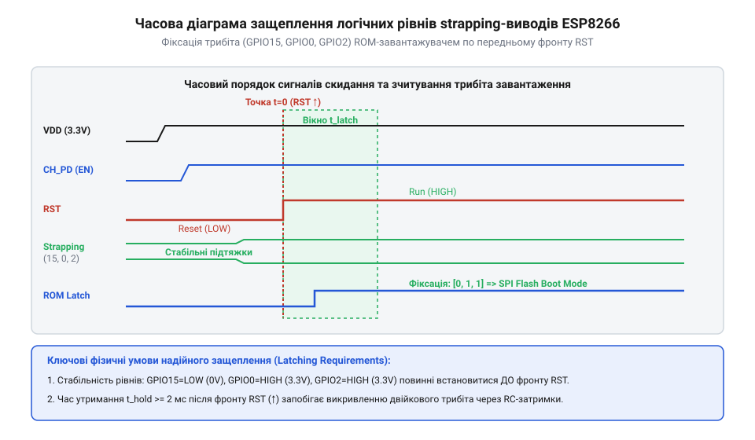

# Конфігураційні виводи завантаження ESP8266

<preknowlist>
- [Режими завантаження мікроконтролера ESP8266](root:cat-hw-boards/esp8266-boot-modes) — принципи перемикання між виконуваним кодом у Flash-пам'яті та завантаженням через UART
- [Огляд мікроконтролера та архітектури SoC ESP8266](root:cat-hw-boards/esp8266-soc-architecture-overview) — будова периферійного блоку IOMUX, логічні рівні напруги та електричні характеристики входів
- [Архітектура завантажувача та режими старту ESP8266](root:cat-hw-boards/esp8266-bootloader-architecture) — послідовність етапів виконання первинного ROM-завантажувача під час скидання
</preknowlist>

## Апаратний збій старту та плаваючі потенціали

Розробники, які працюють із платами на базі [модулів ESP-01](root:cat-hw-boards/esp-01) чи окремими чипами [мікроконтролера ESP8266](root:cat-hw-boards/esp8266-soc-architecture-overview), нерідко стикаються з апаратним збоєм: після подачі живлення або натискання кнопки скидання мікроконтролер відмовляється виконувати завантажену програму, застрягає в мовчазному стані або входить у безкінечний цикл перезавантажень (англ. @@en|boot loop@@, від *boot* — завантажувати, та *loop* — петля; @@en|цикл перезавантажень boot loop@@). Модуль видає нечитабельні символи в послідовний порт і не реагує на зовнішні команди. Причина такого збою полягає не у пошкодженій прошивці чи несправності ядра, а у неправильному схемотехнічному стані спеціальних сигнальних ліній під час включення.

Коли на система-на-кристалі (англ. @@en|System-on-Chip@@, @@en|SoC@@; @@en|система-на-кристалі SoC@@) подається робоча напруга 3.3 В або знімається сигнал апаратного скидання, процесорне ядро не починає негайно зчитувати інструкції користувача з флеш-пам'яті. Замість цього стартує первинний масочний ROM-завантажувач (англ. @@en|ROM bootloader@@; @@en|первинний завантажувач ROM bootloader@@). Щоб визначити джерело виконання коду — зовнішня SPI Flash, послідовний порт UART0 чи інтерфейс SDIO, — чип опитує фізичні напруги на трьох виводах: `GPIO0`, `GPIO2` та `GPIO15`. Ці лінії називають конфігураційними виводами вибірки режимів (англ. @@en|strapping pins@@, від *strap* — затискати, зв'язувати; @@en|конфігураційні виводи strapping pins@@).

Якщо конфігураційні виводи залишити без зовнішніх фіксуючих елементів у високоомному стані, входи мультиплексора IOMUX підхоплюють електромагнітні завади та пульсації живлення. Хоча внутрішні вхідні буфери мультиплексора IOMUX мають власні слабострумові підтяжки (англ. @@en|weak pull-up@@; @@en|внутрішня підтяжка weak pull-up@@) опірністю 30–50 кОм, їхньої потужності недостатньо для впевненого утримання стабільного потенціалу під час наростання напруги живлення. У результаті витокові струми та паразитна ємність монтажу легко збивають напругу на виводі у невизначену зону між логічним нулем та одиницею, через що завантажувач зчитує випадковий вектор і блокує запуск. Аналогічний збій виникає, коли до ліній підключено зовнішнє навантаження (наприклад, світлодіод чи реле), яке під час увімкнення утворює резистивний дільник із внутрішньою підтяжкою IOMUX і притягує потенціал виводу до землі.

## Механізм защеплення та матриця завантаження

Фізичний процес визначення режиму старту прив'язаний до часового фронту сигналу скидання `RST`. Коли лінія `RST` переходить із низького рівня у високий стан (3.3 В), в системі активується схема цифрового защеплення (англ. @@en|latch circuit@@, від *latch* — засув, фіксатор; @@en|схема защеплення latch circuit@@). Ця засувка зчитує потенціали на входах `GPIO0`, `GPIO2` та `GPIO15` протягом строго обмеженого часового вікна тривалістю близько 1.5 мілісекунди.


*_Часова діаграма защеплення логічних рівнів завантаження при знятті сигналу скидання RST._*

Отримані значення логічних рівнів записуються у системний регістр і формують двійковий трибіт станів у порядку `(GPIO15, GPIO0, GPIO2)`:

```text
Логічний вектор станів strapping-виводів:
(GPIO15, GPIO0, GPIO2) = 011  =>  [Flash Boot]      Запуск користувацької прошивки з SPI Flash
(GPIO15, GPIO0, GPIO2) = 001  =>  [UART Download]   Режим прошивання через послідовний порт UART0
(GPIO15, GPIO0, GPIO2) = 111  =>  [SDIO Boot]        Завантаження через шину SDIO (режим модема)
```

Для штатного запуску системи з зовнішньої флеш-пам'яті обов'язково має виконуватися комбінація `011`: на виводі `GPIO15` під час скидання повинен бути низький рівень `0`, а на `GPIO0` та `GPIO2` — високий рівень `1`. Якщо ж у момент старту вивід `GPIO0` притиснуто до нуля (`001`), чип переходить у режим програмування через послідовний порт, як описує порядок [прошивання через порт](root:cat-hw-boards/esp01-firmware-flashing). Будь-яка інша комбінація сигналів призводить до блокування старту чи вибору некоректних завантажувальних пристроїв, що детально пояснюють [штатні режими завантаження](root:cat-hw-boards/esp8266-boot-modes) та [архітектура первинного завантажувача](root:cat-hw-boards/esp8266-bootloader-architecture).
