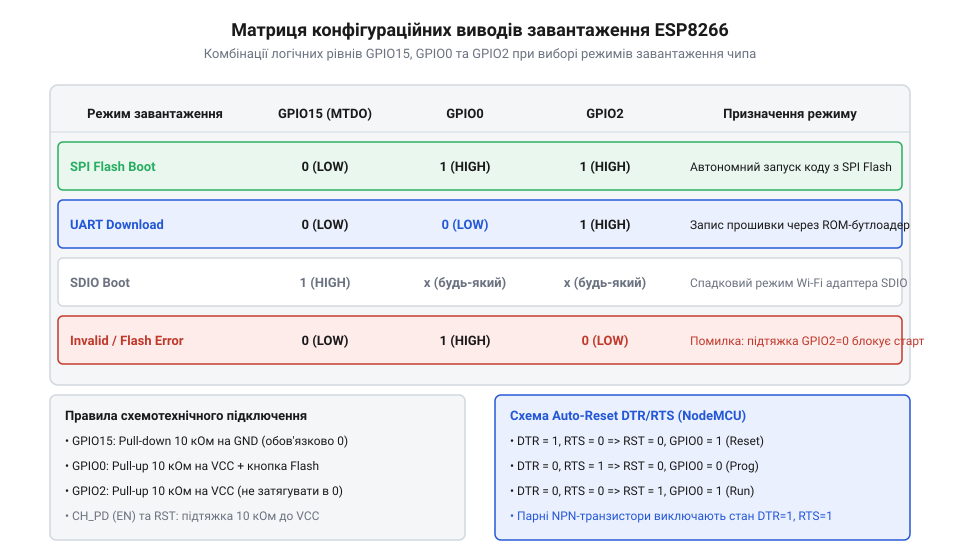
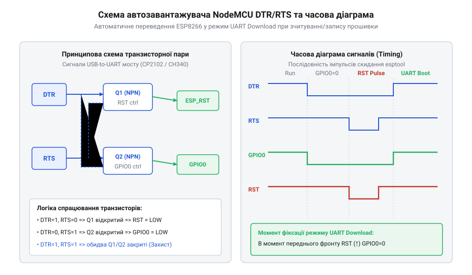

# Еволюція концепції strapping-виводів та засобів їх автоматичної комутації в ESP8266

<preknowlist>
- [Огляд мікроконтролера та архітектури SoC ESP8266](root:cat-hw-boards/esp8266-soc-architecture-overview) — будова ядра Xtensa LX106 та первинного завантажувача ROM
- [ESP-01 (Wi-Fi, ESP8266)](root:cat-hw-boards/esp-01) — цокольовка виводів та обмеження використання GPIO
- [Режими завантаження мікроконтролера ESP8266](root:cat-hw-boards/esp8266-boot-modes) — вимоги до підтяжки сигнальних ліній старту
</preknowlist>

## Спадщина SDIO та чип ESP8089

Історія виникнення режимів старту мікроконтролера ESP8266 бере початок із 2013 року, коли шанхайська компанія Espressif Systems розробила спеціалізований Wi-Fi співпроцесор ESP8089. Початковим призначенням цього чипа було забезпечення бездротового зв'язку для бюджетних планшетних ПК та медіаплеєрів на базі процесорів Rockchip та Allwinner. У цій архітектурі ESP8089 працював як ведений пристрій, підключений до головного процесора через інтерфейс @@en|SDIO@@ (англ. @@en|Secure Digital Input Output@@, від *secure* — безпечний, *digital* — цифровий, *input* — вхід та *output* — вихід; @@en|інтерфейс SDIO@@).

Оскільки власної енергонезалежної Flash-пам'яті чип ESP8089 не мав, прошивка виконуваного коду завантажувалася в його внутрішнє @@en|SRAM@@ безпосередньо з центрального процесора під час подачі живлення. Для вибору параметрів шини та конфігурації завантажувача первинний [постійний запам'ятовувальний пристрій ROM](root:cat-hw-boards/esp8266-bootloader-architecture) зчитував стан спеціальних виводів — конфігураційних виводів завантаження (англ. @@en|strapping pins@@, від *strap* — обв'язувати, фіксувати та *pin* — вивід, контакт; @@en|конфігураційні виводи strapping pins@@). Стан цих ліній під час апаратного скидання визначав, чи ініціалізувати шину у сумісному 1-бітовому режимі @@en|SDIO 1-bit mode@@ з передачею даних виключно лінією `DAT0` (де лінії `DAT1–DAT3` залишалися вільними для передачі переривань чи службових сигналів), чи розгортати високошвидкісний 4-бітовий режим @@en|SDIO 4-bit mode@@, у якому всі чотири лінії `DAT0–DAT3` працювали паралельно для максимальної пропускної здатності при завантаженні прошивки. Саме логічні рівні на фіксуючих контактах під час подачі живлення вказували первинній мікропрограмі ROM, через які саме фізичні виводи шини очікувати бінарний образ від хост-процесора.

Згодом інженери Espressif виявили, що обчислювальної потужності інтегрованого 32-бітового ядра Xtensa LX106 достатньо не лише для обробки мережевого стека, а й для виконання повноцінних прикладних програм користувача. У 2014 році на ринок вийшов чип ESP8266EX, який перетворив ведений співпроцесор на автономну систему на кристалі (англ. @@en|System on Chip@@; @@en|SoC@@). Проте для збереження зворотної сумісності з кристалом ESP8089 розробники залишили апаратний масив первинного завантажувача ROM практично без змін, зберігши спадкову матрицю декодування логічних рівнів на виводах `GPIO15`, `GPIO0` та `GPIO2`. Фізичний механізм зчитування рівнів у чипі ESP8089 прив'язувався строго до часового вікна наростання напруги на лінії скидання: під час виходу з апаратного скидання внутрішній компаратор стробує вхідні буфери й защеплює (англ. @@en|latch@@, від *latch* — засувка, фіксувати; @@en|защеплювати latch@@) потенціали виводів у внутрішні D-тригери за кілька мікросекунд до запуску тактування ядра. Якщо логічні рівні на виводах не встигали стабілізуватися до моменту перетину порогової напруги, завантажувач ROM зчитував нестабільний стан і блокував ініціалізацію шини SDIO, що в успадкованій архітектурі ESP8266EX також стало причиною апаратних збоїв, коли обиралися хибні [режими завантаження мікроконтролера](root:cat-hw-boards/esp8266-boot-modes).

## Проблема мультиплексування та пастки ESP-01

У звичайному автономному режимі роботи завантажувач мікроконтролера виконує код із зовнішньої SPI Flash-пам'яті (англ. @@en|Serial Peripheral Interface Flash@@, від *serial* — послідовний, *peripheral* — периферійний, *interface* — інтерфейс та *flash* — флеш-пам'ять). Для цього апаратна логіка чипа під час зняття сигналу скидання (англ. @@en|Power-On Reset@@; @@en|POR@@) опитує три сигнальні лінії: `GPIO15`, `GPIO0` та `GPIO2`. Комбінація їхніх електричних рівнів визначає вектор передачі керування ядра після завершення процедури старту.

*Схема логічних рівнів конфігураційних виводів для вибору режимів завантаження.*

Штатна робота з виконання коду з Flash-пам'яті вимагає чіткої комбінацій логічних рівнів: `GPIO15` повинен утримуватися у стані логічного нуля (0 В), а виводи `GPIO0` та `GPIO2` — у стані логічної одиниці (3.3 В). Для переведення чипа в режим оновлення прошивки через послідовний порт вивід `GPIO0` притискають до землі (0 В), залишаючи `GPIO15` у нулі, а `GPIO2` у одиниці. Якщо ж вивід `GPIO15` під час старту опиниться підтягнутим до високого рівня (3.3 В), первинний завантажувач @@en|ROM@@ активує спадковий режим веденого пристрою @@en|SDIO@@, повністю блокуючи звернення до зовнішньої флеш-пам'яті. У цьому режимі внутрішні алгоритми [архітектури завантажувача ESP8266](root:cat-hw-boards/esp8266-bootloader-architecture) перенаправляють вектор виконання ядра на опитування контролера веденої шини @@en|SDIO@@ та примусово вимикають периферійні лінії контролера @@en|SPI Flash@@. Оскільки ядро очікує завантаження виконуваного образу безпосередньо у внутрішнє @@en|SRAM@@ через зовнішні пакети даних від головного процесора, відсутність відповіді по шині @@en|SDIO@@ призводить до нескінченного блокуючого очікування та повністю унеможливлює автономний запуск із підключеного чипа пам'яті.

Перші масові плати на ринку, зокрема [модулі серії ESP-01](root:cat-hw-boards/esp-01), містили критичні схемотехнічні недоліки через відсутність належної обв'язки. Розробники плат часто не встановлювали зовнішній підтягувальний резистор опором `10 кОм` між лінією `GPIO15` та землею, через що вивід залишався в плаваючому стані. Будь-які наведення на вхідних буферах призводили до того, що під час включення [автономного мікроконтролера ESP8266](root:cat-hw-boards/esp8266-soc-architecture-overview) завантажувач випадково обирав режим SDIO та впадав у циклічне перезавантаження. Для забезпечення стабільного старту розробники змушені були вручну розводити джампери й підтяжки, керуючись документацією на [режими завантаження ESP8266](root:cat-hw-boards/esp8266-boot-modes), поки не з'явилися оновлені модулі ESP-01S з інтегрованими резисторами.

На додаток до плаваючого стану `GPIO15`, серйозною схемотехнічною пасткою оригінальних плат [серії ESP-01](root:cat-hw-boards/esp-01) був світлодіод індикації активності порту, підключений між шиною живлення `3.3 В` та конфігураційним виводом `GPIO2`. Для штатного запуску із флеш-пам'яті вивід `GPIO2` під час зняття скидання вимагає високого логічного рівня, проте падіння напруги на світлодіоді у поєднанні з низьким внутрішнім імпедансом вхідного буфера чипа створювало нестабільний дільник напруги. Підключення будь-якого зовнішнього давача або транзисторного ключа з низьким вхідним опором до виводу `GPIO2` призводило до просідання напруги у вікні защеплення нижче за поріг логічної одиниці, змушуючи завантажувач ухвалювати хибне рішення і блокувати старт коду аж до появи інтегрованої обв'язки в [модифікованих модулях ESP-01S](root:cat-hw-boards/esp-01s).

## Створення схем автоматичного прошивання NodeMCU

Ранній етап розробки пристроїв на ESP8266 вимагав від інженерів постійних ручних маніпуляцій. Для кожного завантаження нового бінарного файлу потрібно було вручну замикати лінію `GPIO0` на землю, притискати вивід `RST` для перезавантаження чипа, витримувати часову паузу та відпускати виводи у зворотній послідовності. Такі механічні дії не лише сповільнювали налагодження, а й регулярно спричиняли помилки запису через недотримання точних інтервалів переключення режимів.

Для усунення людського чинника у 2014–2015 роках розробники платформи NodeMCU створили схему автоматичного скидання (англ. @@en|auto-reset circuit@@, від *auto* — автоматичний, *reset* — скидання та *circuit* — схема; @@en|схема автозавантаження auto-reset circuit@@) на двох біполярних NPN-транзисторах (англ. @@en|NPN transistor@@, від *negative-positive-negative* — негативний-позитивний-негативний; @@en|NPN-транзистор@@). Схема підключається до допоміжних сигналів керування послідовного порту `DTR` (англ. @@en|Data Terminal Ready@@, від *data* — дані, *terminal* — термінал та *ready* — готовий) та `RTS` (англ. @@en|Request to Send@@, від *request* — запит, *to* — до та *send* — надсилати), які формуються мікросхема-перетворювачами USB-UART (CH340G або CP2102).

*Схема транзисторного автозавантажувача NodeMCU на базі сигналів DTR та RTS з часовою діаграмою послідовності скидання і переведення у режим прошивання.*

Логіка роботи перехресного транзисторного моста побудована таким чином, що почергова зміна станів сигналів `DTR` та `RTS` програмним утилітом уможливлює незалежне керування виводами `RST` та `GPIO0`. Коли прошивальник виставляє `DTR` у високий стан, а `RTS` у низький, перший транзистор притискає вивід `GPIO0` до нуля, залишаючи лінію `RST` підтягнутою до живлення. Наступний імпульс на лінії `RTS` короткочасно опускає потенціал `RST`, що ініціює апаратний старт чипа із зафіксованим нулем на `GPIO0`. Проте надійність цього автоматичного перемикання часто порушується через явище паразитного зворотного живлення (англ. @@en|back-powering@@, від *back* — зворотний та *powering* — живлення; @@en|паразитне живлення back-powering@@), коли струм від сигнальних ліній `TXD` та `RXD` послідовного адаптера підживлює шину 3.3 В через внутрішні захисні діоди вхідних буферів, заважаючи повному зняттю напруги. Крім того, наявність зовнішнього фільтруючого конденсатора на лінії `RST` затягує розряд та збільшує часову константу (англ. @@en|time constant@@, від *time* — час та *constant* — константа; @@en|часова константа time constant@@) `RC`-кола: якщо короткий імпульс `RTS` завершується до того, як потенціал на виводі `RST` встигне опуститися нижче порогової напруги спрацьовування завантажувача, перезавантаження не відбувається. Завдяки врахуванню цих фізичних обмежень та правильному вибору затримок у програмі прошивання [архітектура завантажувача та режими старту](root:cat-hw-boards/esp8266-bootloader-architecture) дозволяють прозоро виконувати [оновлення прошивки ESP-01](root:cat-hw-boards/esp01-firmware-flashing) без натискання фізичних кнопок.

## Міфи про виводи та спадщина для ESP32

Серед розробників початківців сформувався стійкий міф про те, що конфігураційні виводи завантаження `GPIO0`, `GPIO2` та `GPIO15` є «втраченими» для прикладних задач і не можуть використовуватися як звичайні лінії вводу-виводу (англ. @@en|General-Purpose Input/Output@@, від *general* — загальний, *purpose* — призначення, *input* — вхід та *output* — вихід; @@en|універсальні виводи вводу-виводу GPIO@@). Це уявлення є хибним: апаратна логіка первинного завантажувача опитує стан цих ліній виключно в короткий момент скидання живлення (протягом кількох мікросекунд).

Після того як первинний завантажувач зчитав комбінацію логічних рівнів і передав керування основній програмі користувача, усі три виводи переходять у повне розпорядження прикладного коду. Лінія `GPIO2` під час роботи може слугувати як вихід посліводного порту UART1 або шини I2C, а `GPIO15` — як сигнальний вихід вибору периферійного пристрою (англ. @@en|Chip Select@@; @@en|CS@@). Головним схемотехнічним інваріантом є лише забезпечення правильних електричних рівнів під час старту: зовнішні схеми не повинні примусово змінювати потенціал ліній до завершення ініціалізації SoC.

Досвід використання конфігураційних виводів завантаження в ESP8266 став основою для проєктування наступних поколінь мікроконтролерів Espressif. У SoC ESP32 концепцію [режимами завантаження мікроконтролера](root:cat-hw-boards/esp8266-boot-modes) розширили: до матриці додали виводи вибору робочої напруги внутрішнього регулятора Flash-пам'яті (1.8 В або 3.3 В) та налаштувань інтерфейсу JTAG. Проте базовий принцип автоматичного скидання через транзисторні пари `DTR/RTS` та тимчасового зчитування рівнів під час POR залишився незмінним стандартом для всієї індустрії IoT.
