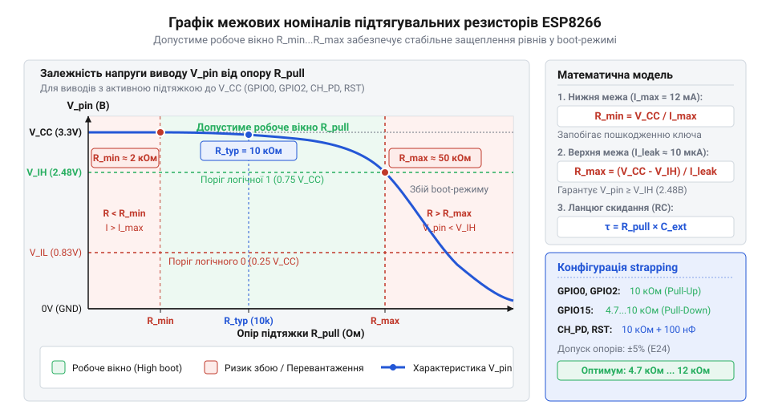

# Математика розрахунку підтягувальних резисторів, затримок защеплення та дільників для strapping-виводів

<preknowlist>
- [Режими завантаження мікроконтролера ESP8266](root:cat-hw-boards/esp8266-boot-modes) — Таблиця логічних комбінацій виводів GPIO15, GPIO0 та GPIO2 для режимів Flash Boot та UART Download
- [Огляд мікроконтролера та архітектури SoC ESP8266](root:cat-hw-boards/esp8266-soc-architecture-overview) — Параметри КМОН-периферії, порогові напруги V_IL/V_IH та максимуми струмів виводів GPIO
</preknowlist>

## Вимога розрахунку межевих підтягувальних опорів

Під час подачі живлення на мікроконтролер ESP8266 його вбудований завантажувач @@en|ROM bootloader@@ опитує стан конфігураційних виводів @@en|strapping pins@@ (`GPIO0`, `GPIO2` та `GPIO15`) для вибору режиму запуску. У цей початковий момент виводи мікроконтролера перебувають у стані високого імпедансу (англ. high-impedance state, високий опір), і без зовнішніх фіксуючих елементів на них виникає плаваючий потенціал. Внутрішні паразитичні ємності (англ. internal parasitic capacitances) кристала кремнію в поєднанні з температурним дрейфом (англ. temperature drift) створюють нестабільну часову затримку накопичення заряду на вхідних каскадах. Це зміщує точний момент досягнення порогових напруг під час опитування, через що будь-які зовнішні наводки чи електромагнітні завади призводять до довільного зчитування логічних рівнів, спричиняючи помилки вибору джерела завантаження та випадкове блокування процесора.

Для стабілізації логічних рівнів застосовують @@en|pull-up resistor|підтягувальні резистори@@ до лінії живлення або землі. Проте довільний вибір номіналу резистора створює апаратний ризик. Занадто великий опір не зможе компенсувати внутрішній струм витоку (англ. leakage current) КМОН-входів, через що напруга на виводі потрапить у невизначену зону тригера Шмітта (нім. Schmitt-Trigger). Занадто малий опір створить надмірне струмове навантаження при перемиканні виводу у вихідний стан логічного нуля чи одиниці, що викликає перевищення допустимого струму та перегрів кристала. Тому виникає сувора математична необхідність обчислення верхньої межі опору `R_max` для гарантії логічного рівня та нижньої межі `R_min` для захисту виводів від струмового перевантаження. Детальний аналіз логічних комбінацій режимів запуску наведено у статті [Режими завантаження мікроконтролера ESP8266](root:cat-hw-boards/esp8266-boot-modes).

Додатково математична модель повинна враховувати технологічні допуски розкиду опорів резисторів (до ±5%), тепловий дрейф параметрів кремнію та коливання напруги шини живлення `V_DD`. Зміна робочої напруги у діапазоні від 3.0 В до 3.6 В зсуває порогові напруги спрацьовування вхідних каскадів, через що розрахований номінал мусить забезпечувати запас завадостійкості за умови аналізу найгіршого сценарію (англ. @@en|worst-case analysis@@, від *worst* — найгірший, та *case* — випадок). Нехтування цими електричними граничними параметрами на компактних модулях призводить до ситуацій, коли пристрій стабільно завантажується в лабораторних умовах, проте зазнає збоїв старту під час експлуатації в реальних приладах, про що попереджає [огляд сімейства модулів ESP-01](root:cat-hw-boards/esp-01-module-family-overview).

Крім стаціонарних відхилень напруги, додатковий деструктивний вплив чинять низькочастотні пульсації джерела живлення (англ. @@en|power supply ripple@@, від *ripple* — пульсація, дрібна хвиля; @@en|пульсації джерела живлення power supply ripple@@), які виникають під час імпульсного споживання струму цифровими вузлами SoC. Оскільки порогові напруги спрацьовування вхідного тригера Шмітта прив'язані до шини живлення співвідношеннями `V_IH = 0.75 · V_DD` та `V_IL = 0.25 · V_DD`, амплітудне просідання `ΔV_ripple` динамічно зміщує поріг защеплення (англ. @@en|latch threshold@@) вниз саме у момент фіксації векторів старту за фронтом `RST`. Якщо потенціал на виводах `GPIO0` чи `GPIO2` через занадто великий опір підтяжки не встигає досягти динамічно зміщеного порогу `V_IH` за час часового вікна опитування, ROM-завантажувач помилково зчитує логічний нуль замість одиниці, що призводить до збою старту, який описує [архітектура завантажувача ESP8266](root:cat-hw-boards/esp8266-bootloader-architecture).

## Граничні опори R_max та R_min

Верхня межа опору підтяжки `R_max` визначається струмом витоку КМОН-транзисторів на вхідних каскадах GPIO та мінімально допустимими пороговими напругами логічної одиниці `V_IH` або логічного нуля `V_IL`. За описом апаратної частини у матеріалі про [архітектуру SoC ESP8266](root:cat-hw-boards/esp8266-soc-architecture-overview), максимальний струм витоку вхідного каскаду ESP8266 становить `I_leak = 50 nA` (або до `1 μA` з урахуванням температурного дрейфу), а логічні пороги тригера Шмітта становлять `V_IH = 0.75 × V_DD` та `V_IL = 0.25 × V_DD`. При підсумковому виборі резистора з розрахованого допустимого інтервалу обов'язково враховують технологічний розкид номіналів компонентів стандартних рядів E24 (англ. @@en|E24 series@@; @@en|ряд E24@@), де реальний опір `R_real` відхиляється від номінального значення `R_nom` у межах допуску (англ. @@en|tolerance@@; @@en|допуск номіналу@@) `δ = ±5%` (серія J) або `δ = ±10%` (серія K). Для запобігання виходу опору за межу `R_max` за найгірших температурних умов та крайніх технологічних відхилень номінал `R_nom` обирають із запасом за нерівністю `R_nom · (1 + |δ|) ≤ R_max`, що гарантує збереження логічних рівнів у матеріалі про [режими завантаження](root:cat-hw-boards/esp8266-boot-modes).

Розглянемо вивід, підтягнутий до живлення `V_DD` через резистор `R_pullup`. Напруга на виводі `V_pin` під дією струму витоку `I_leak` визначається як різниця живлення та падіння напруги на резисторі:

```text
V_pin
= V_DD - I_leak × R_pullup      [падіння напруги за законом Ома]
≥ V_IH                          [критерій логічної одиниці]
```

Звідси розраховуємо верхню межу опору підтяжки до живлення:

```text
R_pullup
≤ (V_DD - V_IH) / I_leak        [перенесення членів нерівності]
= (V_DD - 0.75 × V_DD) / I_leak [підстановка порогу V_IH]
= (0.25 × V_DD) / I_leak        [спрощення виразу]
```

Для підтяжки до землі (англ. pull-down) струм витоку створює падіння напруги на резисторі `R_pulldown`, яке не повинно перевищувати поріг логічного нуля `V_IL`:

```text
V_pin
= I_leak × R_pulldown           [закон Ома для витоку на GND]
≤ V_IL                          [критерій логічного нуля]
```

Звідси верхня межа опору підтяжки до землі становить:

```text
R_pulldown
≤ V_IL / I_leak                 [визначення R_max для pull-down]
= (0.25 × V_DD) / I_leak        [підстановка порогу V_IL]
```

Нижня межа опору `R_min` визначається максимально допустимим струмом виводу `I_out_max = 12 mA` при його активній роботі на вихід. Якщо вивід підтягнуто до `V_DD`, а внутрішній транзистор примусово замикає його на землю:

```text
R_min
= V_DD / I_out_max              [закон Ома для максимального струму]
```


*Допустимий діапазон опорів підтяжки визначається між струмом витоку та захистом виводу від струмового перевантаження.*

**Приклад розрахунку допустимого вікна опору підтяжки:**
Для напруги живлення `V_DD = 3.3 V`, максимального витоку `I_leak = 1 μA` та допустимого струму виводу `I_out_max = 12 mA` розраховуємо межеві значення:

```text
R_max
= (0.25 × 3.3) / 10⁻⁶           [підстановка параметрів у формулу]
= 0.825 / 10⁻⁶                  [обчислення чисельника]
= 825 kΩ                        [максимальний опір підтяжки]

R_min
= 3.3 / 0.012                   [підстановка живлення та струму]
= 275 Ω                         [мінімальний опір підтяжки]
```

Отже, робочий опір підтяжки повинен обиратися з діапазону від `275 Ω` до `825 kΩ`. На практиці стандартні номінали `10 kΩ` забезпечують відмінне компромісне співвідношення між високою завадостійкістю та низьким струмовим навантаженням.

## Часові константи tau ланцюгів скидання

Лінія скидання `RST` та вивід активації чипа `CH_PD` (англ. @@en|chip power down@@) містять внутрішні та зовнішні ємності `C`, які разом із підтягувальним резистором `R` утворюють інтегрувальне RC-коло. Окрім формування часової затримки, це коло обмежує швидкість наростання напруги `dV/dt` (англ. @@en|slew rate@@, від *slew* — зміщуватися, описувати дугу) для запобігання хибному спрацьовуванню схеми апаратного скидання POR при пульсаціях джерела живлення. Якщо швидкість зміни напруги є меншою за мінімально допустиму межу `(dV / dt)_min = V_IH / τ = (0.75 × V_DD) / (R × C)`, тимчасові просідання потенціалу викликають повторне спрацьовування вхідного тригера Шмітта та спричиняють збій ініціалізації. Під час подачі живлення напруга на виводі `V_RST(t)` зростає за експоненційним законом:

```text
V_RST(t)
= V_DD × (1 - e^(-t / τ))       [рівняння заряду конденсатора]
```

де `τ` (грецька літера тау) — часова константа (англ. time constant) RC-ланцюга, яка обчислюється як добуток опору та ємності:

```text
τ
= R × C                         [формула часової константи]
```

Для гарантованого защеплення (англ. latching) логічних рівнів завантажувачем `ROM bootloader` напруга на лінії `RST` повинна досягти порогового значення логічної одиниці `V_IH = 0.75 × V_DD`. Обчислимо час `t_latch`, необхідний для досягнення цього порогу:

```text
V_DD × (0.75)
= V_DD × (1 - e^(-t_latch / τ)) [прирівняння до порогу V_IH]

0.75
= 1 - e^(-t_latch / τ)          [скорочення V_DD]

e^(-t_latch / τ)
= 0.25                          [ізоляція експоненти]

-t_latch / τ
= ln(0.25)                      [логарифмування двох частин]

t_latch
= -τ × ln(0.25)                 [множення на -τ]
= τ × ln(4)                     [властивість логарифма ln(1/x) = -ln(x)]
≈ 1.386 × τ                     [чисельне значення ln(4)]
```

**Приклад розрахунку тривалості затримки для RC-ланцюга:**
При використанні резистора `R = 10 kΩ` та конденсатора `C = 100 nF` часова константа та час защеплення становлять:

```text
τ
= 10⁴ × 10⁻⁷                    [підстановка R та C]
= 10⁻³ s                        [1.0 ms]

t_latch
= 1.386 × 1.0 × 10⁻³            [множення на коефіцієнт ln(4)]
≈ 1.39 ms                       [час досягнення порогу V_IH]
```

Цей розрахунок показує, що протягом `1.39 ms` після вмикання живлення логічні рівні на виводах `GPIO0`, `GPIO2` та `GPIO15` повинні утримуватися у строго визначених станах без коливань для надійної ініціалізації завантажувача. Більш детально процеси викладено у статті [Архітектура завантажувача та режими старту ESP8266](root:cat-hw-boards/esp8266-bootloader-architecture).

## Резистивні дільники та вхідні витоки

У багатьох схемотехнічних рішеннях виводи `GPIO` підключаються до резистивних дільників напруги — наприклад, для моніторингу акумуляторної батареї або узгодження логічних рівнів суміжних периферійних модулів. Якщо такий дільник підключений до strapping-виводу `GPIO0`, на рівень напруги під час скидання додатково впливає внутрішній вихідний опір джерела вимірюваного сигналу `R_src`, який послідовно додається до верхнього плеча `R1`. З урахуванням теореми Тевеніна (англ. @@en|Thévenin's theorem@@; теорема Тевеніна про еквівалентний генератор), опори `R1` (разом із `R_src`) та `R2` (нижнє плече) утворюють еквівалентне схематичне джерело із напругою `V_eq` та еквівалентним опором `R_eq`:

```text
V_eq
= V_in × (R2 / (R1 + R2))       [теорема Тевеніна для напруги]

R_eq
= (R1 × R2) / (R1 + R2)         [паралельне з'єднання опорів дільника]
```

Проте під час старту мікроконтролера вхідний струм витоку `I_leak` проходить через еквівалентний опір `R_eq`, створюючи додаткове відхилення реальної напруги `V_real` від розрахованої еквівалентної напруги:

```text
V_real
= V_eq - I_leak × R_eq          [урахування падіння від витоку]
= V_in × (R2 / (R1 + R2)) - I_leak × ((R1 × R2) / (R1 + R2)) [підстановка V_eq та R_eq]
```

Якщо еквівалентний опір дільника `R_eq` перевищує верхню межу `R_max`, обчислену у розділі 2, струм витоку змістить вихідну напругу дільника за межі порогів `V_IH` або `V_IL`. Це призведе до зчитування некоректного логічного стану завантажувачем та зриву запуску системи.

Для забезпечення сумісності дільника із конфігураційними виводами необхідно виконувати дві умови:
1. Еквівалентний опір дільника не повинен перевищувати розраховану межу: `R_eq ≤ R_max`.
2. Реальна напруга `V_real` під дією `I_leak` повинна гарантовано задовольняти вимоги логічного порогу (`≥ V_IH` для підтяжки вгору або `≤ V_IL` для підтяжки до землі).

При проектуванні модулів типу [ESP-01](root:cat-hw-boards/esp-01) чи [ESP-01S](root:cat-hw-boards/esp-01s) дотримання цих співвідношень гарантує відсутність конфліктів між зовнішньою периферією та вбудованою системою завантаження.
