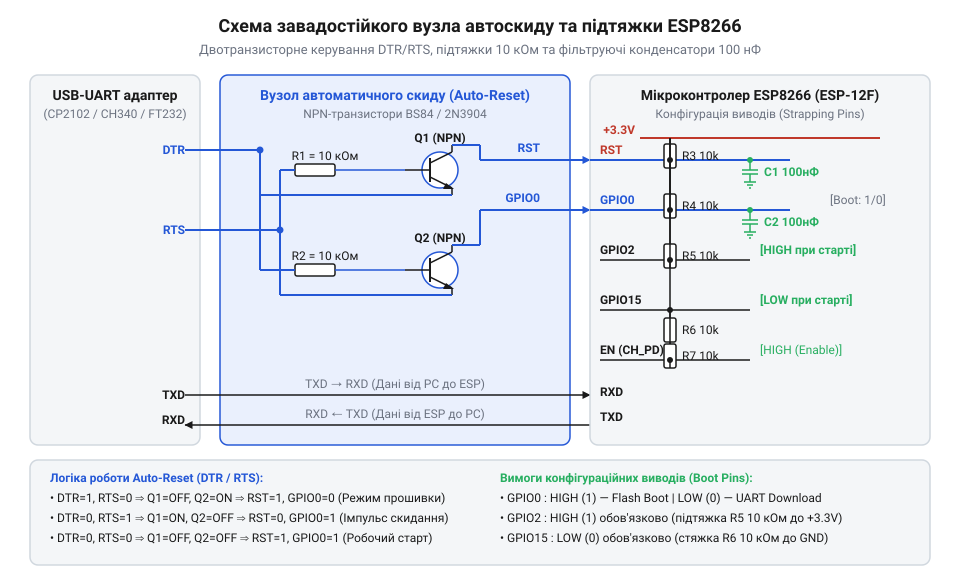

# Складання завадостійкої схеми підтяжки та транзисторного автоскиду DTR/RTS для ESP8266

<preknowlist>
- [Режими завантаження мікроконтролера ESP8266](root:cat-hw-boards/esp8266-boot-modes) — потрібні знання комбінацій логічних рівнів GPIO0, GPIO2 та GPIO15 для вибору режимів старту.
- [Архітектура завантажувача та режими старту ESP8266](root:cat-hw-boards/esp8266-bootloader-architecture) — потрібні знання про таймінги та процес фіксації рівнів ROM-завантажувачем.
- [Оновлення прошивки та прошивання ESP-01](root:cat-hw-boards/esp01-firmware-flashing) — потрібні знання базових команд esptool та логіки роботи з прошивками.
</preknowlist>

## Невизначеність ліній та плаваючі збої

При підключенні [модуля ESP-01](root:cat-hw-boards/esp-01) або окремого мікроконтролера ESP8266 на макетну плату розробники часто стикаються з непередбачуваною поведінкою системи: пристрій то хаотично перезавантажується, то відмовляється виконувати прошивку, то застрягає в невідомому стані. Головна причина таких плаваючих збоїв полягає у відсутності апаратної обв'язки ліній вибору режиму завантаження (від англ. @@en|boot-strapping pins@@; @@en|конфігураційні виводи завантаження@@) та лінії скидання `RST`. Коли виводи `GPIO0`, `GPIO2`, `GPIO15` та `RST` залишаються неприв'язаними до чітких потенціалів живлення, вхідні транзистори мікроконтролера перебувають у високоімпедансному стані (від англ. @@en|high-impedance@@; @@en|високоімпедансний стан Z@@). У цьому стані будь-який наведений електромагнітний шум, наведення від джерела живлення або наближення руки створюють на лініях плаваючий потенціал (від англ. @@en|floating state@@; @@en|плаваючий рівень напруги@@).

Під час включення живлення або зняття сигналу скидання внутрішній ROM-завантажувач [архітектури SoC ESP8266](root:cat-hw-boards/esp8266-soc-architecture-overview) фіксує логічні рівні на трьох виводах `GPIO0`, `GPIO2` та `GPIO15` протягом вузького вікна защепкування тривалістю від 20 до 100 мікросекунд. Якщо в цей момент на лініях присутній плаваючий потенціал, завантажувач зчитує випадкову комбінацію бітів і робить хибний вибір джерела стартового коду. Наприклад, якщо `GPIO15` наводнюється до логічної одиниці, чип намагається виконати запуск із SD-карти через SDIO-інтерфейс, якого фізично немає в схемі. Якщо рівень `GPIO2` випадково падає до логічного нуля, мікроконтролер переходить у заборонений апаратний стан і моментально потрапляє у циклічне перезавантаження (від англ. @@en|boot loop@@; @@en|циклічне перезавантаження@@).

Додатковою проблемою є контактний брязкіт (від англ. @@en|contact bounce@@; @@en|контактний брязкіт@@) механічних кнопок та нестабільні перехідні процеси на лінії `RST`. При натисканні або відпусканні кнопки скидання механічні контакти генерують серію хаотичних імпульсів напруги тривалістю від десятків мікросекунд до кількох мілісекунд. ROM-завантажувач сприймає цю серію як багаторазові апаратні скидання, перериваючи стадію ініціалізації внутрішньої пам'яті. У моніторі послідовного порту при цьому з'являється нерозбірне сміття символів або нескінченний вивід діагностичних повідомлень завантажувача `rst cause:2` та `boot mode:(x,x)`.

Без створення жорсткої завадостійкої схеми зовнішніх підтягувальних резисторів та фільтруючих конденсаторів неможливо забезпечити стабільний вибір [режимів завантаження мікроконтролера](root:cat-hw-boards/esp8266-boot-modes). Ба більше, спроба вручну перемикати виводи кнопками або перемичками під час [прошивання модуля ESP-01](root:cat-hw-boards/esp01-firmware-flashing) часто призводить до помилок неузгодження таймінгів прошивального конвеєра `esptool`. Для розв'язання цих проблем потрібна схемотехнічна обв'язка з автоматичним керуванням лініями `RST` та `GPIO0`.

## Схемотехніка автоскиду та підтяжка виводів

Завадостійке проєктування вузла завантаження ESP8266 вимагає розділення двох задач: забезпечення фіксованих логічних рівнів під час штатної роботи та автоматичного перемикання у режим прошивки за сигналом від комп'ютера. Перша задача вирішується встановленням зовнішніх підтягувальних резисторів (від англ. @@en|pull-up resistor@@; @@en|підтягувальний резистор до VCC@@) та стягувальних резисторів (від англ. @@en|pull-down resistor@@; @@en|підтягувальний резистор до GND@@) номіналом 10 кОм.

Для виводів `GPIO0`, `GPIO2` та `RST` використовують резистори 10 кОм, підключені до позитивної шини живлення 3.3 В (`VCC`). Вони утримують логічну одиницю під час звичайного запуску. Вивід `GPIO15` підтягують резистором 10 кОм до землі (`GND`), оскільки для штатного запуску із зовнішньої пам'яті SPI Flash цей вивід обов'язково повинен мати логічний нуль. Оскільки мікроконтролер ESP8266 не має внутрішнього підтягувального резистора до землі на `GPIO15`, зовнішній резистор 10 кОм до `GND` є критично необхідним елементом обв'язки.

Друга задача — створення схемотехнічного вузла автоматичного скидання (від англ. @@en|auto-reset circuit@@; @@en|схема автоматичного скидання Auto-Reset@@). Прошивальний інструмент `esptool` керує процедурою завантаження через лінії керування модемом `DTR` (від англ. @@en|Data Terminal Ready@@; @@en|підготовка термінала@@) та `RTS` (від англ. @@en|Request to Send@@; @@en|запит на передачу@@) USB-UART адаптера. Пряме підключення `DTR` до `RST`, а `RTS` до `GPIO0` не працюватиме, оскільки термінальні програми утримують ці лінії в активному стані, що призведе до вічного скидання. Для розв'язки використовують двотранзисторну схему на біполярних транзисторах NPN (від англ. @@en|bipolar junction transistor@@; @@en|біполярний транзистор@@) типу S8050 або 2N3904.


*Схема принципова та з'єднання компонентів завадостійкого вузла автоскиду з підтяжками 10 кОм і фільтрами 100 нФ для надійного вибору режимів завантаження.*

Логіка роботи двотранзисторного вузла автоскиду базується на крос-перехресному підключенні бази та емітера двох NPN-транзисторів Q1 та Q2:
1. **Транзистор Q1 (керування RST):** колектор підключений до лінії `RST`, база через захисний резистор 10 кОм з'єднана з `RTS`, а емітер — з лінією `DTR`.
2. **Транзистор Q2 (керування GPIO0):** колектор підключений до `GPIO0`, база через резистор 10 кОм з'єднана з `DTR`, а емітер — з лінією `RTS`.

Коли утиліта `esptool` ініціює прошивку, вона послідовно змінює рівні сигналів `DTR` та `RTS`:
- **Формування скидання:** `esptool` встановлює `DTR = 0` (активний низький рівень 0 В) та `RTS = 1` (високий рівень 3.3 В). На базі Q1 виникає позитивна напруга відносно емітера, транзистор Q1 відкривається і притягує лінію `RST` до 0 В (ініціюючи апаратне скидання). При цьому Q2 залишається закритим, оскільки на його базі 0 В.
- **Фіксація режиму прошивання:** `esptool` перемикає `DTR = 1` (3.3 В) та `RTS = 0` (0 В). Транзистор Q1 закривається, дозволяючи лінії `RST` піднятися до 3.3 В через підтягувальний резистор. Одночасно відкривається транзистор Q2 і притягує вивід `GPIO0` до 0 В. ROM-завантажувач у момент відпускання `RST` зчитує `GPIO0 = 0`, `GPIO2 = 1` та `GPIO15 = 0`, успішно входячи у режим завантаження через послідовний порт.
- **Стан спокою або однаковий рівень:** якщо `DTR` та `RTS` мають однакові рівні (обидва `0` або обидва `1`), різниця потенціалів між базою та емітером обох транзисторів не перевищує порогову напругу. Обидва транзистори повністю закриті, і виводи `RST` та `GPIO0` утримуються підтяжками 10 кОм на високому рівні 3.3 В.

Ця схемотехніка позбавлена конфліктів і широко застосовується в розробці [адаптерів прошивання ESP-01](root:cat-hw-boards/esp-01-programmer-adapters) та інтегрованих плат розробки для всього [сімейства модулів ESP-01 та ESP-01S](root:cat-hw-boards/esp-01-module-family-overview).

## Монтаж модуля обв'язки на платі

Фізична збірка завадостійкого модуля обв'язки на макетній безпайковій або друкованій платі вимагає дотримання правил високочастотного монтажу для виключення паразитичних індуктивностей та ємнісних наводок. Навіть правильно розрахована принципова схема може працювати нестабільно, якщо довжина провідників підтяжки надмірна або фільтруючі ємності віддалені від мікроконтролера.

Покроковий порядок монтажу елементів обв'язки:
1. **Розміщення базових компонентів:** встановіть роз'єм для [плати модуля ESP-01S](root:cat-hw-boards/esp-01s) або сам мікроконтролер ESP8266 та поруч — роз'єм USB-UART адаптера. Забезпечте спільну шину заземлення (`GND`) між адаптером та модулем.
2. **Монтаж силової фільтрації:** уздовж шини живлення 3.3 В (`VCC`) встановіть електролітичний або танталовий конденсатор ємністю 100 мкФ та паралельно йому розв'язувальний керамічний конденсатор (від англ. @@en|decoupling capacitor@@; @@en|розв'язувальний керамічний конденсатор@@) ємністю 100 нФ. Керамічний конденсатор повинен знаходитися якомога ближче до виводів живлення ESP8266 для придушення високочастотних імпульсних стрибків струму під час роботи Wi-Fi передавача.
3. **Встановлення підтягувальних резисторів:** запаяйте резистори 10 кОм між `VCC` та виводами `GPIO0`, `GPIO2` і `RST`. Для виводу `GPIO15` встановіть резистор 10 кОм між виводом та шиною `GND`. Довжина провідників від резисторів до виводів мікроконтролера має бути мінімальною.
4. **Монтаж фільтруючого конденсатора RST:** підключіть керамічний конденсатор ємністю 100 нФ безпосередньо між виводом `RST` та шиною `GND`. Цей конденсатор є ключовим елементом придушення високочастотних завад та брязкіту контактів. Фізичне розміщення цього конденсатора впритул до виводу `RST` критично важливе: воно мінімізує індуктивність петлі заземлення і шунтує наводнені імпульсні завади безпосередньо на корпусі чипа.
5. **Розводка двотранзисторного вузла Auto-Reset:** розмістіть NPN-транзистори Q1 та Q2 (у корпусах SOT-23 або TO-92). Підключіть базові резистори 10 кОм до ліній `DTR` та `RTS` USB-UART адаптера. З'єднайте колектори з виводами `RST` та `GPIO0`.

Під час монтажу важливо уникати паралельного прокладання сигнальних провідників `DTR`/`RTS` поруч із виводами `GPIO0` або `RST` протягом тривалих відрізків, щоб запобігти ємнісній перехресній наводці (від англ. @@en|crosstalk@@; @@en|перехресна наводка / паразитичний зв'язок@@). Правильно зібраний вузол гарантує чисті прямокутні фронти сигналів скидання без виводів у невизначені стани, що відповідає електричним специфікаціям [архітектури завантажувача ESP8266](root:cat-hw-boards/esp8266-bootloader-architecture).

## Тестування та усунення циклічних перезавантажень

Після завершення монтажу необхідно виконати верифікацію роботи завадостійкого вузла та перевірити автоматичне перемикання режимів завантаження. Для цього використовується офіційна консольна утиліта прошивання `esptool` та монітор послідовного порту UART.

Первинне тестування виконується через виконання команди зчитування ідентифікатора флеш-пам'яті:
```bash
esptool.py --port COM3 --baud 115200 flash_id
```

Під час виконання команди утиліта `esptool` автоматично генерує послідовність імпульсів `DTR`/`RTS`. У консолі має відобразитися процес автоматичного скидання (від англ. @@en|Connecting...@@; @@en|встановлення зв'язку@@) та зчитана інформація про виробника чипа та обсяг Flash-пам'яті. Це підтверджує чітке спрацьовування двотранзисторної схеми Auto-Reset.

Для поглибленої діагностики апаратних станів та аналізу причин можливих збоїв використовують монітор послідовного порту, налаштований на нестандартну швидкість 74880 бод (від англ. @@en|baud rate@@; @@en|швидкість передачі бод@@). Саме на цій швидкості системний ROM-завантажувач ESP8266 виводить первинний діагностичний лог під час кожного скидання чипа.

Типові повідомлення завантажувача та їх розшифровка:
- `rst cause:1, boot mode:(3,6)` — штатний запуск при початковій подачі живлення у режим розгортання програми з SPI Flash (`GPIO15=0`, `GPIO0=1`, `GPIO2=1`).
- `rst cause:2, boot mode:(1,6)` — успішний автоматичний вхід у режим прошивання UART Download mode під керуванням схеми Auto-Reset (`GPIO15=0`, `GPIO0=0`, `GPIO2=1`).
- `rst cause:2, boot mode:(0,6)` або `boot mode:(2,6)` — апаратна помилка конфігурації виводів! Свідчить про те, що `GPIO2` виявився підтягнутим до нуля або `GPIO15` підтягнутим до одиниці. При такій комбінації мікроконтролер потрапляє у циклічне перезавантаження.

Для програмної перевірки станів виводів та аналізу причин скидання використовують спеціалізовані модулі діагностики. Нижче наведено ідіоматичні реалізації моніторингу завантаження для C++ (Arduino) та C (ESP-IDF / Bare-Metal):

:::tabs
@tab cpp|arduino
:::code proj-esp8266-strapping-auto-reset-circuit-build/cpp/include/EspBootMonitor.hpp
:::code proj-esp8266-strapping-auto-reset-circuit-build/cpp/src/EspBootMonitor.cpp
:::code proj-esp8266-strapping-auto-reset-circuit-build/cpp/src/main.cpp
@tab c|esp-idf
:::code proj-esp8266-strapping-auto-reset-circuit-build/c/include/esp8266_boot_pins.h
:::code proj-esp8266-strapping-auto-reset-circuit-build/c/src/esp8266_boot_pins.c
:::code proj-esp8266-strapping-auto-reset-circuit-build/c/main.c
:::

У C++ реалізації клас `EspBootMonitor` під час виклику методу `begin()` миттєво фіксує початковий стан виводів `GPIO0`, `GPIO2`, `GPIO15` за допомогою `digitalRead()` та зчитує вказівник на структуру причини скидання `ESP.getResetInfoPtr()`. Це дозволяє відрізнити апаратне скидання від програмного watchdog-перезапуску (`REASON_WDT_RST`) або виходу з глибокого сну. Метод `toString()` здійснює розширений аналіз та формує текстовий звіт українською мовою.

У C реалізації низькорівневий модуль безпосередньо зчитує стан регістра вхідних даних `ESP8266_GPIO_IN_REG` (адреса `0x60000318`). Функція `esp8266_decode_boot_mode()` реалізує бітову маску і розкодовує поточний режим завантаження, а функція `esp8266_reconfigure_pin_safe()` забезпечує безпечне переналаштування виводів під периферійні функції (наприклад, світлодіод на `GPIO2` чи кнопку на `GPIO0`) після завершення фази завантаження без ризику порушення підтяжок при наступному скиданні.

Усунення основних апаратних несправностей:
1. **Постійний bootloop при включенні:** перевірте опір на виводі `GPIO15` відносно `GND` (має бути строго 10 кОм) та напругу на `GPIO2` (має бути 3.3 В).
2. **Сміття в терміналі та відмова esptool:** відсутність або дефект фільтруючого конденсатора 100 нФ на лінії `RST`.
3. **Нестійке прошивання:** перевищення довжини провідників ліній `DTR`/`RTS` або просідання напруги джерела 3.3 В нижче 3.0 В у момент імпульсу скидання.

Дотримання цієї методики забезпечує надійне [керування виводами GPIO](root:cat-hw-boards/esp8266-at-gpio-control) та повністю виключає плаваючі апаратні збої ESP8266.
