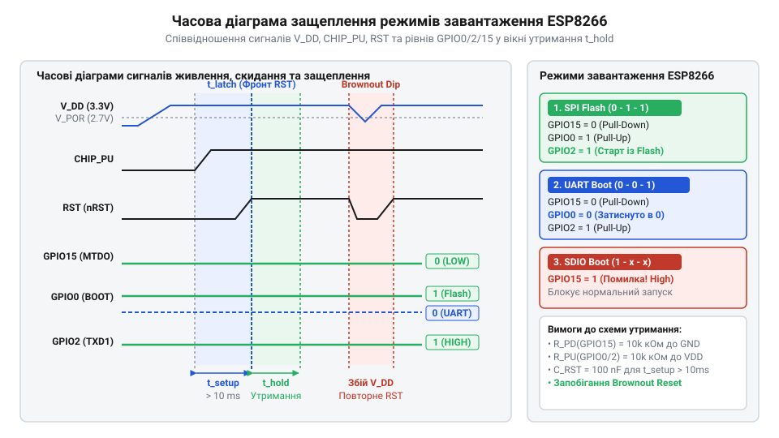
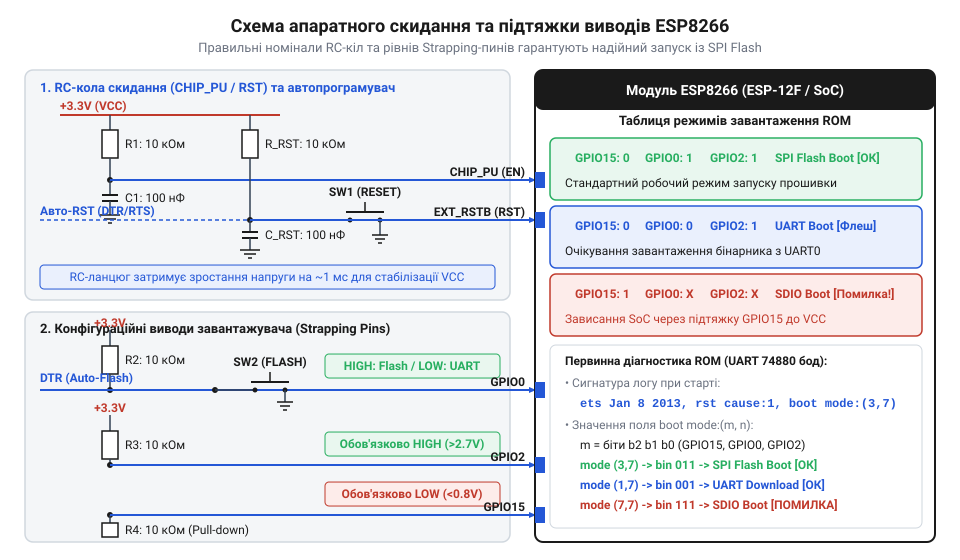
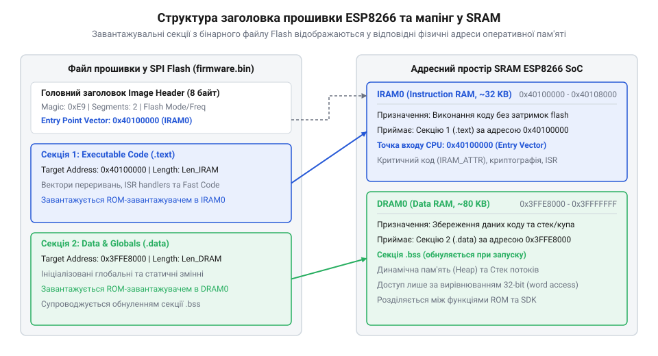
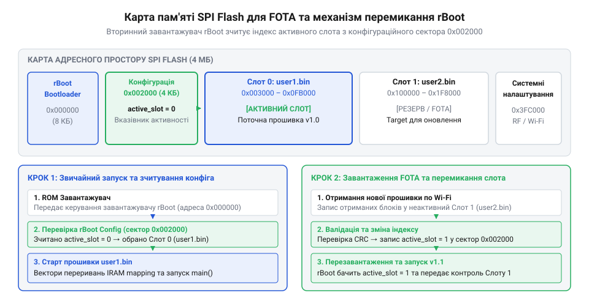

# Архітектура завантажувача та режими старту ESP8266

<preknowlist>
- [Огляд мікроконтролера та архітектури SoC ESP8266](root:cat-hw-boards/esp8266-soc-architecture-overview) — загальна організація процесорного ядра Xtensa LX106, розподіл пам'яті SRAM та базові принципи роботи внутрішніх шин SoC
- [Режими завантаження мікроконтролера ESP8266](root:cat-hw-boards/esp8266-boot-modes) — базове призначення та концептуальні відмінності між режимами виконання з SPI Flash та програмування через UART
- [Конфігураційні виводи завантаження ESP8266](root:cat-hw-boards/esp8266-boot-strapping-pins) — призначення виводів GPIO0, GPIO2 та GPIO15 як апаратних селекторів конфігурації старту
- [Оновлення прошивки ESP8266 по повітрю (FOTA)](root:cat-hw-boards/esp8266-fota-update) — концепція використання двох слотів пам'яті user1.bin та user2.bin для бездротового оновлення
</preknowlist>

## Чому ESP8266 раптово зациклює перезавантаження

Уявіть типову ситуацію з практики розробки: ви зібрали новий пристрій на базі [популярних модулів ESP-01](root:cat-hw-boards/esp-01) або розробили власну печатну плату для мікроконтролера, написали бездоганний програмний код, але після підключення джерела живлення пристрій відмовляється працювати. У терміналі послідовного порту замість очікуваних відлагоджувальних повідомлень з'являється нечитабельне хаотичне сміття на швидкості 115200 бод, або ж чип потрапляє у безкінечний цикл апаратних перезавантажень (англ. *hard reset boot loop*). Розробник починає шукати помилки у функції ініціалізації периферії чи перевіряти вказівники у пам'яті, однак причина збою криється значно глибше. Система зазнає краху ще до того, як процесорне ядро встигає зчитати та виконати бодай одну інструкцію з вашої прошивки.

Щоб зрозуміти джерело цієї нестабільності, необхідно звернутися до внутрішньої архітектури системи на кристалі. На відміну від класичних 8-бітних чи 32-бітних мікроконтролерів, які запускають програму безпосередньо з внутрішньої флеш-пам'яті, `@@en|ESP8266@@` (англ. *Espressif Systems 8266*) являє собою високоінтегровану `@@en|SoC@@` (англ. *system on chip* — система на кристалі). Вона побудована на базі 32-бітного процесорного ядра `@@en|Xtensa LX106@@`. Внутрішня структура чипа не містить великого масиву енергонезалежної пам'яті для розміщення користувацького коду. Замість цього розробники Espressif передбачили можливість виконання інструкцій із зовнішньої мікросхеми `@@en|SPI Flash@@` (англ. *Serial Peripheral Interface Flash* — послідовна флеш-пам'ять), а також завантаження коду через інтерфейси `@@en|UART@@` (англ. *universal asynchronous receiver-transmitter* — універсальний асинхронний приймач-передавач) або `@@en|SDIO@@` (англ. *Secure Digital Input Output* — інтерфейс введення-виведення SD). Детальніше ознайомитися з [архітектурою ядра Xtensa LX106](root:cat-hw-boards/esp8266-soc-architecture-overview) можна для розуміння організації оперативної пам'яті та шин SoC. Для порівняльного аналізу архітектури та еволюції периферійних систем інших мікроконтролерів родини Espressif дивіться [огляд архітектурної лінійки бездротових SoC серії ESP](root:cat-hw-boards/esp-series-soc-architecture-overview).

Оскільки потенційних джерел запуску коду кілька, кристалу потрібен чіткий і безумовний апаратний механізм, який у перші ж наносекунди після зняття сигналу скидання підкаже процесору, звідки саме зчитувати первинні інструкції. Цю задачу виконує спеціальний апаратний етап защеплення режимів старту. Під час наростання напруги живлення апаратні тригери всередині `@@en|ESP8266@@` зчитують логічні рівні на трьох спеціальних виводах защеплення — `@@en|GPIO0@@`, `@@en|GPIO2@@` та `@@en|GPIO15@@`. Ці виводи називаються `@@en|strapping pins@@` (англ. *strap* — прив'язувати, затискати) і виконують роль апаратних селекторів конфігурації.

Головна пастка полягає у тому, що виводи `@@en|GPIO0@@`, `@@en|GPIO2@@` та `@@en|GPIO15@@` у процесі звичайного виконання програми є виводами загального призначення (`@@en|GPIO@@`, англ. *general-purpose input/output*). Через це розробники часто підключають до них зовнішні периферійні компоненти: світлодіоди, транзисторні ключі реле, кнопки чи сенсори. Особливо підступний фізичний вплив чинять [кола автоматичного програмування](root:cat-hw-boards/esp-01-programmer-adapters) `@@en|USB-UART@@` конвертерів із керуючими сигналами `@@en|DTR@@` (англ. *data terminal ready* — готовність вихідного термінала) та `@@en|RTS@@` (англ. *request to send* — запит на передачу). Схема автопрограмування зазвичай будується на двох протилежно ввімкнених `@@en|NPN@@`-транзисторах, де сигнал `@@en|DTR@@` підключено до бази першого транзистора та емітера другого, а `@@en|RTS@@` — до бази другого та емітера першого. Коли утиліта прошивки ініціює завантаження, вона подає низький рівень на `@@en|DTR@@` при високому `@@en|RTS@@`, що відкриває другий транзистор і примусово притягує вивід `@@en|GPIO0@@` до землі (0 В). Далі утиліта короткочасно переводить `@@en|RTS@@` у нуль при високому `@@en|DTR@@`, відкриваючи перший транзистор і розряджаючи лінію скидання `@@en|CHIP_PU@@` (або `@@en|RST@@`). Наприкінці циклу обидва сигнали повертаються у високий стан, лінія `@@en|CHIP_PU@@` піднімається через зовнішній резистор підтяжки до 3.3 В, однак через RC-затримку на лінії скидання в момент переходу напруги через пороговий рівень логічної одиниці внутрішній апаратний тригер-засувка `@@en|ESP8266@@` зчитує стан [виводів конфігурації старту](root:cat-hw-boards/esp8266-boot-strapping-pins). Якщо ж під час звичайної подачі живлення або при відкритті послідовного порту системний драйвер операційної системи хаотично змінює стан виводів `@@en|DTR@@` чи `@@en|RTS@@` (наприклад, залишає `@@en|DTR@@` у низькому стані), транзистор підтримує потенціал `@@en|GPIO0@@` нижче порогового значення 0.25 × VDD саме у часове вікно защеплення. У результаті `@@en|ESP8266@@` зафіксовує комбінацію `@@en|GPIO0@@` = 0 і замість [нормального запуску з флеш-пам'яті](root:cat-hw-boards/esp8266-boot-modes) переходить у режим завантаження прошивки через послідовний порт — `@@en|UART Download Mode@@`. У цьому стані кристал мовчки чекає спеціальних команд від програматора і не реагує на зовнішній світ, викликаючи у розробника ілюзію «знеструмленого» або «згорілого» чипа.

Якщо ж хибний рівень зафіксовано на виводі `@@en|GPIO15@@` (наприклад, він залишився у підвішеному стані або був підтягнутий до високого рівня через зовнішній навантажувальний резистор), `@@en|ESP8266@@` намагається виконати запуск із шини `@@en|SDIO@@`. Не знайшовши відповідного хост-контролера чи картки пам'яті, вбудований алгоритм зупиняється. Переповнення буферів або неетикетковані логи викликають спрацьовування [апаратного вартового таймера](root:hw-arch/esp8266-hardware-and-software-watchdog-timers), який примусово перезавантажує кристал. Так виникає циклічний reboot: чип стартує, зчитує неправильний режим, падає за таймаутом WDT, перезапускається і знову потрапляє у ту саму апаратну пастку.

Вивчаючи [історію завантажувачів Espressif](root:cat-hw-boards/esp8266-bootloader-architecture/hist-esp8266-bootloader-evolution.md), можна простежити, що зашитий у кристалі масочний `@@en|ROM-завантажувач@@` (англ. *read-only memory* — постійний запам'ятовувальний пристрій) був розроблений як максимально простий та надійний апаратний завантажувач. Він не має можливості автовизначення намірів користувача чи програмного обходу фізичних рівнів на ніжках. Логіка зашита в кремнії раз і назавжди: спочатку апаратне защеплення рівнів GPIO, і лише потім — передача керування будь-якому коду.

Звідси випливає фундаментальна вимога до проектування будь-яких пристроїв на базі `@@en|ESP8266@@`: забезпечення суворо детермінованого стану виводів `@@en|GPIO0@@`, `@@en|GPIO2@@` та `@@en|GPIO15@@` у момент зняття сигналу скидання є обов'язковою передумовою надійного запуску. Жодний програмний код, оновлення `@@en|firmware@@` (англ. *firmware* — мікропрограма) чи програмне скидання не здатні виправити проблему, якщо на фізичному рівні під час подачі живлення (`@@en|power-on reset@@`, `@@en|POR@@`) виводи защеплення перебувають у невизначеному або завадовразливому стані.

## Апаратне защеплення режимів старту ESP8266

Перехід від хаотичного перезавантаження до передбачуваного старту вимагає детального аналізу роботи апаратних засувок кристала. Процес защеплення (англ. *latching*) відбувається у момент зняття апаратного скидання, коли сигнал на лінії `@@en|CHIP_PU@@` (англ. *chip power up* — увімкнення живлення чипа) або `@@en|RST@@` (англ. *reset* — скидання) переходить із низького логічного рівня до високого. У цей короткий часовий інтервал внутрішня системна логіка `@@en|ESP8266@@` тактує апаратні тригери-засувки (`@@en|latch@@`), які фіксують миттєві логічні стани на виводах `@@en|GPIO0@@`, `@@en|GPIO2@@` та `@@en|GPIO15@@`.

Зафіксовані значення зберігаються у спеціальному внутрішньому регістрі статусу завантаження SoC і зберігають свою чинність до наступного скидання. Це означає, що після завершення фази защеплення процесорне ядро `@@en|Xtensa LX106@@` може переналаштувати виводи `@@en|GPIO0@@`, `@@en|GPIO2@@` та `@@en|GPIO15@@` на виконання будь-яких інших функцій введення-виведення без ризику змінити поточний режим роботи системи. Детальніше про роботу з цими ніжками можна прочитати у матеріалі про [конфігураційні виводи завантаження](root:cat-hw-boards/esp8266-boot-strapping-pins).

Комбінація логічних рівнів на виводах `@@en|GPIO15@@`, `@@en|GPIO0@@` та `@@en|GPIO2@@` формує двобітний або трибітний вектор, який однозначно визначає подальший маршрут виконання коду `@@en|ROM-завантажувачем@@`. Усі можливі варіанти зведені в апаратну таблицю істинності режимів старту:

| `@@en|GPIO15@@` | `@@en|GPIO0@@` | `@@en|GPIO2@@` | Режим завантаження (`@@en|Boot Mode@@`) | Джерело коду та опис |
| :---: | :---: | :---: | :--- | :--- |
| `0` (GND) | `1` (VCC) | `1` (VCC) | `@@en|SPI Flash Boot@@` | Основний робочий режим: виконання прошивки з зовнішньої пам'яті `@@en|SPI Flash@@`. |
| `0` (GND) | `0` (GND) | `1` (VCC) | `@@en|UART Download Mode@@` | Режим програмування: очікування завантаження коду через послідовний порт `@@en|UART0@@`. |
| `1` (VCC) | `x` (будь-який) | `x` (будь-який) | `@@en|SDIO Boot@@` | Режим завантаження коду через шину `@@en|SDIO@@` від зовнішнього хост-контролера. |

Як видно з таблиці, для штатного запуску користувацької прошивки з флеш-пам'яті обов'язковою є комбінація: `@@en|GPIO15@@` = LOW (0), `@@en|GPIO0@@` = HIGH (1), `@@en|GPIO2@@` = HIGH (1). Якщо [перемикати режими завантаження](root:cat-hw-boards/esp8266-boot-modes) навмисно, наприклад для оновлення прошивки по дроту, достатньо притягнути `@@en|GPIO0@@` до землі перед зняттям сигналу скидання.

Варто враховувати, що всередині кристала `@@en|ESP8266@@` вже присутні слабкі внутрішні резистори підтяжки (порядку 30–50 кОм): `@@en|GPIO0@@` та `@@en|GPIO2@@` мають слабкі внутрішні pull-up резистори до VCC, а `@@en|GPIO15@@` має внутрішній pull-down резистор до GND. Однак спиратися виключно на внутрішні резистори під час проектування схем категорично заборонено. Паразитні ємності друкованих провідників та струми витоку зовнішніх компонентів легко долають цей слабкий опір під час наростання живлення.

Процес фіксації рівнів вимагає дотримання суворих часових параметрів. Логічні рівні на виводах защеплення повинні бути сформовані та стабілізовані ще до того, як сигнал на лінії `@@en|CHIP_PU@@` досягне порогу спрацьовування внутрішніх логічних елементів V_IH ≈ 0.75 · VDD. Час встановлення (англ. *setup time*, t_setup) визначає мінімальну тривалість, протягом якої стабільний рівень повинен утримуватися до фронту скидання. Час утримання (англ. *hold time*, t_hold) регламентує тривалість збереження рівня після проходження фронту V_IH.

Фізичне співвідношення сигналів керування та рівнів на конфігураційних ніжках під час зняття скидання показано на часовій діаграмі нижче:


*Часова діаграма апаратного защеплення станів GPIO0, GPIO2 та GPIO15 під час зняття сигналу скидання.*

На діаграмі чітко видно критичне вікно защеплення. Якщо напруга живлення VDD наростає занадто повільно (наприклад, через велику ємність згладжувальних конденсаторів на лінії 3.3 В або обмежений струм джерела живлення), рівень на лінії `@@en|CHIP_PU@@` може перевищити поріг включення раніше, ніж внутрішні підтяжки або зовнішні резистори встигнуть створити на виводах `@@en|GPIO0@@` чи `@@en|GPIO2@@` високий логічний потенціал. У результаті тригери-засувки зафіксують нульовий рівень, і чип помилково перейде у `@@en|UART Download Mode@@` або заблокує старт.

Аналогічні проблеми виникають при короткочасних просіданнях напруги живлення — так званих `@@en|brownout@@` подіях. Якщо напруга VDD падає нижче критичного порогу функціонування тригерів (близько 2.3 В), але лінія `@@en|CHIP_PU@@` не розряджається повністю до нуля, після відновлення живлення стан засувок стає невизначеним. Кристал може спонтанно обрати режим `@@en|SDIO Boot@@` та зациклити reboot.

Для запобігання цим явищам використовується зовнішній `@@en|RC-ланцюг@@` на лінії `@@en|CHIP_PU@@`, який затримує зростання напруги на виводі увімкнення до моменту повної стабілізації живлення VDD. Розрахунок мінімальної часової константи затримки виконується за формулою розряду/заряду конденсатора через резистор:

```
t_delay = R · C · ln(VDD / (VDD - V_IH))
        = 10000 · 0.000001 · ln(3.3 / (3.3 - 2.475))    [підстановка R=10kΩ, C=1µF, V_IH=0.75·VDD]
        = 0.010 · ln(4.0)                              [спрощення відношення напруг]
        = 0.010 · 1.386                                [обчислення натурального логарифма]
        = 0.01386 с ≈ 13.86 мс                         [підсумковий час затримки CHIP_PU]
```

Отримане значення затримки у 13.86 мс гарантує, що шина живлення VDD встигне вийти на номінальну напругу 3.3 В, а зовнішні кола підтяжки сформують стабільні рівні t_setup до моменту защеплення. Більш детально розрахунки часових констант та дільників викладено у відповідних [розрахунках часових констант](root:cat-hw-boards/esp8266-bootloader-architecture/math-esp8266-boot-timing-and-baudrate.md).

Зважаючи на особливості защеплення, на використання виводів `@@en|GPIO0@@`, `@@en|GPIO2@@` та `@@en|GPIO15@@` у зовнішніх електричних схемах накладаються жорсткі фізичні обмеження. Повна технічна специфікація сигналів та рекомендації щодо компонентної бази містяться в [апаратному інтерфейсі завантаження](root:cat-hw-boards/esp8266-bootloader-architecture/api-esp8266-boot-hardware-interface.md). Головне правило схемотехніки для `@@en|ESP8266@@` — будь-яке зовнішнє навантаження, підключене до цих виводів, не повинно шунтувати чи спотворювати логічні рівні під час зняття сигналу скидання. Наприклад, світлодіод, підключений між `@@en|GPIO0@@` та землею (GND), під час включення створить низький рівень і переведе чип у режим програмування, а підтяжка `@@en|GPIO15@@` до VCC унеможливить запуск із SPI Flash назавжди.

## Робота масочного ROM-завантажувача та діагностика

Підключивши аналізатор послідовного порту до мікроконтролера у момент подачі живлення, розробник часто бачить не зрозумілий відлагоджувальний текст прошивки, а ряд абракадабри на стандартній швидкості 115200 бод чи швидку серію перезавантажень. Щоб розшифрувати цей перший подих кристала, необхідно простежити кроки, які виконує процесор відразу після того, як тригери-засувки зафіксували логічні рівні на конфігураційних виводах.

У першу ж наносекунду після підняття напруги на лінії `@@en|CHIP_PU@@` апаратний вектор скидання спрямовує процесорне ядро `@@en|Xtensa LX106@@` за фізичною адресою `0x40000000`. За цією адресою в кристалі розташований масочний `@@en|ROM-завантажувач@@` (англ. *Read-Only Memory* — постійний запам'ятовувальний пристрій) обсягом 64 КБ, зашитий на фабриці під час виготовлення кремнієвої пластини. Його першочерговим завданням є первинна ініціалізація внутрішньої системної шини, налаштування системного тактування та розшифровка защепленого вектора з конфігураційного регістра режимів старту.

Одним із перших дій `@@en|ROM-завантажувача@@` є активація апаратного периферійного модуля `@@en|UART0@@` для виводу первинних системних логів. Тут розробників чекає пастка: лог виводиться на нестандартній швидкості. Вбудований ROM-код розроблявся з розрахунком на базовий опорний генератор із частотою 40 МГц, однак переважна більшість комерційних модулів (таких як ESP-01 чи NodeMCU) оснащені кварцовим резонатором `@@en|crystal oscillator@@` (англ. *crystal oscillator* — кварцовий резонатор) на 26 МГц. Оскільки дільник частоти в регістрі налаштування швидкості `@@en|baudrate@@` (від прізвища винахідника Жана Бодо, англ. *baud rate* — швидкість передачі символів) залишається розрахованим на 40 МГц, фактична швидкість передачі пропорційно зменшується:

```
baud_rom = baud_target · (f_xtal / f_rom_ref)
         = 115200 · (26.0 / 40.0)             [підстановка частоти кварцу 26 МГц та опорної ROM 40 МГц]
         = 115200 · 0.65                       [обчислення відношення частот генераторів]
         = 74880 бод                           [підсумкова швидкість діагностичного порту UART0]
```

Якщо термінальна програма розробника налаштована на стандартні 115200 бод, кадри даних сприймаються з помилками синхронізації, що призводить до відображення хаотичних символів. Налаштування швидкості термінала на 74880 бод відкриває доступ до точної діагностичної інформації `@@en|ROM-завантажувача@@`.

Загальний алгоритм виконання інструкцій вбудованого ROM-коду від зняття скидання до передачі керування наведено на блок-схемі нижче:


*Блок-схема послідовного виконання інструкцій вбудованого ROM-завантажувача ESP8266 після зняття сигналу скидання.*

Перший рядок, який передає `@@en|ROM-завантажувач@@` у порт `@@en|UART0@@`, має стандартний вигляд `ets Jan  8 2013,rst cause:X, boot mode:(Y,Z)`. Аналіз двох параметрів — `@@en|rst cause@@` (англ. *reset cause* — причина скидання) та `@@en|boot mode@@` (англ. *boot mode* — режим завантаження) — дозволяє миттєво визначити стан апаратної частини.

Параметр `@@en|rst cause@@` вказує на фізичну причину останнього перезапуску чипа:
- `rst cause:1` — нормальний запуск після подачі живлення (`@@en|Power-on Reset@@`, `@@en|POR@@`);
- `rst cause:2` — зовнішнє апаратне скидання низьким рівнем на виводі `@@en|RST@@` або `@@en|CHIP_PU@@`;
- `rst cause:3` — програмне скидання, викликане системним викликом розробника;
- `rst cause:4` — аварійне скидання від [апаратного вартового таймера](root:hw-arch/esp8266-hardware-and-software-watchdog-timers) (`@@en|Hardware WDT@@`, англ. *watchdog timer* — вартовий таймер), викликане зависанням процесорного ядра або помилкою вибірки коду;
- `rst cause:5` — скидання від програмного вартового таймера (Software WDT);
- `rst cause:6` — вихід із режиму глибокого сну.

Другий параметр `@@en|boot mode:(Y,Z)@@` містить розшифровку защеплених логічних рівнів. Число `Y` являє собою десяткове значення 3-бітного вектора `(GPIO15, GPIO0, GPIO2)`. Для штатного запуску із зовнішньої пам'яті `@@en|SPI Flash Boot@@` вектор дорівнює `011` у двійковій системі, що відповідає `Y = 3` (`boot mode:(3,7)`). Якщо `Y = 1` (`001`), чип перебуває у `@@en|UART Download Mode@@` і чекає прошивки. Якщо `Y = 7` (`111`), зафіксовано високий рівень на `@@en|GPIO15@@`, що викликає спробу `@@en|SDIO Boot@@` та наступну паніку ядра. Друга цифра `Z` описує додаткові прапорці адресації шини та вибору конфігурації.

Якщо пристрій потрапляє у цикл перезавантажень із початковим логом `rst cause:4, boot mode:(3,7)`, це свідчить про те, що апаратне защеплення відбулося успішно, однак `@@en|ROM-завантажувач@@` не зміг прочитати коректний заголовок із зовнішньої пам'яті `@@en|SPI Flash@@` або зчитаний код викликав виняток ядра. Автоматизувати розбір таких первинних повідомлень можна за допомогою скриптів, описаних у матеріалі про [аналізаторі логів завантажувача](root:cat-hw-boards/esp8266-bootloader-architecture/proj-esp8266-boot-diagnostics-analyzer.md).

Для забезпечення безумовного входу в режим `@@en|SPI Flash Boot@@` та захисту від електричних завад схемотехніка вузла скидання повинна містити надійні кола підтяжки та транзисторну схему узгодження сигналів `@@en|DTR/RTS@@` від USB-UART конвертера:


*Принципова електрична схема зовнішньої обв'язки ліній CHIP_PU, RST та конфігураційних виводів защеплення GPIO0, GPIO2, GPIO15.*

Схема автопрограмування на двох NPN-транзисторах гарантує, що коли сигнальні лінії `@@en|DTR@@` та `@@en|RTS@@` перебувають у пасивному високому стані, вивід `@@en|GPIO0@@` підтягується до напруги 3.3 В через резистор R2, а `@@en|CHIP_PU@@` отримує живлення через затримувальний RC-ланцюг R1-C1. Детальні електричні характеристики та часові вимоги до компонентів наведено в [апаратному інтерфейсі завантаження](root:cat-hw-boards/esp8266-bootloader-architecture/api-esp8266-boot-hardware-interface.md).

## Структура заголовків та розміщення прошивки

Переконавшись за допомогою діагностичного логу у виборі режиму `@@en|SPI Flash Boot@@`, масочний завантажувач переходить до взаємодії із зовнішньою мікросхемою пам'яті. Контролер шини `@@en|SPI Flash@@` зчитує перші байти за адресою `0x00000` (або `0x01000` залежно від конфігурації). Якщо бінарний образ пошкоджений, вирівнювання адрес порушене або завантажувальний заголовок містить невірні біти, процесорне ядро згенерує фатальну помилку вибірки інструкцій `@@en|InstructionFetchError@@` та примусово перезавантажиться.

Для надійного розпізнавання коду `@@en|ROM-завантажувач@@` вимагає суворого дотримання бінарного формату заголовка образу. Першим байтом файлу прошивки обов'язково має бути магічний байт `@@en|magic byte@@` (англ. *magic byte* — магічний байт ідентифікації) зі значенням `0xE9`. Структура головного заголовка `@@en|image_header_t@@` та наступних заголовків секцій `@@en|segment_header_t@@` описується C-структурами:

```c|esp-idf
typedef struct {
    uint8_t magic;          /* Магічний байт 0xE9 для перевірки цілісності образу */
    uint8_t num_segments;   /* Кількість секцій коду та даних у файлі прошивки */
    uint8_t spi_mode;       /* Режим роботи SPI Flash: 0=QIO, 1=QOUT, 2=DIO, 3=DOUT */
    uint8_t spi_speed_size; /* 4 біти швидкості SPI (40/80МГц) та 4 біти розміру Flash */
    uint32_t entry_point;   /* Вектор виклику точки входу процесора в RAM */
} image_header_t;

typedef struct {
    uint32_t memory_offset; /* Фізична адреса завантаження секції у IRAM0 або DRAM0 */
    uint32_t segment_size;  /* Розмір бінарного тіла секції у байтах (вирівняно по 4 байти) */
} segment_header_t;
```

Поле `spi_mode` визначає кількість ліній даних шини SPI (наприклад, Quad I/O або Dual I/O), а поле `spi_speed_size` кодує тактову частоту шини (20, 26.7, 40 або 80 МГц) та фізичний обсяг мікросхеми флеш-пам'яті (від 512 КБ до 16 МБ). Поле `entry_point` містить 32-бітну адресу в оперативній пам'яті (англ. *entry point* — точка входу), куди `@@en|ROM-завантажувач@@` повинен передати керування після завершення копіювання усіх секцій.

Критичною вимогою формату є вирівнювання розмірів секцій `segment_size` та адрес завантаження `memory_offset` по 4-байтній межі (32-бітні слова). Архітектура [архітектурою пам'яті Xtensa](root:hw-arch/xtensa-lx106-memory-architecture-and-bus-mapping) не підтримує невирівняне читання 32-бітних інструкцій: якщо адреса секції не кратна 4, спроба копіювання викликає апаратне виключення `@@en|LoadStoreError@@`.

Зчитуючи заголовки секцій послідовно, `@@en|ROM-завантажувач@@` розподіляє бінарні блоки коду та даних між різними областями адресного простору SoC:

1. `@@en|IRAM0@@` (англ. *Instruction RAM* — оперативна пам'ять інструкцій, адреси `0x40100000`–`0x40108000`, обсяг до 32 КБ): високошвидкісна статична пам'ять із нульовою затримкою вибірки. Сюди завантажуються обробники апаратних переривань (ISR), критичні функції таймерів та драйвер шини SPI. 2. `@@en|DRAM0@@` (англ. *Data RAM* — оперативна пам'ять даних, адреси `0x3FFE8000`–`0x3FFFFFFF`, обсяг близько 80 КБ): використовується для розміщення ініціалізованих глобальних змінних (секція `.data`), нульових змінних (секція `.bss`), стека та купи. 3. `@@en|irom0_text@@`: основний обсяг користувацького коду, який не вміщується у 32 КБ `@@en|IRAM0@@`. Цей код не копіюється в оперативну пам'ять, а виконується безпосередньо із зовнішньої флеш-пам'яті через апаратний кєш обсягом 32 КБ за допомогою відображення шини [контролера SPI Flash](root:hw-arch/esp8266-spi-flash-controller-and-mmap-architecture) на адреси `0x40200000`.

Наочну структуру заголовків та схему відображення секцій у фізичну пам'ять представлено на діаграмі:


*Бінарна структура завантажувального заголовка та механізм завантаження секцій коду й даних у внутрішню оперативну пам'ять ESP8266.*

Однак масочний `@@en|ROM-завантажувач@@` має жорстко зафіксовану логіку: він завжди зчитує заголовок із фіксованого зсуву флеш-пам'яті. У реальних системах [бездротового оновлення FOTA](root:cat-hw-boards/esp8266-fota-update) (`@@en|FOTA@@`, англ. *Firmware Over-The-Air* — оновлення мікропрограми по повітрю) це створює проблему, оскільки пристрій повинен мати два незалежні слоти прошивки — `@@en|user1.bin@@` та `@@en|user2.bin@@` — для безпечного оновлення без ризику перетворення пристрою на «цеглину» при обриві зв'язку.

Для вирішення цього завдання застосовується вторинний завантажувач `@@en|rboot@@` (англ. *robust bootloader* — відмовостійкий вторинний завантажувач). Він записується за базовою адресою `0x00000` і виступає проміжним містком між ROM-кодом та користувацькою програмою.

Під час старту `@@en|ROM-завантажувач@@` ініціалізує та запускає `@@en|rboot@@`. Вторинний завантажувач зчитує власну конфігураційну таблицю з флеш-пам'яті, визначає поточний активний слот (`user1` чи `user2`), перевіряє цілісність магічного байта `0xE9` та контрольної суми образу, переналаштовує регістри мапування кєшу і передає керування на точку входу обраного слота. Карта розташування компонентів у пам'яті показана нижче:


*Розподіл адресного простору зовнішньої мікросхеми SPI Flash для реалізації двослотового бездротового оновлення FOTA.*

Повний список регістрів конфігурації шини та структур даних доступний у [програмному інтерфейсі завантажувача](root:cat-hw-boards/esp8266-bootloader-architecture/api-esp8266-bootloader-headers-and-registers.md), а практичні кроки з розробки та налаштування FOTA описані у проектному керівництві з побудови [вторинного завантажувача rboot](root:cat-hw-boards/esp8266-bootloader-architecture/proj-esp8266-custom-bootloader-fota.md).

## Вторинний завантажувач та двослотовий FOTA

Запуск користувацької програми через масочний ROM-код добре працює при первинному програмуванні пристрою, однак стає вразливим місцем у системах, що потребують дистанційного оновлення. Якщо спробувати перезаписати єдиний бінарний образ безпосередньо у флеш-пам'яті по бездротовому каналу, будь-яка завада зв'язку, збій живлення чи передчасне розривання TCP-сесії залишать мікросхему з пошкодженим кодом. Під час наступного скидання апаратний завантажувач не знайде магічного байта, і пристрій остаточно втратить здатність до запуску.

Щоб усунути цю одноточкову вразливість, у системну архітектуру впроваджують вторинний завантажувач `@@en|rboot@@` (англ. *robust bootloader* — відмовостійкий вторинний завантажувач). Це компактна програма обсягом 4 КБ, яка записується у найперший сектор зовнішньої пам'яті за фізичною адресою `0x00000`. Під час подачі живлення масочний ROM-код виконує защеплення рівнів, зчитує заголовок за цією базовою адресою та передає керування `@@en|rboot@@`. Вторинний завантажувач виступає програмним диспетчером: він зчитує власний сектор конфігурації `@@en|rboot_config_t@@` (за адресою `0x02000`) і визначає, який саме бінарний образ є активним.

Фізична флеш-пам'ять при цьому ділиться на два незалежні слоти — `@@en|user1.bin@@` (слот 0, адреса `0x02000` або `0x08000`) та `@@en|user2.bin@@` (слот 1, адреса `0x82000` або `0x102000`). Поки мікроконтролер виконує робочу програму зі слота 0, фоновий процес [безпосереднього оновлення прошивки](root:cat-hw-boards/esp8266-fota-update) приймає нові блоки даних по Wi-Fi і послідовно записує їх у неактивний слот 1, взагалі не зачіпаючи працюючий код.

Перед зміною прапорця активного слота `@@en|rboot@@` вимагає суворої перевірки цілісності завантаженого файлу. Зчитуючи заголовок образу `@@en|image_header_t@@`, завантажувач послідовно обходить усі завантажувальні секції та обчислює підсумкову контрольну суму `@@en|checksum@@` (англ. *checksum* — контрольна сума цілісності). Алгоритм виконує побайтову операцію виключального «АБО» (XOR) для всього масиву даних і порівнює результат із контрольним байтом наприкінці бінарного файлу. Якщо хоча б один байт був спотворений при передачі по мережі, перевірка провалюється, оновлення відхиляється, а системний сектор конфігурації залишається вказаним на попередній робочий слот.

Після успішного підтвердження контрольної суми виникає задача передачі керування процесору `@@en|Xtensa LX106@@`. Оскільки користувацький код розрахований на виконання з віртуальної адреси `0x40200000` через кєш, `@@en|rboot@@` переналаштовує регістри мапування [контролера SPI Flash](root:hw-arch/esp8266-spi-flash-controller-and-mmap-architecture). Завантажувач змінює зміщення в апаратному блоці керування пам'яттю `@@en|MMU@@` (англ. *memory management unit* — блок керування пам'яттю), завдяки чому фізичний зсув слота `user2.bin` прозоро відображається на стандартну віртуальну адресу `0x40200000`. Після цього `@@en|rboot@@` копіює секції `@@en|IRAM0@@` та `@@en|DRAM0@@` в оперативну пам'ять, оновлює регістр векторів переривань `@@en|VBR@@` (англ. *vector base register* — базовий регістр векторів переривань) і здійснює перехід за адресою точки входу `@@en|entry_point@@`.

Надійний алгоритм FOTA додатково захищає пристрій від ситуацій, коли новий бінарний образ має коректну контрольну суму, але містить програмну помилку, яка викликає зависання або [апаратний вартовий таймер](root:hw-arch/esp8266-hardware-and-software-watchdog-timers). Для цього реалізують механізм автоматичного відкочування `@@en|rollback@@` (англ. *rollback* — відкочування на попередній стан):

1. При успішному завантаженні нового слота у сектор конфігурації записується тимчасовий прапорець пробного запуску (`boot_once`). 2. Пристрій виконує програмний перезапуск через `@@en|system_restart()@@`. 3. Завантажувач `@@en|rboot@@` запускає новий слот. 4. Якщо нова прошивка успішно ініціалізує периферію та підключається до мережі, вона викликає функцію підтвердження і робить новий слот постійним. 5. Якщо ж виникає перезавантаження до моменту підтвердження, `@@en|rboot@@` під час наступного старту виявляє неочищений прапорець збою і автоматично відновлює вказівник на попередню перевірену версію `user1.bin`.

Базову реалізацію структур даних конфігурації та алгоритму перевірки цілісності й перемикання слотів у завантажувачі представлено нижче:

:::tabs
:::code esp8266-bootloader-architecture-d/c/esp-idf/calculate-image-checksum.c
<!-- slide -->
:::code esp8266-bootloader-architecture-d/cpp/arduino/rbootconfig.cpp
:::

Повний опис структур заголовків та системних регістрів наведено у [програмному інтерфейсі завантажувача](root:cat-hw-boards/esp8266-bootloader-architecture/api-esp8266-bootloader-headers-and-registers.md), а розгортання власного завантажувача деталізовано у матеріалі про [проєктування вторинного завантажувача rboot](root:cat-hw-boards/esp8266-bootloader-architecture/proj-esp8266-custom-bootloader-fota.md).

## Схеми підтяжки та завадостійкість скидання

Навіть найнадійніший вторинний завантажувач з алгоритмами відкочування не зможе захистити систему, якщо апаратна частина виявиться вразливою до зовнішніх електричних завад під час подачі живлення. Специфіка роботи `@@en|ESP8266@@` полягає у тому, що під час роботи радіопередавача Wi-Fi вихідний підсилювач потужності `@@en|PA@@` (англ. *power amplifier* — підсилювач потужності) споживає імпульсний струм величиною від 300 до 500 мА із тривалістю фронту в кілька мікросекунд. Якщо лінія живлення або кола скидання розроблені без урахування цих піків, у системі виникають короткочасні просідання напруги `@@en|brownout@@` (англ. *brownout* — просідання напруги живлення), які викликають хибне спрацьовування засувок або зависання мікроконтролера.

Для забезпечення стовідсотково детермінованого старту необхідно розробляти завадостійкі зовнішні кола підтяжки для ліній защеплення `@@en|GPIO0@@`, `@@en|GPIO2@@` та `@@en|GPIO15@@`. Використання виключно внутрішніх резисторів кристала є поширеною помилкою: їхній опір становить 30–50 кОм, що робить лінії дуже вразливими до струмів витоку через поверхню друкованої плати та паразитну ємність провідників.

Схемотехнічні правила проектування кіл защеплення вимагають встановлення зовнішніх дискретних резисторів:

1. `@@en|GPIO0@@`: встановлюється зовнішній резистор підтяжки `@@en|pull-up@@` (англ. *pull-up* — підтяжка до верхнього рівня) номіналом 10 кОм до лінії живлення 3.3 В. При використанні кіл автопрограмування на транзисторах сигнальні лінії `DTR` та `RTS` підключаються через розв'язувальні діоди Шотткі або резистори 4.7 кОм, щоб унеможливити підтяжку до землі при відключеному USB-конвертері. 2. `@@en|GPIO2@@`: підключається зовнішній резистор `@@en|pull-up@@` 10 кОм до напруги 3.3 В. Якщо вивід використовується для керування периферією (наприклад, світлодіодом), її підключають виключно між виводом та VCC через транзисторний ключ, щоб під час скидання вивід не притягувався до землі. 3. `@@en|GPIO15@@`: встановлюється зовнішній резистор притяжки `@@en|pull-down@@` (англ. *pull-down* — притяжка до нижнього рівня) номіналом 10 кОм до землі (GND). Будь-які зовнішні пристрої, підключені до `@@en|GPIO15@@`, під час подачі живлення повинні перебувати у високоімпедансному стані `@@en|Hi-Z@@` (англ. *high impedance* — високоімпедансний стан).

Окрім кіл защеплення, критичне значення має організація часової затримки на лінії увімкнення `@@en|CHIP_PU@@` та скидання `@@en|RST@@`. Щоб внутрішні тригери засувок зафіксували коректні рівні, напруга живлення VDD повинна повністю стабілізуватися на рівні 3.3 В ще до того, як потенціал на лінії `@@en|CHIP_PU@@` перетне поріг включення `V_IH = 0.75 · VDD`. Затримка формується за допомогою затримувального `@@en|RC-ланцюга@@` (англ. *RC circuit* — резистивно-ємнісне коло).

Час затримки наростання напруги `t_delay` розраховується з рівняння заряду конденсатора через резистор R:

```
V(t) = VDD · (1 - e^(-t / (R · C)))
0.75 · VDD = VDD · (1 - e^(-t / (R · C)))            [рівняння при досягненні порогу V_IH]
e^(-t / (R · C)) = 0.25                             [скорочення VDD та спрощення виразу]
t_delay = R · C · ln(4)                             [логарифмування обох частин рівняння]
        = 10000 · 0.000001 · 1.38629                [підстановка R=10kΩ, C=1µF та ln(4) ≈ 1.38629]
        = 0.010 · 1.38629                           [обчислення часової константи RC]
        = 0.01386 с = 13.86 мс                      [підсумковий час затримки увімкнення CHIP_PU]
```

Значення затримки у 13.86 мс гарантує, що шина живлення встигне повністю вийти на номінальну напругу навіть при використанні імпульсних джерел із повільним розгоном, виключаючи потрапляння у невідомий стан. Більш детально часові параметри та математичні співвідношення викладено у [математичному розрахунку таймингів](root:cat-hw-boards/esp8266-bootloader-architecture/math-esp8266-boot-timing-and-baudrate.md).

Для промислових систем із високими вимогами до надійності замість пасивного RC-ланцюга застосовують спеціалізовані мікросхеми — [супервізори живлення](root:cat-hw-boards/esp8266-bootloader-architecture/api-esp8266-boot-hardware-interface.md) (`@@en|voltage supervisor@@`, англ. *voltage supervisor* — супервізор живлення), такі як APX809 або TPS3809 з порогом спрацьовування 2.93 В. Супервізор примусово утримує лінію `@@en|RST@@` у низькому стані протягом 140–200 мс після того, як напруга VDD перевищить 2.93 В, повністю блокуючи будь-які хибні перезапуски при імпульсних завадах.

Для фільтрації високочастотних шумів та захисту від радіозавад Wi-Fi передавача застосовують комплексне шунтування:
- Безпосередньо біля виводів живлення `VDD33` встановлюють керамічний `@@en|decoupling capacitor@@` (англ. *decoupling capacitor* — розв'язувальний конденсатор) ємністю 100 нФ у парі з електролітичним або танталовим конденсатором на 10–47 мкФ для компенсації струмових імпульсів. - На лінії `@@en|RST@@` та `@@en|CHIP_PU@@` додають керамічні конденсатори ємністю 1–10 нФ паралельно до виводів кнопки скидання для поглинання ВЧ-наведень від антени. - Лінії зовнішніх роз'ємів захищають TVS-діодами від електростатичного розряду `@@en|ESD@@` (англ. *electrostatic discharge* — електростатичний розряд).

Програмний аналіз причин попередніх скидань та моніторинг стабільності напруги через апаратні регістри SoC реалізується наступним чином:

:::tabs
:::code esp8266-bootloader-architecture-d/c/esp-idf/rst-info.c
<!-- slide -->
:::code esp8266-bootloader-architecture-d/cpp/arduino/hardwareresetdiagnostics.cpp
:::

Дотримання цих правил схемотехніки у поєднанні з налаштуванням виводів згідно з [конфігураційними виводами завантаження](root:cat-hw-boards/esp8266-boot-strapping-pins) та перевіркою [режимів завантаження мікроконтролера](root:cat-hw-boards/esp8266-boot-modes) повністю виключає випадкові зависання пристрою та гарантує детерміновану роботу в жорстких промислових умовах.