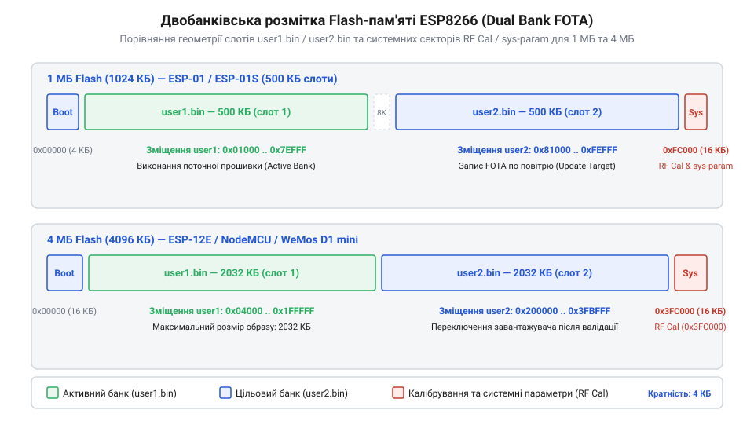

# Еволюція механізмів оновлення прошивки ESP8266 по повітрю

<preknowlist>
- [Оновлення прошивки та прошивання ESP-01](root:cat-hw-boards/esp01-firmware-flashing) — базові принципи запису прошивки у Flash-пам'ять через послідовний інтерфейс.
- [Архітектура завантажувача та режими старту ESP8266](root:cat-hw-boards/esp8266-bootloader-architecture) — організація початкового завантаження та вибір векторів старту мікроконтролера.
- [ESP-01 (Wi-Fi, ESP8266)](root:cat-hw-boards/esp-01) — апаратні характеристики базового модуля з 512 КБ Flash-пам'яті.
</preknowlist>

## Криза оновлень та перші однобанківські схеми

Масове розгортання пристроїв Інтернету речей зробило використання [традиційного дротового прошивання](root:cat-hw-boards/esp01-firmware-flashing) через послідовний порт UART фізично неможливим у реальних експлуатаційних умовах. Датчики, вмонтовані в стіни, чи контролери в герметичних корпусах вимагали дистанційного способу зміни програмного забезпечення — оновлення прошивки по повітрю (англ. @@en|FOTA@@, від @@en|Firmware Over-The-Air@@). Проте у 2014 році перші масові модулі, такі як [компактний модуль ESP-01](root:cat-hw-boards/esp-01), випускалися з обсягом Flash-пам'яті лише 512 КБ, що наклало суворі апаратні обмеження на первинний програмний стек від компанії @@en|Espressif Systems@@.

Перші реалізації оновлення у складі первинного комплекту розробки @@en|Non-OS SDK@@ використовували однобанківську схему: новий бінарний образ завантажувався через мережу Wi-Fi і записувався безпосередньо у той самий сектор накопичувача, де виконувалася поточна програма. Оскільки обсяг прошивки майже повністю заповнював наявний простір, місця для збереження резервної копії не залишалося. Будь-який збій живлення або втрата з'єднання під час стирання чи запису Flash-пам'яті призводив до аварійного «цеглування» (англ. @@en|bricking@@) пристрою. Вбудований у мікросхему [початковий завантажувач](root:cat-hw-boards/esp8266-bootloader-architecture) після перезавантаження виявляв пошкоджений заголовок коду і відновлював роботу лише після повторного підключення програматора через дріт, що знівелювало головну ідею бездротового обслуговування.

Апаратна причина такого незворотного збою полягає в фізичних особливостях нор-флеш-пам'яті (англ. @@en|NOR Flash@@, від *NOT-OR* — логічне ні-або). Перед записом нових байтів мікроконтролер мусить виконати процедуру секторного очищення (англ. @@en|Sector Erase@@, від *sector* — сектор та *erase* — очищення), яка скидає всі біти обраного сектора обсягом 4 кБ у стан логічної одиниці (`0xFF`). З апаратної точки зору ця операція є надзвичайно повільною й триває від `40` мс до `300` мс для кожного окремого сектора, створюючи критичне вікно вразливості (англ. @@en|vulnerability window@@, від *vulnerability* — вразливість та *window* — вікно) тривалістю в кілька секунд при оновленні всього бінарного образу. Під час виконання функції оновлення системний стек @@en|Non-OS SDK@@ послідовно викликав стирання блоків пам'яті за списком адрес, починаючи з початкових секторів виконуваної програми. Якщо раптове вимкнення живлення ставалося під час очищення першого ж сектора, апаратна таблиця векторів переривань (англ. @@en|interrupt vector table@@, від *interrupt* — переривання, *vector* — вектор, *table* — таблиця) незворотно стиралася, а утилізовані байти перетворювалися на `0xFF`. При наступному включенні [архітектура завантажувача](root:cat-hw-boards/esp8266-bootloader-architecture) не могла виявити сигнатурний магічний байт `0xE9` у заголовку образу, а первинний вектор переривань виявлявся знищеним. Внаслідок цього апаратний ПЗП-завантажувач впадав у циклічний перезапуск або зупиняв виконання коду, роблячи відновлення пристрою по повітрю неможливим без повторного прошивання через послідовний порт.

## Перехід до двобанківського перемикання та rboot

Усвідомлення ризиків однобанківського запису змусило інженерів перейти до двобанківської схеми оновлення (англ. @@en|dual-bank update@@). Її суть полягає у фізичному розділенні Flash-пам'яті на два однакові слоти — `user1.bin` та `user2.bin` — згідно з чітко визначеною картою розділів (англ. @@en|partition map@@). Під час роботи системи пристрій виконує програму з першого банку, тоді як новий образ із мережі послідовно завантажується і перевіряється в другому банку. Тільки після повного звірення контрольної суми завантажувач змінює вхідну мітку в конфігураційному секторі й перемикає вектор запуску на новий слот. Якщо під час передачі даних виникає помилка чи обрив живлення, активний банк залишається недоторканим, гарантуючи надійний відкат (англ. @@en|rollback@@) до працездатної версії.

*Розподіл Flash-пам'яті між слотами user1.bin та user2.bin із конфігураційним сектором завантажувача rboot.*

Реалізація цієї схеми вимагала подвоєння обсягу накопичувача щонайменше до 1 МБ, що стимулювало перехід від 512-кілобайтних модулів першого покоління до плат із 4 МБ пам'яті. Стандартний завантажувач від Espressif мав жорсткі прив'язки до адрес розміщення образів, тому у 2015 році розробник Річард Бертон (англ. @@en|Richard A Burton@@) створив відкритий завантажувач @@en|rboot@@. Він підтримував довільну кількість слотів, дозволяв використовувати корисний обсяг Flash-пам'яті без фіксованих лімітів і надійно реалізував механізм відкату при некоректному старті нової прошивки, що згодом лягло в основу стандартів оновлення для [архітектури мікроконтролера ESP8266](root:cat-hw-boards/esp8266-soc-architecture-overview).

Математична надійність завантажувача @@en|rboot@@ спирається на обчислення контрольних сум за алгоритмом @@en|CRC32@@ (англ. @@en|Cyclic Redundancy Check@@, від *cyclic* — циклічний і *redundancy* — надлишковість) для конфігураційного блоку та заголовків кожного з бінарних образів. Під час підключення живлення завантажувач обчислює значення `CRC32_calc` для 16-байтового системного сектору конфігурації й порівнює його зі збереженим 32-бітним еталоном `CRC32_stored`. Якщо рівність `CRC32_calc = CRC32_stored` підтверджується, завантажувач зчитує вказівник активного слота `current_rom` і додатково перевіряє 4-байтовий заголовок вибраного образу (`user1.bin` або `user2.bin`) на наявність сигнатури `0xE9`. Виявлення невідповідності або пошкодження даних змушує завантажувач автоматично ігнорувати битий слот і здійснювати [перемикання векторів старту](root:cat-hw-boards/esp8266-bootloader-architecture) на попередній гарантовано робочий банк, повністю виключаючи зависання мікроконтролера через пошкоджену прошивку.

## Еволюція програмних стеків та криптозахист

Первісні реалізації оновлення по повітрю в ранньому фреймворку Non-OS SDK передавали бінарні образи у відкритому вигляді через незахищений протокол HTTP. Процес виклику функції оновлення повністю блокував виконання основного циклу програми, що призводило до втрати мережевих сокетів та обриву обробки датчиків. З появою масових загроз перехоплення та підміни даних в мережах Інтернету речей компанія Espressif Systems у 2016 році представила оновлений стек на базі операційної системи FreeRTOS — ESP8266 RTOS SDK. Впровадження асинхронних задач дозволило виконувати зчитування та запис прошивки у фоновому режимі без зупинки критичних системних сервісів.

Паралельно відбулася криптографічна революція в захисті тракту передачі. Відкритий трафік замінили на [захищені SSL/TLS з'єднання](root:cat-hw-boards/esp8266-at-ssl-tls), де сервер оновлень автентифікується за допомогою цифрових сертифікатів. Для запобігання записам модифікованих бінарних файлів у структуру заголовок образу почали запевняти криптографічним хешем SHA-256 та цифровим підписом на основі асиметричних алгоритмів RSA або ECC. Під час приймання чергового блоку завантажувач у фоновому режимі вираховує проміжний хеш, а після завершення завантаження верифікує підпис відкритим ключем розробника, зашитим у захищену область пам'яті.

Механічно цей процес базується на комбінації потокового обчислення хешу та розшифрування асиметричного ключа. В міру надходження мережевих пакетів завантажувач послідовно передає кожен прийнятий блок даних до алгоритму @@en|SHA-256@@ (від *Secure Hash Algorithm* — безпечний алгоритм хешування), підтримуючи та оновлюючи проміжний стан хеш-контексту без необхідності буферизації всього бінарного образу в обмеженій операційній пам'яті. Одночасно із заголовочної частини образу вилучається цифровий підпис, який розшифровується за допомогою вшитого відкритого ключа (англ. @@en|public key@@, від *public* — публічний та *key* — ключ) через математичні операції асиметричних алгоритмів @@en|RSA@@ (від прізвищ розробників *Rivest*, *Shamir*, *Adleman*) або @@en|ECC@@ (від *Elliptic Curve Cryptography* — криптографія на еліптичних кривих), що відновлює еталонне значення дайджесту (англ. @@en|digest@@, від *digest* — стислий виклад). По завершенні прийому останнього сектора підсумковий обчислений хеш порівнюється з розшифрованим еталоном: найменша відмінність бодай в один біт свідчить про спотворення даних чи підробку, через що [архітектура завантажувача ESP8266](root:cat-hw-boards/esp8266-bootloader-architecture) блокує перемикання прапорця слота й відхиляє невалідну прошивку.

*Діаграма асинхронного захищеного тракту бездротового оновлення прошивки ESP8266.*

Такий багатоступеневий конвеєр унеможливив впровадження шкідливого коду навіть у разі повної компрометації бездротової мережі Wi-Fi.

Вирішальним кроком у цій еволюції стало впровадження криптографічної бібліотеки @@en|mbedTLS@@ та уніфікованої таблиці розділів у фінальних ревізіях @@en|ESP8266 RTOS SDK v3.x@@, що заклало концептуальний фундамент для наступного покоління фреймворку @@en|ESP-IDF@@. Використання програмно-апаратних засобів перевірки в поєднанні із захищеним завантаженням (англ. @@en|Secure Boot@@, від *secure* — захищений і *boot* — завантаження) остаточно перетворило чипсет @@en|ESP8266@@ із вразливого бездротового адаптера на повноцінний вузол Інтернету речей, здатний працювати в мережах із суворими вимогами до кібербезпеки. У результаті розробники отримали можливість здійснювати безшовне віддалене обслуговування розподілених систем, спираючись на надійні шифровані канали та стійкі до обривів живлення [режими завантаження ESP8266](root:cat-hw-boards/esp8266-boot-modes).

## Розвінчання міфів та сучасна практика

Навколо бездротового оновлення ESP8266 виникло кілька стійких технічних оман, найпоширенішою з яких стало твердження про принципову неможливість виконання FOTA на модулях [ESP-01](root:cat-hw-boards/esp-01) із компактною Flash-пам'яттю обсягом `512` кБ. Цей міф виник через те, що стандартна двобанківська розмітка вимагала щонайменше `1` МБ накопичувача. Проте інженери розробили двоетапну схему завантаження (англ. @@en|two-stage stub bootloader@@), у якій проміжний мініатюрний завантажувач завантажував стиснуту нову прошивку у вільні сектора та розпаковував її після верифікації, що дозволяло безпечно оновлювати пристрої з `512` кБ пам'яті.

Інший небезпечний міф стосувався нібито повної безпеки й відмовостійкості стандартної AT-команди `AT+CIUPDATE`, за допомогою якої здійснюється [керування через AT-команди](root:cat-hw-boards/esp8266-at-gpio-control). На практиці перші версії цієї команди зверталися до незахищеного сервера за некодованим HTTP-протоколом і не перевіряли цілісність секторів, що нерідко призводило до аварійного блокування пристроїв при збоях зв'язку. У сучасній інженерній практиці для побудови надійних пристроїв розробники відмовляються від стандартних AT-команд на користь кастомної розмітки пам'яті (англ. @@en|partition map@@) в [архітектурі завантажувача ESP8266](root:cat-hw-boards/esp8266-bootloader-architecture) із виділенням резервного сектору для автоматичного відкату (англ. @@en|rollback@@) на попередню робочу версію при виявленні помилок під час першого старту.

Процес виконання команди `AT+CIUPDATE` розгортається у чітку п'ятикрокову послідовність кодових квитків, де кожен крок позначає окремий фазовий стан прошивального тракту. На першій стадії модуль повертає статусну відповідь `+CIPUPDATE: 1`, що свідчить про успішне резолвінг-підключення до сервера оновлень та отримання опису версії. На другій стадії пристрій повідомляє `+CIPUPDATE: 2`, розпочинаючи завантаження бінарних пакетів у мережевий буфер. Далі відповідь `+CIPUPDATE: 3` сигналізує про безпосередній стиральний перезапис Flash-секторів накопичувача, після чого стан `+CIPUPDATE: 4` підтверджує завершення приймання та цілісність даних. Фінальне квитування `OK` означає успішну перевірку контрольної суми й передачу команди на автоматичне перезавантаження системи для старт-ініціалізації оновленого програмного ядра.
