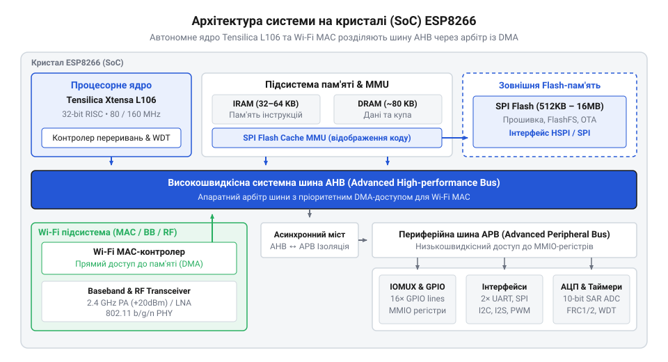
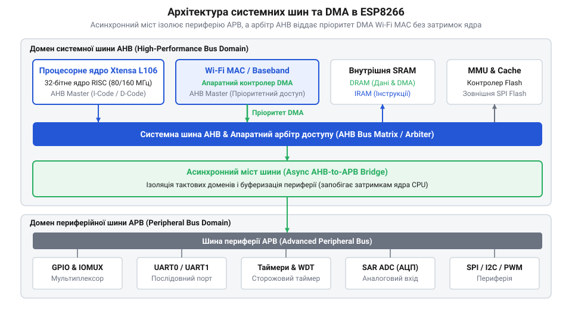
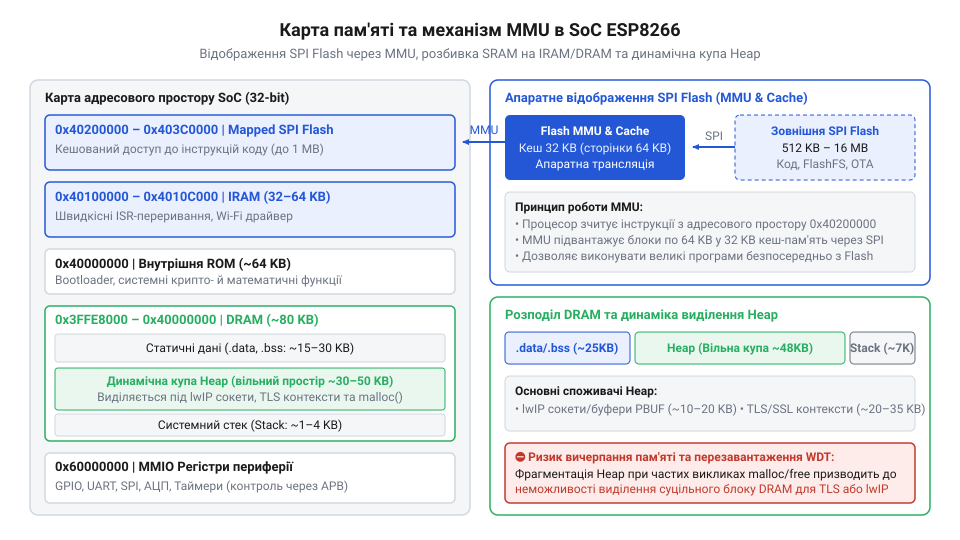
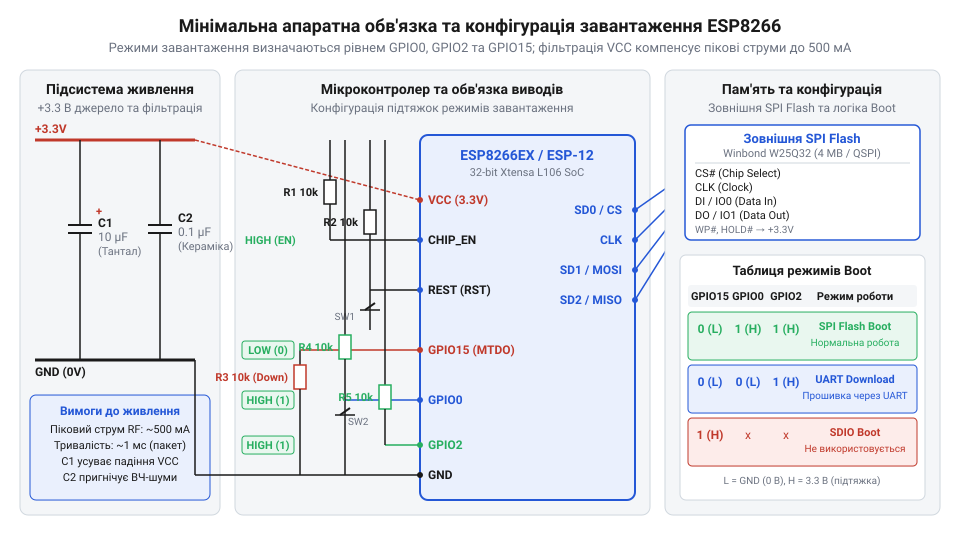

# Огляд мікроконтролера та архітектури SoC ESP8266

<preknowlist>
- [Конфігураційні виводи завантаження ESP8266](root:cat-hw-boards/esp8266-boot-strapping-pins) — призначення та логічні рівні виводів GPIO0, GPIO2 та GPIO15 для вибору режиму завантаження
- [Архітектура завантажувача та режими старту ESP8266](root:cat-hw-boards/esp8266-bootloader-architecture) — послідовність передачі керування від вбудованого ROM-завантажувача до коду Flash-пам'яті
- [Архітектура мережевого стека lwIP у ESP8266](root:cat-hw-boards/lwip-architecture-esp8266) — принципи функціонування буферів pbuf та їхній вплив на доступний обсяг оперативної пам'яті DRAM
- [Апаратні FIFO-буфери інтерфейсу UART в ESP8266](root:cat-hw-boards/esp8266-uart-hardware-fifo) — принцип роботи апаратного FIFO-буфера серійного інтерфейсу для обробки вхідного та вихідного потоку даних
</preknowlist>

## Чому Wi-Fi модем став мікроконтролером

Розробка бездротового вузла для збору даних часто починається з типової схеми: традиційний 8-бітний мікроконтролер керує датчиками та виконує вимірювання, а зовнішній радіомодуль відповідає лише за передачу пакетів через @@en|Wi-Fi@@. У такій системі мікроконтролер надсилає текстові @@en|AT-команди@@ (англ. *Attention commands*, від англ. *attention* — увага) через послідовний інтерфейс @@en|UART@@ (англ. *Universal Asynchronous Receiver-Transmitter*), очікуючи на текстові відповіді від модема. Проте на практиці цей підхід миттєво створює критичні затримки, ускладнює схемотехніку та призводить до розсинхронізації керування периферією. Кожен мережевий пакет змушений проходити подвійну обробку: спершу формуватися у пам'яті головного контролера, потім трансформуватися у текстовий потік, передаватися через повільну послідовну лінію зі швидкістю 115200 @@en|бод@@ (від прізвища французького інженера Еміля Бодо, *Émile Baudot*), накопичуватися у [апаратних буферах UART](root:cat-hw-boards/esp8266-uart-hardware-fifo) внутрішньої пам'яті модема і лише після асинхронного розбору розшифровуватися мережевим стеком.

Фізичний послідовний протокол @@en|UART@@ передає один байт даних у вигляді 10 біт (1 стартовий біт, 8 біт даних, 1 стоповий біт). При швидкості 115200 бод передача лише 1 кілобайта корисного навантаження вимагає понад 87 мілісекунд чистого часу перебування даних на фізичному проводі, не враховуючи програмної обробки. Головний мікроконтролер змушений витрачати обчислювальні ресурси на формування текстових рядків через функції `snprintf`, аналіз вхідного потоку за допомогою `strstr` або `sscanf` та постійне відстеження складних станів пристрою. У разі виникнення таймаутів, випадкових викривлень символів або непередбачених службових повідомлень типу `BUSY p...` або `ERROR` крихкий апаратний автомат швидко ламається, змушуючи розробника додавати складні алгоритми повторних спроб і перезавантажень.

При спробі побудувати динамічне керування периферією через такий текстовий міст виникає непереборне блокування апаратних ресурсів. Вхідні бездротові кадри переривають виконання основного коду головного мікроконтролера, а потоковий розбір асинхронних відповідей типу `+IPD` вимагає виділення значних буферів оперативної пам'яті на обох пристроях. У результаті замість спрощення системи розробник отримує подвійний бюджет пам'яті, складні апаратні таймаути та ризик втрати даних при переповненні послідовного зв'язку. Причина цих проблем полягала в хибному сприйнятті мікросхеми @@en|ESP8266@@ як чистого апаратного модема, тоді як усередині її корпусу вбудований повноцінний 32-бітний @@en|мікроконтролер@@ (від гр. *μικρός* — малий та англ. *controller* — управитель), здатний самостійно виконувати як мережеві протоколи, так і користувальницький код застосунку.

Поява мікросхеми @@en|ESP8266EX@@ від компанії @@en|Espressif Systems@@ у 2014 році початково позиціонувалася як випуск ультрабюджетного виносного @@en|Wi-Fi модема@@ з серійним інтерфейсом @@en|AT-команд@@ для платформ на зразок @@en|Arduino@@. Проте ентузіасти та спільнота розробників швидко виявили, що всередині компактного корпусу приховано потужне 32-бітне обчислювальне ядро @@en|Tensilica Xtensa L106@@. Це відкриття викликало хвилю реверс-інжинірингу, що змусило виробника опублікувати офіційний пакет розробки @@en|Non-OS SDK@@ і відкрити прямий доступ до апаратних ресурсів чипа. Архітектурні компроміси системи на кристалі (англ. *System on Chip*, від гр. *σύστημα* — впорядкована сукупність та англ. *chip* — тонка пластина), або @@en|SoC@@, такі як відсутність апаратних прискорювачів криптографії, суворо обмежена кількість виводів @@en|GPIO@@ та винесення всієї флеш-пам'яті програм у зовнішню мікросхему @@en|SPI Flash@@, були безпосереднім наслідком початкової орієнтації чипа на мінімальну собівартість. Розуміння цієї еволюції пояснює, чому специфічні обмеження пам'яті й периферії є не помилкою проєктування, а свідомою ціною за інтеграцію повноцінного бездротового мікроконтролера в один дешевий напівпровідниковий кристал.

Основою автономності @@en|ESP8266@@ є 32-бітне процесорне ядро @@en|Tensilica Xtensa L106@@, побудоване за архітектурою @@en|RISC@@ (англ. *Reduced Instruction Set Computer*, від англ. *reduced* — скорочений, *instruction* — інструкція). Ядро працює на базовій тактовій частоті 80 МГц із можливістю програмного розгону до 160 МГц. Воно містить 5-ступеневий обчислювальний конвеєр (вибірка, декодування, виконання, доступ до пам'яті, запис результату), використовує систему змінної довжини команд (16 та 24 біти) для підвищення щільності коду у пам'яті, а також не підтримує апаратні регістрові вікна. Ядро оснащене багаторівневою системою векторних переривань (15 апаратних переривань на двох пріоритетних рівнях), що забезпечує реакцію на зовнішні події з мінімальною затримкою. Завдяки високій швидкодії [процесорного ядра Tensilica](root:hw-arch/xtensa-l106-processor-core) обчислювальної потужності чипа з надлишком вистачає для одночасного виконання радіочастотних алгоритмів зв'язку, обслуговування [стека протоколів lwIP](root:cat-hw-boards/lwip-architecture-esp8266) та прямого опитування фізичних датчиків без залучення зовнішніх мікроконтролерів.


*Схема показує внутрішню топологію SoC ESP8266EX: ядро Xtensa L106 під'єднано до системних шин AHB та APB, контролера SPI Flash, блоків SRAM, периферії та апаратного Wi-Fi трансивера.*

Перехід від концепції зовнішнього модема до автономного мікроконтролера змінює фундаментальну топологію розробки. Замість трансляції [стандартних серійних команд](root:cat-hw-boards/esp-at-command-set-overview) через послідовний порт, програма користувача компонується безпосередньо з вихідними бібліотеками операційної системи або низькорівневого @@en|SDK@@. Пристрій більше не витрачає обчислювальні такти на проміжне текстове кодування й декодування даних. Вхідні бездротові кадри потрапляють напряму у буфери оперативної пам'яті @@en|RAM@@, де обробляються функціями зворотного виклику (англ. *callback*) через вказівники у пам'яті, скорочуючи затримку обробки з 90 мілісекунд до кількох мікросекунд. Виводи загального призначення при цьому керують виконавчими механізмами з точністю до окремих тактів процесора.

Однак автономне функціонування мікроконтролера на одному кристалі з потужним бездротовим трансивером створює жорсткі апаратні вимоги до внутрішньої комутаційної інфраструктури. Коли обчислювальне ядро та бездротовий контролер змагаються за доступ до єдиного масиву оперативної пам'яті, виникає потреба в спеціалізованій системі внутрішніх шин, здатній розділяти високошвидкісні обчислювальні транзакції ядра та неперервні потоки мережевого радіообміну без взаємних блокувань.

## Архітектура системних шин та арбітраж

Для забезпечення паралельної роботи процесорного ядра та бездротового трансивера в чипі @@en|ESP8266@@ застосовано двошінну системну топологію. Усі внутрішні блоки об'єднані двома основними шинами: високоефективною системною шиною @@en|AHB@@ (англ. *Advanced High-performance Bus*, від англ. *advanced* — вдосконалений, *high-performance* — високоефективний, *bus* — шина) та периферійною шиною @@en|APB@@ (англ. *Advanced Peripheral Bus*, від англ. *peripheral* — периферійний). Шина @@en|AHB@@ працює на повній частоті ядра (80 або 160 МГц) і слугує високошвидкісним магістральним каналом для передачі 32-бітних слів між процесором, внутрішньою статичною оперативною пам'яттю @@en|SRAM@@ (англ. *Static Random-Access Memory*), контролером зовнішньої флеш-пам'яті та бездротовим контролером @@en|Wi-Fi MAC@@.

Системна шина @@en|AHB@@ виконує роль базованого на матриці комутатора (англ. *bus matrix*), який дозволяє паралельно пропускати декілька транзакцій читання й запису за умови, що джерела та одержувачі даних не звертаються до одного й того ж фізичного порту контролера пам'яті. Це забезпечує максимальну пропускну здатність при вибірці інструкцій із блоків пам'яті та одночасному оновленні мережевих буферів.

На відміну від системної шини, периферійна шина @@en|APB@@ призначена для обслуговування низькошвидкісних апаратних блоків, що не вимагають максимальної пропускної здатності. На шині @@en|APB@@ розташовані регістри матриці виводів @@en|IOMUX@@ та @@en|GPIO@@, контролери послідовних інтерфейсів @@en|UART0@@ і @@en|UART1@@, таймери, аналогово-цифровий перетворювач @@en|АЦП@@ та сторожовий таймер @@en|WDT@@ (англ. *Watchdog Timer*). Пряме підключення повільної периферії до високочастотної шини @@en|AHB@@ призводило б до постійних простоїв конвеєра процесора через очікування тактів тактування периферійних регістрів. Для усунення цієї проблеми між шинами встановлено спеціалізований @@en|асинхронний міст@@ (англ. *Asynchronous bridge*, від гр. *ἀ-*, *σύν*, *χρόνος* — неузгоджений у часі та англ. *bridge* — міст).

Основним завданням асинхронного мосту є буферизація та ізоляція транзакцій запису й читання між двома різнорідними тактовими доменами. Коли ядро @@en|Tensilica L106@@ виконує операцію запису в конфігураційний регістр виводу @@en|GPIO@@ через шину @@en|AHB@@, асинхронний міст фіксує адресу та дані у внутрішніх засувках і негайно підтверджує завершення шинного циклу для процесора. Завдяки цьому ядро продовжує виконання наступних інструкцій без жодної затримки, поки міст самостійно проводить операцію запису на нижчій тактовій частоті шини @@en|APB@@. Міст оснащений двопортовими тригерами синхронізації, що повністю виключає виникнення метастабільних станів при перетині межі тактових доменів. У разі операції читання міст синхронізує сигнали між доменами, мінімізуючи час очікування ядра та повністю захищаючи системну шину @@en|AHB@@ від блокування з боку повільної периферії.


*Схема системних шин AHB та APB ілюструє розділення високоефективного 32-бітного трафіку ядра й DMA від повільної периферії через асинхронний міст, а також пріоритетне керування шиною з боку апаратного арбітра.*

Найбільш критичним вузлом системної топології є апаратний арбітр шини @@en|AHB@@, який регулює доступ до [оперативної пам'яті SRAM](root:hw-arch/esp8266-spi-flash-mmu). Радіочастотний модуль @@en|Wi-Fi@@ працює у реальному часі на рівнях @@en|MAC@@ (англ. *Medium Access Control*, від англ. *medium* — середовище, *access* — доступ) та @@en|PHY@@ (англ. *Physical Layer*, від гр. *φύσις* — природа). Радіочастотний каскад приймає демодульовані бездротові сигнали стандартів 802.11b/g/n і безперервно заповнює апаратний FIFO-буфер трансивера. При прийомі або передачі бездротового кадру недопустимі навіть мікросекундні затримки доступу до пам'яті, оскільки це спричинить переповнення буфера та втрату кадру на фізичному рівні. Для забезпечення безперебійного мережевого обміну [контролером Wi-Fi MAC](root:com-transport/esp8266-wifi-mac-phy-stack) застосовується виділений контролер прямого доступу до пам'яті @@en|DMA@@ (англ. *Direct Memory Access*, від лат. *directus* — прямий, *memoria* — пам'ять, *accessus* — підхід).

Обмін даними через @@en|DMA@@ організовано за допомогою дескрипторних кільцевих буферів у пам'яті @@en|DRAM@@. Кожен дескриптор містить вказівник на буфер кадру, довжину пакета та прапорці володіння (англ. *owner bit*). Апаратний арбітр шини призначає каналу @@en|DMA@@ бездротового контролера абсолютний вищий пріоритет над транзакціями процесорного ядра. Коли модуль @@en|Wi-Fi MAC@@ ініціює передачу або прийом пакета, арбітр миттєво надає шину @@en|AHB@@ контролеру @@en|DMA@@ для пересилання даних між апаратним FIFO трансивера та масивами оперативної пам'яті.

Передача даних через @@en|DMA@@ відбувається пакетами по 4 слова (16 байтів) за принципом захоплення тактових циклів (англ. *cycle stealing*). При цьому контролер @@en|DMA@@ захоплює шину @@en|AHB@@ лише на кілька тактів, мінімізуючи вплив на процесор. Якщо ядро процесора спробує звернутися до того ж фізичного банку пам'яті в момент активності @@en|DMA@@, апаратний арбітр тимчасово призупиняє тактування конвеєра ядра на 2–4 такти (менше 50 наносекунд). Цього часу достатньо для завершення сплеску @@en|DMA@@ без втрати бездротового кадру та без відчутного уповільнення обчислювального коду.

Такий апаратний розподіл шинного часу гарантує надійність мережевого з'єднання навіть під час максимального обчислювального навантаження на процесор. Завдяки ізоляції периферійного домену через асинхронний міст та пріоритетному арбітражу @@en|DMA@@ для радіомодема, пристрій здатний утримувати стабільний бездротовий зв'язок без загрози виникнення системних заторів у шинній топології SoC. Розуміння цієї шинної організації дозволяє перейти до аналізу адресового простору та вивчення механізмів розподілу пам'яті між кодом інструкцій та динамічною купою.

## Карта пам'яті IRAM DRAM та MMU

Під час розробки складних застосунків для мікроконтролера розробник раптом стикається з несподіваними перезавантаженнями пристрою: прошивка успішно компонується і навіть починає працювати, але при спробі виділити буфер під мережевий пакет або відкрити захищене з'єднання система негайно аварійно завершує роботу з помилкою видачі пам'яті або перезавантаженням від сторожового таймера @@en|WDT@@. Пастка полягає в тому, що загальний паспортний обсяг внутрішньої статичної пам'яті @@en|SRAM@@ у 160 кілобайтів створює ілюзію великого єдиного простору. Насправді ж адресовий простір чипа @@en|ESP8266@@ має сувору апаратну сегментацію, де оперативна пам'ять фізично й функціонально розділена на два ізольовані масиви — оперативну пам'ять інструкцій @@en|IRAM@@ (англ. *Instruction RAM*, від лат. *instructio* — вказівка та англ. *random-access memory* — пам'ять довільного доступу) та оперативну пам'ять даних @@en|DRAM@@ (англ. *Data RAM*, від лат. *datum* — дана річ та англ. *random-access memory* — пам'ять довільного доступу).

Уся архітектура пам'яті @@en|ESP8266EX@@ розгортається у 32-бітному адресовому просторі від `0x00000000` до `0xFFFFFFFF`. Внутрішня пам'ять @@en|IRAM@@ розташована в діапазоні адрес від `0x40100000` до `0x4010C000` і має фізичний обсяг від 32 до 48 кілобайтів (залежно від конфігурації розподілу системних буферів). Цей масив підключений безпосередньо до високоефективної шини інструкцій (I-Bus) процесорного ядра @@en|Tensilica Xtensa L106@@. Головна особливість @@en|IRAM@@ — виконання коду з нульовою затримкою (англ. *zero wait-state*) на повній частоті процесора 80 або 160 МГц. Однак шина інструкцій вимагає суворого 32-бітного вирівнювання даних: будь-яка спроба виконати невирівняне 8-бітне або 16-бітне читання з @@en|IRAM@@ викликає апаратне виключення процесора (англ. *LoadStoreAlignment fault*).

Пам'ять @@en|IRAM@@ є критично обмеженим ресурсом. У ній обов'язково повинні розміщуватися обробники апаратних переривань @@en|ISR@@ (англ. *Interrupt Service Routine*, від лат. *interruptus* — перерваний, *servitium* — служба, *rutina* — заведеній порядок), критичні за часом функції низькорівневого стека @@en|Wi-Fi MAC@@ та процедури запису у зовнішню флеш-пам'ять. Причина цієї вимоги полягає у тому, що під час стирання або запису сектора зовнішньої флеш-пам'яті шина читання з неї апаратно блокується, і якби код обробника переривання в цей момент спробував прочитатися з флеш-пам'яті, процесор миттєво б заблокувався. Для примусового розміщення критичних функцій у пам'яті @@en|IRAM@@ у коді застосовується спеціальний макрос атрибута компонувальника `ICACHE_RAM_ATTR` (або `IRAM_ATTR`), детально описаний у [системному SDK API](root:cat-hw-boards/esp8266-soc-architecture-overview/api-esp8266-system-sdk-api.md).

Друга частина оперативної пам'яті — @@en|DRAM@@ — розташована в діапазоні адрес від `0x3FFE8000` до `0x40000000` і підключена до шини даних (D-Bus). На відміну від IRAM, шина даних підтримує довільні 8-, 16- та 32-бітні операції читання й запису. Фізичний обсяг @@en|DRAM@@, доступний для програми, становить приблизно 80 кілобайтів, однак ця пам'ять одночасно ділиться між декількома системними потребами. При старті прошивки у @@en|DRAM@@ спершу завантажується секція `.data` (ініціалізовані глобальні та статичні змінні), потім виділяється секція `.bss` (неініціалізовані змінні) та статичні буфери системного стека. Весь залишок нерозподіленого неперервного простору @@en|DRAM@@ передається під динамічну [купу Heap](root:cat-hw-boards/esp8266-soc-architecture-overview/math-esp8266-dram-heap-budget.md) (англ. *heap* — купа, масив динамічної пам'яті).

Оскільки сумарний обсяг виконаного коду користувача та мережевих бібліотек зазвичай становить від 200 кілобайтів до 1 мегабайта, він фізично не здатний поміститися у 32 кілобайти внутрішньої @@en|IRAM@@. Для вирішення цієї проблеми у SoC @@en|ESP8266@@ інтегровано апаратний блок MMU (англ. *Memory Management Unit*, від лат. *memoria* — пам'ять, англ. *management* — керування, *unit* — вузол) та кеш інструкцій @@en|ICache@@ (англ. *Instruction Cache*, від лат. *instructio* — вказівка та фр. *cacher* — ховати) обсягом 32 кілобайти.


*Схема картографування пам'яті показує розділення внутрішньої SRAM на IRAM інструкцій та DRAM даних, а також прозоре трансліювання 1 МБ вікна зовнішньої SPI Flash через апаратний блок MMU та кеш ICache.*

Апаратний блок MMU відображає фізичні сторінки зовнішньої флеш-пам'яті @@en|SPI Flash@@ у віртуальне адресове вікно процесора розміром 1 мегабайт, розташоване за адресами `0x40200000`–`0x40300000`. Коли ядро виконує код із цього діапазону, вибірка інструкцій проходить через швидкісний кеш @@en|ICache@@. У разі попаданні в кеш (англ. *cache hit*) інструкція зчитується за 1 такт. У разі промаху (англ. *cache miss*) конвеєр процесора тимчасово заморожується, а блок MMU ініціює апаратну послідовну вибірку 32-байтного блоку з зовнішньої мікросхеми флеш-пам'яті через чотирибітовий інтерфейс @@en|QSPI@@ (англ. *Quad Serial Peripheral Interface*, від лат. *quattuor* — чотири). Штраф за промах кешу становить від 12 до 20 тактів процесора. Більш докладно механізми підвантаження сторінок розглянуті у статті про [систему MMU та кешування](root:hw-arch/esp8266-spi-flash-mmu).

Найбільш критичною ланкою підсистеми пам'яті є динамічне виділення та фрагментація купи @@en|Heap@@. Після старту системи та ініціалізації базових служб у розпорядженні застосунку залишається всього від 35 до 45 кілобайтів вільної пам'яті @@en|Heap@@. Кожен новий мережевий сокет [мережевого стека lwIP](root:cat-hw-boards/lwip-architecture-esp8266) вимагає виділення структур `pbuf` та буферів прийому/передачі, що зменшує доступну купу на 2–4 кілобайти на кожне активне з'єднання. Якщо ж застосунок використовує шифровані [захищені SSL/TLS з'єднання](root:cat-hw-boards/esp8266-at-ssl-tls) через [криптографічну бібліотеку mbedTLS](root:cat-hw-boards/mbedtls-embedded-crypto-library), один лише буфер контексту TLS з обробкою ключів RSA-2048 та розміром кадру 16 кілобайтів вимагає від 18 до 24 кілобайтів неперервного блоку @@en|Heap@@. Докладніше про оптимізацію мережевих буферів та взаємодію з Wi-Fi драйвером в умовах дефіциту пам'яті розглядає стаття про [архітектуру та оптимізацію мережевого стека lwIP на ESP8266](root:sf-devices/lwip-internals).

При частих операціях створення й видалення мережевих сокетів або текстових рядків виникає катастрофічна фрагментація пам'яті: загальний обсяг вільної @@en|Heap@@ може становити, наприклад, 15 кілобайтів, але він розбитий на сотні дрібних ділянок по 200–500 байтів. Спроба виділити суцільний буфер розміром 4 кілобайти у цей момент завершується відмовою (`NULL`), що призводить до падіння сокета чи перезавантаження процесора. Затяжні спроби виділення пам'яті або нескінченні цикли очікування без повернення керування системній операційній системі провокують спрацьовування апаратного сторожового таймера @@en|WDT@@.

Розрахунок початкового обсягу динамічної купи та оцінка її фрагментації здійснюється за такою математичною моделлю:

```
Heap_free = DRAM_total - (Data_static + Bss_static + LwIP_static_buffers)
= 81920 - (4096 + 28672 + 12288)      [віднімання статичних секцій .data, .bss та системних буферів]
= 36864 байтів                        [доступна початкова купа Heap (~36 КБ)]
```

Для оцінки максимального неперервного блоку з урахуванням індексу фрагментації `F_frag` застосовується співвідношення:

```
Block_max = Heap_free × (1 - F_frag)
= 36864 × (1 - 0.65)                  [обчислення при коефіцієнті фрагментації 65%]
= 12902 байтів                        [максимальний неперервний блок (~12.6 КБ)]
```

Для запобігання системним аваріям розробник повинен постійно моніторити стан пам'яті. Практична діагностика витіків пам'яті та телеметрія залишку ресурсу реалізується у спеціалізованому [практичному стенді розробки](root:cat-hw-boards/esp8266-soc-architecture-overview/proj-esp8266-hardware-bench-and-resource-telemetry.md). Нижче наведено ідіоматичний код для моніторингу @@en|Heap@@ та виклику швидких процедур з @@en|IRAM@@:

:::tabs
@tab C (ESP-IDF / Non-OS SDK)
:::code esp8266-soc-architecture-overview-d/c/esp-idf/fast-gpio-isr-handler.c
@tab C++ (Arduino ESP8266)
:::code esp8266-soc-architecture-overview-d/cpp/arduino/handle-fast-interrupt.cpp
:::

Зрозумівши принципи розміщення коду та обмеження пам'яті, можна перейти до вивчення того, як ядро взаємодіє з фізичними виводами кристала та периферійними блоками через матрицю регістрів.

## Підсистема вводу виводу та периферія

Програма, яка виконується у процесорному ядрі, не має прямого зв'язку з фізичними контактними площадками напівпровідникового кристала. Для того щоб змінити логічний рівень на виводі чи прочитати стан зовнішнього датчика, сигнал повинен пройти через багатошарову цифрову підсистему, основними ланками якої є мультиплексор виводів @@en|IOMUX@@ (англ. *Input/Output Multiplexer*, від лат. *multiplex* — багатократний) та матриця регістрів вводу-виводу з відображенням у пам'ять @@en|MMIO@@ (англ. *Memory-Mapped I/O*, від лат. *memoria* — пам'ять та англ. *input/output* — ввід-вивід).

Мікросхема @@en|ESP8266EX@@ випускається у компактному корпусі QFN32, який має лише 17 фізичних виводів загального призначення @@en|GPIO@@ (від GPIO0 до GPIO16). Щоб забезпечити максимальну функціональність при такій обмеженій кількості контактів, кожен фізичний вивід підключено до апаратного мультиплексора @@en|IOMUX@@. Конфігурація мультиплексора визначається групою спеціалізованих MMIO-регістрів `PERIPHS_IO_MUX` (наприклад, `PERIPHS_IO_MUX_GPIO0_U`). Завдяки @@en|IOMUX@@ один і той самий контакт може працювати у 4–5 різних функціональних режимах: як звичайний цифровий вивід @@en|GPIO@@, як лінія послідовного порту @@en|UART@@, як шина @@en|SPI@@, інтерфейс @@en|I2S@@ або вихід широтно-імпульсного модулятора @@en|ШІМ@@.

Окрім вибору функціонального призначення, регістри @@en|IOMUX@@ керують внутрішніми електричними параметрами виводу: вмикають внутрішній підтягувальний резистор до лінії живлення (англ. *pull-up*), налаштовують нагрузочну здатність вихідного каскаду та переводять вивід у стан високого імпедансу під час сну. Повний перелік конфігурацій та призначення виводів висвітлено у [довіднику апаратного інтерфейсу](root:cat-hw-boards/esp8266-soc-architecture-overview/api-esp8266ex-hardware-interface.md).

Коли мультиплексор @@en|IOMUX@@ переведено в режим цифрового вводу-виводу `FUNC_GPIO`, керування контактом передається безпосередньо матриці регістрів @@en|MMIO GPIO@@, розташованій за базовою адресою `0x60000300`. Замість повільного читання й модифікації єдиного регістру стану, в архітектурі @@en|ESP8266@@ застосовано атомарні регістри прямого встановлення та скидання:

1. `GPIO_OUT_W1TS` (`0x60000304`, англ. *Write 1 to Set*) — запис одиниці в відповідний біт миттєво встановлює на виводі високий логічний рівень 3.3 В. Запис нуля в інші біти не змінює їхнього стану. 2. `GPIO_OUT_W1TC` (`0x60000308`, англ. *Write 1 to Clear*) — запис одиниці миттєво скидає логічний рівень виводу в 0 В. 3. `GPIO_ENABLE_W1TS` та `GPIO_ENABLE_W1TC` — атомарне ввімкнення та вимкнення режиму виходу для обраних ліній. 4. `GPIO_IN` (`0x60000318`) — регістр миттєвого зчитування фізичного логічного стану всіх 16 ліній вводу.

Використання атомарних регістрів `W1TS` та `W1TC` дозволяє виконувати перемикання станів виводів за один єдиний такт процесора без ризику виникнення стану гонки (англ. *race condition*) та без необхідності тимчасового блокування переривань. Окремим винятком є вивід GPIO16: він розташований у домені RTC (англ. *Real-Time Clock*, від лат. *realis* — дійсний, *tempus* — час, англ. *clock* — годинник) за адресою `0x60000700` і використовується переважно для виходу з режиму глибокого сну через фізичний зв'язок з лінією скидання `EXT_RSTB`.

Окрім базової матриці @@en|GPIO@@, чип містить апаратні контролери периферійних інтерфейсів. Серійний обмін забезпечують два контролери @@en|UART@@. Інтерфейс @@en|UART0@@ (виводи GPIO1 TX та GPIO3 RX) є повнодуплексним і оснащений 128-байтовими апаратними буферами @@en|FIFO@@ (англ. *First In, First Out*, від англ. *first* — перший, *in* — вхід, *out* — вихід) як на прийом, так і на передачу. Детальний аналіз роботи цих буферів наведено у статті про [апаратні буфери UART](root:cat-hw-boards/esp8266-uart-hardware-fifo). Контролер @@en|UART1@@ (вивід GPIO2 TX) є односпрямованим і призначений виключно для передачі системних налагоджувальних логів, що дозволяє вивільнити @@en|UART0@@ для обміну з зовнішніми датчиками.

Для аналогових вимірювань у чип вбудовано 10-бітний аналогово-цифровий перетворювач послідовного наближення @@en|SAR ADC@@ (англ. *Successive Approximation Register ADC*, від лат. *successio* — послідовність, *approximare* — наближатися) чи просто @@en|АЦП@@ (англ. *ADC*, від гр. *ἀνάλογος* — відповідний та лат. *converter* — перетворювач). Вхідний аналоговий сигнал подається на контакт Pin 6 (`TOUT`). Фізичний діапазон вхідної напруги безпосередньо на кристалі становить від 0.0 до 1.0 В (на готових платах розробника NodeMCU встановлено дільник напруги 220к/100к, що розширює діапазон до 3.3 В). Якщо вивід `TOUT` залишено непідключеним, @@en|АЦП@@ можна програмно переключити на внутрішнє вимірювання напруги живлення мікросхеми `VDD33`.

Найбільш критичним архітектурним обмеженням підсистеми периферії @@en|ESP8266@@ є **повна відсутність апаратних прискорювачів криптографії**. У чипі немає апаратних блоків для обчислення алгоритмів @@en|AES@@ (англ. *Advanced Encryption Standard*, від англ. *advanced* — розширений, *encryption* — шифрування, *standard* — стандарт), @@en|SHA-2@@ або @@en|RSA@@ (від прізвищ розробників *Rivest*, *Shamir*, *Adleman*).

Усі криптографічні обчислення, необхідні для підтримання безпечних протоколів HTTPS, WPA2-Enterprise та захищеного обміну даних через [мережеві сокети TCP/UDP](root:cat-hw-boards/esp01-tcp-udp-sockets), виконуються **програмно** процесорним ядром @@en|Tensilica L106@@. Це створює величезне обчислювальне навантаження на систему:

1. **Затримки та блокування ядра**: При виконанні рукостискання TLS з обчисленням ключів RSA-2048 програмний код виконує мільйони операцій множення великих чисел, завантажуючи ядро на 100% протягом 1–3 секунд. 2. **Конкуренція з мережевим стеком**: Під час програмного розшифрування блоків @@en|AES-128@@ ядро витрачає від 40 до 60 тактів на один байт даних. Якщо в цей момент на трансивер надходить високошвидкісний потік бездротових кадрів, обчислення шифру конкурують за тактові цикли з фоновими завданнями [мережевого стека lwIP](root:cat-hw-boards/lwip-stack-architecture-in-embedded). 3. **Ризик спрацьовування WDT**: Якщо програмна функція шифрування виконує обчислення у довгому циклі й не повертає керування операційній системі довше 800 мілісекунд, сторожовий таймер @@en|WDT@@ примусово перезавантажує мікроконтролер. 4. **Сплески енергоспоживання**: Запуск програмного шифрування змушує переводити ядро на максимальну частоту 160 МГц, що підвищує струм споживання ядра до 70–80 мА. У поєднанні з роботою радіопередавача імпульсне навантаження на лінію живлення сягає 170–240 мА.

Для усунення блокувань при програмному шифруванні розробник повинен розбивати довгі обчислювальні цикли та вставляти виклики передачі керування системі (`yield()` або `vTaskDelay()`). Нижче наведено приклад прямого керування периферією через MMIO-регістри та організацію безпечного програмного обчислення:

:::tabs
@tab C (ESP-IDF / Non-OS SDK)
:::code esp8266-soc-architecture-overview-d/c/esp-idf/setup-hardware-peripherals.c
@tab C++ (Arduino ESP8266)
:::code esp8266-soc-architecture-overview-d/cpp/arduino/setup.cpp
:::

Розуміння принципу роботи підсистеми вводу-виводу, апаратних обмежень периферії та навантаження на ядро при програмному шифруванні є фундаментальною основою для подальшого проєктування зовнішньої електричної обв'язки чипа та схеми живлення.

## Електричні режими живлення та конфігурація

Під час складання прототипів на основі чипа @@en|ESP8266@@ розробники нерідко стикаються з непередбачуваною поведінкою пристрою: мікроконтролер циклічно перезавантажується під час спроби підключитися до бездротової мережі, блокується на фазі старту або взагалі виходить з ладу після підключення до звичайного 5-вольтового програматора. Корінь цих проблем криється у нехтуванні суворими електричними специфікаціями напівпровідникового кристала, вимогами до згладжування пікових імпульсних струмів та специфікою КМОН-структур. Спроба розглядати чип як звичайний 5-вольтовий мікроконтролер із лінійним споживанням струму призводить до апаратних аварій, навіть якщо програмна частина реалізована бездоганно.

Мікросхема @@en|ESP8266EX@@ виготовлена за технологічним процесом @@en|КМОН@@ (англ. *Complementary Metal-Oxide-Semiconductor*, від англ. *complementary* — комплементарний, *metal* — метал, *oxide* — оксид, *semiconductor* — напівпровідник) і призначена для живлення від номінальної напруги 3.3 В (припустимий діапазон від 3.0 В до 3.6 В). Логічні рівні периферійних виводів є суворо 3.3-вольтовими: поріг розпізнавання логічної одиниці `V_IH` становить не менше `0.75 × VCC` (приблизно 2.47 В), а логічного нуля `V_IL` — не більше `0.25 × VCC` (приблизно 0.83 В). Подання на будь-який вивід @@en|GPIO@@ напруги 5 В від популярних плат розробки чи адаптерів @@en|USB-UART@@ безпосередньо загрожує цілісності чипа.

Небезпека 5-вольтових сигналів підсилюється наявністю у виводах @@en|GPIO@@ внутрішніх захисних діодів від електростатичного розряду @@en|ESD@@ (англ. *Electrostatic Discharge*, від гр. *ἤλεκτρον* — бурштин, англ. *static* — нерухомий, *discharge* — розряд), увімкнених між вхідною площадкою та внутрішньою шиною живлення 3.3 В. Коли на вхід послідовного прийому @@en|RX@@ подається високий рівень 5 В, захисний діод відкривається у прямому напрямку, і струм починає протікати через вхідний вивід прямо у внутрішню шину живлення чипа. Це явище має назву @@en|паразитне живлення@@ (англ. *parasitic powering*). У результаті пристрій продовжує частково функціонувати навіть при відключеній основній лінії 3.3 В, отримуючи енергію через сигнальний провід @@en|TX@@ зовнішнього контролера. При цьому КМОН-структура зазнає електричного перевантаження, що провокує локальний перегрів, непередбачувані збої скидання та небезпечний ефект засувки (англ. *latch-up*), здатний повністю спалити напівпровідникову структуру. Для узгодження з 5-вольтовою периферією обов'язково застосовують активні транзисторні перетворювачі рівнів або резистивні дільники на лінії @@en|RX@@.

Другим критичним аспектом електричної конфігурації є вибір режиму завантаження за допомогою спеціальних виводів @@en|strapping pins@@ (англ. *strapping pins*, від англ. *strap* — ремінь, фіксатор). Під час зняття сигналу скидання внутрішній завантажувач @@en|ROM Bootloader@@ аналізує логічні рівні на трьох фізичних контактах: @@en|GPIO0@@, @@en|GPIO2@@ та @@en|GPIO15@@. Отримане комбінаційне значення визначає, з якого саме джерела буде зчитуватися виконуваний код. Докладніше про послідовність виконання первинного ROM-коду та алгоритм опитування виводів розповідає стаття про [архітектуру та фази завантаження ROM Bootloader ESP8266](root:sf-devices/esp8266-bootloader-architecture).

Комбінація для штатного завантаження коду з зовнішньої флеш-пам'яті (англ. *SPI Flash Boot*) вимагає таких рівнів: @@en|GPIO15@@ має бути підтягнутий до логічного нуля (0), а @@en|GPIO0@@ та @@en|GPIO2@@ — до логічної одиниці (1). Якщо в момент старту @@en|GPIO0@@ опиниться у стані логічного нуля, мікроконтролер перейде у режим завантаження прошивки через послідовний порт (англ. *UART Download Boot*). Якщо ж вивід @@en|GPIO15@@ залишиться підтягнутим до високого рівня, чип спробує виконати старт через інтерфейс @@en|SDIO Boot@@, що унеможливить запуск програми з флеш-пам'яті. Повний перелік електричних характеристик та призначення кожного контакту описує [апаратний інтерфейс SoC ESP8266EX](root:cat-hw-boards/esp8266-soc-architecture-overview/api-esp8266ex-hardware-interface.md), а вибір варіантів запусків визначають [режими завантаження мікроконтролера](root:cat-hw-boards/esp8266-boot-modes).

Для надійного старту конфігураційні лінії обладнують зовнішніми підтягувальними резисторами. Вивід @@en|GPIO15@@ обов'язково підтягують до землі @@en|GND@@ резистором 10 кОм, а @@en|GPIO0@@ та @@en|GPIO2@@ — до шини 3.3 В резисторами по 10 кОм. Вивід увімкнення внутрішніх регуляторів @@en|EN@@ (або @@en|CH_PD@@) та лінію скидання @@en|RST@@ також підтягують до 3.3 В через резистори 10 кОм.


*Схема мінімальної обв'язки показує правильну конфігурацію підтягувальних резисторів для вибору режиму старту зі SPI Flash та фільтрацію джерела живлення 3.3 В додатковими танталовими й керамічними конденсаторами.*

Найбільш підступною апаратною проблемою @@en|ESP8266@@ є характер споживання струму під час роботи радіочастотного каскаду @@en|RF@@ (англ. *Radio Frequency*, від лат. *radius* — промінь та англ. *frequency* — частота) та підсилювача потужності @@en|PA@@ (англ. *Power Amplifier*, від англ. *power* — потужність, *amplifier* — підсилювач). У режимі очікування чи виконання обчислень процесорне ядро споживає всього 15–20 мА. Однак під час випромінювання бездротових пакетів @@en|Wi-Fi@@ споживання струму стрибкоподібно зростає до 170–400 мА. Ці імпульси тривають від сотень мікросекунд до кількох мілісекунд і мають дуже високу швидкість наростання фронту.

Якщо джерело живлення побудоване на слабкому лінійному регуляторі @@en|LDO@@ (англ. *Low Drop-Out*, від англ. *low* — низький, *drop-out* — падіння напруги) або підключення виконане довгими тонкими провідниками з високим еквівалентним послідовним опором @@en|ESR@@ (англ. *Equivalent Series Resistance*, від лат. *aequalis* — рівний, англ. *series* — послідовність, *resistance* — опір), імпульсний струм викликає миттєве просідання напруги живлення нижче критичної межі 2.8 В. Наслідком цього є посадка живлення @@en|Brownout@@ (англ. *brownout*, від англ. *brown* — темний, *out* — вихід) та спрацьовування апаратного скидання. Для компенсації цих сплесків безпосередньо біля виводів живлення чипа необхідно встановлювати паралельну зв'язку з згладжувального накопичувального конденсатора (танталового чи електролітичного ємністю 10–100 мкФ) та високочастотного керамічного конденсатора ємністю 0.1 мкФ.

Практичне обчислення ємності згладжувального конденсатора та розрахунок підтягувальних резисторів детально розгортає [розраховування імпульсного живлення](root:cat-hw-boards/esp8266-soc-architecture-overview/math-esp8266-power-and-strapping-calc.md). Математичний розрахунок необхідної мінімальної ємності `C_min` для компенсації імпульсу струму амплітудою `I_peak` тривалістю `Δt` при допустимому просіданні напруги `ΔV_max` описується такою моделлю:

```
C_min = (I_peak - I_idle) × Δt / ΔV_max
= (0.350 - 0.020) × 0.001 / 0.100      [віднімання базового струму, тривалість 1 мс, просідання 100 мВ]
= 0.330 × 0.001 / 0.100                [обчислення заряду Q = 0.00033 Кл]
= 0.0033 Ф                             [теоретичне значення накопичувальної ємності (3.3 мкФ)]
```

Для вибору величини підтягувального резистора `R_pull` конфігураційного виводу завантаження при максимальному струмі витоку входу `I_leak` розрахунок має такий вигляд:

```
R_max = (VCC - V_IH_min) / I_leak
= (3.3 - 2.47) / 0.000050              [падіння напруги 0.83 В при струмі витоку 50 мкА]
= 16600 Ом                             [максимально припустимий опір підтяжки (~16.6 кОм)]

R_recommended = 10000 Ом               [вибір стандартного номіналу 10 кОм для забезпечення завадостійкості]
```

Для перевірки стійкості живлення та відстеження напруги живлення в реальному часі використовують вбудований АЦП або аналіз просідань. Налаштування апаратних режимів зниженого споживання та моніторингу реалізується в [практичному стенді розробки](root:cat-hw-boards/esp8266-soc-architecture-overview/proj-esp8266-hardware-bench-and-resource-telemetry.md). Нижче наведено приклади програмного керування енергоспоживанням та виклику процедур глибокого сну:

:::tabs
@tab C (ESP-IDF / Non-OS SDK)
:::code esp8266-soc-architecture-overview-d/c/esp-idf/enter-deep-sleep-mode.c
@tab C++ (Arduino ESP8266)
:::code esp8266-soc-architecture-overview-d/cpp/arduino/setuppowermanagement.cpp
:::

Проєктування апаратної обв'язки з урахуванням імпульсних навантажень живлення, надійна підтяжка конфігураційних виводів завантаження та узгодження логічних рівнів 3.3 В гарантують стабільну роботу SoC ESP8266EX у складних умовах експлуатації, завершуючи формування цілісного уявлення про мікроконтролер.