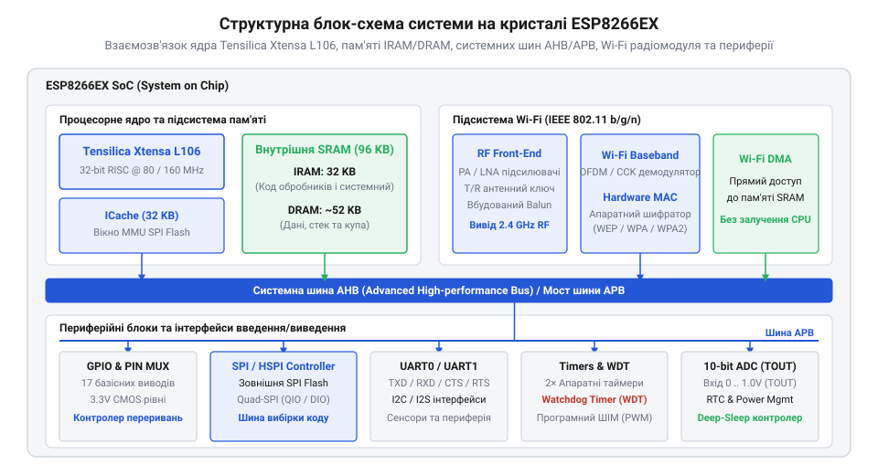

# Огляд мікроконтролера та архітектури SoC ESP8266

<preknowlist>
- [ESP-01 (Wi-Fi, ESP8266)](root:cat-hw-boards/esp-01) — Базові принципи схемотехнічного виконання та призначення виводів модуля ESP-01
- [Режими завантаження мікроконтролера ESP8266](root:cat-hw-boards/esp8266-boot-modes) — Призначення режимів старту між виконанням коду з Flash-пам'яті та програмуванням через UART
- [Конфігураційні виводи завантаження ESP8266](root:cat-hw-boards/esp8266-boot-strapping-pins) — Призначення та вимоги до логічних рівнів підтяжки виводів GPIO0, GPIO2 і GPIO15 при старті
</preknowlist>

## Проблема інтеграції та архітектура SoC

Розробка бездротових пристроїв вимагає поєднання процесора та радіомодема. Використання двох окремих мікросхем здорожчувало плату. Система на кристалі @@en|SoC@@ (від англ. *System on Chip* — система на кристалі) ESP8266EX об'єднала ядро та Wi-Fi трансивер на єдиному кристалі.

Обробку коду виконує 32-бітна @@en|RISC@@-архітектура (від англ. *Reduced Instruction Set Computer* — комп'ютер зі скороченим набором інструкцій) Tensilica Xtensa L106 з 5-стадійним конвеєром. Для обміну даними кристал має дві шини: системну @@en|AHB@@ (від англ. *Advanced High-performance Bus* — високопродуктивна шина) для пам'яті та периферійну @@en|APB@@ (від англ. *Advanced Peripheral Bus* — периферійна шина). Контролер @@en|DMA@@ (від англ. *Direct Memory Access* — прямий доступ до пам'яті) передає мережеві пакети між трансивером і пам'яттю напряму, не завантажуючи процесор.

*Підсистема SoC ESP8266EX: об'єднання обчислювального ядра, апаратного Wi-Fi та периферійних шин.*

## Підсистема оперативної пам'яті DRAM та IRAM

Внутрішня оперативна пам'ять @@en|SRAM@@ (від англ. *Static Random Access Memory* — статична оперативна пам'ять) обсягом 160 КБ розділена на два блоки. Пам'ять інструкцій @@en|IRAM@@ виконує код без затримок і містить критичні обробники переривань. Пам'ять даних @@en|DRAM@@ зберігає змінні й вимагає 32-бітного вирівнювання адрес, а мережеві буфери спричиняють її фрагментацію.

*Карта внутрішньої пам'яті SRAM: розділення адресного простору між кодом інструкцій IRAM та даними DRAM.*

## Шина SPI Flash та кешування L1

Через брак IRAM код зберігається у зовнішній флеш-пам'яті. Блок управління пам'яттю @@en|MMU@@ (від англ. *Memory Management Unit*) мапує її у віртуальний адресний простір ядра через кеш інструкцій L1 @@en|ICache@@ (від англ. *Instruction Cache*).

Зчитування йде шиною SPI у режимі QIO або DIO. При промаху кешу процесор зупиняється для підвантаження сторінки. Щоб уникнути затримок, критичні функції виносять в IRAM макросом `IRAM_ATTR`, а решту залишають у флеш-пам'яті макросом `ICACHE_FLASH_ATTR`.

*Механізм вибірки коду з флеш-пам'яті: підкачування сторінок через блок MMU в кеш інструкцій ICache.*

## Схемотехніка GPIO та фантомне живлення

Виводи @@en|GPIO@@ (від англ. *General Purpose Input/Output* — виводи загального призначення) побудовані на @@en|CMOS@@-каскадах із обмеженням струму 12 мА. Подача напруги на вивід знеструмленого чипа викликає струм через діоди @@en|ESD@@ захисту на лінію живлення та фантомне заживлення кристала. Для підключення 5-вольтової периферії застосовують дільники напруги й струмообмежувальні резистори з урахуванням вимог, які задають [конфігураційні виводи завантаження](root:cat-hw-boards/esp8266-boot-strapping-pins).

*Внутрішнє влаштування виводу GPIO: струмообмеження КМОН-транзисторів та захисні ESD-діоди.*

## Підсистема живлення та пікові струми

Випромінювання Wi-Fi трансивера створює сплески споживання струму до 300 мА. Падіння напруги нижче 2.6–2.8 В запускає детектор @@en|Brownout@@ (від англ. *brownout* — просідання напруги живлення) і перезавантажує чип. Для стабілізації використовують @@en|LDO@@-стабілізатор (від англ. *Low Dropout* — стабілізатор з малим падінням напруги) та керамічні конденсатори X7R біля виводів живлення.

*Профіль споживання струму: амплітудні сплески радіоканалу та межа спрацьовування Brownout Reset.*

## Енергозбереження та регістри RTC

З трьох режимів сну (Modem-sleep, Light-sleep, Deep-sleep) у Deep-sleep вимикається все, крім таймера та пам'яті @@en|RTC RAM@@ (від англ. *Real-Time Clock RAM*) на 512 байтів.

RTC RAM зберігає мережевий стан для швидкого перепідключення. Пробудження з Deep-sleep відбувається через подачу низького рівня з GPIO16 на RST або за допомогою таймера @@en|RTC@@ (від англ. *Real-Time Clock* — годинник реального часу). Механізм використовують на платах [модуля ESP-01](root:cat-hw-boards/esp-01) з урахуванням [режимів завантаження мікроконтролера](root:cat-hw-boards/esp8266-boot-modes).
