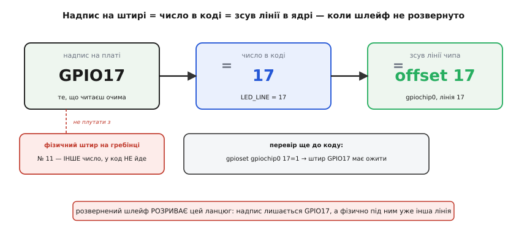
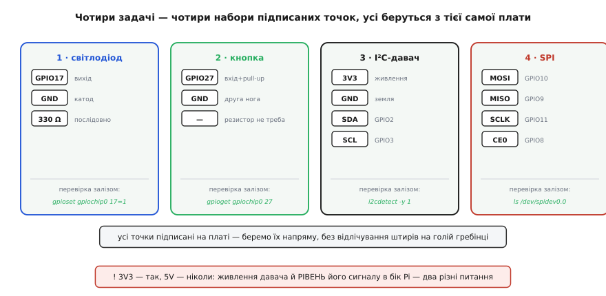

# ⚙️ Керуємо виводами Pi з макетки: світлодіод, кнопка, I²C, SPI через libgpiod

Плата-розширення зробила головне: витягла сорок штирів гребінки Raspberry Pi на макетку й підписала кожен — `3V3`, `GND`, `GPIO17`, `SDA`. Тепер перед вами не голий частокіл контактів, а поле надписаних точок, куди можна тицяти дротом без страху. Але сама плата — німа. Вона нічого не блимає й нічого не читає; вона лише **виводить** лінії. Життя в цю макетку вдихає код, що біжить на самій Raspberry Pi. І ось тут постає перше практичне питання: **як саме сучасна Pi дозволяє програмі смикнути вивід**, коли той винесений на макетку.

Відповідь на Raspberry Pi 5 (і на свіжих ядрах Pi 4) — бібліотека **`libgpiod`** поверх символьного пристрою `/dev/gpiochipN`. Не `RPi.GPIO`, не `wiringPi`, не файли в `/sys/class/gpio` — усе це на Pi 5 або мертве, або доживає. Чому саме так, ми розберемо за хвилину, а поки закарбуймо головну думку цієї вставки, бо вона і є містком від плати до коду: **надпис на штирі — це обіцянка, а не факт**. Плата надрукувала `GPIO17` і обіцяє, що дріт із цієї точки веде саме до лінії GPIO17 процесора. Код вірить цій обіцянці — він оперує тим самим числом `17`. Наша задача — стежити, щоб обіцянка не була порожньою, бо є рівно два способи її зламати, і обидва тихі.

Розберемо чотири типові задачі повністю, з робочим C: засвітити світлодіод, прочитати кнопку, поговорити з I²C-давачем, обмінятися байтами по SPI. Кожну — так, щоб число в коді впізнавалося в надписі на платі. А наприкінці зберемо в купу пастки, специфічні саме для роботи **через плату на макетці**: вони інші, ніж коли тицяєш прямо в гребінку.

Одразу застереження, від якого залежить, житиме плата чи ні: **логіка всіх виводів Pi — 3.3 вольта**. Вивід очікує на вході від 0 до 3.3 В і сам видає стільки ж. Плата пасивна — вона не боронить виводи, а лише оголює й підписує їх. Тому точка `5V`, підписана поруч із сигнальними, — це заряджена рушниця: подати ці п'ять вольтів на 3.3-вольтовий вивід (напряму чи через давач, що віддає п'ятивольтовий сигнал) майже гарантовано **вбиває ніжку процесора**. Тримайте це в голові з першого дроту; наприкінці повернемось.

## Чому на Pi 5 старий код мовчить, а libgpiod — ні

Перш ніж писати нове, варто зрозуміти, чому **не працює старе** — інакше ви згаєте вечір, лагодячи приклад із інтернету, який на цій платі приречений.

Якщо ви колись керували Raspberry Pi з коду, ви майже напевно бачили `import RPi.GPIO as GPIO`. Ця бібліотека (і споріднені `wiringPi`, старий `pigpio`) працювала грубо й швидко: відкривала `/dev/gpiomem`, відображала собі в пам'ять шматок регістрів блоку GPIO всередині головного чипа Broadcom і писала прямо в регістр «стан виводів». Блок сидів за фіксованою фізичною адресою, роками тією самою — і код звертався до неї напряму.

На Pi 5 цього блоку за старою адресою **немає**. Виводи GPIO тепер живуть за окремим чипом-компаньйоном **RP1** — це власний чип Raspberry Pi, «південний міст», що тримає на собі всю периферію (GPIO, USB, Ethernet, камеру, дисплей) і під'єднаний до головного процесора BCM2712 шиною PCIe 2.0 ×4. Коли `RPi.GPIO` намагається відобразити `/dev/gpiomem` і знайти там знайомі регістри, вона впирається в порожнечу: заліза за тією адресою більше немає. Звідси ліс однакових питань у мережі — «мій скрипт нічого не блимає на Pi 5, хоч на Pi 4 працював». Код стукає туди, де вже нікого немає.

Сучасний шлях інший за самою філософією. Ви **не лізете в регістри руками** — ви просите ядро. Кажете йому: «дай мені лінію номер N цього чипа як вихід, початкове значення нуль» — і ядро само розмовляє з RP1 через свій драйвер. Ваш код не знає й не хоче знати, за якою адресою фізично сидить RP1; він працює через стабільний інтерфейс — символьний пристрій `/dev/gpiochipN`, — однаковий на будь-якій платі й на будь-якому Linux, від промислового контролера до сервера. Обгортка над цим інтерфейсом і є `libgpiod`.

> 🔧 **Навіщо це.** Швидка перевірка «на кого розрахований чужий приклад»: шукайте в ньому слова `gpiomem`, `mmap`, `RPi.GPIO`, `wiringPi` — це маркери мертвого на Pi 5 підходу. Побачили — не лагодьте, беріть `libgpiod` від початку. Ще одна пастка тут — старіші статті, що радять писати у файли `/sys/class/gpio/export`: цей інтерфейс (**sysfs**) офіційно застарілий і на нових ядрах прибирається. Канон один: `libgpiod` поверх `/dev/gpiochipN`. Глибше про архітектуру RP1, права доступу й роботу з диском на Pi 5 — у [ширшій вставці про GPIO-API п'ятої моделі](root:cat-hw-boards/rpi5/api-gpio.md); тут ми дивимось на те саме крізь призму макетки.

Ще дві дрібниці, які треба вирішити **до** першого рядка коду, бо вони — про те, як плата стикується з бібліотекою.

**Який `/dev/gpiochipN`.** RP1 виставляє кілька чипів. Історично на ранніх системах Pi 5 гребінка сорока виводів висіла на `/dev/gpiochip4`, і в старих прикладах ви це число ще зустрінете. У ядрах приблизно з середини 2024 року Raspberry Pi навела лад: тепер **`gpiochip0` завжди відповідає користувацьким виводам гребінки** — так само, як на старих платах, щоб приклади не ламалися. Тому в свіжій системі беріть `/dev/gpiochip0`. Якщо ж плата на старішому ядрі й `gpiochip0` виявився не тим — гляньте `gpiodetect` (перелічить усі чипи) і `gpioinfo` (розпише лінії), знайдіть чип гребінки й підставте його. Далі в коді я триматимусь `/dev/gpiochip0`.

**Постав бібліотеку.** Один рядок: `sudo apt install libgpiod-dev gpiod`. Пакет `libgpiod-dev` дає заголовок `gpiod.h` і саму бібліотеку для збірки; пакет `gpiod` дає **командні утиліти** — `gpioset`, `gpioget`, `gpioinfo`, `gpiodetect`. Ці утиліти — ваш найкращий друг на макетці, і саме ними ми перевірятимемо кожне з'єднання руками, ще до написання програми.

## Перше правило макетки: перевір залізо руками, потім пиши код

Коли плата винесла виводи на макетку, у ланцюга «код → штир» з'явилася нова слабка ланка — **дроти-перемички**. На голій гребінці ви тицяли прямо в контакт; тут між кодом і виводом лежить перемичка, яка може не доткнутися, вискочити з дірки чи піти не в ту колонку. Тому золоте правило: перш ніж винуватити код, **переконайтесь, що залізо ожило від руки**. Утиліти `gpiod` роблять це за секунди й без жодного рядка C.

Скажімо, ви завели світлодіод на точку `GPIO17`. Не пишіть поки програму — виставте вивід руками:

```
gpioset gpiochip0 17=1     # виставити лінію 17 у високий рівень → світлодіод має спалахнути
gpioset gpiochip0 17=0     # у низький → згаснути
```

Спалахнув — весь ланцюг від ядра до ніжки живий: чип правильний, лінія вільна, перемичка на місці, полярність світлодіода не переплутана. Тепер, якщо ваша майбутня програма мовчатиме, ви точно знаєте — справа **в коді**, а не в дротах. Не спалахнув — розбираєтесь із залізом, і код тут узагалі ні до чого. Ця тридцятисекундна перевірка заощаджує години гадання «чому не блимає».

Так само з входом. Завели кнопку на `GPIO27` — прочитайте лінію руками:

```
gpioget gpiochip0 27       # надрукує поточний рівень лінії 27 (0 або 1)
```

Натисніть кнопку, повторіть — значення має змінитися. А `gpioinfo gpiochip0` розпише **всі** лінії чипа: яка вільна, яка кимось зайнята, який у неї напрямок і підпис-споживач. Коли пізніше запит лінії з коду поверне «пристрій зайнятий», саме `gpioinfo` покаже, хто її тримає.

> 🔧 **Навіщо це.** Ця звичка окупається саме через плату. Пасивна плата не має власного розуму, який міг би збоїти, — тож поломка завжди або в коді, або в фізичному з'єднанні на макетці. Утиліти `gpiod` розрубують це навпіл: ожив вивід від `gpioset` — залізо в порядку, копай код; не ожив — копай дроти й полярність, код читати марно. Ви ніколи не гадаєте над обома половинами одночасно.

І остання перевірка перед кодом — та, що рятує саму плату. Якщо ви щойно надягли шлейф, **звірте живлення мультиметром**: доторкніться щупом до точки `3V3` — маєте побачити 3.3 В, до `5V` — близько 5 В. Якщо на точці, підписаній `3V3`, раптом п'ять вольтів — шлейф розвернуто, надписи брешуть, і ви щойно спіймали це мультиметром, а не згорілим давачем. Чому таке буває — за мить, у пастках; поки просто візьміть за звичку.

## Задача 1: засвітити світлодіод на GPIO17

**Умова.** На макетку виведено плату-розширення. Від точки `GPIO17` дріт іде на анод світлодіода; катод — через резистор 330 Ом у точку `GND`. Треба, щоб світлодіод блимав. Це «Hello, world» заліза: блимає — весь ланцюг від коду до ніжки живий.

**Ідея.** Раз плата пасивна, точка `GPIO17` на макетці — це буквально лінія GPIO17 процесора, лише винесена на зручне місце. Тому код нічим не відрізняється від блимання прямо на гребінці: просимо в ядра лінію 17 як вихід і смикаємо її через `libgpiod`. Число `17` у коді — те саме, що надруковано біля штиря (`GPIO17`), і те саме, що ми виставляли утилітою `gpioset`. Три написи одного числа — надпис на платі, аргумент `gpioset`, константа в коді — мусять збігатися; якщо десь інше число, ви смикаєте не ту лінію.

:::tabs
:::code api-libgpiod-breadboard/c/blink.c
:::code api-libgpiod-breadboard/py/blink.py
:::

**Складність — де саме церемонія.** Код здається довгим для «блимнути», і це особливість версії 2 `libgpiod`: вона розбиває запит на **три об'єкти-конфіги**. `line_settings` — як поводиться лінія (напрямок, підтяжка, початкове значення); `line_config` — які саме зсуви ліній беремо й з якими налаштуваннями; `request_config` — метадані запиту (підпис споживача). Ці три збираються одним викликом `gpiod_chip_request_lines()`, що повертає **дескриптор запиту** — далі всі значення пишуться-читаються через нього. Для однієї лінії це виглядає надлишковим, але окупається, коли ліній багато й у кожної свій режим: ви складаєте конфіг як конструктор, а не сиплете десяток аргументів в одну функцію.

**Пастка тут.** Слова `ACTIVE`/`INACTIVE`, а не «1» і «0», — не примха. `libgpiod` мислить **логічним станом лінії**, а не напругою: за замовчуванням `ACTIVE` — це високий рівень (3.3 В), тож `ACTIVE` = світлодіод горить. Але лінію можна оголосити «активна-низька», і тоді `ACTIVE` відповідатиме **нулю** на ніжці. На макетці це прикусає, коли світлодіод посаджено катодом на вивід, а анодом на `3V3`: тоді горить він від **низького** рівня, і без оголошення полярності логіка коду вивернеться навпаки. Поки що тримаємо звичайну схему (анод на вивід, катод через резистор на землю) — і `ACTIVE` чесно означає «горить».

**Висновок.** Плата вставилась у цю картину так гладко, що в коді про неї немає жодного сліду — ми керуємо лінією GPIO17, лише фізично вона тепер зручно на макетці з підписом. Що таке цифровий вивід, рівні 0 і 3.3 В, вхід проти виходу — розібрано в статті [вивід загального призначення](root:hw-digital/gpio); тут ми цим користуємось.

## Задача 2: прочитати кнопку з підтяжкою на GPIO27

**Умова.** До точки `GPIO27` і точки `GND` на макетці під'єднано тактову кнопку — два дроти, більше нічого. Треба в коді знати, натиснута вона чи ні.

**Ідея й головна пастка входу.** Наївний план «читаю рівень на GPIO27» має діру. Поки кнопка не натиснута, вивід **ні до чого не під'єднаний** (кнопка розімкнена), і вхід «висить у повітрі»: рівень не визначений, вхід ловить наводки й показує то нуль, то одиницю хаотично. Читати такий вхід марно — і на макетці це видно особливо яскраво, бо довгі перемички ловлять наводки ще охочіше за короткий контакт у гребінці.

Рятує **підтяжка** — резистор, що м'яко тягне вхід до відомого рівня, коли зовні нічого не задано. Найзручніше ввімкнути **підтяжку до плюса** (*pull-up*): внутрішній резистор тягне вхід до 3.3 В, тож у спокої ми стабільно читаємо **одиницю**. Другий кінець кнопки — на землі. Натиснули → коло замкнулося на землю → вхід просів у **нуль**. Виходить перевернута логіка: **розімкнено = 1, натиснуто = 0**. Найпоширеніша схема, бо потребує лише кнопки та двох дротів — резистор дає сам чип, паяти зовнішній не треба. RP1 має вбудовані підтяжки на кожному вводі, і `libgpiod` вмикає їх одним викликом.

:::tabs
:::code api-libgpiod-breadboard/c/button.c
:::code api-libgpiod-breadboard/py/button.py
:::

**Складність і дві пастки.** Перша — вибір підтяжки, і його треба зробити **свідомо під свою схему**. `GPIOD_LINE_BIAS_PULL_UP` тягне до плюса (спокій = 1, натиск = 0). Є ще `PULL_DOWN` (тягне до землі, натиск дає 1), `DISABLE` (жодної підтяжки — коли її дає зовнішнє коло) і `AS_IS` (не чіпати). Саме підтяжка задає, що ви прочитаєте в спокої, тож рядок логіки `pressed = (v == INACTIVE)` прямо залежить від неї — переставите підтяжку, а логіку ні, і кнопка «читатиметься навпаки».

Друга — **дребезг контактів**. Механічний контакт при натиску не замикається чисто: пластини кілька мілісекунд дрижать, і лінія за цей час стрибає нуль-одиниця-нуль багато разів. Опитуючи вхід раз на 20 мс, ми природно перестрибуємо цю бовтанку — до наступного читання контакт уже влігся. Це найпростіший *debounce*, грубий, але для кнопки в циклі опитування достатній. Тонший шлях — не опитувати, а попросити ядро надсилати **події зміни рівня** (edge events) і фільтрувати їх за часом; `libgpiod` це вміє, але для першого разу опитування наочніше. Перевірити ж, що кнопка взагалі доходить до ніжки, найпростіше без коду — `gpioget gpiochip0 27` до й після натиску.

## Задача 3: поговорити з I²C-давачем із макетки

**Умова.** До макетки під'єднано I²C-давач — нехай поширений барометр-термометр BMP280 за адресою 0x76. З плати він бере чотири підписані точки: `3V3` (живлення), `GND` (земля), `SDA` (це GPIO2, фізичний штир 3) і `SCL` (GPIO3, штир 5). Треба прочитати його регістр `id` за адресою 0xD0 — давач має віддати сталий байт-підпис 0x58. Це найкоротший спосіб переконатися, що зв'язок є.

**Ідея — і чому тут немає `libgpiod`.** I²C — це дві лінії (дані SDA і такт SCL), на яких висить кілька пристроїв, кожен зі своєю адресою; протокол детально розібрано в статті про [шину I²C](root:com-devices/i2c-bus). Ключове: цими двома лініями порядкує **окремий драйвер ядра**, а не ви руками. Плата лише виводить лінії `SDA`/`SCL` на макетку підписаними — говорить по них контролер I²C усередині Pi. Тому `libgpiod` ми не чіпаємо: драйвер виставляє нам файл-пристрій `/dev/i2c-1`, і розмова з давачем — це відкрити цей файл, сказати «моя ціль — адреса 0x76», а далі писати й читати байти звичайними `write()`/`read()`.

Тут перевага плати особливо відчутна. Без неї довелося б відраховувати на голій гребінці штирі 1 (3V3), 3 (SDA), 5 (SCL), 6 (GND) — чотири різні місця, легко промахнутися на штир. На макетці ви берете чотири підписані точки, всі поруч. Але спершу — знову перевірка залізом, і для I²C вона своя:

```
i2cdetect -y 1     # просканує шину i2c-1 і покаже адреси; BMP280 має світитися як 76
```

Щоб шина взагалі з'явилася, її вмикають: у `raspi-config` розділ *Interface Options → I2C → Enable*, або рядком `dtparam=i2c_arm=on` у `/boot/firmware/config.txt` і перезавантаження. Побачили `76` у таблиці `i2cdetect` — дроти й адреса в порядку, є сенс писати код. Не побачили — код читати марно, розбирайтесь із дротами `SDA`/`SCL` і живленням.

**Читання регістра — це «напиши, потім прочитай».** Щоб дістати регістр 0xD0, треба спершу **записати** давачу один байт — номер потрібного регістра, — а тоді **прочитати** один байт відповіді. Класична двотактна розмова майже з усіма I²C-давачами.

:::tabs
:::code api-libgpiod-breadboard/c/i2c_id.c
:::code api-libgpiod-breadboard/py/i2c_id.py
:::

**Складність.** Тут працює принцип «усе — файл»: пристрій на шині виглядає як файл `/dev/i2c-1`, і єдине спеціальне — `ioctl(fd, I2C_SLAVE, ADDR)`, яким ми один раз кажемо драйверу, до **кого** з пристроїв на шині адресуємо наступні `write`/`read`. Далі байти йдуть туди-сюди звичайно; про такти, старт-стоп-умови й підтвердження шини дбає контролер I²C у ядрі.

> 🔧 **Навіщо це.** Схема «напиши регістр → прочитай значення» — не примха BMP280, а **загальний діалект** майже всіх I²C-давачів: акселерометрів, годинників реального часу, розширювачів портів, драйверів дисплеїв. Опанувавши цей код на одному давачі, ви читаєте будь-який інший — міняється лише адреса, номери регістрів і скільки байтів забирати. Тому один раз розберіть його до кінця.

**Пастка макетки для I²C.** Шина I²C тримається на підтяжках ліній `SDA`/`SCL` до 3.3 В — на самій Pi вони вже є, тож зазвичай додаткові не потрібні. Але якщо давач-модуль із світу Arduino розрахований на 5 В і **сам підтягує лінії до п'яти вольтів**, ці 5 В зайдуть у 3.3-вольтові виводи GPIO2/GPIO3 — і це той самий смертний вирок ніжці, що й скрізь. Живіть I²C-давач із точки `3V3`, а не `5V`; тоді і живлення, і рівні на `SDA`/`SCL` самі собою в безпечному діапазоні.

## Задача 4: обмінятися байтами по SPI

**Умова.** До макетки під'єднано SPI-пристрій — наприклад, АЦП, флеш-пам'ять чи дисплей. З плати він бере чотири підписані сигнальні точки: `MOSI` (це GPIO10, штир 19), `MISO` (GPIO9, штир 21), `SCLK` (GPIO11, штир 23) і `CE0` (GPIO8, штир 24) — плюс `3V3` і `GND` на живлення. Треба надіслати пристрою байт-команду й прочитати його відповідь.

**Ідея — знову окремий драйвер, не `libgpiod`.** SPI — це чотири лінії й обмін «повним дуплексом»: майстер (Pi) жене такт по `SCLK`, на кожному такті висуває біт по `MOSI` й **одночасно** втягує біт по `MISO`, а лінією `CE0` (chip-enable) обирає, до якого пристрою на шині зараз говорить; сам протокол розібрано в статті про [шину SPI](root:com-devices/spi-bus). Як і з I²C, цими лініями порядкує драйвер ядра — плата лише виводить їх підписаними. Драйвер виставляє файл-пристрій `/dev/spidev0.0`, де `0` — номер шини (SPI0), а друге число — який chip-enable: `spidev0.0` — це CE0 (GPIO8), `spidev0.1` — CE1. Тобто **надпис `CE0` на платі й хвіст `.0` в імені файлу — це той самий вибір пристрою**.

Вмикають SPI рядком `dtparam=spi=on` у `/boot/firmware/config.txt` (або через `raspi-config → Interface Options → SPI`) і перезавантаженням. Перевірка залізом тут — переконатися, що файл-пристрій з'явився:

```
ls /dev/spidev0.0     # є файл → шина SPI0 увімкнена, драйвер підхопив CE0
```

**Обмін — це один «повнодуплексний» transfer.** На відміну від I²C, у SPI надсилання й отримання відбуваються **разом**: ви подаєте буфер на вихід (`MOSI`) і водночас забираєте те, що прийшло на вхід (`MISO`) за ті самі такти. У Linux один такий обмін описує структура `spi_ioc_transfer`, а запускає його `ioctl(fd, SPI_IOC_MESSAGE(1), …)`.

:::tabs
:::code api-libgpiod-breadboard/c/spi_xfer.c
:::code api-libgpiod-breadboard/py/spi_xfer.py
:::

**Складність і пастки.** По-перше, `memset(&tr, 0, sizeof tr)` — **не косметика**. Структура `spi_ioc_transfer` має поля, яких ми не заповнюємо (`delay_usecs`, `cs_change` та інші); лишити їх зі сміттям зі стека — значить наказати драйверу непередбачувані затримки чи зняття chip-enable серед обміну. Обнуляйте структуру завжди.

По-друге, **`tx` і `rx` однакової довжини — бо обмін дуплексний**. Ви не «надсилаєте 2 байти, потім читаєте 2»; ви женете 2 такти, і за ці ж такти те, що на `MISO`, лягає в `rx`. Хочете лише прочитати — все одно шлете стільки ж пустих байтів (тут другий байт `0x00`), щоб дати такти, під які пристрій висуне відповідь. Це збиває з пантелику після I²C, де напрямки розділені.

По-третє, **режим і швидкість — з даташита пристрою, не навмання**. `SPI_MODE_0…3` задають полярність такту й фазу вибірки (коли саме читати біт); неправильний режим дає читабельний, але **зсунутий** результат — байти приходять, та не ті. Швидкість `hz` теж обмежена пристроєм: перевищите — обмін розсиплеться. Ці числа беруться з опису конкретного пристрою, а плата тут ні до чого — вона лише пропускає лінії.

## Пастки, специфічні для роботи через плату

Код вище короткий, і в цьому підступ: три чверті болю — не в самих викликах, а навколо них, і на макетці ці граблі свої. Зберімо їх.

**Розвернений шлейф = дзеркальні лінії, і надписи брешуть.** Це найпаскудніша пастка всієї конструкції, і вона одна перекреслює всю нашу довіру до надписів. Плоский роз'єм шлейфа симетричний — його фізично можна надіти двома способами, розвернувши на 180°. Правильно: пін 1 Pi йде на пін 1 плати. Розвернуто: пін 1 їде туди, де плата чекає пін 2, і **вся розводка стає дзеркальною** — лівий стовпчик міняється з правим. Наслідок жорсткий: надпис `GPIO17` тепер сидить на штирі, куди фактично приходить сусідня лінія; надпис `3V3` — на штирі, де насправді 5 вольтів. Плата мовчки бреше, а ваш код, вірячи надписам, шле сигнали й живлення не туди. Число `17` у коді правильне — а фізична лінія під ним інша, і жоден `gpioset` не «оживить» той світлодіод, бо на його штир іде вже не GPIO17. Рятує звичка: **червона смуга шлейфа завжди дивиться на пін 1** — і на боці Pi, і на боці плати; пін 1 позначено на обох (квадратна площадка чи надпис «1»). Один раз звірили — надписи знову правдиві. І мультиметр на `3V3` перед першим дротом: побачили п'ять — шлейф розвернуто.

**5 вольтів через підписану точку `5V` — смертний вирок ніжці.** Повторю, бо на цьому гублять не вечір, а плату. Плата пасивна: вона **ніяк не боронить** виводи від перенапруги, лише оголює й підписує їх. Логіка всіх GPIO — 3.3 В; вбудованого захисту «встромив 5 В — і нічого» немає. Плата тут навіть підступна, бо кладе точки `5V` і `3V3` **поруч** із сигнальними GPIO, всі однаково зручні й підписані — і рука сама тягнеться живити щось п'ятьма вольтами, забувши, що сигнал із цього «щось» потім піде назад у 3.3-вольтовий вивід. Живлення давача й **рівень його сигналу** — два різні питання, і плата на них не відповідає. Найбезпечніше правило: поки не впевнені — беріть давачі на 3.3 В і живіть їх із точки `3V3`; тоді і живлення, і сигнал самі в безпечному діапазоні. Усе п'ятивольтове — через перетворювач рівнів, ніколи навпростець.

**Фізичний штир проти BCM-номера.** Той самий контакт несе **два різні числа**: фізичне місце на гребінці (1…40 — просто його позиція в ряду) і номер лінії GPIO (нумерація BCM — ім'я лінії в чипі). GPIO17 фізично сидить на штирі 11. `libgpiod` оперує **зсувами ліній**, тобто BCM-номерами: щоб узяти GPIO17, ви передаєте `offset = 17`, а не `11`. Плата тут радше рятує, ніж шкодить — вона друкує саме BCM-ім'я (`GPIO17`), те, що піде в код. Але щойно ви звіряєтесь із фотографією гребінки в інтернеті, де підписи часто фізичні, плутанина повертається: побачили «пін 11», підставили `11` у код — і смикаєте зовсім іншу лінію (GPIO11). Правило коротке: **число в коді — це BCM-ім'я з надпису на платі, а не порядковий номер штиря на фото гребінки.**


*Ланцюг рівностей: надпис `GPIO17` на платі = константа `17` у коді = зсув лінії 17 на `gpiochip0`. Фізичний штир №11 — окреме число, у код воно не потрапляє. Розвернений шлейф розриває саме цей ланцюг: надпис лишається, а фізична лінія під ним стає іншою.*

**Хто вже зайняв лінію.** Лінію GPIO в один момент тримає **один** споживач. Якщо вивід уже відданий у device tree під якусь функцію (скажімо, під той самий SPI чи I²C) або його зайняла інша програма, ваш запит лінії поверне «пристрій зайнятий». Тут стає в пригоді підпис-споживач, що ми ставили через `set_consumer`: `gpioinfo gpiochip0` покаже по кожній лінії, вільна вона чи ким узята — і в чужому виводі одразу видно, що лінію тримає саме ваш `blink`, а не безіменний процес. До речі, тому й не можна одночасно смикати `libgpiod`-ом ті самі GPIO2/3, що зайняті під I²C, чи GPIO8-11 під SPI: доки шина ввімкнена, ці лінії належать її драйверу.


*Світлодіод бере `GPIO17`+`GND`; кнопка — `GPIO27`+`GND` із внутрішньою підтяжкою; I²C-давач — `3V3`/`GND`/`SDA`/`SCL`; SPI — `MOSI`/`MISO`/`SCLK`/`CE0`. Знизу кожної картки — команда, якою це перевіряють залізом ще до коду. Наскрізне правило: `3V3` — так, `5V` — ніколи в бік 3.3-вольтового виводу.*

**Python, якщо не хочеться C.** Усе вище має пряме дзеркало в Python: той самий `libgpiod` з офіційною прив'язкою (пакет `gpiod`), для I²C — `smbus2`, для SPI — `spidev`, а для GPIO є ще зручна надбудова `gpiozero`, де світлодіод — буквально об'єкт `LED(17)` з методами `.on()`/`.off()`. Під капотом воно на Pi 5 ходить через ту саму символьну підсистему ядра, тож усі пастки з нумерацією, правами й 3.3 В лишаються ті самі — міняється лише синтаксис. C тут показаний тому, що оголює механізм: видно кожен крок, який обгортка ховає.

Підсумок короткий. Плата-розширення не додає Pi здатностей — вона робить наявні **видимими й підписаними**, а весь розум лишається в коді на самій Pi. Керувати виводами з цього коду — це не «писати в порт», як на мікроконтролері, а **просити в ядра ресурс**: лінію GPIO через `libgpiod`, шину I²C через `/dev/i2c-1`, шину SPI через `/dev/spidev0.0`. Плата між кодом і залізом лишається чесним, але буквальним посередником: що надруковано на штирі — те код і смикне, **якщо** шлейф не розвернуто. Три речі, які варто закарбувати саме для роботи через плату: **надпис = BCM-число в коді** (а не фізичний штир); **перевір вивід від руки утилітою `gpiod`, перш ніж винуватити код**; і — **3.3 В так, 5 В на вивід ніколи**, бо плата вас від цього не врятує.
