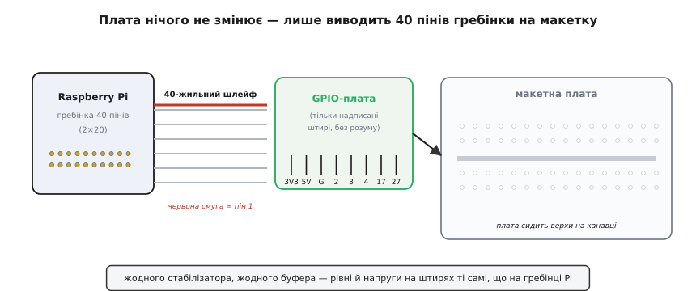
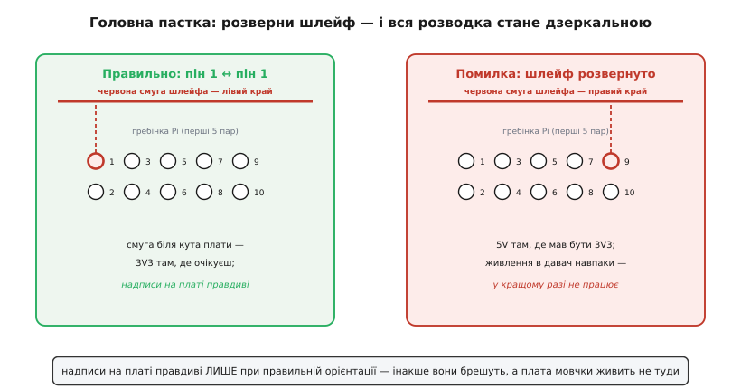

# GPIO Extension Board для Raspberry Pi

<preknowlist>
- [Родина Raspberry Pi](root:cat-hw-boards/raspberry-pi-family) — загальну стандартизовану 40-контактну гребінку виводів GPIO, яка присутня на платах екосистеми
</preknowlist>

## Призначення та пасивна природа адаптера

Гребінка з сорока штирків на краю [Raspberry Pi 4 Model B](root:cat-hw-boards/rpi4) розташована двома щільними рядами без шовкографічного підпису назв сигналів. Підключення дротів-перемичок безпосередньо до такої гребінки створює ризик промахнутися контактом і викликати коротке замикання. Плата-розширення @@en|GPIO Extension Board@@ (часто звана @@en|T-Cobbler@@ — Т-подібний взуттєвик) розв'язує цю проблему, виносячи всі лінії на безпаєчну макетну плату з наочним маркуванням кожного виводу.

*Плата-розширення виносить та дублює контакти GPIO на макетну плату, додаючи чітке шовкографічне маркування кожного виводу.*

За своєю конструкцією адаптер є суто пасивним подовжувачем. Він не містить активних мікросхем, підсилювачів чи регуляторів: кожен контакт прямо з'єднується з відповідною жилою шлейфа. Плата не перетворює напругу й не змінює часових характеристик сигналів, залишаючи всі лінії 3.3-вольтовими.

## Т-подібна форма та підключення шлейфа

Формфактор @@en|T-Cobbler@@ розроблено у формі літери «Т», що дозволяє встановлювати плату верхи на центральний розділювальний жолобок макетної плати. Така геометрія розводить виводи на два ізольовані боки, залишаючи вільні отвори для зручного макетування. Зв'язок із комп'ютером здійснюється через 40-жильний плаский шлейф.

*Орієнтація кольорової смуги шлейфа відносно піна 1 запобігає переполюсуванню ліній живлення та сигналів.*

Головна апаратна пастка полягає в можливості підключити роз'єм шлейфа із розвертанням на 180 градусів. Дзеркальне ввімкнення подає напругу 5 В на сигнальні 3.3-вольтові лінії та заземлення. Щоб запобігти збою, кольорову (найчастіше червону) смугу шлейфа завжди орієнтують до першого контакту (позначеного цифрою 1 або білим трикутником) як на платі [Raspberry Pi 5](root:cat-hw-boards/rpi5), так і на самому адаптері, а перед подачею живлення перевіряють напругу на шинах мультиметром.

## Розподіл виводів живлення та шин

На друкованій платі адаптера виводи згруповано за функціональним призначенням. На краї виведено лінії живлення 3.3 В, 5 В та спільний дріт @@en|GND@@ (від англ. @@en|Ground@@ — заземлення, або земля). Сигнальні контакти підписано за стандартом нумерації @@en|BCM@@ (від англ. @@en|Broadcom@@ — назва розробника чипа), що забезпечує пряму відповідність між написом на платі та номерами виводів у коді прошивки.

На плату винесено також усі апаратні інтерфейси, які підтримує вся [родина Raspberry Pi](root:cat-hw-boards/raspberry-pi-family). Контакти шини @@en|I2C@@ (лінії @@en|SDA@@ та @@en|SCL@@), послідовної шини @@en|SPI@@ (лінії @@en|MOSI@@, @@en|MISO@@, @@en|SCLK@@, @@en|CE0@@) та асинхронного порту @@en|UART@@ (лінії @@en|TX@@, @@en|RX@@) мають чіткі позначки, що спрощує підключення зовнішніх давачів та дисплеїв.

## Небезпека перенапруги та вибір формфактора

Сусідство шини 5 В із цифровими 3.3-вольтовими виводами вимагає обережності: випадковий дріт-перемичка або підключення 5-вольтового давача без перетворювача логічних рівнів неминуче виведе з ладу вхідний каскад процесора. Адаптер лише виносить лінії, але не захищає їх від перенапруги.

Для настільного макетування й швидких експериментів найкраще підходить Т-подібний @@en|T-Cobbler@@. Якщо ж пристрій монтується в постійну шафу автоматики чи корпус, замість плати під макетку обирають адаптери з гвинтовими клемами (англ. *screw terminals*), де кожен дріт надійно затискається гвинтом.
