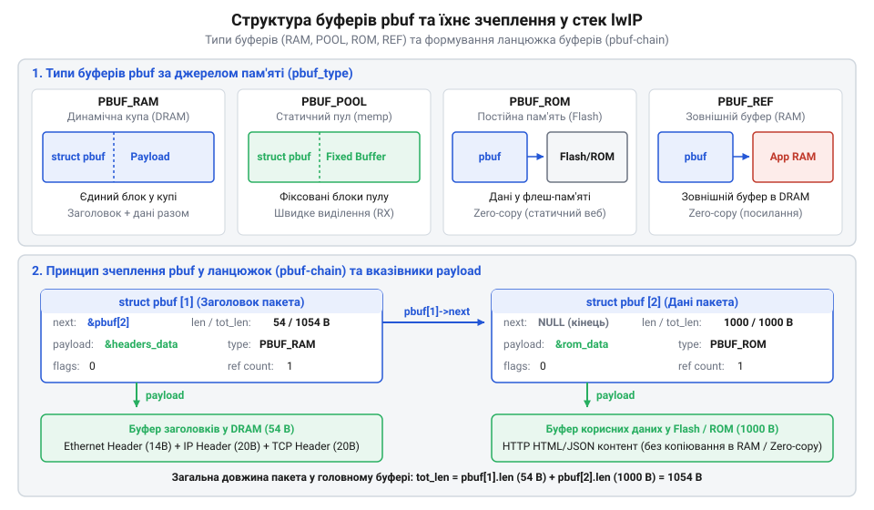
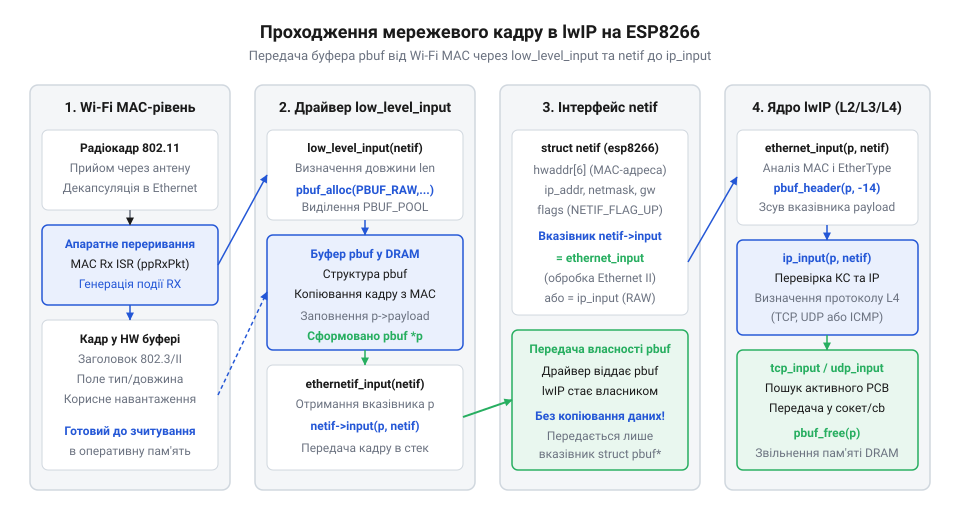
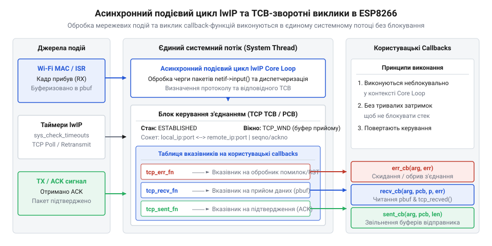
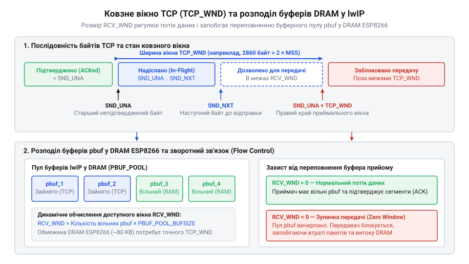

# Архітектура мережевого стека lwIP у ESP8266

<preknowlist>
- [Огляд мікроконтролера та архітектури SoC ESP8266](root:cat-hw-boards/esp8266-soc-architecture-overview) — розподіл оперативної пам'яті DRAM, обсяг динамічної купи та обмеження обчислювальних ресурсів ядра Xtensa L106
- [Мережеві сокети TCP/UDP на модулі ESP-01](root:cat-hw-boards/esp01-tcp-udp-sockets) — принципи високорівневої організації прикладних TCP/UDP-з'єднань та сокетних абстракцій
- [Мережевий стек LwIP 2.x у вбудованих операційних системах](root:cat-hw-boards/lwip-stack-architecture-in-embedded) — загальні концепції побудови стека lwIP та принципи мінімізації накладних витрат пам'яті
</preknowlist>

## Дефіцит оперативної пам'яті та мережеві збої

Уявіть типову практичну задачу: ви розробляєте бездротовий датчик або прикладний веб-сервер керування на базі мікроконтролерів [сімейства модулів ESP8266](root:cat-hw-boards/esp8266-family-overview). Ви написали програмну логіку обробки запитів, протестували її на поодиноких `@@en|TCP@@`-пакетах, і пристрій працює стабільно. Однак варто підключити до сервера кілька одночасних клієнтів або запустити інтенсивний потік даних, як пристрій раптово втрачає мережеве з'єднання, видає у консоль відлагодження сповіщення `ERR_MEM` і зациклюється у перезавантаженнях за сигналом `@@en|watchdog timer@@` (англ. *watchdog timer* — вартовий таймер). Спроби розробника збільшити розміри локальних масивів чи примусово викликати очищення пам'яті не дають результату, оскільки корінь проблеми полягає у фізичних обмеженнях пам'яті кристала та невідповідності класичної сокетної моделі архітектурній специфіці мікроконтролера.

Щоб усвідомити неминучість фатальних мережевих збоїв, необхідно проаналізувати [фізичну організацію пам'яті DRAM](root:cat-hw-boards/esp8266-dram-memory-management) у системі на кристалі `@@en|ESP8266@@` (англ. *Espressif Systems 8266*). Однокристальна система побудована на базі 32-бітного процесорного ядра `@@en|Xtensa LX106@@` і має загальний масив статичної оперативної пам'яті `@@en|SRAM@@` (англ. *static random-access memory* — статична пам'ять із довільним доступом) обсягом близько 160 КБ. Цей обсяг суворо розділений на дві незалежні фізичні області: пам'ять інструкцій `@@en|IRAM@@` (англ. *instruction RAM*) обсягом 32 КБ, де розміщуються критичні до швидкодії функції та обробники переривань, та пам'ять даних `@@en|DRAM@@` (англ. *dynamic random-access memory* — динамічна пам'ять із довільним доступом) обсягом близько 80 КБ. Для зберігання змінних, стека системних задач та динамічної купи доступно лише 80 КБ `@@en|DRAM@@`.

З цих 80 КБ фізичної пам'яті `@@en|DRAM@@` левова частка відразу відчужується під системні потреби SoC ще до запуску користувацької прошивки. Нижні адреси пам'яті забирають статичні глобальні змінні, таблиці векторів, буфери системних задач операційної системи та апаратні дескриптори [підсистеми Wi-Fi MAC та PHY](root:cat-hw-boards/esp8266-wifi-mac-phy-subsystem), які відповідають за прийом і формування бездротових кадрів стандарту IEEE 802.11. У результаті для користувацького коду, створюваних об'єктів та динамічної купи `@@en|heap@@` (англ. *heap* — купа) залишається дуже скромний обсяг — у найкращому разі від 30 до 50 КБ. У цьому вузькому просторі мають одночасно розміщуватися всі мережеві буфери, блоки керування з'єднаннями та прикладні дані програми.

На звичайних персональних комп'ютерах чи серверних платформах мережевий обмін будується навколо високорівневої сокетної абстракції. Якщо розглянути класичні [мережеві сокети TCP/UDP](root:cat-hw-boards/esp01-tcp-udp-sockets), то блокувальна модель `@@en|POSIX@@` (англ. *Portable Operating System Interface*) передбачає виділення окремого операційного потоку (англ. *thread*) на кожне активне з meрежеве з'єднання. Кожен такий потік вимагає власного стека пам'яті (зазвичай від 2 до 4 КБ), а сам `@@en|socket@@` (англ. *socket* — гніздо) створює окремі кільцеві буфери прийому й відправки обсягом у кілька кілобайт. Якщо спробувати реалізувати подібну модель на `@@en|ESP8266@@`, то відкриття лише трьох-чотирьох паралельних `@@en|TCP@@`-сесій повністю вичерпає доступну `@@en|heap@@`-пам'ять. Крім того, традиційні сокети копіюють дані на кожному рівні: з буфера мережевої карти у буфер ядра `@@en|OS@@`, а звідти — у буфер користувацького додатка. Потрійне дублювання одного й того самого кадру в `@@en|DRAM@@` для мікроконтролера є неприпустимим марнотратством.

Коли мережеве навантаження зростає, динамічне виділення пам'яті функцією `malloc()` зазнає невдачі і повертає `NULL`. Мережевий стек фіксує помилку вичерпання буферів `ERR_MEM`. Якщо бездротовий модуль отримує кадри з ефіру на швидкості 54 Мбіт/с, а `@@en|Wi-Fi MAC@@`-драйвер не може виділити пам'ять під вхідний пакет, кадр скидається безпосередньо на фізичному рівні. Якщо прикладний код не здатен миттєво обробити відмову або зациклюється у синхронному очікуванні ресурсу в головному системному потоці `@@en|system loop@@`, процесор зупиняє виконання внутрішніх системних задач `@@en|system task@@`. Бездротовий контролер `@@en|Wi-Fi@@` перестає отримувати процесорний час для відправки апаратних підтверджень `@@en|ACK@@` та обслуговування таймерів [архітектури SoC ESP8266](root:cat-hw-boards/esp8266-soc-architecture-overview). У середовищі `@@en|SDK@@` за надійність системи відповідають два рівні захисту: програмний вартовий таймер `@@en|Software WDT@@` (англ. *Software Watchdog Timer*) та апаратний вартовий таймер `@@en|Hardware WDT@@` (англ. *Hardware Watchdog Timer*). Програмний таймер `@@en|Software WDT@@` функціонує в межах системного подієвого циклу `@@en|system loop@@`: фонові системні таски `@@en|system task@@` операційної системи мають періодично отримувати управління від користувацького коду, щоб скидати лічильник таймера. Якщо прикладний код блокує потік понад 1.5–3 секунди, системні таски не встигають скинути `@@en|Software WDT@@`, і він генерує переривання із перезавантаженням мікроконтролера (`@@en|wdt reset@@`). Якщо ж процесор заблоковано настільки глибоко, що зупинилися навіть програмні обробники переривань, через 6–8 секунд спрацьовує фізичний лічильник `@@en|Hardware WDT@@`, вбудований у кристал `@@en|ESP8266@@`, який примусово скидає сигнал скидання процесора на апаратному рівні.

Вирішення цієї фундаментальної суперечності між обмеженнями пам'яті та вимогами стека `@@en|TCP/IP@@` стало можливим завдяки архітектурним ідеям шведського дослідника Адама Данкельса (англ. *Adam Dunkels*). Звернувшись до витоків, вивчаючи [еволюцію мережевого стека lwIP](root:cat-hw-boards/lwip-architecture-esp8266/hist-lwip-esp8266-evolution.md), можна простежити, як у лабораторії SICS було створено `@@en|lwIP@@` (англ. *lightweight IP* — легковаговий міжмережевий протокол). Головною метою проекту стала реалізація повнофункціонального стека `@@en|TCP/IP@@` для мікроконтролерів із ліченими кілобайтами пам'яті без використання важких абстракцій `@@en|POSIX@@`. Інженери Espressif інтегрували `@@en|lwIP@@` у системне середовище `@@en|SDK@@`, зробивши його серцем мережевої підсистеми `@@en|ESP8266@@`. Ознайомитися із загальними принципами функціонування стека у вбудованих системах можна в матеріалі про [мережевий стек lwIP 2.x](root:cat-hw-boards/lwip-stack-architecture-in-embedded).

Таким чином, умовою надійної роботи `@@en|ESP8266@@` в мережі є повна відмова від блокувальних сокетів і копіювання буферів. Мережевий стек має обробляти кадри безпосередньо у місці їхнього початкового розміщення за принципом `@@en|zero-copy@@` (англ. *zero-copy* — без копіювання даних) та виконувати обробку мережевих подій у єдиному неблокувальному подієвому циклі. Базовим інструментом реалізації цього принципу в `@@en|lwIP@@` є спеціалізована структура буферизації `@@en|pbuf@@`.

## Буферизація кадрів через структуру pbuf

Для реалізації принципу `@@en|zero-copy@@` стек `@@en|lwIP@@` використовує єдину уніфіковану структуру буферизації даних — `@@en|pbuf@@` (англ. *packet buffer* — пакетний буфер). Замість того щоб виділяти суцільний фіксований масив у пам'яті `@@en|DRAM@@` і копіювати туди кадри при переході між мережевими рівнями, `@@en|lwIP@@` формує зв'язані списки з декількох дрібніших буферних блоків. Внутрішня структура `struct pbuf` описується базовим набором полів:
- `next` — покажчик на наступний елемент `@@en|pbuf@@` у зв'язаному ланцюжку `@@en|pbuf chain@@` (або `NULL`, якщо вузол є останнім);
- `payload` — покажчик на початок фактичних корисних даних кадру всередині виділеної ділянки пам'яті;
- `tot_len` — загальна довжина корисних даних у поточному буфері та всіх наступних вузлах ланцюжка;
- `len` — довжина даних, які розміщені безпосередньо у цьому конкретному буфері;
- `type_internal` — коди та прапори внутрішнього механізму виділення пам'яті під даний буфер;
- `ref` — атомарний лічильник посилань на буфер, який визначає кількість системних об'єктів, що зараз використовують даний `@@en|pbuf@@`.

Принципову схему побудови та чотири класичні типи буферів `@@en|pbuf@@` наочно показано на діаграмі:


*Структурна організація типів буферів pbuf та механізм зчеплення пакетів у зв'язаний список lwIP.*

Залежно від походження даних та вимог до швидкодії, `@@en|lwIP@@` надає чотири класичні типи буферних структур: `PBUF_RAM`, `PBUF_POOL`, `PBUF_ROM` та `PBUF_REF`. Кожен із них призначений для строго визначеного сценарію передачі:

1. `PBUF_RAM` — виділяється з динамічної купи `@@en|heap@@` за допомогою внутрішнього менеджера пам'яті `mem_malloc()`. При цьому заголовок `struct pbuf` та сам масив даних розміщуються в одному суцільному блоці пам'яті `@@en|DRAM@@`. Головна перевага `PBUF_RAM` полягає у тому, що перед початком даних `payload` залишається резервне місце під мережеві заголовки (`@@en|Ethernet@@`, `@@en|IP@@`, `@@en|TCP/UDP@@`). При проходженні кадру вниз по стеку функція `pbuf_header()` просто зміщує покажчик `payload` ліворуч у резервну область, уникаючи перезапису даних. Цей тип застосовується для вихідних пакетів, сформованих прикладною програмою.

2. `PBUF_POOL` — виділяється зі статичних пулів фіксованого розміру `memp`. Виділення пам'яті з пулу виконується за строго детермінований час O(1), що робить `PBUF_POOL` ідеальним вибором для використання у перериваннях бездротового драйвера `@@en|Wi-Fi MAC@@` при прийомі вхідних кадрів (RX). Якщо розмір вхідного кадру перевищує розмір одного блоку пулу (`PBUF_POOL_BUFSIZE`), `@@en|lwIP@@` автоматично зчіплює кілька буферів `PBUF_POOL` у зв'язаний список за допомогою покажчиків `next`.

3. `PBUF_ROM` — буфер без копіювання, корисні дані якого розміщуються у постійній пам'яті `@@en|Flash@@` або області `RODATA` (англ. *read-only data*). Сам заголовок `struct pbuf` виділяється зі статичного пулу `memp`, але покажчик `payload` вказує безпосередньо на статичний рядок або масив у флеш-пам'яті. Це дає змогу відправляти великі статичні веб-сторінки чи веб-ресурси взагалі без використання байтів `@@en|DRAM@@` під самі дані.

4. `PBUF_REF` — аналог `PBUF_ROM`, але покажчик `payload` посилається на масив даних у `@@en|DRAM@@`, за збереження й незмінність якого відповідає користувацький додаток. `@@en|lwIP@@` не копіює ці дані, а передає мережевому адаптеру безпосередній покажчик на оперативну пам'ять програми.

Важливою апаратною вимогою 32-бітного ядра `@@en|Xtensa LX106@@` є суворе вирівнювання адрес у пам'яті `MEM_ALIGNMENT = 4`. Усі покажчики `payload` у структурах `@@en|pbuf@@` повинні бути вирівняні по 4-байтовій межі. Спроба зчитати 32-бітне число з невирівняної адреси призведе до фатального апаратного винятку процесора (`@@en|LoadStoreAlignment exception@@`) та миттєвого перезавантаження контролера.

Обчислення загальної довжини даних у зв'язаному ланцюжку `@@en|pbuf chain@@` виконується шляхом рекурсивного або ітеративного додавання довжин `len` кожного окремого вузла. Розглянемо приклад обчислення величини `tot_len` для кадру, що складається з двох зчеплених буферів `PBUF_POOL`:

**Приклад обчислення сумарної довжини зв'язаного буфера:**
```
tot_len₁ = len₁ + len₂
         = 128 + 512            [додавання довжини першого та другого pbuf]
         = 640 байт             [підсумковий обсяг даних у ланцюжку]
```

Значення `tot_len` у першому вузлі ланцюжка дорівнює 640 байт, тоді як поле `len` першого вузла містить 128 байт. У другому (і останньому) вузлі значення `tot_len` та `len` збігаються і дорівнюють 512 байт.

Керування життєвим циклом буферів у @@en|lwIP@@ базується на лічильнику посилань `ref`. При створенні нового буфера викликом `pbuf_alloc()` значення `ref` ініціалізується одиницею. Якщо буфер передається кільком підсистемам (наприклад, дублюється для черги повторної відправки @@en|TCP@@), виклик `pbuf_ref()` збільшує лічильник `ref`. Звільнення пам'яті здійснюється викликом `pbuf_free()`, який послідовно обробляє вузли ланцюжка @@en|pbuf chain@@. На кожному кроці функція зменшує лічильник `ref` поточного буфера `p` на одиницю. Якщо після цього значення `p->ref` залишається більшим за нуль, `pbuf_free()` припиняє обхід і залишає поточний та всі наступні вузли в пам'яті. Якщо ж значення `p->ref` досягає нуля, функція зберігає покажчик `p->next` на наступний елемент і повертає пам'ять поточного буфера у купу `mem_malloc()` або пул `memp`. Після цього `pbuf_free()` рекурсивно переходить до збереженого покажчика `p->next`, повторюючи процедуру зменшення `ref` та перевірки для наступного вузла. Каскадне звільнення триває вздовж ланцюжка до першого елемента з ненульовим значенням `ref` або до кінцевого покажчика `NULL`. Такий механізм запобігає передчасному видаленню розділюваних кадрів, повертаючи [динамічні блоки DRAM](root:cat-hw-boards/esp8266-dram-memory-management) до відповідних пулів без зависання покажчиків. Якщо прикладний код не виконає `pbuf_free()` для отриманого кадру, лічильник `ref` голови ланцюжка не зменшиться до нуля, блокуючи рекурсивне звільнення всіх наступних вузлів `p->next` і спричиняючи швидке вичерпання буферної пам'яті.

Критична помилка розробника — забути викликати `pbuf_free()` у зворотному виклику прийому даних `tcp_recv`. У такому разі виникає витік пам'яті в пулі `PBUF_POOL`, що швидко призводить до відмови у виділенні нових буферів `ERR_MEM` та повного блокування мережевого обміну. Детальний опис функцій маніпулювання буферами міститься в [довіднику lwIP Raw API](root:cat-hw-boards/lwip-architecture-esp8266/api-lwip-raw-api.md). Крім того, інструменти виявлення таких витоків розглядаються у матеріалі про [профілювання та діагностику витоків пам'яті](root:cat-hw-boards/lwip-architecture-esp8266/proj-esp8266-lwip-profiler.md).

Нижче наведено практичний приклад створення буфера `PBUF_RAM`, резервування заголовків та обходу зв'язаного ланцюжка `@@en|pbuf@@` мовами C та C++:

:::tabs
:::code lwip-architecture-esp8266-d/c/esp-idf/pbuf.c
:::code lwip-architecture-esp8266-d/cpp/arduino/pbufhandler.cpp
:::

## Інтеграція драйвера netif із Wi-Fi

Зрозумівши принципи буферизації даних через структуру `@@en|pbuf@@`, необхідно простежити, як мережеві кадри долають межу між фізичним радіоефіром та внутрішніми протокольними обробниками стека `@@en|lwIP@@`. У мікроконтролері `@@en|ESP8266@@` прийом і передача радіосигналів вимагають чіткої узгодженості між апаратно-програмними механізмами контролера та софтверними структурами даних. Щоб об'єднати різнорідні мережеві технології в єдину систему, `@@en|lwIP@@` використовує спеціальну фундаментальну абстракцію — мережевий адаптер `@@en|netif@@` (англ. *network interface* — мережевий інтерфейс).

Функціонування бездротового зв'язку починається з рівня безпосередньої взаємодії з ефіром. За прийом радіосигналів, декомплексування кадрів стандарту IEEE 802.11 та перевірку контрольних сум відповідає [архітектура Wi-Fi підсистеми MAC та PHY](root:cat-hw-boards/esp8266-wifi-mac-phy-subsystem). Коли антена `@@en|ESP8266@@` вловлює радіопакет, апаратний трансивер генерує низькорівневе переривання `@@en|ISR@@` (англ. *interrupt service routine* — процедура обробки переривання). Обробник переривання бездротового контролера приймає сирий кадр і перетворює його на стандартний кадр `@@en|Ethernet II@@`, виключаючи специфічні заголовки 802.11.

На цьому етапі вмикається низькорівневий драйвер обробки вхідного трафіку `low_level_input()`. Драйвер звертається до підсистеми пам'яті `@@en|lwIP@@` і викликає функцію `pbuf_alloc()`, запитуючи виділення буфера типу `PBUF_POOL`. Завдяки детермінованому часу виділення пам'яті з пулів `memp`, кадр негайно копіюється з апаратного `@@en|FIFO@@`-буфера Wi-Fi модуля у виділений ланцюжок `@@en|pbuf chain@@`. Якщо розмір кадру перевищує розмір одного блоку пулу, `@@en|lwIP@@` автоматично зв'язує кілька `PBUF_POOL` послідовно через покажчики `next`.

Сформований `@@en|pbuf@@` передається на обробку вище за допомогою структури `struct netif`. У середовищі `@@en|ESP8266@@` прошивка ініціалізує два незалежні мережеві інтерфейси `@@en|netif@@`:
- Station (`wlan0` / `st1`) — мережевий адаптер режиму клієнта для підключення до зовнішньої точки доступу `@@en|Wi-Fi@@`;
- Access Point (`ap0` / `ap1`) — мережевий адаптер режиму власної точки доступу для прийому підключень від інших пристроїв.

Кожен із цих інтерфейсів описується екземпляром `struct netif`, який містить ключові параметри мережевого вузла:
- `ip_addr`, `netmask`, `gw` — поточні `@@en|IP@@`-адреса, маска підмережі та шлюз за замовчуванням;
- `hwaddr`, `hwaddr_len` — фізична `@@en|MAC@@`-адреса мережевого адаптера (6 байт);
- `flags` — бітові прапори стану (наприклад, `NETIF_FLAG_UP` вказує на активацію інтерфейсу, `NETIF_FLAG_LINK_UP` — на наявність фізичного зв'язку, а `NETIF_FLAG_ETHARP` дозволяє використання протоколу `@@en|ARP@@`);
- `input` — покажчик на функцію обробки вхідних пакетів (зазвичай посилається на `ethernet_input` або `tcpip_input`);
- `output` — покажчик на функцію відправки `@@en|IP@@`-пакетів, що вимагає визначення `@@en|MAC@@`-адреси через `@@en|ARP@@` (`etharp_output`);
- `linkoutput` — покажчик на функцію безпосередньої передачі сирого кадру в апаратний драйвер `@@en|Wi-Fi MAC@@` (`low_level_output`).

Повний шлях проходження кадру від апаратного переривання до обробників мережевого рівня проілюстровано на діаграмі:


*Шлях проходження мережевого кадру від апаратного переривання Wi-Fi MAC через структуру netif до обробників IP-рівня lwIP.*

Коли функція `low_level_input()` зчитала кадр у `@@en|pbuf@@`, вона викликає функцію, вказану в покажчику `netif->input()`. У більшості конфігурацій це `ethernet_input()`. Вона аналізує заголовок Ethernet, витягує тип протоколу (`EtherType`) і передає пакет далі: для `@@en|ARP@@`-запитів — у модуль `etharp_input()`, а для `@@en|IP@@`-пакетів — безпосередньо у функцію `ip_input()`. Процес відбувається без жодного додаткового копіювання даних у `@@en|DRAM@@`: змінюються лише покажчики `payload` всередині `@@en|pbuf@@` за допомогою `pbuf_header()`.

Зворотно, коли стек `@@en|lwIP@@` відправляє вихідний пакет, `ip_output()` визначає, через який саме `@@en|netif@@` слід спрямувати дані. Далі викликається `netif->output()`, де `etharp_output()` перевіряє `@@en|ARP@@`-кеш. Якщо `@@en|MAC@@`-адресу одержувача знайдено, функція додає Ethernet-заголовок до `@@en|pbuf@@` і передає його покажчику `netif->linkoutput()`. Останній викликає низькорівневу функцію `low_level_output()`, яка вміщує `@@en|pbuf chain@@` в апаратну чергу передачі `@@en|TX FIFO@@` бездротового контролера `@@en|Wi-Fi MAC@@`.

Докладний опис усіх полів структури `struct netif`, прапорів і процедур реєстрації міститься в матеріалі про [інтерфейс мережевого адаптера netif](root:cat-hw-boards/lwip-architecture-esp8266/api-esp8266-netif-driver.md).

Нижче наведено приклад коду мовами C та C++, що демонструє витяг об'єкта `netif` для мережевого інтерфейсу Station, перевірку його стану та зчитування `@@en|IP@@`-адреси й `@@en|MAC@@`-адреси у середовищі `@@en|ESP8266@@`:

:::tabs
:::code lwip-architecture-esp8266-d/c/esp-idf/netif.c
:::code lwip-architecture-esp8266-d/cpp/arduino/netifmonitor.cpp
:::

## Блоки TCB та асинхронна подійна модель

Коли вхідний `@@en|IP@@`-пакет проходить через мережевий адаптер `@@en|netif@@` та потрапляє у функцію `ip_input()`, стек `@@en|lwIP@@` повинен визначити, якому саме мережевому з'єднанню чи прикладній програмі призначені отримані дані. У традиційних операційних системах для цього використовуються важковагові об'єкти ядра та блокувальні `@@en|POSIX@@`-сокети. Натомість у мікроконтролері `@@en|ESP8266@@` стек реалізує асинхронну подієву модель, в основі якої лежать компактні блоки керування з'єднанням — `@@en|TCB@@` (англ. *transmission control block* — блок керування передачею).

У протоколах `@@en|TCP@@` та `@@en|UDP@@` кожен системний сокет або активне сеансове з'єднання описується відповідною структурою даних: `struct tcp_pcb` (англ. *protocol control block* — блок керування протоколом) або `struct udp_pcb`. Структура `struct tcp_pcb` містить увесь стан `@@en|TCP@@`-сесії:
- Адресний кортеж: локальна `@@en|IP@@`-адреса й порт (`local_ip`, `local_port`) та віддалена `@@en|IP@@`-адреса й порт (`remote_ip`, `remote_port`);
- Поточний стан з'єднання `state` (наприклад, `CLOSED`, `LISTEN`, `SYN_SENT`, `SYN_RCVD`, `ESTABLISHED`, `FIN_WAIT_1`, `TIME_WAIT`);
- Порядкові номери та таймери: номер наступного очікуваного байта `rcv_nxt`, номер наступного вихідного байта `snd_nxt`, затримки підтверджень `@@en|ACK@@` та таймери повторної передачі `@@en|retransmission@@`;
- Черги буферів: списки невисланих `unsent`, непідтверджених `unacked` та втрачених `ooseq` пакетів `@@en|pbuf@@`;
- Параметри керування потоком: розмір приймального вікна `rcv_wnd`, розмір вікна передавача `snd_wnd` та максимальний розмір вікна `@@en|TCP_WND@@` (англ. *TCP window size* — розмір вікна TCP);
- Покажчики на користувацькі зворотні виклики `@@en|callback@@` (англ. *callback* — зворотний виклик): `recv`, `sent`, `err`, `poll`, `accept`.

На відміну від багатопоточних систем, де кожен `@@en|socket@@` очікує на дані у власному операційному потоці, `@@en|ESP8266@@` працює у єдиному неблокувальному системному подієвому циклі `@@en|event loop@@` (англ. *event loop* — подієвий цикл). Усі мережеві події обробляються послідовно у головному потоці `@@en|system loop@@` без перемикання контексту процесора `@@en|Xtensa LX106@@`.

Взаємодію подієвого циклу `@@en|lwIP@@` із блоками `@@en|TCB@@` та користувацькими `@@en|callback@@`-функціями показано на схемі:


*Схема асинхронного подієвого циклу lwIP та взаємодії блоку TCB з користувацькими callback-функціями.*

Життєвий цикл асинхронної обробки подій розгортається за чітким алгоритмом:
1. Реєстрація: додаток створює `struct tcp_pcb` викликом `tcp_new()`, зв'язує його з портом через `tcp_bind()` і переводить у стан прослуховування `tcp_listen()`. При надходженні нового з'єднання реєструються зворотні виклики `tcp_recv()`, `tcp_sent()`, `tcp_err()`. 2. Прийом даних: коли новий сегмент `@@en|TCP@@` надходить у `ip_input()`, стек шукає відповідний `struct tcp_pcb` за сокетним кортежем. Знайшовши об'єкт, `@@en|lwIP@@` викликає зареєстровану функцію `recv`. Переданий у функцію `@@en|pbuf@@` містить корисні дані кадру. 3. Оновлення вікна та звільнення: додаток зчитує дані з `@@en|payload@@`, інформує стек про звільнення місця у приймальному буфері викликом `tcp_recved(pcb, len)` і повертає буфер у купу або пул викликом `pbuf_free(p)`. 4. Відправка даних: для відправки повідомлення додаток викликає `tcp_write()`, яка розміщує дані у черзі `unsent`. Виклик `tcp_output()` ініціює передачу через `@@en|netif@@`. Коли віддалений вузол надсилає `@@en|ACK@@`-підтвердження, `@@en|lwIP@@` викликом `sent` сповіщає програму про успішне звільнення черги відправки.

Ключовим фактором, що визначає швидкість обміну даними та споживання `@@en|DRAM@@`, є параметри ковзного вікна `@@en|TCP_WND@@`. Керування потоком даних гарантує, що передавач не переповнить приймальні буфери повільного пристрою. Загальні прикладні концепції ковзного вікна висвітлено у матеріалі про [керування потоком даних і ковзне вікно в протоколі TCP](root:com-transport/tcp-ip-sliding-window-flow-control).

У середовищі `@@en|ESP8266@@` розмір `@@en|TCP_WND@@` безпосередньо зв'язаний із наявною оперативною пам'яттю:


*Структура ковзного вікна TCP_WND та розподіл оперативної пам'яті DRAM під приймальні та вихідні буфери.*

Якщо значення `@@en|TCP_WND@@` розраховано неправильно, виникають дві граничні пастки:
- Занадто велике вікно (`TCP_WND` > 2 × `TCP_MSS` * кількість з'єднань): при інтенсивному потоці даних віддалений хост надсилає серію кадрів великого обсягу. Стек `@@en|lwIP@@` вимушений виділяти десятки буферів `PBUF_POOL`. Пам'ять `@@en|DRAM@@` миттєво вичерпується, викликаючи помилку `ERR_MEM` та перезавантаження контролера;
- Занадто мале вікно (`TCP_WND` < 2 × `TCP_MSS`): приймач оголошує невеликий обсяг вікна, через що передавач змушений чекати підтвердження `@@en|ACK@@` після кожного окремого сегмента. Пропускна здатність з'єднання падає у десятки разів.

Детальний математичний аналіз залежності між добутком смуги пропускання на затримку (`@@en|BDP@@` — англ. *bandwidth-delay product*), розміром вікна та споживанням `@@en|DRAM@@` наведено у матеріалі про [розрахунок буферної пам'яті lwIP та вікна TCP](root:cat-hw-boards/lwip-architecture-esp8266/math-lwip-memory-and-window-math.md).

Практична реалізація асинхронного мережевого сервера на основі Raw API детально розглядається у керівництві з [розробки асинхронного TCP/UDP-сервера](root:cat-hw-boards/lwip-architecture-esp8266/proj-esp8266-lwip-raw-server.md). Повний список функцій маніпулювання блоками `@@en|TCB@@` та callback-функціями містить [довідник lwIP Raw API](root:cat-hw-boards/lwip-architecture-esp8266/api-lwip-raw-api.md).

Нижче наведено приклад створення асинхронного `@@en|TCP@@`-сервера на базі lwIP Raw API мовами C та C++:

:::tabs
:::code lwip-architecture-esp8266-d/c/esp-idf/tcp-pcb.c
:::code lwip-architecture-esp8266-d/cpp/arduino/asyncrawserver.cpp
:::

## Керування потоком даних вікном TCP

Уявіть ситуацію, коли віддалений високопродуктивний сервер або настільний комп'ютер надсилає безперервний інтенсивний потік `@@en|TCP@@`-пакетів на мікроконтролер `@@en|ESP8266@@`. Якщо завантажена прикладна програма обробляє вхідні дані повільніше, ніж вони надходять із бездротового ефіру, буфери прийому миттєво переповнюються. Без дієвого інструменту узгодження швидкостей мережевий стек почне скидати кадри, викликаючи масові повторні передачі та повне вичерпання динамічної купи `@@en|DRAM@@`. Щоб уникнути цього збою, стек `@@en|lwIP@@` використовує апаратний та програмний механізм керування потоком, в основі якого лежить ковзне вікно `@@en|TCP_WND@@` (англ. *TCP window size* — розмір вікна TCP).

Принцип дії ковзного вікна базується на постійному зворотному інформуванні передавача про поточний обсяг вільної пам'яті в приймальному буфері. У структурі `struct tcp_pcb` розмір оголошеного вікна зберігається у полі `rcv_wnd`. Коли віддалений хост надсилає сегмент, `@@en|lwIP@@` розміщує його у буфері `@@en|pbuf@@` та зменшує значення `rcv_wnd` на величину отриманих даних. Якщо прикладний код зчитує дані з `@@en|pbuf@@`, він мусить викликати функцію `tcp_recved(pcb, len)`. Цей виклик сповіщає стек про звільнення `len` байтів у пам'яті, після чого `@@en|lwIP@@` розширює значення `rcv_wnd` і надсилає віддаленому вузлу пакет підтвердження `@@en|ACK@@` (англ. *acknowledgment* — підтвердження) з оновленим розміром вікна. Загальні засади цього алгоритму розкрито у матеріалі про [керування потоком даних](root:com-transport/tcp-ip-sliding-window-flow-control) у мережевих протоколах.

Якщо програма затримує виклик `tcp_recved()`, приймальне вікно `rcv_wnd` поступово зменшується до нуля. У цьому разі стек оголошує стан порожнього вікна (англ. *Zero Window*), і віддалений передавач примусово припиняє відправку даних, періодично надсилаючи лише зондувальні пакети (англ. *Zero Window Probe*) для перевірки стану буфера.

Для забезпечення максимальної пропускної здатності мережевого з'єднання розмір `@@en|TCP_WND@@` має бути узгоджений із добутком смуги пропускання на час затримки — `@@en|BDP@@` (англ. *bandwidth-delay product* — добуток смуги пропускання на затримку). Обчислимо максимально можливу теоретичну швидкість передачі даних `S` залежно від оголошеного вікна `@@en|TCP_WND@@` та часу кругової затримки `@@en|RTT@@` (англ. *round-trip time* — час кругової затримки):

```
S = TCP_WND / RTT
  = BDP / RTT            [підстановка оптимального значення вікна]
  = C                    [фізична смуга пропускання каналу]
```

Отримана залежність вказує, що якщо розмір вікна `@@en|TCP_WND@@` менший за величину `@@en|BDP@@`, передавач буде змушений простоювати в очікуванні підтверджень `@@en|ACK@@`, а реальна швидкість обміну не досягне фізичної ємності каналу `C`.

Однак у мікроконтролері `@@en|ESP8266@@` розмір `@@en|TCP_WND@@` обмежений доступним обсягом `@@en|DRAM@@`. Для розрахунку загального обсягу оперативної пам'яті `M_tcp`, необхідного для підтримки `N` активних `@@en|TCP@@`-сесій, підсумуємо обсяги приймального вікна `@@en|TCP_WND@@`, вихідного буфера відправки `@@en|TCP_SND_BUF@@` (англ. *TCP send buffer* — буфер відправки TCP) та самого блоку керування `struct tcp_pcb`:

```
M_conn = sizeof(struct tcp_pcb) + TCP_WND + TCP_SND_BUF
M_tcp  = N × M_conn
       = N × (sizeof(struct tcp_pcb) + TCP_WND + TCP_SND_BUF)  [підстановка складових одного з'єднання]
```

Формула розкриває сувору лінійну залежність споживання пам'яті від кількості паралельних з'єднань, що вимагає ретельного вибору параметрів у конфігурації стека.

**Приклад розрахунку споживання пам'яті DRAM під 4 паралельні TCP-сесії:**
Розглянемо випадок, коли `@@en|ESP8266@@` утримує `N = 4` одночасних з'єднання з розміром вікна `TCP_WND = 2920` байт (що дорівнює подвійному максимальному розміру сегмента `@@en|TCP_MSS@@` — англ. *maximum segment size*), буфером відправки `TCP_SND_BUF = 2920` байт та розміром TCB-блоку `sizeof(struct tcp_pcb) = 196` байт:

```
M_conn = 196 + 2920 + 2920
       = 6036 байт                      [обсяг DRAM на один TCB-блок із буферами]
M_tcp  = 4 × M_conn
       = 4 × 6036                       [множення на кількість паралельних сесій]
       = 24144 байт                     [підсумкова потреба у пам'яті DRAM]
```

Підсумковий розрахунок показує, що 4 активні сесії вимагають 24.14 КБ пам'яті, що забирає понад половину доступної динамічної купи `@@en|heap@@`. Більш детальні методики обчислень описані у матеріалі про [розрахунок буферної пам'яті lwIP](root:cat-hw-boards/lwip-architecture-esp8266/math-lwip-memory-and-window-math.md).

Практичні аспекти налаштування асинхронного обміну висвітлено у керівництві з [розробки асинхронного TCP/UDP-сервера](root:cat-hw-boards/lwip-architecture-esp8266/proj-esp8266-lwip-raw-server.md). Специфікацію системних функцій виклику надає [довідник lwIP Raw API](root:cat-hw-boards/lwip-architecture-esp8266/api-lwip-raw-api.md).

Нижче наведено практичний приклад коду мовами C та C++, який демонструє керування приймальним вікном `@@en|TCP_WND@@`, виклик `tcp_recved()` та перевірку вільної пам'яті буфера передачі `tcp_sndbuf()` у середовищі `@@en|ESP8266@@`:

:::tabs
:::code lwip-architecture-esp8266-d/c/esp-idf/tcp-pcb-2.c
:::code lwip-architecture-esp8266-d/cpp/arduino/windowflowcontroller.cpp
:::

## Оптимізація пам'яті та діагностика з'єднань

Навіть за умови виваженого розрахунку ковзного вікна, тривала експлуатація мережевого пристрою `@@en|ESP8266@@` у реальних умовах може супроводжуватися раптовими відмовами. Прошивка перестає приймати нові з'єднання, виклики створення сокетів повертають помилку `ERR_MEM`, а в окремих випадках мікроконтролер повністю зависає. Корінь цих аномалій полягає у фрагментації динамічної купи `@@en|DRAM@@`, вичерпанні статичних пулів буферів `memp` або невидимих витоках ресурсів через незакриті блоки `@@en|TCB@@`.

Для швидкого виявлення та локалізації мережевих проблем стек `@@en|lwIP@@` надає вбудовану підсистему підрахунку статистики `@@en|LWIP_STATS@@` (англ. *lwIP statistics system* — система статистики lwIP). При активації опцій `LWIP_STATS = 1` та `MEMP_STATS = 1` у конфігурації прошивки, стек веде глобальну структуру `@@en|lwip_stats@@` (англ. *lwIP statistics structure* — структура статистики lwIP). Вона містить масиви лічильників для динамічної купи `mem`, окремих пулів пам'яті `memp` та протокольних модулів (`tcp`, `udp`, `ip`).

Кожна категорія описується лічильними полями структури `struct stats_proto` або `struct stats_mem`:
- `avail` — загальна кількість зарезервованих елементів або байтів пам'яті у пулі;
- `used` — поточна кількість активно використовуваних елементів чи байтів;
- `max` — пікове максимальне значення використання з моменту старту системи;
- `err` — кількість відмов у виділенні пам'яті через вичерпання ресурсу (`ERR_MEM`).

Аналіз цих лічильників дає змогу точно встановити причину виникнення помилок `ERR_MEM`. У середовищі `@@en|ESP8266@@` найчастіше трапляються три типові сценарії відмови:

1. Вичерпання пулу `PBUF_POOL` (`memp[MEMP_PBUF_POOL].err > 0`): Виникає тоді, коли вхідний потік кадрів високої інтенсивності заповнює всі доступні буфери RX, а прикладний код не встигає їх обробляти. Інша поширена причина — втрата виклику `pbuf_free()` у гілках обробки помилок. У результаті буфери не повертаються у пул, і бездротовий драйвер `@@en|Wi-Fi MAC@@` втрачає можливість приймати нові кадри з ефіру.

2. Вичерпання динамічної купи `MEM_SIZE` (`mem.err > 0`): Трапляється при спробах виділити буфери `PBUF_RAM` великого обсягу для вихідних пакетів або при виділенні пам'яті під прикладні об'єкти програми у [фізичній організації пам'яті DRAM](root:cat-hw-boards/esp8266-dram-memory-management). Сильна фрагментація купи призводить до того, що навіть за наявності сумарного вільного обсягу пам'яті `mem_malloc()` не може знайти суцільний блок потрібного розміру.

3. Переповнення пулу блоків `TCB` (`memp[MEMP_TCP_PCB].err > 0`): Спостерігається при некоректному або раптовому розриві мережевих сесій віддаленими клієнтами без надсилання прапорців `@@en|FIN@@` (англ. *finish flag*) або `@@en|RST@@` (англ. *reset flag*). Блоки `struct tcp_pcb` залишаються завислими у станах `TIME_WAIT` (англ. *time wait state*) або `FIN_WAIT_2`, блокуючи створення нових з'єднань.

Методи діагностики та профілювання таких збоїв детально розглядаються у матеріалі про [діагностику витоків пам'яті](root:cat-hw-boards/lwip-architecture-esp8266/proj-esp8266-lwip-profiler.md).

Для оптимізації роботи `@@en|lwIP@@` у середовищі з обмеженими ресурсами необхідно адаптувати конфігураційні параметри `lwipopts.h` під конкретне прикладне навантаження:

- Режим автономного датчика (Low Memory Profile): Для пристроїв, що надсилають короткі телеметричні повідомлення і вимагають максимуму вільної `@@en|DRAM@@` під прикладну логіку, розмір приймального вікна зменшують до `TCP_WND = 2 × TCP_MSS` (2920 байт), кількість пулів `PBUF_POOL_SIZE` обмежують до 4–6 елементів, а кількість блоків `MEMP_NUM_TCP_PCB` встановлюють рівною 2. Це вивільняє додатково до 15 КБ купи.

- Режим високої швидкодії (High Throughput Profile): Для пристроїв оновлення прошивки по повітрю або локальних веб-серверів розмір вікна розширюють до `TCP_WND = 4 × TCP_MSS` (5840 байт), а кількість `PBUF_POOL_SIZE` збільшують до 12–16. Це забезпечує максимальну швидкість обміну без втрати пакетів, але потребує ретельного моніторингу залишку `@@en|heap@@`.

Загальні принципи побудови стека у вбудованих системах розкрито у матеріалі про [мережевий стек lwIP 2.x](root:cat-hw-boards/lwip-stack-architecture-in-embedded), а специфіку розподілу ресурсів розглядає [архітектури SoC ESP8266](root:cat-hw-boards/esp8266-soc-architecture-overview).

Нижче наведено приклад коду мовами C та C++, який ілюструє зчитування лічильників статистики `@@en|lwip_stats@@`, перевірку стану пулів пам'яті та примусове закриття завислих з'єднань у середовищі `@@en|ESP8266@@`:

:::tabs
:::code lwip-architecture-esp8266-d/c/esp-idf/print-lwip-diagnostics.c
:::code lwip-architecture-esp8266-d/cpp/arduino/lwipprofiler.cpp
:::