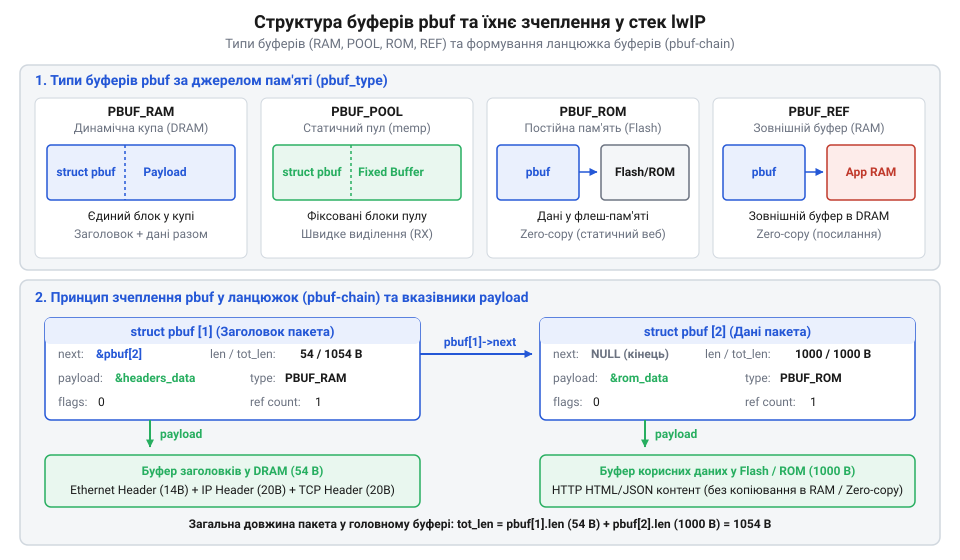
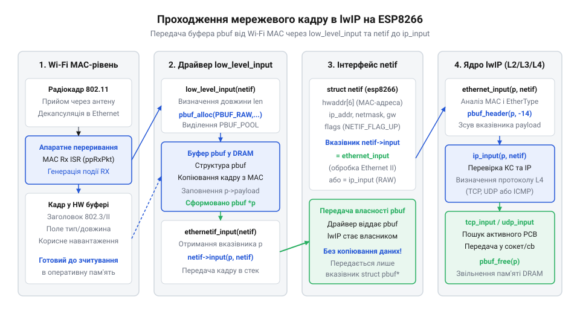
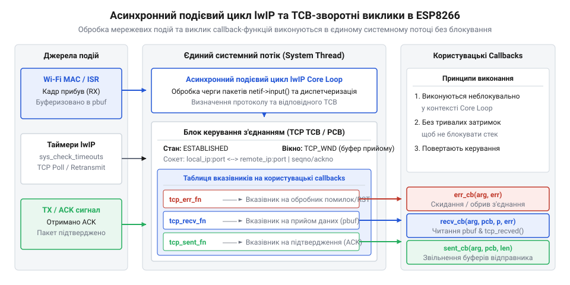
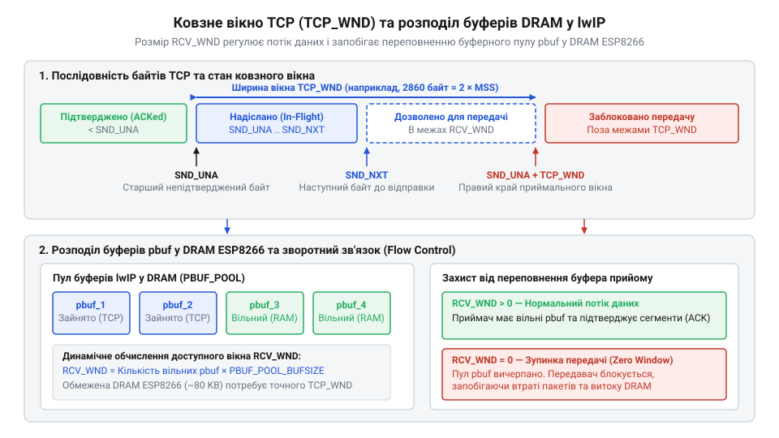

# Архітектура мережевого стека lwIP у ESP8266

<preknowlist>
- [Огляд мікроконтролера та архітектури SoC ESP8266](root:cat-hw-boards/esp8266-soc-architecture-overview) — розподіл оперативної пам'яті DRAM, обсяг динамічної купи та обмеження обчислювальних ресурсів ядра Xtensa L106
- [Мережеві сокети TCP/UDP на модулі ESP-01](root:cat-hw-boards/esp01-tcp-udp-sockets) — принципи високорівневої організації прикладних TCP/UDP-з'єднань та сокетних абстракцій
- [Мережевий стек LwIP 2.x у вбудованих операційних системах](root:cat-hw-boards/lwip-stack-architecture-in-embedded) — загальні концепції побудови стека lwIP та принципи мінімізації накладних витрат пам'яті
</preknowlist>

## Дефіцит оперативної пам'яті та мережеві збої

При зростанні мережевого обміну пристрій на ESP8266 раптово втрачає зв'язок, видає помилку `ERR_MEM` та перезавантажується за сигналом вартового таймера `@@en|WDT@@` (англ. *watchdog timer*, вартовий таймер). Причина — обмежений [обсяг оперативної пам'яті](root:cat-hw-boards/esp8266-soc-architecture-overview) `@@en|DRAM@@` (англ. *dynamic random-access memory*) у 80 КБ, що ділиться між купою програми та мережевими буферами.

Класичні [сокетні абстракції](root:cat-hw-boards/esp01-tcp-udp-sockets) стандарту `@@en|POSIX@@` (англ. *Portable Operating System Interface*) вимагають виділення окремого потоку на кожне з'єднання та потрійного дублювання буферів: у програмі, сокеті й драйвері. Виділення буферів по 2–4 КБ на кожному рівні швидко вичерпує купу при кількох сесіях. Заблокований потік утримує ядро `@@en|Xtensa@@`, унеможливлює скидання `@@en|WDT@@` та спричиняє фатальний збій. Запобігти цьому дозволяють асинхронний подієвий цикл і zero-copy передача у стеку `@@en|lwIP@@` (англ. *lightweight IP*).

## Буферизація кадрів через структуру pbuf

Для відмови від дублювання даних [вбудованих мережевих стеків](root:cat-hw-boards/lwip-stack-architecture-in-embedded) стек `@@en|lwIP@@` використовує структуру `@@en|pbuf@@` (англ. *packet buffer*, пакетний буфер). Елемент `struct pbuf` містить вказівники `next` для зчеплення у списки та `payload` для адресації даних, поля `len` і `tot_len`, прапори та лічильник `ref`.


*Різновиди pbuf (RAM, POOL, ROM, REF) та об'єднання фрагментів кадру у зв'язаний список для запобігання копіюванню даних.*

Стек розрізняє чотири типи: `PBUF_RAM` виділяється з купи `mem` із заголовками; `PBUF_POOL` — із блоків `memp` для переривань; `PBUF_ROM` вказує на Flash `@@en|iROM@@`; `PBUF_REF` — на буфери в `@@en|DRAM@@` без копіювання. У ядрі `@@en|Xtensa LX106@@` вказівник `payload` вирівнюється по 4-байтовій межі. Обсяг `tot_len` є сумою `len` поточного буфера та `next->tot_len` наступних ланок. Виклик `pbuf_free()` звільняє пам'ять, коли `ref` спадає до нуля.

## Інтеграція драйвера netif із Wi-Fi

Містком між `@@en|Wi-Fi MAC/PHY@@` та стеком `@@en|lwIP@@` є мережевий інтерфейс `@@en|netif@@` (англ. *network interface*). При надходженні радіокадру переривання `@@en|ISR@@` (англ. *interrupt service routine*) через `low_level_input()` зчитує `@@en|FIFO@@` у буфер `PBUF_POOL` та передає пакет `ethernet_input()`.


*Послідовність передачі кадру з апаратного переривання Wi-Fi MAC у стек lwIP без дублювання буферів у DRAM.*

Далі `ethernet_input()` перевіряє заголовки Ethernet і спрямовує навантаження в `ip_input()` без копіювання в `@@en|DRAM@@`. Драйвер ESP8266 має два екземпляри `@@en|netif@@` для [модулів серії ESP-01](root:cat-hw-boards/esp-01-module-family-overview): `st` для `@@en|Station@@` (STA) та `ap` для `@@en|Access Point@@` (AP). Стан визначають прапори `NETIF_FLAG_UP` й `NETIF_FLAG_LINK_UP`, а маршрутизацію — IP, маска та шлюз.

## Блоки TCB та асинхронна подійна модель

Опрацювання мережевих протоколів без потоків ОС базується на асинхронній подієвій моделі з блоками керування передачею `@@en|TCB@@` (англ. *Transmission Control Block*), представленими структурою `struct tcp_pcb`.


*Обробка мережевих подій у єдиному потоці system loop через callback-функції TCB без перемикання контексту ОС.*

Замість потокового очікування подієвий цикл `system loop` послідовно обробляє події з черги в єдиному контексті процесора. Прикладна програма реєструє у структурі `struct tcp_pcb` неблокувальні callback-функції: `tcp_recv()` для отримання `@@en|pbuf@@`, `tcp_sent()` для підтверджень `@@en|ACK@@`, `tcp_accept()` для нових з'єднань та `tcp_err()` для локалізації помилок. Коли `ip_input()` приймає `@@en|TCP@@`-сегмент, стек знаходить відповідний блок `struct tcp_pcb` і викликає його callback без перемикання контексту ОС.

## Керування потоком даних вікном TCP

Запобігти переповненню обсягу `@@en|DRAM@@` швидкісним відправником дозволяє апаратно-програмний механізм ковзного вікна `TCP_WND` (англ. *TCP window size*). Прикладна програма після обробки вхідних даних із `@@en|pbuf@@` та їх звільнення зобов'язана викликати функцію `tcp_recved()`. Це сповіщає стек про звільнення приймального буфера, що вираховується у наступних `@@en|ACK@@`-пакетах і запобігає виникненню блокувального стану `@@en|Zero Window@@`.


*Динамічний розрахунок буферів з'єднання та сповіщення відправника через tcp_recved для виключення Zero Window.*

Розмір вікна обмежується добутком пропускної здатності на затримку `@@en|BDP@@` (англ. *Bandwidth-Delay Product*), однак у ESP8266 головним чинником є ліміт пам'яті. Сумарний обсяг `@@en|DRAM@@`, необхідний для обслуговування однієї `@@en|TCP@@`-сесії, визначається співвідношенням:

```
Mem_TCP = TCP_WND + TCP_SND_BUF + sizeof(struct tcp_pcb)
```

При стандартних значеннях `TCP_WND = 5840` байтів та `TCP_SND_BUF = 2920` байтів кожна відкрита сесія вимагає близько 9 КБ `@@en|DRAM@@`. Одночасне обслуговування 5 сесій потребує 45 КБ купи, що виклично для ESP8266 і призводить до помилок `ERR_MEM`.

## Оптимізація пам'яті та діагностика з'єднань

Підсистема `lwip_stats` контролює ресурси у реальному часі: лічильники `avail`, `used`, `max` та `err` показують стан купи `mem`, пулів `memp` і блоків `struct tcp_pcb`.

Параметри пам'яті задають у `lwipopts.h`. Для автономного датчика з підтримкою [FOTA оновлення прошивки](root:cat-hw-boards/esp8266-fota-update) обирають економічний профіль: `MEM_SIZE = 4096`, `PBUF_POOL_SIZE = 4`, `TCP_WND = 2048`, `TCP_SND_BUF = 1460` (витрати ~3.5 КБ на сесію). Для вебсерверів їх збільшують до `TCP_WND = 5840` та `TCP_SND_BUF = 4380`. Зростання лічильника `lwip_stats.pbuf.err` свідчить про витоки пам'яті через незакриті ланцюжки `@@en|pbuf@@` у callback-функціях.