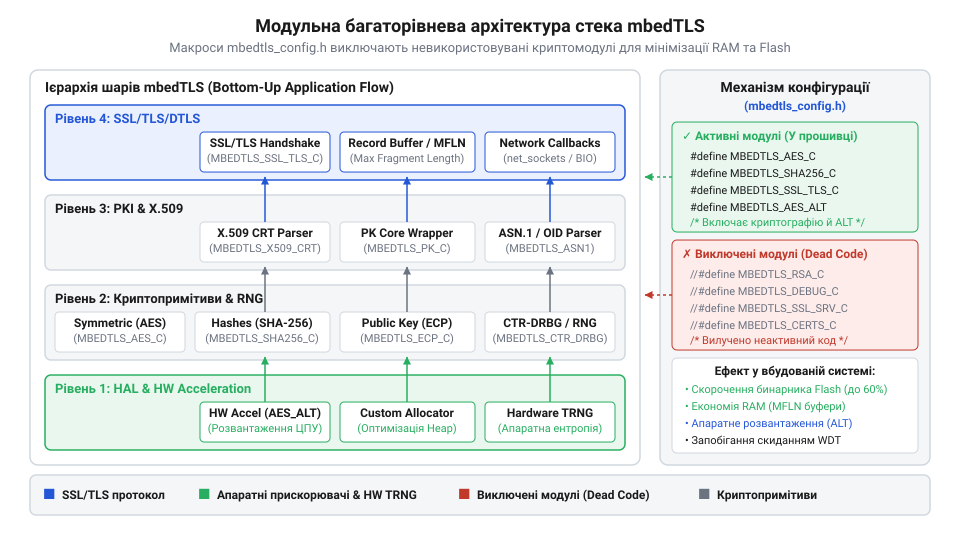
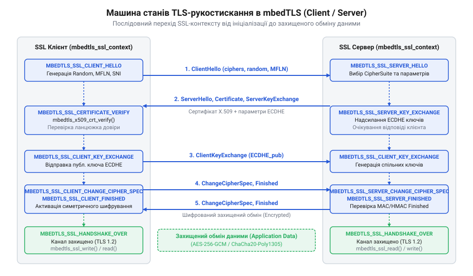
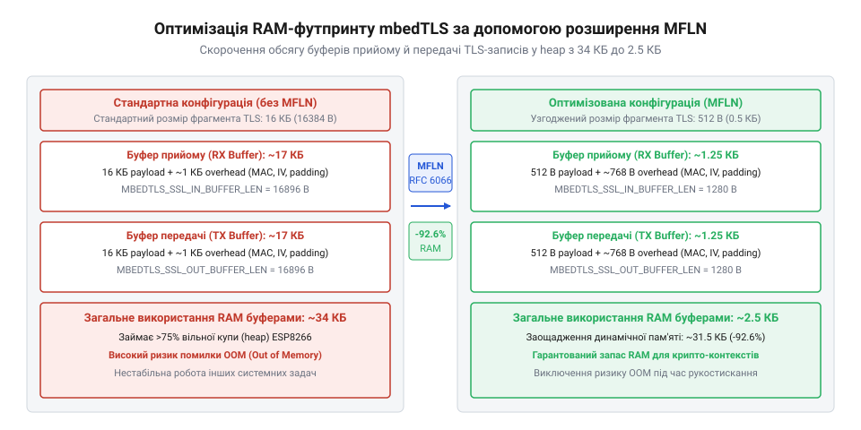
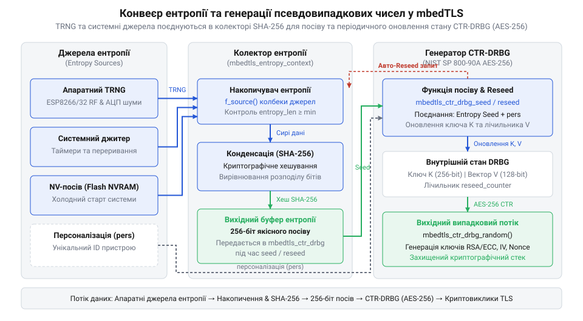
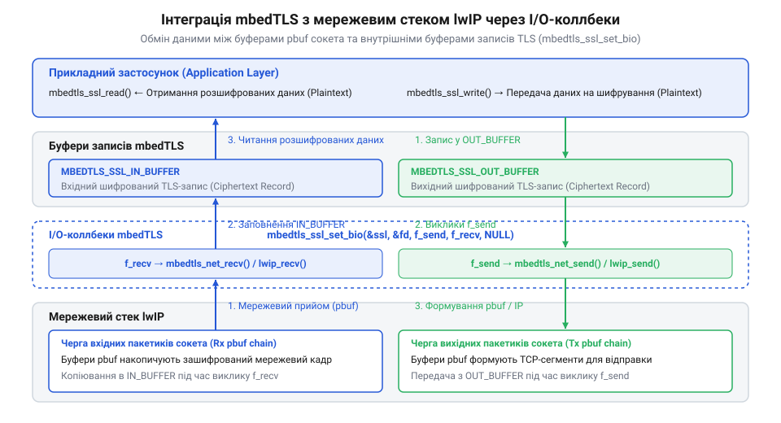

# Криптографічний стек mbedTLS у вбудованих системах

<preknowlist>
- [Огляд мікроконтролера та архітектури SoC ESP8266](root:cat-hw-boards/esp8266-soc-architecture-overview) — Базові параметри обчислювального ядра Xtensa, обсяг доступної оперативної пам'яті (SRAM) та робота сторожового таймера WDT.
- [Мережеві сокети TCP/UDP на модулі ESP-01](root:cat-hw-boards/esp01-tcp-udp-sockets) — Принципи організації TCP-з'єднань, створення неблокуючих сокетів та обробка системних подій прийому й передачі даних.
- [Архітектура мережевого стека lwIP у ESP8266](root:cat-hw-boards/lwip-architecture-esp8266) — Внутрішня будова мережевого стека lwIP, структура буферів pbuf та використання API-функцій передачі байтових потоків.
</preknowlist>

## Проблема безпеки зв'язку у мікроконтролерах

Кожен бездротовий пристрій концепції @@en|Internet of Things@@ (від англ. *Internet of Things*, @@en|IoT@@ — інтернет речей), від портативного сенсора температури на базі мікроконтролера до складної промислової системи обліку, здійснює регулярний обмін інформацією через незахищені мережеві канали. Якщо передача даних реалізується у відкритому текстовому вигляді через звичайні безпосередні [мережеві TCP-сокети](root:cat-hw-boards/esp01-tcp-udp-sockets), будь-який проміжний вузол у локальній чи глобальній мережі виявляється здатним без перешкод перехоплювати чутливу телеметрію, зчитувати облікові записи або здійснювати підробку керівних команд. Найбільш небезпечним ризиком у таких умовах виступає атака типу @@en|Man-in-the-Middle@@ (від англ. *Man-in-the-Middle*, @@en|MITM@@ — людина посередині), за якої зловмисник непомітно вклинюється у розрив каналу зв'язку, перехоплює трафік та підміняє відповіді сервера. Впровадження криптографічного захисту стає абсолютно невідворотним завданням для забезпечення цілісності й конфіденційності, проте спроба інтегрувати стандартні захисні стеки одразу наражається на суворі апаратні обмеження вбудованих систем.

Сучасні мікроконтролери сімейства @@en|ESP8266@@ відрізняються вкрай жорсткими лімітами обчислювальних ресурсів та обсягу оперативної пам'яті. Вивчаючи [архітектуру SoC ESP8266](root:cat-hw-boards/esp8266-soc-architecture-overview), можна переконатися, що обчислювальне ядро @@en|Xtensa@@ LX106 функціонує на тактовій частоті 80 або 160 МГц та позбавлене апаратного блоку обчислень із плаваючою крапкою чи спеціалізованих векторних інструкцій. Фізичний обсяг статичного оперативного запам'ятовування (від англ. *Static Random-Access Memory*, @@en|SRAM@@) обмежений приблизно 80 КБ для даних та коду (DRAM та IRAM). Після ініціалізації внутрішнього бездротового Wi-Fi-стека та системи управління [мережевим стеком lwIP](root:cat-hw-boards/lwip-architecture-esp8266) у розпорядженні прикладного розробника лишається всього 24–40 КБ вільної динамічної купи (від англ. *heap* — купа). Понад те, у системі неперервно функціонує сторожовий таймер (від англ. *Watchdog Timer*, @@en|WDT@@), який ініціює апаратне перезавантаження процесора, якщо тривала обчислювальна операція блокує процес виконання фонових системних тасків на час понад декілька сотень мілісекунд.

Класичні криптографічні бібліотеки загального призначення, такі як @@en|OpenSSL@@, створювалися для настільних операційних систем та потужних серверних платформ із гігабайтами оперативної пам'яті. Вони будуються за монолітним принципом: при ініціалізації підсистеми захисту @@en|Transport Layer Security@@ (від англ. *Transport Layer Security*, @@en|TLS@@ — безпека транспортного шару) бібліотека завантажує в пам'ять усі можливі криптографічні алгоритми, розлогий набір шифрокомплектів, масивні таблиці підстановки та повні ланцюжки довіри сертифікатів. Стандартна специфікація протоколу вимагає виділення окремого буфера приймання та буфера передачі кадрів розміром по 16 КБ кожен. У сукупності зі службовими контекстами сесії це створює базове навантаження у 35–50 КБ оперативної пам'яті на одне з'єднання. Для мікроконтролера @@en|ESP8266@@ це означає миттєве виникнення помилки вичерпання пам'яті (від англ. *Out-of-Memory*, @@en|OOM@@), фрагментацію купи та фатальний крах системної прошивки.

Коли пристрій використовує неблокуючий режим сокетів у мережевому стеку, процедура передачі даних криптографічного стека вимагає спеціального механізму узгодження затримок вводу-виводу (від англ. *non-blocking I/O*). У звичайних операційних системах потік просто блокується до завершення читання або запису в мережевий буфер. Проте в однопотоковому середовищі мікроконтролера блокування потоку спричиняє замирання всієї системної прошивки або зупинку обробки Wi-Fi-переривань. Стек @@en|Mbed TLS@@ вирішує цю проблему за допомогою реєстрації низькорівневих коллбеків відправки та прийому даних (від англ. *I/O callbacks*), які повертають спеціальний код помилки `MBEDTLS_ERR_SSL_WANT_READ` або `MBEDTLS_ERR_SSL_WANT_WRITE`. Це сигналізує стеку про тимчасову недоступність мережевого буфера та дозволяє процесору повертати контроль системному циклу подій без переривання TLS-сесії.

Усвідомлення глибокої прірви між вимогами криптографічних протоколів та реальними можливостями мікроконтролерів зумовило появу спеціалізованих легковагових бібліотек. Аналізуючи [історію розвитку бібліотеки PolarSSL](root:cat-hw-boards/mbedtls-embedded-crypto-library/hist-polarssl-mbedtls-evolution.md), можна відстежити, як у 2006 році французький інженер Christophe Devine започаткував проєкт @@en|XySSL@@ саме з метою створення криптографічного стека з нульовою залежністю від зовнішніх важких операційних систем. Згодом, після придбання проєкту компанією @@en|ARM@@, бібліотека отримала назву @@en|Mbed TLS@@ (історично @@en|mbedTLS@@). Головним архітектурним досягненням стека стала сувора модульність, яка дозволяє ізолювати кожен криптографічний примітив, гнучко налаштовувати розміри буферів та будувати захищений канал навіть у мікроконтролерах із кількома кілобайтами доступної @@en|RAM@@.

Для успішного функціонування в умовах вбудованих систем криптографічний стек повинен відповідати п'яти ключовим вимогам:
1. **Гнучка модульність та умовна компіляція**: можливість виключення будь-якого невикористовуваного алгоритму чи компонента ще на етапі збирання бінарного образу. 2. **Строгий контроль пам'яткового бюджету**: підтримка динамічного або статичного виділення буферів зменшеного розміру без порушення специфікації протоколу. 3. **Абстракція вводу-виводу**: повна незалежність від конкретної операційної системи та пряме підключення до неблокуючих сокетів мережевого стека. 4. **Гарантоване забезпечення ентропії**: можливість інтеграції апаратних генераторів справжньо випадкових чисел (від англ. *True Random Number Generator*, @@en|TRNG@@). 5. **Низькорівневе апаратне прискорення**: наявність прозорих інтерфейсів для делегування важких криптографічних обчислень спеціалізованим апаратним блокам SoC задля розвантаження процесорного ядра й упередження спрацьовування @@en|WDT@@.

## Модульна архітектура та криптографічні примітиви

Архітектура стека @@en|Mbed TLS@@ спроєктована за чітким трирівневим принципом, який забезпечує повну декуполізацію низькорівневої математики від високорівневої логіки керування сесіями. На першому, найнижчому рівні розташовані базові криптографічні примітиви: модулі симетричного шифрування, алгоритми обчислення хеш-дайджестів, математика багаторозрядної арифметики та генератори випадкових чисел. Другий, проміжний шар займає підсистема інфраструктури відкритих ключів (від англ. *Public Key Infrastructure*, @@en|PKI@@) та синтаксичного аналізу сертифікатів стандарту @@en|X.509@@. Третій, найвищий шар реалізує логіку протоколів @@en|TLS@@ та @@en|DTLS@@ (від англ. *Datagram Transport Layer Security*, @@en|DTLS@@ — захист датаграмного транспорту), включаючи кінцевий автомат рукостискання, інкапсуляцію шару записів та обробку системних алертів.


*Підпис: Модульна архітектура бібліотеки mbedTLS із розділенням на рівні примітивів, обробки сертифікатів і TLS-протоколу.*

Фундаментальним механізмом керування обсягом двійкового коду та споживанням оперативної пам'яті в @@en|Mbed TLS@@ виступає заголовочний файл конфігурації `mbedtls/config.h`. Завдяки широкому використанню директив препроцесора `#ifdef` розробник отримує можливість точково вмикати або вимикати конкретні криптографічні модулі. Наприклад, якщо мікроконтролер виконує виключно роль клієнта з попередньо узгодженим симетричним ключем, застосування макросів `#undef MBEDTLS_RSA_C`, `#undef MBEDTLS_X509_CRT_PARSE_C` та `#undef MBEDTLS_SSL_SRV_C` дозволяє повністю вилучити зі збірки код парсингу сертифікатів та серверного рукостискання. Це дає змогу скоротити розмір Flash-прошивки на 70–90 КБ та звільнити критично важливі ресурси @@en|SRAM@@.

Для забезпечення конфіденційності переданих даних у @@en|Mbed TLS@@ інтегровано реалізацію симетричного блочного шифру @@en|AES@@ (від англ. *Advanced Encryption Standard*, @@en|AES@@ — розширений стандарт шифрування). Бібліотека підтримує роботу з ключами довжиною 128, 192 та 256 бітів і надає декілька режимів функціонування. Класичний режим зчеплення блоків шифротексту (від англ. *Cipher Block Chaining*, @@en|CBC@@) вимагає обов'язкового вирівнювання довжини даних за допомогою наповнення (від англ. *padding*) та використання вектора ініціалізації (від англ. *Initialization Vector*, @@en|IV@@). Більш сучасний режим Галуа/лічильника (від англ. *Galois/Counter Mode*, @@en|GCM@@) відноситься до класу автентифікованого шифрування з додатковими даними (від англ. *Authenticated Encryption with Associated Data*, @@en|AEAD@@). Режим @@en|GCM@@ одночасно шифрує дані та обчислює 128-бітовий теґ автентичності, усуваючи потребу в окремому хешуванні, однак потребує додаткових таблиць у пам'яті для прискорення обчислень у полі Галуа.

Забезпечення цілісності інформації та перевірка автентичності джерела покладаються на підсистему хешування. Основним криптографічним алгоритмом у сучасних конфігураціях є @@en|SHA-256@@ (від англ. *Secure Hash Algorithm*, @@en|SHA-256@@ — безпечний алгоритм хешування), який перетворює вхідний потік байтів довільної довжини у фіксований 256-бітовий дайджест. У поєднанні зі секретним ключем модуль `mbedtls_md` формує код автентифікації повідомлень на основі хешування (від англ. *Hash-based Message Authentication Code*, @@en|HMAC@@). Цей механізм лежить в основі роботи псевдовипадкових функцій (від англ. *Pseudo-Random Function*, @@en|PRF@@) для генерації сесійних ключів шифрування в протоколі @@en|TLS@@. Реалізація @@en|SHA-256@@ в @@en|Mbed TLS@@ розроблена з урахуванням мінімізації розміру стек-фреймів, що захищає системний стек тасок від переповнення.

Асиметрична криптографія застосовується для автентифікації вузлів та безпечного розподілу симетричних ключів. Використовуючи [математичний апарат багаторозрядної арифметики](root:cat-hw-boards/mbedtls-embedded-crypto-library/math-mbedtls-bignum-ecc-arithmetic.md) у складі модуля @@en|MPI@@ (від англ. *Multi-Precision Integer*, @@en|MPI@@ — багаторозрядне ціле число), стек виконує обчислення над числами розміром у тисячі бітів. Класичні алгоритми на базі @@en|RSA@@ з довжиною ключа 2048 або 4096 бітів створюють величезне обчислювальне навантаження при піднесенні до степеня за модулем та вимагають виділення значних масивів у купі. Натомість криптографія на еліптичних кривих (від англ. *Elliptic Curve Cryptography*, @@en|ECC@@) забезпечує еквівалентний рівень стійкості при значно меншому розмірі ключа — всього 256 бітів (наприклад, стандартні криві SECP256R1 або Curve25519). Використання алгоритмів цифрового підпису @@en|ECDSA@@ та обміну ключами @@en|ECDHE@@ дозволяє скоротити споживання оперативної пам'яті в 4–5 разів та суттєво прискорити проходження етапу рукостискання.

Окремої уваги заслуговує уніфікована підсистема обробки відкритих і закритих ключів `mbedtls_pk_context` (від англ. *Public Key Layer*). У класичних криптографічних стеках розробникові доводиться викликати окремі функції для шифрування через @@en|RSA@@ та підпису через @@en|ECDSA@@, що ускладнює прикладну логіку прошивки. Модуль `mbedtls_pk` надає єдиний абстрактний програмний інтерфейс (від англ. *Application Programming Interface*, @@en|API@@), який приховує конкретний алгоритм під уніфікованими викликами `mbedtls_pk_sign()`, `mbedtls_pk_verify()`, `mbedtls_pk_encrypt()` та `mbedtls_pk_decrypt()`. Завдяки такій абстракції розробник може прозоро змінювати криптографічний алгоритм автентифікації пристрою — наприклад, переходити з застарілого ключа @@en|RSA-2048@@ на високоефективну криву @@en|ECDSA SECP256R1@@ — без коригування верхніх шарів мережевого коду прошивки.

Для перевірки справжності віддаленого сервера мікроконтролер повинен розібрати та верифікувати його цифровий сертифікат. Модуль `mbedtls_x509_crt` здійснює декодування структур даних у форматі @@en|ASN.1@@ (від англ. *Abstract Syntax Notation One*, @@en|ASN.1@@ — абстрактна синтаксична нотація один), кодованих у бінарному вигляді @@en|DER@@ (від англ. *Distinguished Encoding Rules*, @@en|DER@@ — виділені правила кодування) або у текстовому форматі @@en|PEM@@ (від англ. *Privacy-Enhanced Mail*, @@en|PEM@@ — пошта з підвищеною приватністю). Спираючись на [довідник API X.509](root:cat-hw-boards/mbedtls-embedded-crypto-library/api-mbedtls-crypto-x509-api.md), розробник налаштовує перевірку терміну дії сертифіката, імені видавця та відповідності відкритого ключа. При розгортанні [інфраструктури відкритих ключів](root:sf-security/x509-pki-certificate-infrastructure) на пристроях @@en|IoT@@ у пам'яті мікроконтролера завантажуються лише кореневі сертифікати довірених центрів сертифікації (від англ. *Certificate Authority*, @@en|CA@@), що мінімізує обсяг збережених даних у Flash-пам'яті.

Нижче наведено практичний приклад ініціалізації та виконання обчислення хеш-дайджесту @@en|SHA-256@@ та симетричного шифрування @@en|AES-256-CBC@@ за допомогою криптографічних примітивів @@en|Mbed TLS@@. Приклад демонструє правильний розподіл контекстів у пам'яті та обов'язкову процедуру звільнення ресурсів після завершення обчислень:

:::tabs
:::code mbedtls-embedded-crypto-library-d/c/esp-idf/crypto-compute-sha256.c
:::code mbedtls-embedded-crypto-library-d/cpp/arduino/mbedcryptohelper.cpp
:::

Освоєння базових примітивів симетричного шифрування, хешування та обробки сертифікатів створює надійний криптографічний фундамент. Надалі ці модулі об'єднуються у цілісну систему для проведення процедури TLS-рукостискання та узгодження динамічних сесійних ключів.

## Протокол рукостискання та шар записів

Кожна спроба створити захищене з'єднання між мікроконтролером у вбудованій системі та віддаленим сервером розпочинається з процедури узгодження параметрів шифрування, яку називають рукостисканням (від англ. *Handshake*, @@en|handshake@@ — рукостискання). Доки цей етап не завершено успішно, жоден байт прикладних даних не може бути переданий у мережу. Головна складність реалізації протоколу @@en|TLS@@ (від англ. *Transport Layer Security*, @@en|TLS@@ — безпека транспортного шару) на пристроях із обмеженими ресурсами полягає в тому, що рукостискання вимагає суворого виконання послідовності станів, обміну декількома громіздкими кадрами через [мережеві TCP-сокети](root:cat-hw-boards/esp01-tcp-udp-sockets), виконання важкої асиметричної криптографії та синтаксичного аналізу цифрових сертифікатів. Найменша затримка чи помилка в мережевому буфері загрожує блокуванням виконання фонових системних тасок і спрацьовуванням сторожового таймера.

У стеку @@en|Mbed TLS@@ логіку організації захищеного каналу чітко розділено між двома фундаментальними структурами даних: конфігураційною структурою `mbedtls_ssl_config` та структурою активного контексту з'єднання `mbedtls_ssl_context`. Спираючись на [довідник програмних викликів](root:cat-hw-boards/mbedtls-embedded-crypto-library/api-mbedtls-ssl-core-api.md) ядра mbedTLS, можна побачити, що `mbedtls_ssl_config` містить статичні параметри сесії, які не змінюються у процесі обміну даними: список підтримуваних шифрокомплектів, режими верифікації сертифікатів, посилання на довірену базу кореневих сертифікатів та таймери затримок. Оскільки конфігурація є незмінною, один об'єкт `mbedtls_ssl_config` може одночасно використовуватися десятками активних з'єднань, що суттєво економить оперативну пам'ять. Натомість `mbedtls_ssl_context` зберігає динамічний стан конкретного з'єднання: поточний крок кінцевого автомата рукостискання `mbedtls_ssl_handshake_step`, сесійні ключі шифрування, вектори ініціалізації, послідовні номери кадрів та вхідні й вихідні буфери.

Процес узгодження ключів розгортається за чітко визначеним кінцевим автоматом станів. На першому етапі клієнтський мікроконтролер надсилає повідомлення `ClientHello` (від англ. *ClientHello*, @@en|ClientHello@@). У цьому кадрі пристрій передає підтримувану версію протоколу, 32-байтову випадкову послідовність `client_random`, перелік доступних шифрокомплектів (наприклад, `TLS_ECDHE_ECDSA_WITH_AES_128_GCM_SHA256`), розширення ідентифікатора сервера (від англ. *Server Name Indication*, @@en|SNI@@) та розширення узгодження максимальної довжини фрагмента (від англ. *Maximum Fragment Length Negotiation*, @@en|MFLN@@). У відповідь сервер надсилає кадр `ServerHello` (від англ. *ServerHello*, @@en|ServerHello@@), обираючи один компромісний шифрокомплект і передаючи власну випадкову послідовність `server_random`, після чого відправляє свій ланцюжок цифрових сертифікатів `Certificate` (від англ. *Certificate*, @@en|Certificate@@) та тимчасовий публічний ключ еліптичної кривої у кадрі `ServerKeyExchange` (від англ. *ServerKeyExchange*, @@en|ServerKeyExchange@@).

Отримавши сертифікат сервера, мікроконтролер виконує його перевірку через підсистему `mbedtls_x509_crt`. Стек перевіряє цифровий підпис видавця за допомогою завантаженої в `mbedtls_ssl_config` базі кореневих сертифікатів центрів сертифікації (від англ. *Certificate Authority*, @@en|CA@@), термін дії та відповідність імені хоста. При побудові [інфраструктури відкритих ключів](root:sf-security/x509-pki-certificate-infrastructure) верифікація гарантує захист від перехоплення трафіку. Після успішної перевірки сертифікати клієнт генерує власну тимчасову пару ключів на еліптичній кривій, надсилає свій відкритий ключ у кадрі `ClientKeyExchange` (від англ. *ClientKeyExchange*, @@en|ClientKeyExchange@@) та обчислює спільне секретне число за алгоритмом @@en|ECDHE@@. На основі спільного секрету, `client_random` та `server_random` обидві сторони незалежно одна від одної обчислюють попередній секрет (від англ. *Pre-Master Secret*), а з нього за допомогою псевдовипадкових функцій @@en|HMAC-SHA256@@ виводять головний сесійний секрет (від англ. *Master Secret*), з якого формуються ключі шифрування та макро-теґи автентичності.

Завершальний етап рукостискання гарантує цілісність усіх попередньо обміняних службових повідомлень. Клієнт надсилає кадр `ChangeCipherSpec` (від англ. *ChangeCipherSpec*, @@en|ChangeCipherSpec@@), який сигналізує мережевому стеку про перехід усіх наступних кадрів на зашифрований режим функціонування, та одразу надсилає зашифрований кадр `Finished` (від англ. *Finished*, @@en|Finished@@). Кадр `Finished` містить перевірочний хеш-дайджест усіх надісланих і отриманих під час рукостискання байтів. Сервер перевіряє цей дайджест, надсилає власні кадри `ChangeCipherSpec` і `Finished`, після чого стан сесії в `mbedtls_ssl_context` змінюється на `MBEDTLS_SSL_HANDSHAKE_OVER`. Вивчаючи [архітектуру протоколу TLS 1.3](root:sf-security/tls13-handshake-protocol-architecture), можна відзначити, що новіші версії скорочують цей обмін до одного мережевого кругового затримання (від англ. *Round-Trip Time*, @@en|RTT@@).


*Підпис: Послідовність станів та обміну кадрами протоколу TLS-рукостискання між мікроконтролером і сервером.*

Після завершення рукостискання захищений канал переходить у шар записів (від англ. *Record Layer*, @@en|Record Layer@@). Будь-які прикладні дані, що передаються через функцію `mbedtls_ssl_write()`, розбиваються на кадри записів. Кожен запис обгортається в 5-байтовий заголовок (тип контенту `0x17` для прикладних даних, версія протоколу та 16-бітна довжина), шифрується алгоритмом симетричного шифрування (наприклад, @@en|AES-GCM@@) та доповнюється 16-байтовим теґом автентифікації. При отриманні даних функція `mbedtls_ssl_read()` виконує зворотні операції. Якщо пристрій працює з неблокуючими сокетами, функція прийому-передачі повертає спеціальні коди затримки `MBEDTLS_ERR_SSL_WANT_READ` або `MBEDTLS_ERR_SSL_WANT_WRITE`. Це дозволяє мікроконтролеру повернути контроль системному циклу й уникнути блокування прошивки.

У бездротових IoT-мережах із нестабільним зв'язком замість TCP часто застосовують [захист датаграмного транспорту DTLS](root:sf-security/dtls) поверх UDP-сокетів. На відміну від стандартного TLS, протокол @@en|DTLS@@ ураховує можливість втрати або зміни порядку надходження UDP-пакетів. Стек @@en|Mbed TLS@@ додає до заголовка кожного запису явний 48-бітний послідовний номер та впроваджує внутрішній таймер повторного надсилання втрачених кадрів рукостискання. При розробці прикладного коду розробник може реалізувати як звичайний HTTPS-клієнт, розбираючи [реалізацію HTTPS-клієнта](root:cat-hw-boards/mbedtls-embedded-crypto-library/proj-esp8266-mbedtls-https-client.md) для ESP8266, так і розгорнути [двосторонню автентифікацію mTLS](root:cat-hw-boards/mbedtls-embedded-crypto-library/proj-mtls-iot-hardware-accelerated.md) для апаратно прискорених систем.

Нижче наведено практичний приклад ініціалізації та виконання рукостискання TLS з обробкою неблокуючого вводу-виводу в стеку @@en|Mbed TLS@@:

:::tabs
:::code mbedtls-embedded-crypto-library-d/c/esp-idf/execute-tls-handshake.c
```cpp|arduino
#include <Arduino.h>
#include "mbedtls/ssl.h"

class MbedTlsHandshakeHelper {
public:
    static int performHandshake(mbedtls_ssl_context *ssl) {
        int res = mbedtls_ssl_handshake(ssl);
        if (res == MBEDTLS_ERR_SSL_WANT_READ || res == MBEDTLS_ERR_SSL_WANT_WRITE) {
            // Буфери сокета зайняті, очікуємо наступної ітерації loop()
            return res;
        }
        return res;
    }
};
```
:::

## Розподіл оперативної пам'яті та MFLN

Головним бар'єром під час впровадження криптографічного захисту у вбудованих системах є суворе обмеження оперативної пам'яті (від англ. *Random-Access Memory*, @@en|RAM@@). Стандартна специфікація протоколу @@en|TLS@@ передбачає, що максимальний розмір незашифрованого фрагмента прикладних даних у кадові запису становить 16384 байти (16 КБ). Для обробки таких кадрів криптографічний стек повинен виділити два повнорозмірних буфери в динамічній купі (від англ. *heap*, @@en|heap@@): буфер приймання `in_buf` та буфер передачі `out_buf`. З урахуванням службових заголовків, криптографічного наповнення та теґів автентичності розмір кожного буфера сягає приблизно 16.5 КБ. У результаті лише на вхідні й вихідні мережеві буфери витрачається 33 КБ пам'яті. Аналізуючи [архітектуру SoC ESP8266](root:cat-hw-boards/esp8266-soc-architecture-overview), легко переконатися, що після ініціалізації системного Wi-Fi-стека у пристрої лишається всього 24–40 КБ вільної статичної оперативної пам'яті (від англ. *Static Random-Access Memory*, @@en|SRAM@@). Спроба виділити повнорозмірні TLS-буфери неминуче призводить до помилки вичерпання пам'яті (від англ. *Out-of-Memory*, @@en|OOM@@) та перезавантаження прошивки.

Загальний пам'ятковий бюджет `P_total`, необхідний для підтримки однієї активної TLS-сесії у купі мікроконтролера, обчислюється як сума статичних контекстів, сертифікатів, тимчасових криптографічних буферів та двох буферів шару записів:

P_total = P_ctx + P_conf + P_cert + P_crypto + P_rx + P_tx
= P_base + MFLN_size + MFLN_size                         [підстановка обмежених буферів MFLN]
= 5120 + 1024 + 1024                                     [обчислення при MFLN = 1024]
= 7168 байтів (7.0 КБ)                                   [підсумковий бюджет RAM]

У цій формулі величина `P_ctx` позначає обсяг структури `mbedtls_ssl_context` (~1.5 КБ), `P_conf` — частку `mbedtls_ssl_config` (~0.5 КБ), `P_cert` — пам'ять під парсинг кореневого сертифіката `mbedtls_x509_crt` (~1.5 КБ), `P_crypto` — робоче поле обчислення еліптичних кривих у модулі багаторозрядної арифметики `MPI` (~1.6 КБ), а `P_rx` та `P_tx` — розміри буферів прийому й передачі. Без оптимізації сума `P_rx + P_tx` складає 33 КБ, що робить загальний бюджет рівним 39.6–43 КБ.

Для подолання цієї кризи у стеку @@en|Mbed TLS@@ застосовується стандартне розширення узгодження максимальної довжини фрагмента (від англ. *Maximum Fragment Length Negotiation*, @@en|MFLN@@). Механізм @@en|MFLN@@ дозволяє клієнту під час надсилання кадру `ClientHello` запропонувати серверу зменшений розмір максимального кадру запису. Специфікація передбачає чотири фіксованих значення: 512 байтів (`MBEDTLS_SSL_MAX_FRAG_LEN_512`), 1024 байти (`MBEDTLS_SSL_MAX_FRAG_LEN_1024`), 2048 байтів (`MBEDTLS_SSL_MAX_FRAG_LEN_2048`) та 4096 байтів (`MBEDTLS_SSL_MAX_FRAG_LEN_4096`). Якщо сервер підтримує це розширення, він підтверджує його у кадрі `ServerHello`, після чого обидві сторони зменшують розмір виділюваних буферів `in_buf` та `out_buf` до узгодженого значення. Використання конфігурації `MFLN = 1024` зменшує обсяг I/O-буферів з 33 КБ до 2.4 КБ, що скорочує загальне споживання оперативної пам'яті до 7.0–7.5 КБ і дає змогу вільно запускати TLS на ESP8266.


*Підпис: Порівняльний розподіл динамічної пам'яті mbedTLS без розширення MFLN та з його використанням.*

Крім зменшення розміру буферів через @@en|MFLN@@, важливо контролювати фрагментацію динамічної купи. При частих перевиділеннях пам'яті під час встановлення нових TLS-сесій у купі утворюються дрібні ізольовані блоки, через що чергова спроба виділити суцільний буфер завершується помилкою @@en|OOM@@, навіть якщо сумарно вільна пам'ять наявна. Для боротьби з фрагментацією у списку [довідника програмних макросів](root:cat-hw-boards/mbedtls-embedded-crypto-library/api-mbedtls-platform-hardware-porting-api.md) mbedTLS передбачено можливість перевизначення системних функцій виділення пам'яті за допомогою `mbedtls_platform_set_calloc_free()`. Розробник може спрямувати всі виділення пам'яті mbedTLS у стабільно зарезервований статичний масив або виділений басейн пам'яті (від англ. *memory pool*). Крім того, активація макросу `MBEDTLS_SSL_VARIABLE_BUFFER_LENGTH` дозволяє стеку динамічно змінювати розмір вихідного буфера залежно від фактичного розміру надісланого пакета.

Гнучке керування пам'яттю стає особливо критичним при взаємодії з [архітектурою мережевого стека lwIP](root:cat-hw-boards/lwip-architecture-esp8266), де мережеві пакети зберігаються у спеціальних буферах `pbuf`. Узгодження розмірів буферів mbedTLS із розмірами pbuf у стеку lwIP дозволяє уникнути подвійного копіювання даних у пам'яті та додатково знижує обчислювальне навантаження на процесор.

Нижче наведено приклад налаштування розширення @@en|MFLN@@ та підключення власного виділювача пам'яті у стеку @@en|Mbed TLS@@:

:::tabs
:::code mbedtls-embedded-crypto-library-d/c/esp-idf/custom-calloc.c
```cpp|arduino
#include <Arduino.h>
#include "mbedtls/ssl.h"

class MbedMemoryOptimizer {
public:
    static bool applyMFLN(mbedtls_ssl_config *conf) {
        // Узгодження максимального розміру буфера в 1024 байти для економії RAM на ESP8266
        int err = mbedtls_ssl_conf_max_frag_len(conf, MBEDTLS_SSL_MAX_FRAG_LEN_1024);
        return (err == 0);
    }
};
```
:::

## Джерела ентропії та апаратне прискорення

Надійність будь-якого криптографічного алгоритму у захищеному каналі зв'язку принципово залежить від якості початкових випадкових даних. При формуванні сесійних ключів шифрування, векторів ініціалізації, випадкових послідовностей кадру `ClientHello` або криптографічних нонсів витоки повторюваних або передбачуваних значень миттєво роблять шифротекст вразливим до зламу. У звичайних операційних системах генерація випадковості покладається на багаторівневі накопичувальні пул-системи ентропії, які збирають шуми від руху миші, апаратних переривань дискових накопичувачів та мережевих адаптерів. Проте в однопотоковому середовищі мікроконтролера такі джерела відсутні. Використання стандартних програмних псевдовипадкових функцій із зафіксованим зерном ініціалізації спричиняє генерацію однакових сесійних ключів при кожному перезавантаженні пристрою, що повністю нівелює захист від атак типу @@en|MITM@@. Розуміння принципових механізмів формування криптографічної випадковості у мікроконтролерах можна здобути, аналізуючи [архітектуру генераторів TRNG](root:hw-arch/trng-hardware-entropy-generation-mcu).

Стек @@en|Mbed TLS@@ вирішує цю проблему за допомогою спеціалізованого колектора ентропії, що реалізований у модулі `mbedtls_entropy_context`. Колектор виступає в ролі проміжного акумулятора, який опитує різноманітні фізичні й програмні джерела ентропії (від англ. *Entropy Sources*, @@en|entropy sources@@) та об'єднує їх у єдиний криптографічно стійкий потік. До колектора можуть підключатися апаратні генератори справжньо випадкових чисел (від англ. *True Random Number Generator*, @@en|TRNG@@ — апаратний TRNG, наприклад, регістр `WDEV_RND_REG` у SoC ESP8266), мікросекундні джитери системних годинників, шуми аналогово-цифрових перетворювачів або власні прикладні функціональні коллбеки. Модуль обробляє отримані сирі байти за допомогою криптографічного хеш-кондиціонування на базі @@en|SHA-256@@ або @@en|SHA-512@@, що рівномірно розподіляє ентропійну щільність та усуває статистичний зсув (від англ. *bias*). Згідно з описом у [довіднику портування платформового API](root:cat-hw-boards/mbedtls-embedded-crypto-library/api-mbedtls-platform-hardware-porting-api.md), розробник може реєструвати власні апаратні джерела випадковості за допомогою функції `mbedtls_entropy_add_source()`, визначаючи ступінь їхньої криптографічної надійності.

Безпосередньо для швидкої генерації випадкових послідовностей у стеку застосовується детермінований генератор випадкових бітів у режимі лічильника (від англ. *Counter mode Deterministic Random Bit Generator*, @@en|CTR-DRBG@@). Оскільки прямолінійне читання фізичного джерела @@en|TRNG@@ є відносно повільною апаратною операцією, генератор `mbedtls_ctr_drbg_context` ініціалізується початковим посівом (від англ. *seed*) від колектора ентропії через функцію `mbedtls_ctr_drbg_seed()`. Налічуючи внутрішній стан на основі блочного шифру @@en|AES-256@@, генератор швидко продукує послідовності псевдовипадкових байтів через виклики `mbedtls_ctr_drbg_random()`, регулярно виконуючи процедуру поновлення посіву (від англ. *reseed*) для захисту від зворотного розкриття ключів.


*Підпис: Потік збору ентропії та ініціалізації генератора псевдовипадкових чисел CTR-DRBG у mbedTLS.*

Поряд із генерацією випадкових чисел, найважчим завданням для процесорного ядра вбудованої системи залишається виконання обчислень асиметричної криптографії (обчислення точок еліптичних кривих @@en|ECDHE@@ / @@en|ECDSA@@ або модульне піднесення до степеня @@en|RSA@@) та симетричного шифрування @@en|AES-GCM@@. Оцінюючи [параметри SoC ESP8266](root:cat-hw-boards/esp8266-soc-architecture-overview), можна переконатися, що обчислювальне ядро @@en|Xtensa@@ LX106 виконує математичні операції з 256-бітовими числами виключно програмно. Неперервне виконання асиметричного рукостискання може тривати від 200 до 800 мілісекунд. Якщо процесор монопольно зайнятий криптографічними обчисленнями й не повертає контроль фоновим таскам Wi-Fi-стека, виникає апаратне спрацьовування сторожового таймера (від англ. *Watchdog Timer*, @@en|WDT@@), що спричиняє перезавантаження мікроконтролера та розрив сесії.

Для зниження обчислювального навантаження на процесорне ядро й запобігання скиданням сторожового таймера @@en|WDT@@ у стеку @@en|Mbed TLS@@ передбачено механізм макросів підміни реалізації `MBEDTLS_*_ALT` (від англ. *Alternative Implementation*, @@en|ALT@@). Шляхом активації в заголовочному файлі конфігурації `config.h` макросів на кшталт `MBEDTLS_AES_ALT`, `MBEDTLS_SHA256_ALT` або `MBEDTLS_MPI_EXP_MOD_ALT` розробник виключає стандартні програмні функції C і заміщує їх низькорівневими викликами апаратних криптоприскорювачів SoC. Організація такого апаратного розвантаження детально розглядається при [розробці апаратно прискореного mTLS](root:cat-hw-boards/mbedtls-embedded-crypto-library/proj-mtls-iot-hardware-accelerated.md), де делегування хешування та симетричного шифрування периферійним блокам скорочує час обробки кадрів у 5–10 разів і гарантує стабільну роботу сторожового таймера.

Нижче наведено практичний приклад ініціалізації колектора ентропії `mbedtls_entropy_context` та генератора `mbedtls_ctr_drbg_context` із генерацією криптографічно стійкого масиву байтів:

:::tabs
:::code mbedtls-embedded-crypto-library-d/c/esp-idf/crypto-init-entropy-and-drbg.c
:::code mbedtls-embedded-crypto-library-d/cpp/arduino/mbedentropymanager.cpp
:::

## Інтеграція з lwIP та діагностика

Криптографічне ядро стека @@en|Mbed TLS@@ навмисно ізольоване від низькорівневих специфік мережевого транспорту. Ядро не містить вбудованих функцій відкриття системних TCP-сокетів або керування мережевими драйверами. Замість цього зв'язування між шаром записів TLS та мережевим середовищем здійснюється через абстракцію вводу-виводу (від англ. *Basic I/O*, @@en|BIO@@). У вбудованих системах на базі мікроконтролерів мережевий обмін функціонує під керуванням [мережевого стека lwIP](root:cat-hw-boards/lwip-architecture-esp8266). Для інтеграції захищеного контексту з сокетами застосовується функція `mbedtls_ssl_set_bio()`, яка приймає посилання на сокетний дескриптор та два низькорівневих коллбеки відправки та прийому даних. Детальні відомості про структуру параметрів описуються у [довіднику ядра TLS](root:cat-hw-boards/mbedtls-embedded-crypto-library/api-mbedtls-ssl-core-api.md). Mbed TLS@@ навмисно ізольоване | Для глибшого розуміння роботи низькорівневих сокетів та організації буферів pbuf ознайомтеся з [архітектурою мережевого стека lwIP](root:sf-devices/lwip-internals).

При роботі з [мережевими сокетами lwIP](root:cat-hw-boards/esp01-tcp-udp-sockets) у мікроконтролерах сокети переводяться у неблокуючий режим за допомогою прапорця `O_NONBLOCK` системного виклику `fcntl()`. У такому режимі, якщо мережевий буфер lwIP не має вхідних даних або тимчасово переповнений при спробі відправки, системні функції `recv()` або `send()` негайно повертають помилку `EWOULDBLOCK` чи `EAGAIN`. Коллбеки вводу-виводу mbedTLS транслюють ці виклики у спеціальні від'ємні коди затримки: `MBEDTLS_ERR_SSL_WANT_READ` або `MBEDTLS_ERR_SSL_WANT_WRITE`. При отриманні таких кодів прикладний потік прошивки не повинен розривати з'єднання; він мусить повернути контроль головному системному циклу подій і повторити виклик `mbedtls_ssl_read()`, `mbedtls_ssl_write()` або `mbedtls_ssl_handshake()` під час наступної ітерації.


*Підпис: Схема взаємодії ядра mbedTLS із мережевим стеком lwIP через коллбеки вводу-виводу.*

Діагностика збоїв у стеку @@en|Mbed TLS@@ спирається на уніфіковану двобайтову кодову систему помилок. Усі від'ємні повернювані значення формуються як кодова комбінація вищого байта модуля (від англ. *High-Byte Module ID*) та нижчого байта конкретної причини. Для швидкої розшифровки кодів у текстові повідомлення використовується функція `mbedtls_strerror()`. У практичній розробці розробники найчастіше зустрічаються з трьома категоріями помилок:
1. **Помилки вичерпання пам'яті (OOM)**: код `MBEDTLS_ERR_SSL_ALLOC_FAILED` (`-0x7F00`) вказує на неможливість виділення суцільного блоку в динамічній купі (від англ. *heap*, @@en|heap@@) під час створення буферів сесії. Вона усувається активацією розширення @@en|MFLN@@ та застосуванням статичних виділювачів. 2. **Збої валідації сертифікатів X.509**: коди групи `MBEDTLS_ERR_X509_*` (наприклад, `-0x2700`) виникають через недійсність терміну дії сертифіката, відсутність кореневого @@en|CA@@ у базі довіри або розсинхронізацію системного часу мікроконтролера. Перед проведенням рукостискання пристрій повинен обов'язково виконати синхронізацію часу за протоколом @@en|SNTP@@. 3. **Таймаути рукостискання**: коди `MBEDTLS_ERR_SSL_TIMEOUT` (`-0x6800`) або `MBEDTLS_ERR_SSL_HANDSHAKE_FAILURE` (`-0x7E80`) свідчать про втрату пакетів або несумісність обраних шифрокомплектів у `config.h`.

Прикладом цілісного розгортання прошивки з обробкою мережевих коллбеків та діагностикою виступає проєктування реальних пристроїв при створенні [легковагового HTTPS-клієнта](root:cat-hw-boards/mbedtls-embedded-crypto-library/proj-esp8266-mbedtls-https-client.md) на мікроконтролері.

Нижче наведено практичний приклад реалізації читання даних з неблокуючого TLS-сокета з обробкою кодів `MBEDTLS_ERR_SSL_WANT_READ` та розшифровкою помилок через `mbedtls_strerror()`:

:::tabs
:::code mbedtls-embedded-crypto-library-d/c/esp-idf/net-read-tls-nonblocking.c
:::code mbedtls-embedded-crypto-library-d/cpp/arduino/mbednetdiagnostichandler.cpp
:::