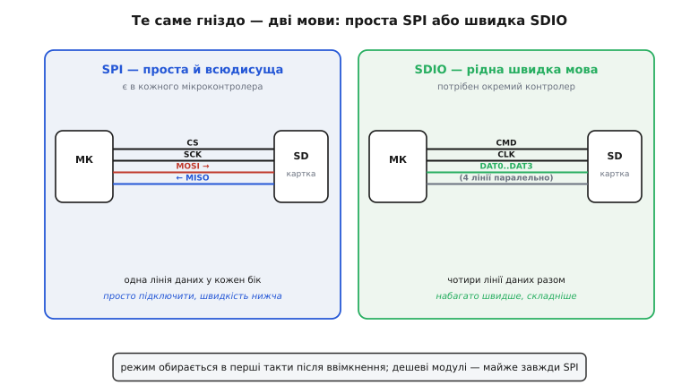
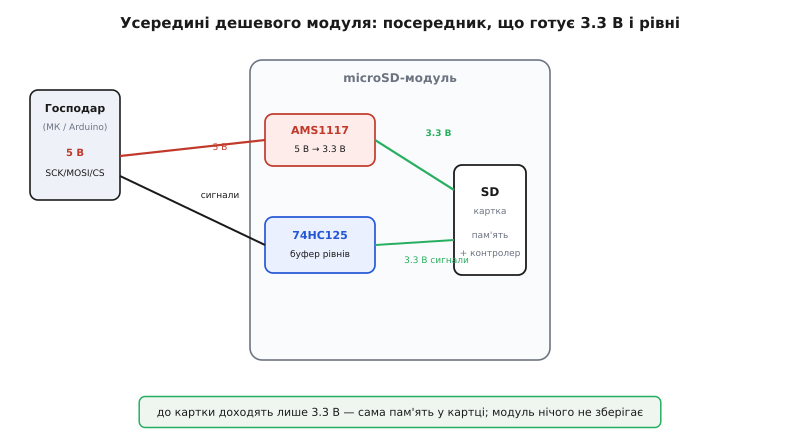

# microSD-модуль

## Призначення та принципи роботи microSD-модуля

microSD-модуль є пасивним схемотехнічним перехідником між мікроконтролером та знімною карткою пам'яті @@en|microSD@@ (від англ. *@@en|micro Secure Digital@@* — мікрозахищене цифрове сховище), який надає механічне гніздо, узгоджує логічні рівні та забезпечує стабілізоване живлення 3.3 В. Картка утримує власний апаратний контролер і підтримує дві протокольні мови зв'язку: швидкісний 4-бітний режим @@en|SDIO@@ (від англ. *@@en|Secure Digital Input Output@@* — цифрове введення-виведення) та універсальну послідовну шину @@en|SPI@@ (від англ. *@@en|Serial Peripheral Interface@@* — послідовний периферійний інтерфейс). Режим @@en|SDIO@@ вимагає спеціалізованого апаратного контролера у SoC, тоді як простіша шина @@en|SPI@@ є в кожного мікроконтролера і спирається на чотири сигнальні лінії: `MOSI`, `MISO`, `SCK` та `CS`. Більшість дешевих модулів розраховано на роботу в режимі @@en|SPI@@ і містить лінійний стабілізатор напруги `AMS1117-3.3` та буфер-перетворювач рівнів `74HC125`, тоді як спеціалізовані 3.3-вольтові модулі підключаються напряму без додаткового пониження напруги.

*Режим SPI використовує чотири лінії даних і підтримується будь-якими мікроконтролерами, тоді як 4-бітний SDIO забезпечує максимальну швидкість обміну.*

*Вхідне живлення 5 В знижується стабілізатором до 3.3 В, а буфер 74HC125 узгоджує амплітуду сигналів для захисту входів картки.*

## Схема підключення та живлення модуля

Електричне підключення модуля до мікроконтролера здійснюється за допомогою шести ліній: живлення `VCC`, заземлення `GND` та чотирьох ліній шини @@en|SPI@@. Лінія вибору пристрою `CS` (від англ. *@@en|Chip Select@@* — вибір мікросхеми) приєднується до довільного цифрового виводу `GPIO`, тоді як `SCK`, `MOSI` та `MISO` підключаються до апаратного контролера SPI. Для запобігання хибному ввімкненню картки у момент скидання мікроконтролера лінію `CS` підтягують до напруги 3.3 В зовнішнім резистором номіналом 10 кОм. Під час запису блоків картка споживає струм імпульсними сплесками амплітудою до сотень міліампер, тому шина живлення 3.3 В вимагає встановлення локального керамічного конденсатора ємністю 1–10 мкФ безпосередньо біля контакту `VCC`. При використанні адаптера для програмування, такого як [плата-адаптер для ESP32-CAM](root:cat-hw-boards/esp32-cam-programmer), стабільність живлення є критичною для запобігання збоям запису.

## Файлова система FAT та сумісність

На фізичному рівні пам'ять картки розбито на пронумеровані блоки розміром по 512 байтів. Для читання даних на комп'ютері поверх блоків розгортається файлова система @@en|FAT@@ (від англ. *@@en|File Allocation Table@@* — таблиця розміщення файлів) у специфікаціях `FAT16` (для карт типорозміру `SDSC` обсягом до 2 ГБ) або `FAT32` (для `SDHC` від 4 до 32 ГБ). Стандарт `FAT32` накладає програмне обмеження на максимальний розмір одного файла у 4 ГБ (докладно 4 294 967 295 байтів), тому в потокових логерах тривалий запис журналів необхідно періодично розбивати на окремі файли. Картки обсягом понад 32 ГБ (`SDXC`) за замовчуванням форматуються в `exFAT`, що вимагає ручного переформатування у `FAT32` для роботи зі стандартними мікроконтролерними бібліотеками. Обмін даними з карткою здійснюється порціями, кратно 512 байтів, що оптимізує швидкість запису та зменшує знос осередків флеш-пам'яті.

## Запобігання збоям та збереження картки

Основна причина передчасної відмови карток у 5-вольтових схемах полягає в некоректній роботі буфера `74HC125`, який при живленні від 5 В подає підвищену напругу на 3.3-вольтові сигнальні входи картки. Якщо картка не визначається під час старту, швидкість шини @@en|SPI@@ на етапі ініціалізації знижують до 100–400 кГц, оскільки запуск на високих частотах викликає помилки вибірки команд. Затримки та короткочасне гальмування запису виникають через внутрішній процес збирання сміття та вирівнювання зносу осередків (від англ. *@@en|wear leveling@@* — вирівнювання зносу), що вимагає накопичення даних у проміжному оперативному буфері. Для запобігання пошкодженню таблиці @@en|FAT@@ та втраті файлів при раптовому знеструмленні застосунок мусить регулярно скидати буфери та коректно закривати відкриті файли.
