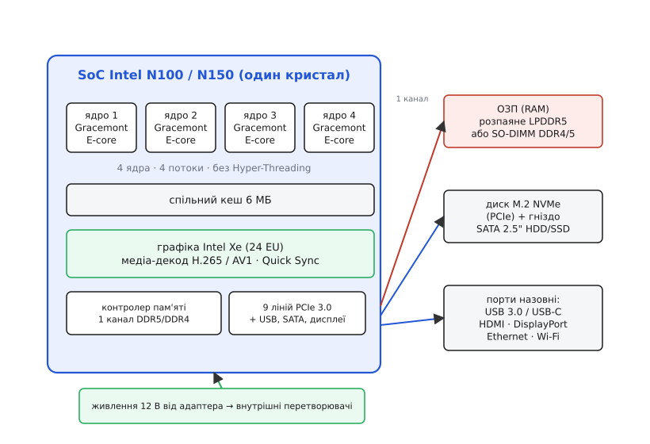
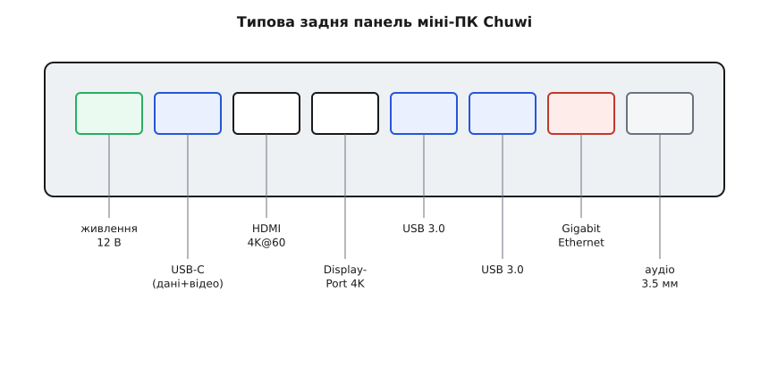

# Міні-ПК Chuwi (x86)

<preknowlist>
- [Родина Raspberry Pi](root:cat-hw-boards/raspberry-pi-family) — концепцію одноплатних комп'ютерів на базі архітектури ARM та принцип прямого керування електронікою через гребінку GPIO
</preknowlist>

## Відмінності між x86 та Raspberry Pi

Замість плат без корпусу з виведеними контактами периферії готовий міні-ПК являє собою повноцінну настільну обчислювальну систему в компактному корпусі. Головна перевага архітектури @@en|x86@@ над @@en|ARM@@-процесорами полягає у нативній програмній сумісності. Пристрій виконує будь-яке десктопне програмне забезпечення, операційні системи Windows чи настільний Linux без трансляції інструкцій чи перекомпіляції. На платформах @@en|ARM@@ запуск x86-програм вимагає динамічної трансляції команд (наприклад, через емулятор @@en|QEMU@@), де кожна інструкція x86 на льоту перекладається в кілька інструкцій ARM, що спричиняє відчутні втрати обчислювальної потужності та затримки виконання. Натомість на x86-міні-ПК контейнеризовані середовища @@en|Docker@@ працюють у нативному режимі: контейнери використовують спільне ядро операційної системи без проміжного шару емуляції (англ. @@en|emulation layer@@), а оскільки переважна більшість серверних образів зібрана під архітектуру `x86_64`, вони виконуються без додаткових витрат ресурсів та без озирання на відсутність сумісних ARM-збірок. Водночас у міні-ПК відсутня [гребінка GPIO](root:cat-hw-boards/gpio-extension-board), тому він не призначений для прямого керування датчиками й виконавчими механізмами, на відміну від того, як це робить [родина Raspberry Pi](root:cat-hw-boards/raspberry-pi-family).

## Апаратна архітектура SoC Intel N100

Основою міні-ПК є система на кристалі (англ. @@en|SoC@@, від *@@en|System-on-Chip@@*) Intel N100, побудована на чотирьох енергоефективних ядрах @@en|Gracemont@@. Процесор працює без підтримки багатониточності (англ. @@en|Hyper-Threading@@) і споживає всього 6 Вт у базовому режимі. Вбудоване графічне ядро Intel Xe містить апаратний медіадекодер @@en|QuickSync@@, який знімає навантаження з центрального процесора при розкодуванні кількох паралельних відеопотоків 4K.

## Конфігурація пам'яті та накопичувачів

Контролер оперативної пам'яті чипа обмежений одним каналом DDR4 або DDR5 з максимально підтримуваним обсягом до 16–32 ГБ. На відміну від плат із розпаяними чипами ОЗП, більшість міні-ПК оснащено знімним слотом @@en|SO-DIMM@@, що дозволяє замінювати модуль пам'яті. Для збереження даних застосовують високошвидкісні твердотільні накопичувачі @@en|M.2 NVMe@@, а в окремих конструкціях передбачено додатковий відсік для диска @@en|SATA@@ формату 2.5 дюйма.

*Внутрішнє влаштування міні-ПК зі слотом SO-DIMM та роз'ємами M.2 NVMe і SATA.*

## Інтерфейси підключення та живлення

Компактний корпус вміщує повноцінний набір периферійних інтерфейсів: мережевий порт Ethernet, роз'єми USB-A та повнофункціональний @@en|USB-C@@ з підтримкою передачі відеосигналу. Два виходи HDMI або DisplayPort дозволяють одночасно виводити зображення на два 4K-монітори. Живлення пристрою здійснюється від зовнішнього 12-вольтового адаптера, а пікове споживання всієї системи під навантаженням не перевищує 25 Вт. Кріплення стандарту @@en|VESA@@ дозволяє монтувати ПК безпосередньо на задню стінку монітора.

*Зовнішні інтерфейси зв'язку, мережі та виходу на монітори.*

## Охолодження та сценарії використання

Система охолодження буває пасивною безвентиляторною або активною з тихим кулером. Пасивний радіатор забезпечує безшумність, але при тривалому граничному навантаженні змушує процесор скидати частоту, тоді як вентилятор підтримує стабільну продуктивність. Низьке енергоспоживання робить міні-ПК ідеальним вибором для цілодобового домашнього сервера (англ. @@en|NAS@@, від *@@en|Network-Attached Storage@@*), медіавузла чи тонкого офісного робочого місця. Проте для важких обчислень чи складних 3D-ігор чотирьох енергоефективних ядер недостатньо.
