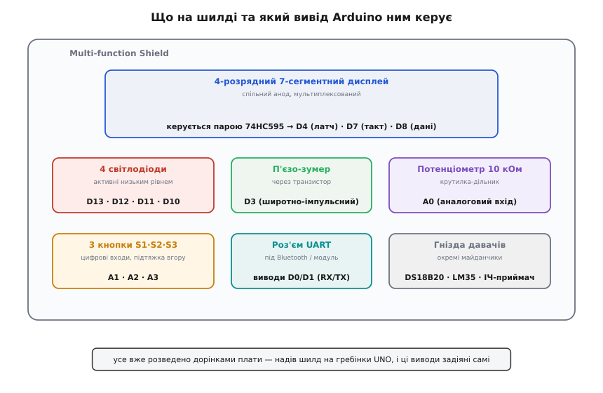
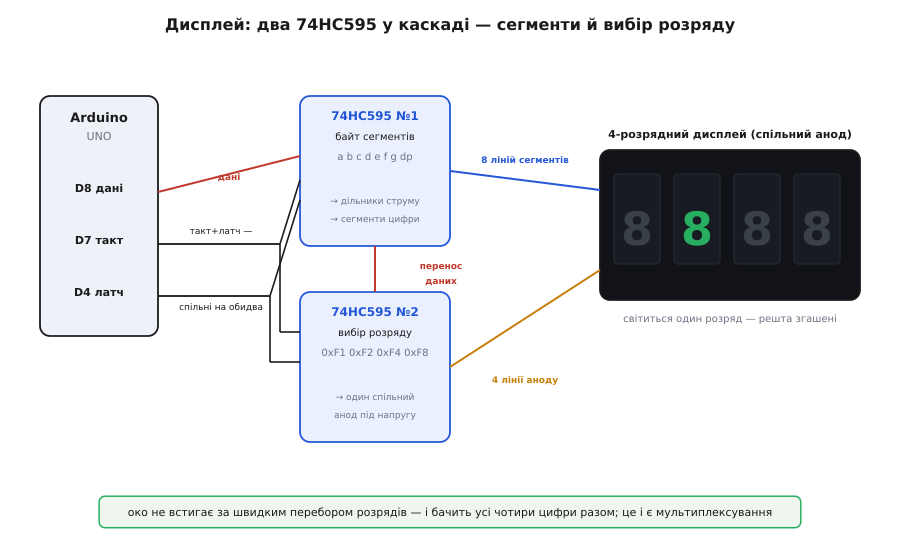

# Multi-function Shield для Arduino UNO

<preknowlist>
- [Arduino UNO R3](root:cat-hw-boards/arduino-uno) — плата, на гребінки якої надівається цей шилд; звідки беруться виводи D0–D13 та A0–A5.
- [Зсувний регістр 74HC595](root:cat-hw-parts/74hc595) — мікросхема, що з одного послідовного входу робить вісім паралельних виходів; чому вистачає трьох дротів на багато ліній.
- [Семисегментний індикатор](root:cat-hw-actuators/seg-5641as) — як із семи паличок скласти цифру; що таке спільний анод і спільний катод.
- [Широтно-імпульсна модуляція](root:hw-arch/pwm-on-mcu) — як швидким вмиканням-вимиканням виводу керувати гучністю зумера й яскравістю.
</preknowlist>

Надіваєш цю плату на гребінки Arduino UNO — і без жодного дроту дістаєш готовий стенд для навчання: чотири червоні цифри світяться, під ними троє кнопок, збоку крутилка, пищить зумер, блимають чотири світлодіоди. Це **Multi-function Shield** (англ. *shield* — щит, плата-накладка) — дешева плата-розширення, зібрана саме для того, щоб було на чому вчитися програмувати мікроконтролер. Замість того щоб паяти дисплей, кнопки й індикатори на макетці й плутатися в дротах, ти отримуєш усе це вже розведеним і перевіреним. Коштує вона копійки, а закриває першу сотню навчальних задач: годинник, лічильник, термометр, простеньке меню, реакція на натискання.

Підступність — рівно одна, і в ній весь сенс цієї плати. Дисплей на ній заведено не «прямо», а через дві мікросхеми-зсувні регістри, тож просто «записати цифру у вивід» не вийде — треба зрозуміти, як плата насправді запалює сегменти. Розберімо шилд так, щоб упізнати його серед інших, знати, який вивід Arduino за що відповідає, і без спотикань написати перший код.

### Що це за плата й чому саме така

Multi-function Shield — це не пристрій із власним «розумом», а **набір периферії на одній платі, підігнаний під роз'єми Arduino UNO**. Жодного мікроконтролера на ньому немає: усім керує сам UNO, на який шилд надівається. Плата лише зводить докупи те, що новачок однаково рано чи пізно чіпляв би окремо, і розводить це по виводах наперед.

Чому саме такий набір? Бо він покриває три речі, потрібні майже в кожній навчальній задачі: **щось показати** (чотири цифри й світлодіоди), **щось прийняти від людини** (три кнопки й потенціометр) і **щось подати сигналом** (зумер). Додай сюди майданчики під давач температури та приймач інфрачервоного пульта — і виходить маленька лабораторія, де можна зібрати справжній прилад, не торкнувшись паяльника.

Плата розрахована на гребінки типу **R3** — це той рядок роз'ємів, що з'явився на Arduino UNO третьої ревізії. Якщо в тебе стара плата до R3, контакти можуть не збігтися — це єдине, що варто перевірити перед покупкою. На UNO, Leonardo та сумісних клонах із R3-гребінками шилд стає як влитий.

> 🔧 **Навіщо це.** Головна цінність шилда — не в самих деталях (їх можна купити за безцінь окремо), а в тому, що **виводи вже призначені та розведені без помилок**. Новачок найчастіше горить не на коді, а на монтажі: переплутав ногу, забув підтяжку, не туди встромив землю. Шилд прибирає цей клас помилок цілком — лишається чистий код, і саме на ньому можна зосередитись.


*Дисплей із чотирьох цифр угорі керується через два регістри 74HC595 (виводи D4, D7, D8). Нижче — чотири світлодіоди (D13–D10), зумер (D3) і потенціометр (A0), ще нижче — три кнопки (A1–A3), роз'єм UART під бездротовий модуль і окремі гнізда під давачі DS18B20, LM35 та ІЧ-приймач. Усе вже розведено дорінками — надів шилд, і ці виводи задіяні самі.*

### Розпіновка: хто на якому виводі

Оскільки вся плата — це заздалегідь зроблена розводка, найважливіше знати **карту виводів**. Ось вона повністю, і саме ці числа підеш писати в коді:

```
Деталь на шилді           Вивід Arduino    Як працює
──────────────────────────────────────────────────────────
Дисплей: дані (SDI)        D8               послідовно в регістр
Дисплей: такт (CLK)        D7               тактує зсув бітів
Дисплей: латч (LATCH)      D4               «клац» — виставити біти
──────────────────────────────────────────────────────────
Світлодіод LED1..LED4      D13 D12 D11 D10  активні НИЗЬКИМ рівнем
Зумер                      D3               широтно-імпульсний
Потенціометр (10 кОм)      A0               аналоговий вхід 0..1023
Кнопка S1 S2 S3            A1  A2  A3        цифрові входи, підтяжка вгору
──────────────────────────────────────────────────────────
UART-роз'єм (RX/TX)        D0 / D1          під Bluetooth / модуль
Гнізда давачів             окремі майданчики DS18B20, LM35, ІЧ-приймач
```

Дві дрібниці з цієї таблиці вирішують, чи запрацює твій перший код.

Перша: **світлодіоди й кнопки активні низьким рівнем**. Світлодіод на шилді загоряється, коли на його виводі низький рівень, а не високий — бо він увімкнений катодом до виводу, аноди до живлення. Тож нуль на першому світлодіоді **вмикає** його, а одиниця гасить — навпаки до звички (в Arduino це `digitalWrite(13, LOW)`). Так само кнопка: у спокої вивід підтягнутий угору й читається як одиниця, а натиснута кнопка садить його на землю — читається нуль. Тому кнопки заводять входом із внутрішньою підтяжкою вгору (в Arduino `INPUT_PULLUP`, в ESP-IDF `pull_up_en`, у STM32 `GPIO_PULLUP`), а натискання ловлять по переходу в нуль.

Друга: **потенціометр — це просто крутилка-дільник напруги** на вивід `A0`. Крутиш ручку — на вивід приходить напруга від нуля до напруги живлення плати (на UNO — 5 В), і АЦП мікроконтролера обертає її в число. Скільки саме — залежить від розрядності АЦП: на UNO це 0–1023 (`analogRead(A0)`, десять бітів), на ESP32 чи STM32 — 0–4095 (дванадцять бітів). Зручно, щоб «наживо» задавати якийсь параметр: яскравість, поріг, швидкість.

> 🔧 **Навіщо це.** Пастка «нічого не світиться» на цьому шилді найчастіше саме тут: людина пише `digitalWrite(13, HIGH)`, чекає, що світлодіод спалахне, — а він гасне. Запам'ятай раз: **на цьому шилді низький рівень — це «увімкнено»** для світлодіодів, а натиснута кнопка — теж низький рівень. Помилку в цьому місці роблять усі, хто бачить активний-низький монтаж уперше.

### Головна хитрість: дисплей через два регістри

Найцікавіше на платі — чотири семисегментні цифри. Наївно було б чекати, що кожен сегмент має свій вивід Arduino. Але тоді на самий дисплей пішло б **32 виводи** (вісім сегментів × чотири цифри), а їх на UNO стільки просто немає. Тому плата йде обхідним шляхом, і в цьому обхідному шляху — уся суть.

По-перше, дисплей **мультиплексований**: усі чотири цифри ділять одні й ті самі вісім ліній сегментів, а розрізняються тим, у якої цифри зараз підведено живлення. У кожну мить світиться **лише один розряд**; решта згашені. Плата дуже швидко перебирає розряди по колу — цифра 1, цифра 2, цифра 3, цифра 4 і знову, — і робить це так швидко, що око зливає спалахи в суцільну картинку з чотирьох цифр. Це та сама ілюзія, що й у кіно: окремі кадри стають рухом.

По-друге, навіть ці вісім ліній сегментів плюс чотири лінії вибору розряду — це вже дванадцять виводів, а плата обходиться **трьома**. Секрет — дві мікросхеми [74HC595](root:cat-hw-parts/74hc595), увімкнені **каскадом** (одна за одною). Кожен такий регістр бере біти по одній лінії, один за одним, і виставляє їх на вісім своїх виходів. Перший регістр тримає **байт сегментів** (які палички цифри світяться), другий — **байт вибору розряду** (яка з чотирьох цифр зараз під напругою).

> Зсувний регістр 74HC595 приймає дані **послідовно** — біт за бітом по лінії SDI, кожен «заштовхує» тактовий імпульс на лінії SH_CP — і зберігає їх усередині. Коли всі вісім бітів на місці, імпульс на лінії ST_CP (латч) разом виставляє їх на вісім паралельних виходів Q0–Q7. Два регістри з'єднують у каскад: переповнений біт першого «витікає» у другий, тож 16 бітів заходять однією лінією даних. Так три виводи Arduino керують шістнадцятьма.


*Три лінії від Arduino (D8 дані, D7 такт, D4 латч) заходять у перший регістр; такт і латч спільні на обидва. Перший 74HC595 виставляє вісім ліній сегментів на всі цифри одразу, другий — чотири лінії аноду, що вмикають лише один розряд. Перенос даних із першого регістра «витікає» у другий. Плата швидко перебирає розряди — око бачить усі чотири цифри разом.*

### Спільний анод: чому байти «навиворіт»

Дисплей на шилді — **спільного аноду** (англ. *common anode*): у кожної цифри всі вісім анодів світлодіодів-сегментів зведені разом в один спільний вивід, а керують сегментами з боку катодів. Наслідок цього простий, але саме він плутає новачків: **сегмент світиться, коли на його лінію подано НИЗЬКИЙ рівень**, бо струм тече від спільного аноду (плюс) через сегмент до виводу з нулем. Логіка перевернута: `0` — світиться, `1` — темно.

Через це байти сегментів у коді виглядають «навиворіт». Ось таблиця, яку використовує ходова бібліотека для цього шилда — байт для кожної цифри від 0 до 9 (порядок бітів: `dp g f e d c b a`, старший біт першим):

```
Цифра   Байт     Двійково    Які сегменти згашені (1) / світяться (0)
──────────────────────────────────────────────────────────────────
  0     0xC0     11000000    горять a b c d e f — контур; g і dp темні
  1     0xF9     11111001     горять лише b c — дві праві палички
  2     0xA4     10100100
  3     0xB0     10110000
  4     0x99     10011001
  5     0x92     10010010
  6     0x82     10000010
  7     0xF8     11111000
  8     0x80     10000000     горять усі сім — вісімка
  9     0x90     10010000
```

Придивись до вісімки: `0x80` = `10000000`. Сім молодших бітів — нулі, тобто всі сім сегментів `a`–`g` світяться; старший біт — одиниця, десяткова кома темна. А одиниця (`1`) — це `0xF9`: лише два біти `b` і `c` у нулі, решта згашені, тому світяться дві праві палички. Якби дисплей був спільного катоду, усі ці байти були б інвертовані (вісімка стала б `0x7F`) — тому таблиця сегментів **прив'язана саме до типу дисплея**, і переносити її наосліп з іншого проєкту не можна.

Другий регістр вибирає розряд байтами `0xF1`, `0xF2`, `0xF4`, `0xF8` — по одному нулю в молодших чотирьох бітах, кожен вмикає свою цифру. Показати число повністю — це швидко прокрутити всі чотири розряди, у кожному виставивши свій байт сегментів і свій байт вибору.

### Перший код: запалити одну цифру

Розберемо на найпростішому: показати цифру `5` у крайньому правому розряді. Три кроки — прибрати латч, заштовхати два байти, клацнути латчем назад. Від мікроконтролера тут потрібні лише **три звичайні виводи-виходи** — жодної особливої периферії; послідовність усюди та сама, різняться тільки назви викликів. Arduino дає найкоротший вхід, бо має готову функцію зсуву; в інших середовищах ті самі вісім бітів виштовхують руками (або віддають апаратному SPI, для якого це рідна робота).

**Показати «5» у першому розряді дисплея.**
:::tabs
:::code multifunction-shield-d/c/arduino/pershyi-kod-zapalyty-odnu.ino
:::code multifunction-shield-d/c/esp-idf/pershyi-kod-zapalyty-odnu.c
:::code multifunction-shield-d/c/stm32/pershyi-kod-zapalyty-odnu.c
:::

Тут `shiftOut` — стандартна функція Arduino, що заштовхує вісім бітів по лінії `DATA`, тактуючи їх лінією `CLK`; `MSBFIRST` каже посилати старший біт першим. Там, де такої функції немає, її роль грає цикл на вісім кроків — виставити біт на лінію даних, смикнути такт — рівно те, що видно у двох сусідніх вкладках. Два виклики поспіль наповнюють обидва регістри каскаду: перший байт «протікає» у другий регістр, коли на його місце заходить другий. Клац латчем — і обидві вісімки бітів разом стають на виходи.

Якщо запустити цей код, ти побачиш `5` лише в одному розряді. Щоб світилися всі чотири цифри числа, треба в `loop()` **швидко по черзі** викликати `showDigit` для кожного розряду — тоді око зіллє їх у ціле число. Це вже не одна дія, а безперервний перебір, і саме на ньому легко наробити помилок (мерехтіння, нерівна яскравість, з'їдений процесорний час). Готову й вилизану версію такого перебору, а заразом роботу з кнопками, зумером і потенціометром зручніше взяти через бібліотеку **MultiFuncShield**, яка ховає весь цей клопіт за простими викликами `write(1234)`: усі її виклики, події кнопок і типові пастки зібрані в [довіднику інтерфейсу](root:cat-hw-boards/multifunction-shield/api-multifunction-shield.md), а [повний робочий приклад](root:cat-hw-boards/multifunction-shield/proj-multifunction-shield-counter.md) — лічильник, що з них складається.

> 🔧 **Навіщо це.** Ручний перебір розрядів навчає бачити, **як насправді світиться мультиплексований дисплей** — це базове вміння для будь-якої матричної індикації. Але в реальному проєкті перебір заважає решті коду: поки процесор крутить цифри, він не робить нічого іншого. Тому мультиплексування виносять у переривання по таймеру — тоді дисплей оновлюється сам, крихітними порціями між іншою роботою, — а логіку пишуть окремо; саме так влаштована бібліотека шилда, і саме тому нею зручно користуватись, коли ти вже розумієш, що вона робить усередині.

### Кнопки, зумер, світлодіоди

Решта периферії проста, і після дисплея видихаєш. **Кнопки** заводяться як входи з підтяжкою вгору, натискання — це перехід у `LOW`:

**Спалахнути світлодіодом, поки натиснута кнопка S1.**
:::tabs
:::code multifunction-shield-d/c/arduino/knopky-zumer-svitlodiody.ino
:::code multifunction-shield-d/c/esp-idf/knopky-zumer-svitlodiody.c
:::code multifunction-shield-d/c/stm32/knopky-zumer-svitlodiody.c
:::

Тут добре видно перевернуту логіку одразу в двох місцях: кнопку натиснуто, коли читається `LOW`, а світлодіод світиться, коли пишеш `LOW`. У живому проєкті кнопку ще й «відбивають» (англ. *debounce*) — механічний контакт деренчить кілька мілісекунд і дає хибні спрацювання, тож натискання підтверджують коротким витриманням, а не першим-ліпшим `LOW`.

**Зумер** сидить на виводі `D3` через транзистор-підсилювач, тож слабкого струму виводу вистачає розгойдати п'єзо-пластину. Ця лінія заведена на вивід, за яким стоїть канал таймера, тож можна не просто «бікнути», а й задати тон — тобто змусити таймер смикати вивід із потрібною частотою: в Arduino це `tone(3, 1000)` (тисяча герц) і `noTone(3)`, в ESP-IDF — канал `LEDC` із заданою частотою, у STM32 — таймер у режимі ШІМ (`HAL_TIM_PWM_Start`). Прості звукові підказки (натиснув — пікнуло, помилка — довгий сигнал) роблять інтерфейс живим без жодної додаткової деталі.

Чотири **світлодіоди** на `D13`–`D10` — це просто індикатори станів (усі активні низьким). Зручні, щоб «на очах» показати внутрішній стан програми, не займаючи дисплей: скажімо, чотири біти лічильника чи стадію процесу.

### Роз'єми розширення: куди рости далі

Крім навчального набору, шилд має кілька майданчиків, щоб задачу можна було довести до справжнього приладу.

**Роз'єм UART** виведений на виводи `D0`/`D1` (апаратний послідовний порт UNO) — сюди під'єднують бездротові модулі: Bluetooth (HC-05/HC-06), радіо, голосовий модуль. Важлива пастка: `D0`/`D1` — це той самий порт, яким Arduino спілкується з комп'ютером через USB. Поки модуль підключено до цього роз'єму, **завантаження прошивки може конфліктувати** з ним; часто модуль доводиться від'єднувати на час прошивання.

**Гніздо під давач температури** приймає або `DS18B20` (цифровий, по одному дроту), або `LM35` (аналоговий) — залежно від виконання плати. Це дає готовий термометр: під'єднав давач у гніздо, зчитав температуру, показав на дисплеї. Один із найпопулярніших перших проєктів на цьому шилді саме такий.

**Роз'єм ІЧ-приймача** — під фотоприймач інфрачервоного пульта (типу VS1838B): пристрій починає слухати звичайний пульт від телевізора й реагувати на кнопки. Разом із дисплеєм і зумером виходить маленький керований пультом прилад.

> 🔧 **Навіщо це.** Ці роз'єми — саме те, що відрізняє «блималку для навчання» від містка до реального пристрою. Типовий шлях на цьому шилді: спершу освоїв дисплей і кнопки, потім увіткнув давач температури — і ось у тебе термометр із порогом-будильником (зумер пищить, коли гаряче), яким можна керувати з пульта. Усе на одній платі, без жодного паяння, — і це чудовий спосіб зібрати перший завершений прилад.

### Варіації: на що дивитись

Плату роблять багато дрібних виробників, тож між партіями є розбіжності, і одна з них здатна зіпсувати перший запуск.

Головна — **тип дисплея**. Переважна більшість шилдів іде зі спільним анодом (саме під нього наведені байти вище), але трапляються клони зі спільним катодом. У такого сегменти світяться від `HIGH`, а не `LOW`, і всі байти сегментів треба **інвертувати**; інколи ще й міняється порядок вибору розрядів. Симптом підміни очевидний: замість цифр висвічується їхній «негатив» — горить те, що мало б бути темним. Якщо стандартний приклад показує нісенітницю, перше, що перевіряють, — чи не інший у тебе тип дисплея.

Другорядні відмінності: який саме давач температури підтримує гніздо (`DS18B20` проти `LM35`), чи розпаяний ІЧ-приймач і UART-роз'єм, якого кольору й яскравості світлодіоди. На логіку роботи це не впливає — лише на те, які з додаткових можливостей у тебе під рукою з коробки.

І остання дрібниця про сумісність: шилд займає чимало «ходових» виводів UNO — `D3`, `D4`, `D7`, `D8`, `D10`–`D13`, `A0`–`A3`. Якщо поверх нього хочеться причепити ще щось своє, вільними лишаються небагато виводів (`D2`, `D5`, `D6`, `D9`, `A4`, `A5`), і саме з них треба виходити, плануючи розширення. Виводи `A4`/`A5` — це шина I²C, тож зовнішній давач чи годинник реального часу з I²C-інтерфейсом чіпляють саме туди, не конфліктуючи з шилдом.
