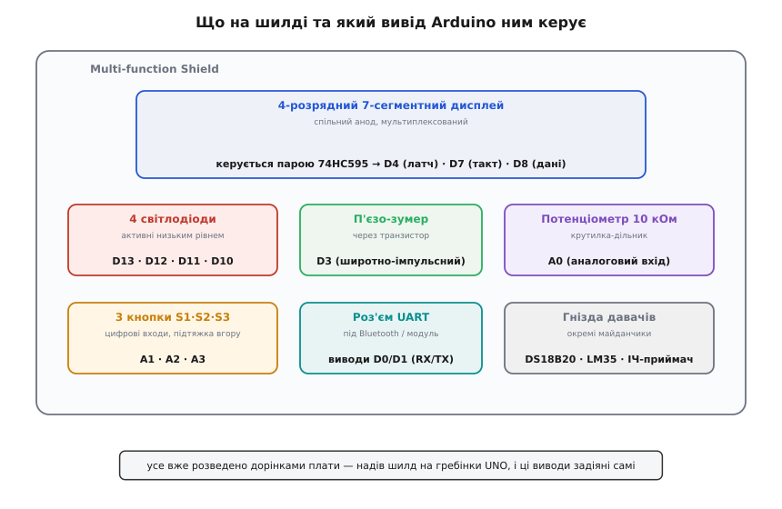
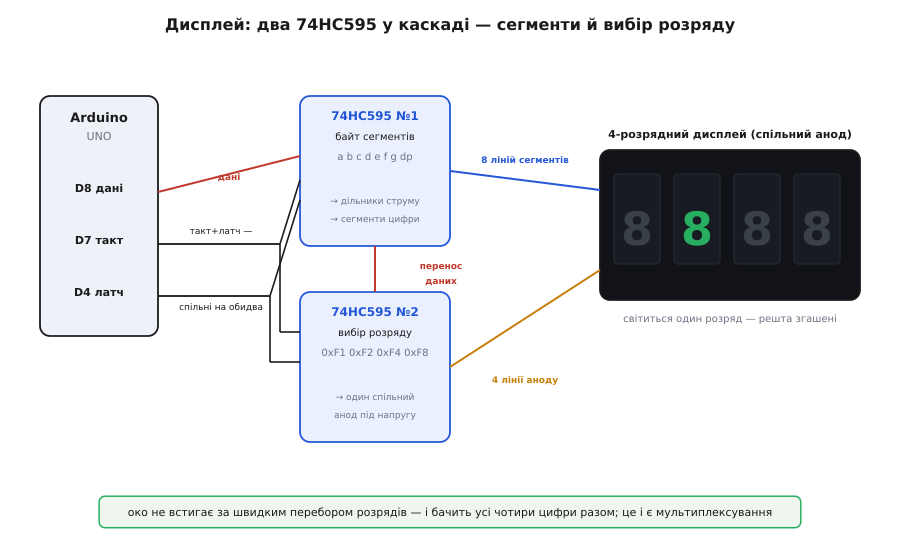

# Multi-function Shield для Arduino UNO

<preknowlist>
- [Arduino UNO R3 (CH340)](root:cat-hw-boards/arduino-uno) — базові знання про гребінки R3 та виводи контролера.
</preknowlist>

## Навчальна периферія на одній платі

Multi-function Shield — це плата розширення (@@en|shield@@), яка надівається безпосередньо на гребінки [Arduino UNO R3](root:cat-hw-boards/arduino-uno). Її головне завдання — надати готовий набір базової периферії для навчання, щоб уникнути паяння та прокладання дротів на макетній платі, які часто відходять. На ній зібрано чотирирозрядний дисплей, кнопки, світлодіоди, зумер, потенціометр та колодки для підключення додаткових датчиків, що дозволяє швидко перевіряти код. Під час встановлення важливо стежити, щоб контакти на нижньому боці плати не торкалися високого металевого корпусу роз'єму USB-B на мікроконтролері, інакше станеться коротке замикання. Щоб цього уникнути, штирі слід ретельно вирівняти з гребінками й не втискати до самого упору, а якщо плата сідає занадто низько — наклеїти на металевий корпус роз'єму USB шматок ізоляційної стрічки.

*Плата Multi-function Shield з позначенням основних компонентів та роз'ємів: дисплей, кнопки, світлодіоди та виводи для додаткових датчиків.*

## Дисплей через зсувні регістри

Чотирирозрядний семисегментний дисплей на платі підключений не напряму до мікроконтролера, а через каскад із двох зсувних регістрів (@@en|shift register@@) 74HC595. Пряме підключення забрало б 12 виводів, а через регістри потрібно лише три лінії — для даних, тактування та засувки (@@en|latch@@). Більше про те, як працюють такі мікросхеми, читайте у статті про [зсувний регістр 74HC595](root:cat-hw-parts/74hc595).

*Схема підключення дисплея до Arduino через два зсувні регістри 74HC595: один регістр керує сегментами, інший обирає активний розряд.*

Щоб показати число на всіх чотирьох розрядах одночасно, застосовують мультиплексування (@@en|multiplexing@@). Контролер по черзі вмикає кожен розряд на коротку мить. Якщо перемикати розряди достатньо швидко, людське око сприймає зображення як цілісне. Один зсувний регістр задає поточний розряд, а інший — комбінацію сегментів для нього. Детальний розбір цього підходу наведено в матеріалі про [мультиплексування семисегментних індикаторів](root:cat-hw-actuators/7-segment-multiplexing).

## Активний низький рівень та розпіновка

Більшість компонентів на цій платі підключені за логікою активного низького рівня (@@en|active low@@). Чотирирозрядний дисплей зібраний зі спільним анодом (@@en|common anode@@), тому певний сегмент світиться, коли на його катод подано логічний нуль. Чотири світлодіоди (позначені D1–D4) підключені безпосередньо до виводів мікроконтролера, але працюють за оберненою логікою: вони увімкнені, коли на їхніх виводах нуль, і вимкнені при логічній одиниці.

Три кнопки (S1, S2, S3) також працюють на замикання на землю. У ненатиснутому стані на виводі з'являється логічна одиниця, а натискання кнопки дає нуль. Оскільки плата не має зовнішніх підтягувальних резисторів для кнопок, слід обов'язково вмикати внутрішні резистори контролера.

## Зчитування входів та звуковий сигнал

Для надійного зчитування станів кнопок відповідні цифрові виводи налаштовують як входи з підтяжкою живлення (@@en|pull-up@@). Багатообертовий потенціометр підключений до аналогового входу A0, що дозволяє плавно зчитувати напругу й використовувати її, наприклад, для налаштування частоти мультиплексування чи яскравості.

На платі встановлено активний зумер (@@en|buzzer@@), який підключений до цифрового виводу D3 і теж активується низьким рівнем. Він не має вбудованого генератора частоти, тому для створення звуку на вивід потрібно подавати сигнал зі змінною частотою, наприклад, за допомогою таймера. Додаткові гребінки дозволяють підключати зовнішні модулі, хоча вони механічно обмежені формфактором [Arduino Nano](root:cat-hw-boards/arduino-nano) чи UNO.
