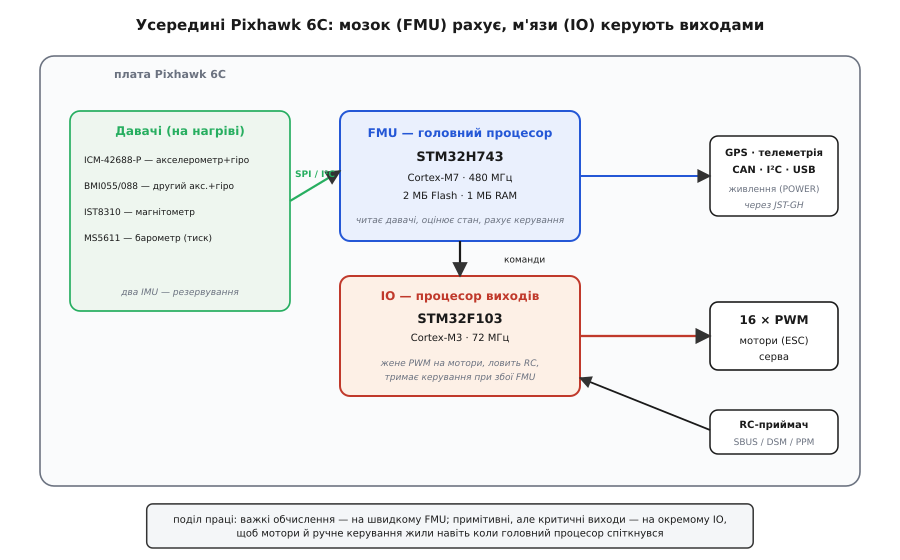
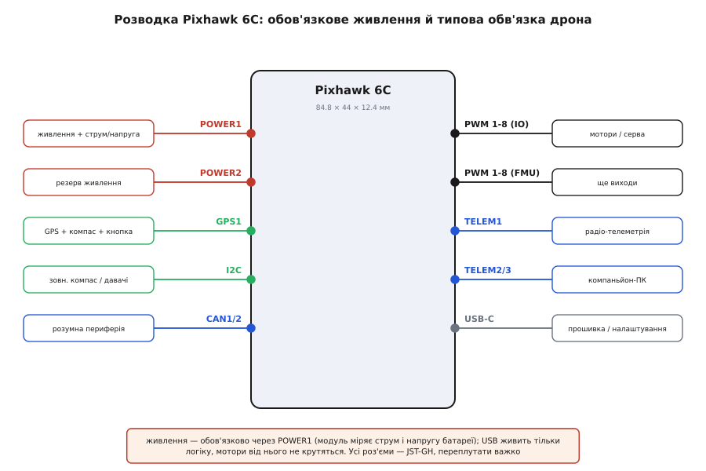

# Pixhawk 6C — польотний контролер

## Роль автопілота у стабілізації дрона

Багатороторний безпілотник є принципово нестійкою фізичною системою: найменший порив вітру або зміна тяги одного з гвинтів миттєво збиває його кутове положення. На відміну від людини, яка не здатна з потрібною частотою коригувати оберти кожного мотора, @@en|flight controller@@ (від англ. *flight controller* — польотний контролер) @@en|Pixhawk 6C@@ виконує це автоматично сотні разів на секунду. Вбудований інерційний модуль @@en|IMU@@ (від англ. *Inertial Measurement Unit* — інерційний вимірювальний модуль) вимірює кутові швидкості та прискорення в трьох осях. Обчислювальний центр обробляє ці дані, розраховує відхилення від заданого стану апарата та формує керівні сигнали на електронні регулятори ходу @@en|ESC@@ (від англ. *Electronic Speed Controller* — електронний регулятор ходу). Зручну комутацію таких сигналів до силових ключів забезпечує використання [PWM-адаптера для Pixhawk](root:cat-hw-boards/pixhawk-pwm-adapter). Так утворюється замкнений контур зворотного зв'язку, де безперервний потік вимірювань гарантує стабільне утримання заданого положення.

Для забезпечення виключної надійності апаратура Pixhawk 6C побудована на двопроцесорній архітектурі: основний блок @@en|FMU@@ (від англ. *Flight Management Unit* — блок управління польотом) обраховує алгоритми навігації та орієнтації, тоді як допоміжний процесор @@en|IO@@ (від англ. *Input/Output* — введення-виведення) відповідає за безперебійне формування сигналів керування моторами та роботу режимів аварійного захисту. Точність оцінки стану забезпечують подвійні резервовані давачі @@en|IMU@@, оснащені внутрішнім апаратним підігрівом, який підтримує стабільну робочу температуру елементів і мінімізує температурний дрейф показів акселерометрів. Безперебійну роботу цієї чутливої електроніки гарантує обов'язкове живлення плати через спеціалізований силовий модуль безпосередньо від польотної батареї, що захищає контролер від скачків напруги та одночасно вимірює струм і напругу силової мережі.

*Схема замкненого контуру стабілізації: давачі зчитують стан дрона, а польотний контролер коригує оберти моторів.*

## Відкриті прошивки та практичні застереження

Гнучкість Pixhawk 6C забезпечує підтримка провідних відкритих прошивок @@en|PX4@@ та @@en|ArduPilot@@. PX4 орієнтована на наукові дослідження й авіоприладобудування, тоді як ArduPilot надає розширені можливості для комерційних автономних місій. Для передачі телеметрії та команд між контролером і наземною станцією використовується мережевий протокол @@en|MAVLink@@ (від англ. *Micro Air Vehicle Link* — протокол зв'язку для мікролітальних апаратів).

*Схема монтажу та підключення периферії Pixhawk 6C із вібророзв'язкою й модулями безпеки.*

Апаратна надійність польоту залежить від дотримання правил монтажу та якості електричних з'єднань. Усі периферійні інтерфейси плати використовують стандартизовані роз'єми @@en|JST-GH@@ стандарту @@en|Pixhawk Connector Standard@@ (англ. @@en|connector@@ від @@en|connect@@ — з'єднувати), оснащені язичковими засувками для захисту від мимовільного роз'єднання під дією польотних вібрацій та перевантажень. Тим часом високочастотні механічні вібрації від моторів здатні зашумити акселерометр, викликаючи дрейф оцінки висоти, тому плату встановлюють на силіконові демпферні подушки, а провідний джгут закріплюють із петлею послаблення натягу. Сигнали керування моторами виводяться на регулятори ходу напряму або через [окремий PWM-адаптер](root:cat-hw-boards/pixhawk-pwm-adapter), причому перед кожним вильотом обов'язкове калібрування давачів, а орієнтація плати має чітко відповідати напрямку руху дрона. Для запобігання випадковому запуску гвинтів на землі використовується кнопка-запобіжник та зумер, які блокують подачу сигналів на ESC до підтвердження готовності оператором.
