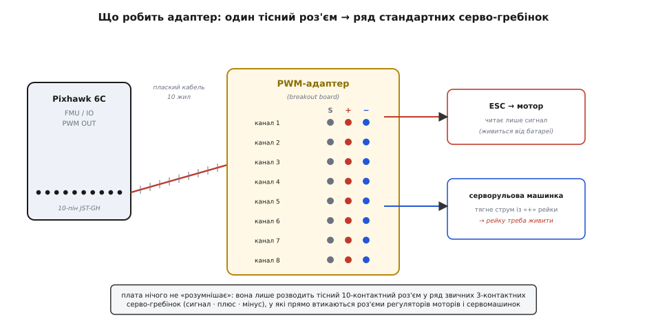
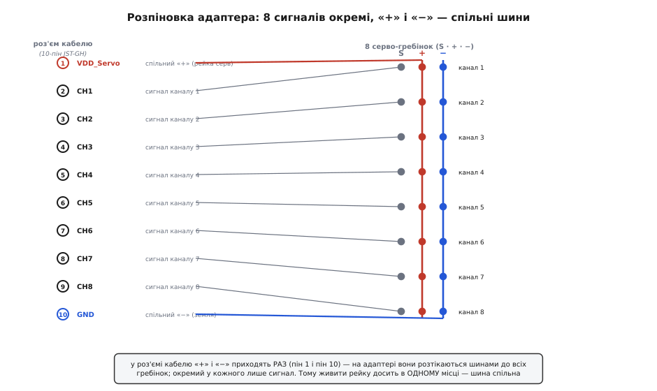
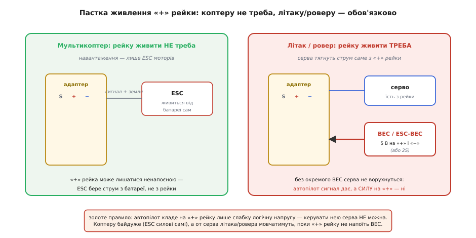

# PWM-адаптер для Pixhawk

<preknowlist>
- [Pixhawk 6C](root:cat-hw-boards/pixhawk-6c) — призначення автопілота та звідки на ньому беруться виходи FMU PWM OUT та I/O PWM OUT
</preknowlist>

## Навіщо Pixhawk потрібен PWM-адаптер

Польотний контролер [Pixhawk 6C](root:cat-hw-boards/pixhawk-6c) керує моторами та сервоприводами за допомогою сигналів широтно-імпульсної модуляції @@en|PWM@@ (англ. @@en|Pulse-Width Modulation@@ від @@en|pulse@@ — імпульс та @@en|width@@ — ширина). Проте підключити мотор чи сервомашинку напряму до бортового автопілота неможливо через фізичну несумісність роз'ємів. На платі контролера виходи генераторів сигналів виведені у щільні 10-контактні гнізда @@en|JST-GH@@, тоді як стандартні регулятори обертів та сервоприводи мають 3-контактні роз'єми з кроком 2.54 мм.

*PWM-адаптер слугує фізичним містком між компактним роз'ємом автопілота та трипіновими серво-гребінками.*

Розв'язком цієї проблеми є пасивна плата-перехідник @@en|breakout board@@ (від англ. @@en|breakout board@@ — плата розведення). Вона приймає багатожильний кабель від автопілота і розводить його на ряд стандартних серво-гребінок, забезпечуючи надійний електричний контакт та зручний монтаж на борту без паяння.

## Принцип розведення сигналів і шин

Пасивний адаптер виконує роль кросового комутатора без активних електронних компонентів. Головний 10-контактний кабель від портів @@en|FMU@@ (від англ. @@en|Flight Management Unit@@ — блок управління польотом) або @@en|I/O@@ (від англ. @@en|Input/Output@@ — вхід/вихід) містить вісім окремих сигнальних жил, одну загальну лінію заземлення та лінію опорного живлення.

*Сигнальні лінії проходять індивідуально на кожен канал, а контакти живлення та землі об'єднані у спільні шини.*

Усередині адаптера вісім сигнальних провідників розводяться на верхні контакти відповідних 3-контактних серво-гребінок (канали з 1 по 8). Середні контакти всіх гребінок об'єднані в єдину плюсову шину живлення, а нижні — у спільну шину заземлення. Таке розведення дозволяє передавати незалежні керуючі імпульси на кожен сервопривід, зберігаючи єдиний контур живлення та опорного потенціалу.

## Особливість живлення та пастка VDD_Servo

Критичною особливістю роботи з адаптером є розподіл сигнальних та силових кіл. Польотний контролер [Pixhawk 6C](root:cat-hw-boards/pixhawk-6c) подає через кабель @@en|JST-GH@@ лише логічні сигнальні імпульси амплітудою 3.3 В та землю, але не живить силову рейку сервоприводів @@en|VDD_Servo@@. Якщо підключити сервомашинки до адаптера без зовнішнього живлення, вони не працюватимуть через відсутність напруги на плюсовій шині.

*Силова рейка сервоприводів вимагає живлення від окремого перетворювача BEC.*

Електронні регулятори обертів @@en|ESC@@ (від англ. @@en|Electronic Speed Controller@@ — електронний регулятор швидкості) мультикоптерів бережуть силовий струм із власної батареї і потребують від адаптера лише сигнал та землю. Проте для керування сервомашинками літака або ровера на плюсову рейку адаптера необхідно подати напругу 5–6 В від окремого імпульсного перетворювача @@en|BEC@@ (англ. @@en|Battery Eliminator Circuit@@ від @@en|battery@@ — батарея та @@en|circuit@@ — схема). ESC@@ (від | Детальніше про принцип дії та схемотехнічне розведення цього перетворювача описує [джерело живлення BEC для сервоприводів](root:cat-hw-boards/bec-power-module).

## Правила підключення та спільна земля

Під час монтажу систем важливо чітко розрізняти порти контролера. Виходи @@en|FMU@@ керують основними моторами та високошвидкісними приводами, а виходи @@en|I/O@@ призначені для допоміжної периферії та додаткових каналів. Переплутування кабелів призведе до того, що польотний контролер надсилатиме команди на невідповідні виконавчі механізни.

Найпоширенішою аварійною помилкою є втрата спільної землі між автопілотом, адаптером та силовим акумулятором. Керуючий сигнал @@en|PWM@@ вимірюється відносно потенціалу землі; якщо земляний провід обірвано або підключено через високий опір, логічний рівень 3.3 В спотворюється перешкодами, що спричиняє хаотичне смикання сервоприводів або повний розрив зв'язку. Крім того, не можна заживлювати потужні сервомашинки безпосередньо від внутрішньої шини [Pixhawk 6C](root:cat-hw-boards/pixhawk-6c), щоб не викликати просідання напруги та перезавантаження автопілота в польоті.
