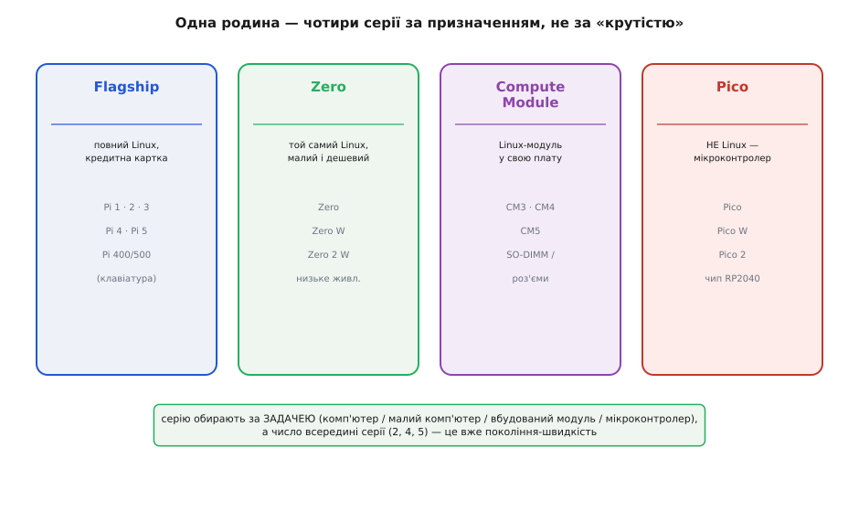

# Родина Raspberry Pi

<preknowlist>
- [Raspberry Pi 4 Model B](root:cat-hw-boards/rpi4) — конструктивні особливості та архітектуру класичного 4-ядерного одноплатника серії Flagship.
- [Raspberry Pi 5](root:cat-hw-boards/rpi5) — відмінності сучасного покоління флагманської серії з шиною PCIe.
</preknowlist>

## Маркування та номенклатура плат родини

Назва будь-якої плати екосистеми @@en|Raspberry Pi@@ (від англ. @@en|raspberry@@ — малина та @@en|pi@@ — скорочення від @@en|Python@@) будується за суворими правилами. Цифра одразу після назви бренду вказує на покоління процесорної архітектури (від першого до [сучасного Raspberry Pi 5](root:cat-hw-boards/rpi5)). 

Конструктивно моделі поділяються на два базові формати: @@en|Model A@@ (від англ. @@en|Model A@@ — модель A) та @@en|Model B@@ (від англ. @@en|Model B@@ — модель B). Моделі з літерою `B` є повнорозмірними платами з максимальним набором портів (4 порти @@en|USB@@, @@en|Ethernet@@) та великим обсягом оперативної пам'яті. Моделі з літерою `A` мають зменшений розмір, лише один порт `USB`, відсутній мережевий адаптер і менше споживання струму. Додаткові суфікси розшифровують апаратне оснащення: `W` (від англ. @@en|wireless@@ — бездротовий) означає наявність модулів @@en|Wi-Fi@@ та @@en|Bluetooth@@, а `H` (від англ. @@en|header@@ — гребінка) вказує на заздалегідь запаяні штирки @@en|GPIO@@.

## Чотири класи плат за призначенням

Для покриття різних інженерних завдань родина розділена на чотири чіткі класи за габаритами та призначенням.

*Класифікація плат Raspberry Pi за розміром, обчислювальною потужністю та сферою використання.*

Перший клас — флагманські одноплатні комп'ютери @@en|Flagship@@ (англ. @@en|flagship@@ — флагман), такі як [класичний Raspberry Pi 4 Model B](root:cat-hw-boards/rpi4) та новіші версії. Це повноцінні комп'ютери розміром із кредитну картку для роботи під управлінням операційної системи @@en|Linux@@. 

Другий клас — серія @@en|Zero@@ (англ. @@en|zero@@ — нуль), що надає той самий `Linux` у надкомпактному корпусі з мінімальним енергоспоживанням. Третій клас — обчислювальні модулі @@en|Compute Module@@ без периферійних роз'ємів, призначені для впаювання в спеціалізовані материнські плати в промисловості. 

Четвертий клас — серія @@en|Pico@@ (англ. @@en|pico@@ — піко). Вона являє собою не комп'ютер, а мікроконтролерну плату на власній мікросхемі `RP2040` чи `RP2350`. Вона не має операційної системи, миттєво запускає прошивку й виконує задачі жорсткого реального часу.

## Спільна апаратно-програмна база родини

Усі одноплатники родини пов'язані стандартизованим апаратно-програмним фундаментом. Фізичним стандартом вводу-виводу є 40-контактна гребінка @@en|GPIO@@ (англ. @@en|General-Purpose Input/Output@@ від @@en|general-purpose@@ — загального призначення) з логічним рівнем 3.3 В. Розводка ліній живлення та послідовних шин @@en|I²C@@, @@en|SPI@@ та @@en|UART@@ залишається незмінною від давніх моделей до сучасних, що дозволяє підключати [зовнішні плати розширення GPIO](root:cat-hw-boards/gpio-extension-board) без переробки схеми.

Програмною основою для комп'ютерних серій є офіційна операційна система @@en|Raspberry Pi OS@@ на базі @@en|Debian Linux@@. Вона містить оптимізовані драйвери, графічне середовище та зумовлює повну сумісність програмного коду при переході на новіші покоління плат.

## Критерії вибору плати під задачу

Вибір оптимального пристрою зводиться до трьох послідовних кроків:

1. **Оцінка потреби в операційній системі.** Якщо проєкт вимагає бази даних, обробки відео чи роботи мережевих служб, обирають `Linux`-одноплатник. Якщо потрібен миттєвий старт, низьке споживання та точні мікросекундні затримки — обирають мікроконтролер `Pico`.
2. **Габарити та живлення.** Для стаціонарних серверів або навчальних ПК беруть серію `Flagship`. Якщо виділено мало місця чи пристрій живиться від акумулятора, зупиняються на `Zero`.
3. **Обсяг пам'яті та призначення.** Для серійних приладів застосовують `Compute Module`. Якщо ж потрібен потужний настільний `x86`-комп'ютер з іншою архітектурою процесора, використовують [портативний міні-ПК Chuwi](root:cat-hw-boards/minipc-chuwi).
