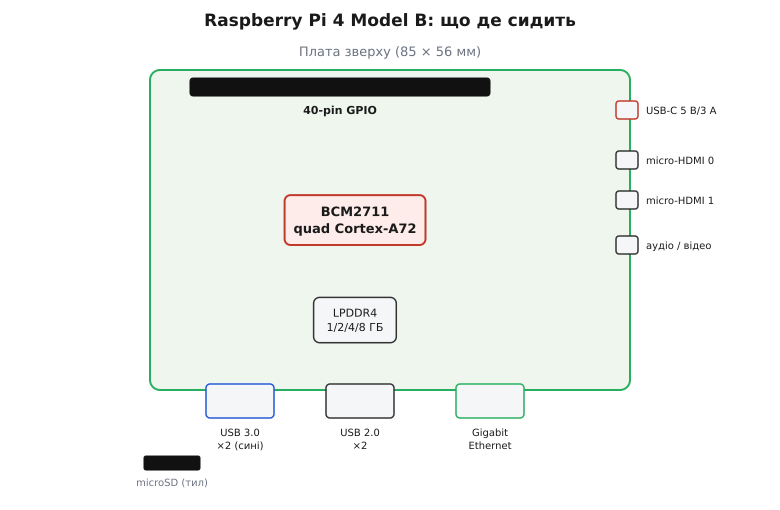
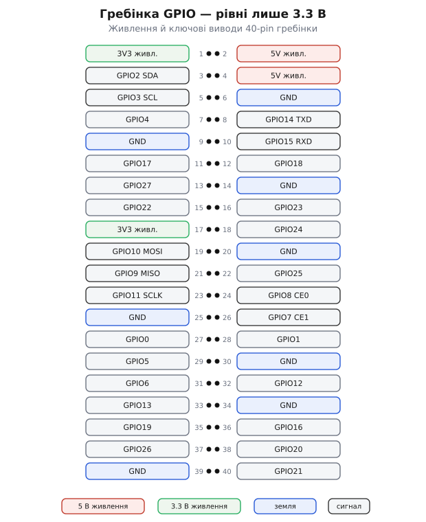

# Raspberry Pi 4 Model B

<preknowlist>
- [Родина Raspberry Pi](root:cat-hw-boards/raspberry-pi-family) — загальну позицію серії одноплатних комп'ютерів Raspberry Pi та призначення маркування Model B з мережевим гніздом Ethernet
</preknowlist>

## Одноплатний комп'ютер проти мікроконтролера

Коли складність проекту виходить за межі простого опитування давачів і вимагає паралельної обробки декількох задач, мережевих протоколів або графічного інтерфейсу, звичайного мікроконтролера перестає вистачати. На відміну від мікроконтролера з голою прошивкою, [одноплатний комп'ютер](root:cat-hw-boards/raspberry-pi-family) @@en|Raspberry Pi 4 Model B@@ являє собою повноцінну обчислювальну систему @@en|SBC@@ (англ. @@en|Single-Board Computer@@), що працює під управлінням повноцінної операційної системи @@en|Linux@@. Позначення @@en|Model B@@ вказує на класичний формфактор серії з повнорозмірним мережевим роз'ємом @@en|Ethernet@@ та розширеним набором периферійних портів для підключення моніторів та периферії.

Наявність повноцінної операційної системи з кешуванням запису на карту пам'яті @@en|MicroSD@@ вимагає суворого дотримання правил її вимикання. Раптове знеструмлення плати під час оновлення системних журналів руйнує таблицю файлової системи @@en|ext4@@, що призводить до пошкодження накопичувача й неможливості наступного завантаження. Для збереження даних систему завжди вимикають програмно командою `sudo poweroff` або через меню робочого столу.

## Архітектура системи на кристалі BCM2711

Серцем платформи є @@en|система на кристалі@@ @@en|SoC@@ (англ. @@en|System on Chip@@) @@en|Broadcom BCM2711@@, виготовлена за 28-нанометровим техпроцесом. Кристал об'єднує чотири 64-бітні ядра @@en|ARM Cortex-A72@@ із частотою 1.5 ГГц, графічний процесор @@en|VideoCore VI@@ із підтримкою @@en|OpenGL ES 3.1@@ та контролер оперативної пам'яті @@en|LPDDR4@@. Використання 64-бітної архітектури в поєднанні з 64-бітною версією @@en|Raspberry Pi OS@@ знімає обмеження 32-бітної адресації та дозволяє ефективно використовувати варіанти плати з 2, 4 або 8 ГБ оперативної пам'яті.

*Розташування ключових компонентів та периферійних вузлів на платі Raspberry Pi 4 Model B.*

Вибір обсягу пам'яті визначається цільовим навантаженням: версії на 2 ГБ достатньо для легких серверів і бездротових маршрутизаторів, 4 ГБ є стандартом для комфортної роботи в браузері та відтворення медіа, а конфігурація на 8 ГБ необхідна для компіляції великих проектів, віртуалізації та контейнеризації @@en|Docker@@. У задачах із високими обчислювальними вимогами альтернативою можуть виступати потужніші рішення [Raspberry Pi 5](root:cat-hw-boards/rpi5) або компактні [міні-ПК Chuwi](root:cat-hw-boards/minipc-chuwi) на базі x86.

## Периферійні порти та виводи GPIO

Периферійне оснащення плати включає повноцінний контролер @@en|Gigabit Ethernet@@ без спільних шин із USB, два високошвидкісні порти @@en|USB 3.0@@ та два порти @@en|USB 2.0@@. Два відеовиходи @@en|micro-HDMI@@ забезпечують виведення зображення на два монітори з роздільною здатністю @@en|4K@@ при частоті 60 кадрів на секунду на першому порту.

*Конструктивна схема та електричне призначення контактів гребінки GPIO.*

Для зв'язку з зовнішньою електронікою плата має 40-контактну гребінку @@en|GPIO@@ (англ. @@en|General-Purpose Input/Output@@). Усі сигнальні виводи працюють виключно з 3.3-вольтовим логічним рівнем і не мають захисту від перенапруги. Підключення 5-вольтових давачів чи мікроконтролерів напряму руйнує вхідні буфери кристала @@en|BCM2711@@, тому для узгодження сигналів обов'язково застосовують двонаправлені @@en|перетворювачі рівнів@@ (англ. @@en|level shifters@@) або дільники напруги. Зручне підключення периферії на макетній платі забезпечує спеціальна [GPIO Extension Board](root:cat-hw-boards/gpio-extension-board). Детальні схемотехнічні рішення та розрахунок дільників напруги висвітлює окрема [інструкція з узгодження логічних рівнів](root:hw-digital/mosfet-level-shifter).

## Живлення, терморегуляція та завантаження з EEPROM

Підсистема живлення вимагає стабільного джерела 5 В зі струмом не менше 3 А через роз'єм @@en|USB-C@@. У початковій ревізії плати v1.1 через спрощену схемотехніку виводів @@en|CC1@@ та @@en|CC2@@ розумні кабелі @@en|USB-C@@ з маркерами @@en|e-marked@@ розпізнавали комп'ютер як аудіоаксесуар і не подавали живлення, що було виправлено в ревізії v1.2 додаванням окремих підтягувальних резисторів.

Висока обчислювальна потужність ядер @@en|ARM Cortex-A72@@ спричиняє швидкий нагрів кристала. При досягненні температури 80 °C система активує апаратне пригальмовування @@en|thermal throttling@@, знижуючи частоту ядер до 1.0 ГГц для запобігання перегріву. Тривала робота під високим навантаженням вимагає використання радіаторів пасивного охолодження або активного вентилятора.

Запуск системи керується енергонезалежною пам'яттю @@en|EEPROM@@, де зберігається код первинного завантажувача. Це дозволяє відмовитися від повільних карт @@en|MicroSD@@ і налаштувати пряме завантаження операційної системи з високошвидкісних накопичувачів @@en|USB-SSD@@ через порти @@en|USB 3.0@@. Порядок переконфігурації завантажувача та зміни пріоритету оновлення описує [посібник із налаштування EEPROM](root:cat-hw-boards/raspi-config-eeprom-boot).
