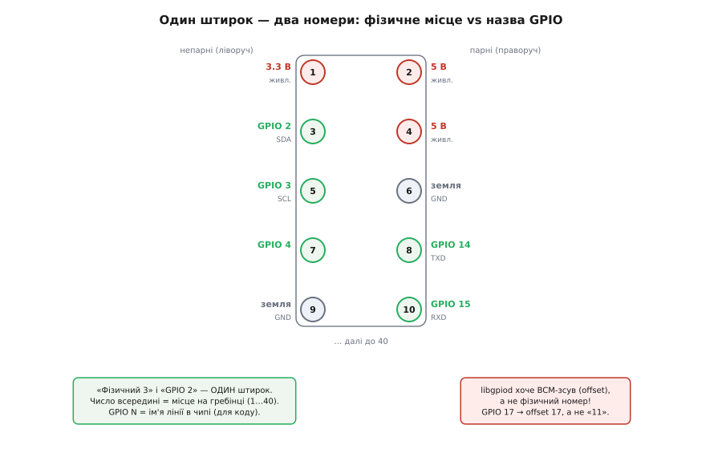

# ⚙️ Керуємо платою з коду: GPIO, кнопка, I²C і диск під Linux

Плата вже завантажила Linux, у терміналі блимає курсор — і тепер хочеться не просто дивитися на неї, а **смикнути залізо з програми**: щоб світлодіод блимнув, коли код так вирішив; щоб натиск кнопки долетів у ваш цикл; щоб давач температури віддав число по двох дротах. Тут ховається головна відмінність від мікроконтролера. На ESP32 ви пишете в регістр порту напряму, бо ви **і є** вся система. На Pi 5 між вашим кодом і ніжкою чипа стоїть ядро Linux зі своїми драйверами, правами й абстракціями. Це не завада — це зручність, якщо знати, за які ручки братися. Розберімо чотири типові задачі повністю, з робочим C, а потім зберемо в одну купу всі граблі, на яких новачок втрачає вечір.

Одразу застереження, від якого залежить, житиме ваша плата чи ні: **логіка виводів — 3.3 вольта**. Кожен GPIO очікує на вході від 0 до 3.3 В і сам видає стільки ж. Подати на вивід 5 вольтів (наприклад, з живлення чи з давача, що працює від 5 В) — це майже гарантовано **вбити ніжку, а то й чип**. Пінам Pi немає вбудованого захисту від перенапруги на рівні «встромив 5 В — і нічого». Тому все п'ятивольтове (багато дисплеїв, старі давачі) підключають через перетворювач рівнів або дільник, а не напряму. Тримайте це в голові з першої ж схеми.

## Чому старий код на Pi 5 мовчить

Перш ніж писати нове, треба зрозуміти, чому **не працює старе**. Якщо ви колись керували Raspberry Pi з коду, ви майже напевно бачили один із двох підходів: файли в `/sys/class/gpio/` (так званий **sysfs**) або бібліотеки з прямим доступом до регістрів через `/dev/mem` чи `/dev/gpiomem` — `RPi.GPIO`, `wiringPi`, `pigpio`. На Pi 5 обидва шляхи розсипаються, і причина в архітектурі.

На старіших моделях (аж до Pi 4) виводами GPIO керував блок усередині головного чипа Broadcom, і його регістри лежали за фіксованою фізичною адресою. Бібліотека відкривала `/dev/gpiomem`, відображала цей шматок пам'яті собі в адресний простір і писала прямо в регістр «стан виводів». Швидко, грубо, працювало роками.

На Pi 5 усе інакше. Виводи GPIO тепер сидять **за окремим чипом RP1** — це «південний міст», який плата тримає на власній шині PCIe. Старий блок за старою адресою просто зник; коли `RPi.GPIO` намагається відобразити `/dev/gpiomem` і знайти там знайомі регістри, вона або падає, або мовчки нічого не робить, бо адреси більше не ті. Ось чому в мережі повно розгублених питань «мій скрипт нічого не блимає на Pi 5, хоча на Pi 4 працював»: код звертається туди, де заліза вже немає.

> 🔧 **Навіщо це.** Правило просте: якщо приклад із інтернету починається з `import RPi.GPIO as GPIO` або відкриває `/dev/mem` — він **написаний під стару плату** і на Pi 5 у кращому разі нічого не зробить, у гіршому вас заплутає. Не борсайтеся, лагодячи його, — беріть сучасний шлях від початку. Швидка перевірка «на кого розрахований код»: шукайте в ньому слова `gpiomem`, `mmap`, `RPi.GPIO`, `wiringPi` — це маркери мертвого на Pi 5 підходу.

Сучасний шлях — **бібліотека `libgpiod`** поверх символьного пристрою (*character device*) `/dev/gpiochipN`. Тут ви не лізете в регістри руками. Ви кажете ядру: «дай мені лінію номер N цього чипа як вихід, початкове значення нуль» — і ядро само розмовляє з RP1 через його драйвер. Ваш код не знає й не хоче знати, за якою адресою фізично сидить RP1; він працює через стабільний інтерфейс ядра, який буде однаковим і на наступній платі. Це той самий механізм, яким користується весь сучасний Linux, від промислових контролерів до серверів, а не самопал під один чип.

## Задача 1: блимнути світлодіодом

**Умова.** До виводу GPIO 17 через резистор на 330 Ом під'єднано світлодіод (аноду — до ніжки, катод — через резистор на землю). Треба, щоб він блимав раз на секунду. Це «Hello, world» заліза: якщо блимає — увесь ланцюг від коду до ніжки живий.

**Ідея.** Через `libgpiod` попросити в ядра лінію 17 як вихід, а далі в циклі перемикати її: одиниця → світлодіод горить, нуль → гасне, між ними пауза. Уся робота з RP1 схована в бібліотеці; ми оперуємо поняттями «лінія» й «значення».

Одразу про число **17**. Це **не** фізичний номер штирка на гребінці — це номер лінії GPIO в нумерації BCM (так історично звуть схему нумерації від Broadcom). Фізично GPIO 17 виходить на 11-й штирок гребінки, але `libgpiod` цей фізичний номер не цікавить: вона працює **зсувами (offset) ліній усередині чипа**, а зсув лінії GPIO 17 дорівнює 17. Ця розбіжність — джерело половини помилок новачка, тож повернімося до неї окремо нижче.

Ще один момент, який треба вирішити до коду: **який саме `/dev/gpiochipN`**. RP1 виставляє кілька чипів, і історично на ранніх системах Pi 5 гребінка сорока виводів висіла на `/dev/gpiochip4`. У ядрах приблизно з середини 2024 року Raspberry Pi навела лад: тепер **`gpiochip0` завжди відповідає користувацьким виводам гребінки** — так само, як на старих платах, щоб приклади не ламалися. Тому в свіжій системі беріть `/dev/gpiochip0`. Якщо ж ваша плата на старішому ядрі й `gpiochip0` виявився не тим, перевірте гребінку командою `gpiodetect` (покаже всі чипи з їхніми іменами) та `gpioinfo` (розпише лінії) і підставте правильний чип. Далі в коді я триматимусь `/dev/gpiochip0`.

**Робочий код (C, `libgpiod` v2).** Спершу поставте бібліотеку й заголовки: `sudo apt install libgpiod-dev gpiod`. Пакет `gpiod` дає ще й командні утиліти (`gpioset`, `gpioget`, `gpioinfo`) — ними зручно перевіряти залізо руками до того, як писати програму.

:::tabs
:::code api-gpio/c/blink.c
:::code api-gpio/py/blink.py
:::

Код здається довгим для «блимнути світлодіодом», і це не випадково. Версія 2 `libgpiod` розбиває запит на **три окремі об'єкти-конфіги**: `line_settings` (як поводиться лінія — напрямок, підтяжка, початкове значення), `line_config` (які саме зсуви ліній беремо й з якими налаштуваннями) і `request_config` (метадані запиту — підпис споживача). Ці три збираються в один виклик `gpiod_chip_request_lines()`, що й повертає **дескриптор запиту** — далі всі значення читаються-пишуться через нього. Розбиття виглядає надлишковим для однієї лінії, але воно окупається, коли ліній багато й у кожної свій режим: ви складаєте конфіг як конструктор, а не сиплете десяток аргументів в одну функцію.

Зверніть увагу на слова **ACTIVE / INACTIVE** замість «1» і «0». `libgpiod` мислить не напругою, а **логічним станом лінії**: активна вона чи ні. За замовчуванням активний стан — це високий рівень (3.3 В), тож ACTIVE = світлодіод горить. Але лінію можна оголосити «активна-низька» (`active-low`), і тоді ACTIVE відповідатиме **нулю** на ніжці — зручно, коли залізо ввімкнене низьким рівнем (наприклад, світлодіод, посаджений катодом на ніжку). Ви пишете логіку в поняттях «увімкнути/вимкнути», а бібліотека сама переводить це в напругу за оголошеною полярністю.

## Задача 2: прочитати кнопку з підтяжкою

**Умова.** До GPIO 27 і землі під'єднано тактову кнопку (два дроти, більше нічого). Треба в коді дізнаватися, натиснута вона чи ні.

**Ідея й головна пастка.** Наївний план — «читаю рівень на GPIO 27» — має діру. Поки кнопка не натиснута, ніжка **ні до чого не під'єднана** (кнопка розімкнена). Вхід у такому стані «висить у повітрі» (*floating*): його рівень не визначений, він ловить наводки й показує то нуль, то одиницю хаотично. Читати такий вхід — марно.

Рятує **підтяжка (pull resistor)** — резистор, що м'яко тягне вхід до відомого рівня, коли зовні нічого не задано. Найзручніше ввімкнути **підтяжку до плюса** (*pull-up*): внутрішній резистор тягне вхід до 3.3 В, тож у спокої ми стабільно читаємо **одиницю**. Другий кінець кнопки — на землі. Натиснули → коло замкнулося на землю → вхід просів у **нуль**. Виходить перевернута логіка: **розімкнено = 1, натиснуто = 0**. Її так і звуть — «активна-низька» кнопка, і це найпоширеніша схема, бо потребує лише кнопки та двох дротів: підтяжку дає сам чип, зовнішній резистор не потрібен.

RP1 має вбудовані підтяжки на кожному вводі, і `libgpiod` вміє їх вмикати одним викликом — не треба паяти резистор.

**Робочий код (C).**

:::tabs
:::code api-gpio/c/button.c
:::code api-gpio/py/button.py
:::

Дві деталі варті слів. По-перше, `GPIOD_LINE_BIAS_PULL_UP` — це і є прохання «увімкни внутрішню підтяжку до плюса». Є ще `PULL_DOWN` (тягне до землі, тоді натиск дає одиницю), `DISABLE` (жодної підтяжки — коли її дає зовнішнє коло) і `AS_IS` (не чіпати те, що є). Обрати треба свідомо під свою схему, бо саме підтяжка задає, що ви прочитаєте в спокої.

По-друге, `usleep(20000)` тут не лише щоб не крутити цикл даремно. Механічний контакт кнопки при натиску **не замикається чисто** — контактні пластини кілька мілісекунд дрижать, і лінія за ці міліметри часу стрибає нуль-одиниця-нуль по багато разів. Це **дребезг контактів** (*bounce*). Опитуючи вхід раз на 20 мс, ми природно перестрибуємо цю бовтанку: до наступного читання контакт уже влігся. Це найпростіший спосіб «придушити дребезг» (*debounce*) — грубий, але для кнопки в циклі опитування його вистачає. Тонший шлях — не опитувати, а попросити ядро надсилати **події зміни рівня** (edge events) і фільтрувати їх за часом; `libgpiod` це вміє, але для першого разу опитування наочніше.

## Задача 3: поговорити з давачем по I²C

**Умова.** До плати по шині I²C під'єднано давач (нехай це буде поширений барометр-термометр BMP280 за адресою 0x76). Треба прочитати його регістр `id` за адресою 0xD0 — давач має віддати сталий байт-підпис 0x58. Це найкоротший спосіб переконатися, що зв'язок є: якщо прочитали правильний підпис — шина, адреса й дроти в порядку.

**Ідея.** I²C — це дві лінії (дані SDA і такт SCL), на яких висить кілька пристроїв, кожен зі своєю адресою. На гребінці Pi 5 під I²C відведено **фізичні штирки 3 (SDA, це GPIO 2) і 5 (SCL, це GPIO 3)**; ця шина в системі зветься `i2c-1`. Тут ми **не** чіпаємо `libgpiod`: шиною порядкує окремий драйвер ядра, а нам він виставляє файл-пристрій `/dev/i2c-1`. Розмова з давачем — це відкрити цей файл, сказати «моя ціль — пристрій за адресою 0x76», а далі писати й читати байти звичайними `write()`/`read()`, як з файлом.

Щоб шина взагалі з'явилася, її треба ввімкнути: у `raspi-config` розділ *Interface Options → I2C → Enable*, або руками рядком `dtparam=i2c_arm=on` у файлі `/boot/firmware/config.txt` і перезавантаження. Після цього перевірте залізо командою `i2cdetect -y 1` — вона просканує шину й покаже адреси пристроїв; ваш давач має світитися як `76`. Тільки коли він там видно, є сенс писати код.

**Читання регістра — це «напиши-потім-прочитай».** Щоб дістати регістр 0xD0, треба спершу **записати** давачу один байт — номер регістра, який хочемо (0xD0), — а тоді **прочитати** з нього один байт відповіді. Класична двотактна розмова майже з усіма I²C-давачами.

**Робочий код (C, через ioctl ядра).**

:::tabs
:::code api-gpio/c/i2c_id.c
:::code api-gpio/py/i2c_id.py
:::

Тут працює той самий принцип «усе — файл», яким Linux пишається. Пристрій на шині I²C виглядає як файл `/dev/i2c-1`; єдине спеціальне — `ioctl(fd, I2C_SLAVE, ADDR)`, яким ми один раз кажемо драйверу, до **кого** з пристроїв на шині адресуємо наступні `write`/`read`. Далі `write(fd, &reg, 1)` шле давачу один байт (номер регістра), а `read(fd, &id, 1)` забирає один байт відповіді. Ніякого возні з тактами й старт-стоп-умовами шини — це все бере на себе драйвер контролера I²C у ядрі; наша справа — байти змісту.

> 🔧 **Навіщо це.** Схема «напиши регістр → прочитай значення» — не примха BMP280, а **загальний діалект** майже всіх I²C-давачів: акселерометрів, годинників реального часу, розширювачів портів, драйверів дисплеїв. Опанувавши цей код на одному давачі, ви читаєте будь-який інший — міняється лише адреса пристрою, номери регістрів і скільки байтів забирати (два для 16-бітного значення тиску, шість для трьох осей акселерометра тощо). Тому варто один раз розібрати його до кінця.

## Задача 4: дістатися NVMe-диска як звичайного файлу

**Умова.** У роз'єм PCIe через плату-перехідник встромлено NVMe-диск. Хочеться прочитати з нього дані з програми — наприклад, глянути, що записано в самому початку диска.

**Ідея, від якої відпадає складність.** Тут немає ані `libgpiod`, ані `ioctl`-магії, і це найважливіше усвідомлення розділу: **NVMe-диск на Pi 5 — це звичайний блочний пристрій Linux**, такий самий, як SSD у ноутбуці. PCIe-контролер BCM2712, драйвер NVMe в ядрі й уся підсистема блочних пристроїв уже зробили роботу; система бачить диск як файл `/dev/nvme0n1` (сам диск) і `/dev/nvme0n1p1`, `…p2` (розділи на ньому). Працювати з ним із коду — це працювати зі **звичайним файлом**: `open`, `read`, `lseek`, `close`. Жодного окремого «API для NVMe» вам не потрібно.

Перевірити, що диск видно, можна командами `lsblk` (покаже дерево дисків і розділів) або `ls /dev/nvme*`. Якщо в списку є `nvme0n1` — драйвер підхопив диск, PCIe-лінія працює.

**Робочий код (C).** Прочитаємо перші 16 байтів **сирого** диска (де в розмічених дисків лежить завантажувальний сектор) і роздрукуємо їх шістнадцятково.

:::tabs
:::code api-gpio/c/nvme_peek.c
:::code api-gpio/py/nvme_peek.py
:::

Уся суть — у тому, чого в коді **немає**. Немає слова «NVMe», немає роботи з PCIe, немає драйвера — бо ядро вже перетворило швидкий диск на PCIe у простий потік байтів за іменем `/dev/nvme0n1`. Це той самий код, яким ви прочитали б файл на диску чи навіть звичайний текстовий файл; змінилося тільки ім'я. У цьому й сила Linux на такій платі: щойно щось стало блочним пристроєм, ви працюєте з ним звичними інструментами, не знаючи, чи це NVMe, чи USB-флешка, чи microSD.

Одне серйозне «але»: писати в сирий диск (`/dev/nvme0n1`) наосліп — **шлях до втрати даних**. Кілька байтів не в те місце — і розмітка чи файлова система зіпсовані. На практиці диск майже завжди читають-пишуть **через файлову систему** (примонтований розділ, звичайні файли в ньому), а до сирого пристрою лізуть лише свідомо: клонувати образ, читати службові сектори, писати завантажувач. Тому приклад і відкрито строго `O_RDONLY`.

## Складність і пастки: де саме втрачають вечір

Код вище короткий, і в цьому підступ: три чверті болю з керуванням Pi 5 з коду — не в самих викликах, а навколо них. Зберімо граблі в одному місці.

**Дві нумерації того самого штирка.** Найпідступніше. На гребінці **фізичний номер** штирка (1…40, просто його місце в ряду) і **номер лінії GPIO** (нумерація BCM, ім'я лінії в чипі) — це **різні числа для того самого контакту**. Скажімо, GPIO 17 фізично сидить на штирку 11. `libgpiod` оперує **зсувами ліній** — тобто BCM-номерами: щоб узяти GPIO 17, ви передаєте `offset = 17`, а не `11`. Плутанина працює в обидва боки: людина бачить у схемі «пін 11», підставляє `11` у код і мовчки смикає зовсім іншу лінію (GPIO 11), а свій світлодіод так і не блимає. Звіряйтеся з розкладкою й тримайте в голові: **число в коді — це GPIO-ім'я (BCM), число на фото гребінки часто фізичне.**

*Число всередині кружка — фізичне місце штирка на гребінці (1…40). Підпис поруч — ім'я лінії GPIO (BCM) та її функція. Один і той самий контакт має обидва: «фізичний 3» і «GPIO 2» — це один штирок. У код для `libgpiod` іде саме BCM-номер (зсув), а не фізичний.*

**Права доступу — і чому root не завжди потрібен.** Символьні пристрої `/dev/gpiochipN` за замовчуванням належать групі `gpio`. Якщо ваш користувач у цій групі (у Raspberry Pi OS типовий користувач уже там; перевірка — команда `groups`, додавання — `sudo usermod -aG gpio $USER` і перезайти в систему), програма смикає GPIO **без `sudo`**. Це не випадковість, а свідомий устрій: правила `udev` призначають цим пристроям групу `gpio` й доступ для її членів, тож демону чи вашій програмі не треба ходити під root, щоб блимнути світлодіодом. Менше прав — менше шкоди від помилки. Те саме з I²C: файли `/dev/i2c-*` віддані групі `i2c`, і членство в ній відкриває шину без root. А от **сирий блочний пристрій** `/dev/nvme0n1` — інша річ: пряме читання диска в обхід файлової системи потребує саме root, тому приклад із диском ми й запускали під `sudo`. Тобто «чи потрібен root» залежить від пристрою: GPIO та I²C — ні, якщо ви в потрібній групі; сирий диск — так.

**3.3 вольта — і 5 В як смертний вирок.** Повторю, бо на цьому гублять не вечір, а плату. Виводи Pi працюють на **3.3 В**. Подати 5 В прямо на вивід — це майже напевно спалити ніжку або чип; вбудованого захисту, що «прощає» таке, немає. П'ятивольтові давачі й дисплеї, поширені зі світу Arduino, вимагають **перетворювача рівнів** (або хоча б дільника на вхід) між собою й гребінкою — не можна просто з'єднати їх дротом. І особливо стережіться живлення 5 В на самій гребінці (штирки 2 і 4): вони поруч із логічними, і випадковий дотик 5-вольтового дроту до сусіднього GPIO — типовий спосіб убити вивід.

**RP1 і мертвий прямий доступ до заліза.** Ще раз, бо це специфіка саме п'ятої моделі: раз GPIO тепер за чипом RP1, **будь-яка бібліотека, що лізе в регістри через `/dev/mem` чи `/dev/gpiomem` за старими адресами, на Pi 5 не працює**. `RPi.GPIO` під п'яту модель не оновлена, класичний `wiringPi` теж жив за прямими адресами. Не витрачайте час на «а може, запрацює» — на Pi 5 канонічний шлях один: `libgpiod` поверх `/dev/gpiochipN`. Це не тимчасова незручність, а нова, правильніша архітектура; сучасні збірки `pigpio` й обгортки на кшталт `gpiozero` під Pi 5 працюють саме тому, що всередині ходять через ту саму символьну підсистему, а не в регістри.

**Хто вже зайняв лінію.** Лінію GPIO в один момент часу тримає **один** споживач. Якщо ви налаштували вивід під якусь функцію в device tree (скажімо, віддали його під PWM чи під I²C) або його вже зайняла інша програма, ваш запит лінії поверне помилку «пристрій зайнятий». Команда `gpioinfo` показує по кожній лінії, вільна вона чи ким узята (там видно підпис-споживач, той самий, що ви ставите через `set_consumer`). Тому й корисно давати запиту осмислений підпис: у чужому виводі `gpioinfo` одразу видно, що лінію тримає саме ваш `blink`, а не якийсь безіменний процес.

**Python, якщо не хочеться C.** Усе вище має пряме дзеркало в Python — той самий `libgpiod` з офіційною прив'язкою (пакет `gpiod`), або зручніша надбудова `gpiozero`, де світлодіод — це буквально об'єкт `LED(17)` з методами `.on()`/`.off()`. Під капотом `gpiozero` на Pi 5 ходить через ту саму символьну підсистему ядра, тож усі пастки з нумерацією, правами й 3.3 В лишаються ті самі — міняється лише синтаксис. C тут показаний тому, що він оголює механізм: видно кожен крок, який Python-обгортка ховає. Розібравши, що робить кожен виклик `libgpiod`, ви вже не заблукаєте в жодній обгортці над ним.

Підсумок короткий. Керувати Pi 5 з коду — це не «писати в порт», як на мікроконтролері, а **просити в ядра ресурс** через його стабільні інтерфейси: лінію GPIO через `libgpiod`, шину через `/dev/i2c-*`, диск через блочний пристрій. Ціна за це — трохи більше церемоній у коді; віддача — той самий код працює на будь-якому Linux і не розсипається від зміни заліза під ним. А три речі, які треба закарбувати з першого дня: **BCM-номер, а не фізичний**; **3.3 В, і ніколи 5 В на вивід**; **на Pi 5 GPIO живе за RP1, тож старий прямий доступ мертвий.**
