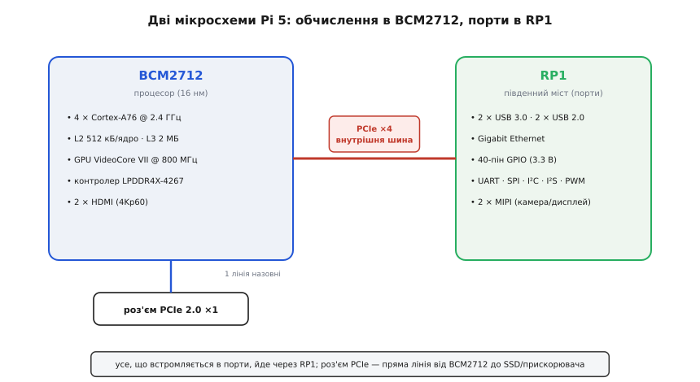
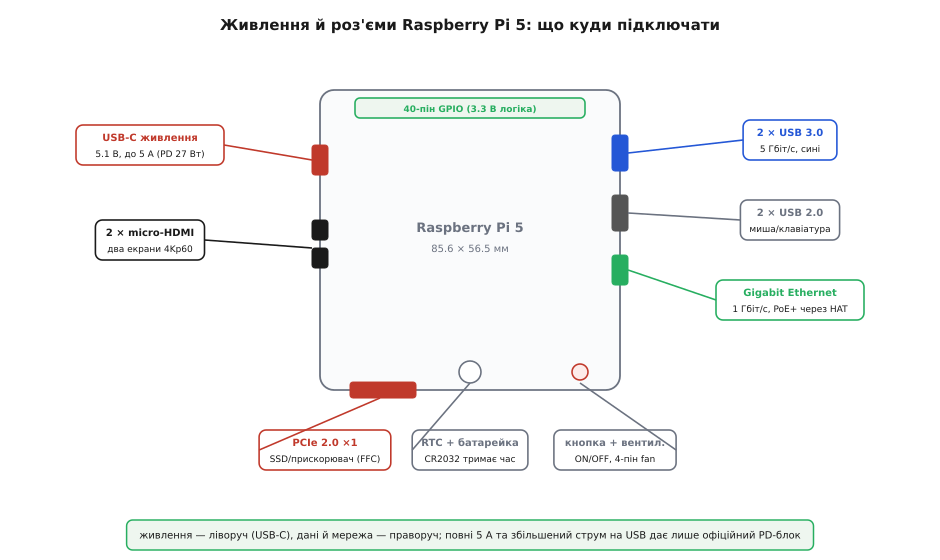

# Raspberry Pi 5

<preknowlist>
- [Родина Raspberry Pi](root:cat-hw-boards/raspberry-pi-family) — Концепція одноплатних комп'ютерів, призначення серії Raspberry Pi та відмінності між мікроконтролерами й повноцінними SBC під управлінням Linux.
</preknowlist>

## Ніша Raspberry Pi 5 у роботі

Мікроконтролери ідеально вимірюють сигнали датчиків та керують виконавчими механізмами в реальному часі, але швидко вичерпують пам'ять при спробі запустити вебсервер, обробити відеопотік чи зберегти великі масиви даних. Класичні [настільні комп'ютери Chuwi](root:cat-hw-boards/minipc-chuwi) забезпечують необхідну обчислювальну потужність, однак споживають забагато енергії й завеликі для автономних пристроїв.

Одноплатний комп'ютер @@en|Raspberry Pi 5@@ розширює концепцію [родини Raspberry Pi](root:cat-hw-boards/raspberry-pi-family). Він поєднує повноцінну операційну систему @@en|Linux@@ із багатьма паралельними процесами та апаратні піни @@en|GPIO@@ (з @@en|General-Purpose Input/Output@@ — роз'єми вводу-виводу загального призначення). Якщо проєкту потрібні мережевий стек, базова аналітика даних та робота з файловими системами, але збережено вимоги до компактності й низького споживання енергії, обирають одноплатник замість мікроконтролера чи башти ПК. Для зручного виведення контактів застосовують [модуль розширення GPIO](root:cat-hw-boards/gpio-extension-board).

Наприклад, під час побудови системи комп'ютерного зору чи локального відеосервера мікроконтролер не зможе опрацювати кілька відеопотоків паралельно через брак пам'яті. Одноплатник задіятиме бібліотеки аналітики в середовищі @@en|Linux@@, одночасно транслюючи дані через мережу та зберігаючи записи у файловій системі без просідання швидкодії.

## Двочипова архітектура та шина PCIe

У порівнянні з [попередником Raspberry Pi 4](root:cat-hw-boards/rpi4), де центральний процесор сам обробляв і обчислення, і всі периферійні порти, у @@en|Raspberry Pi 5@@ розробники розділили ці задачі між двома окремими чипами.

Головний кристал @@en|Broadcom BCM2712@@ відповідає виключно за обчислення та графіку. Усі периферійні інтерфейси — порти @@en|USB@@ (з @@en|Universal Serial Bus@@ — універсальна послідовна шина), @@en|Ethernet@@ та піни @@en|GPIO@@ — винесено на спеціалізований південний міст @@en|RP1@@. Чипи з'єднані між собою внутрішньою високошвидкісною шиною @@en|PCIe@@ (з @@en|PCI Express@@, від @@en|Peripheral Component Interconnect Express@@ — периферійне швидкісне сполучення) з чотирма лініями.

*Двочипова архітектура розвантажує головний процесор від обробки вводу-виводу.*

Окрему зовнішню лінію @@en|PCIe@@ виведено на роз'єм для підключення високошвидкісних накопичувачів @@en|NVMe@@ (з @@en|Non-Volatile Memory Express@@ — протокол для енергонезалежної пам'яті). Пряме підключення накопичувачів @@en|SSD@@ (з @@en|Solid-State Drive@@ — твердотільний накопичувач) замість повільної картки @@en|microSD@@ у рази прискорює завантаження операційної системи та роботу з базами даних.

## Особливості живлення та охолодження плати

Висока обчислювальна потужність збільшила вимоги до живлення плати. Для стабільної роботи потрібне джерело живлення стандарту @@en|USB PD@@ (з @@en|USB Power Delivery@@ — передача живлення через @@en|USB@@) із параметрами 5.1 В та 5 А.

При підключенні слабшого джерела живлення на 3 А плата автоматично обмежує сумарний струм периферійних портів @@en|USB@@ з 1.6 А до 600 мА, щоб запобігти просіданню напруги й перезавантаженню.

*Компонування плати містить спеціальний роз'єм живлення та кріплення активного охолодження.*

Під час інтенсивних обчислень процесор швидко нагрівається. При досягненні критичної температури вмикається тротлінг (з @@en|thermal throttling@@, від @@en|throttle@@ — примусово знижувати частоту) — примусове скидання частоти ядра для захисту від перегріву. Щоб запобігти падінню швидкодії при тривалому навантаженні, платі необхідний радіатор із вентилятором для активного охолодження.
