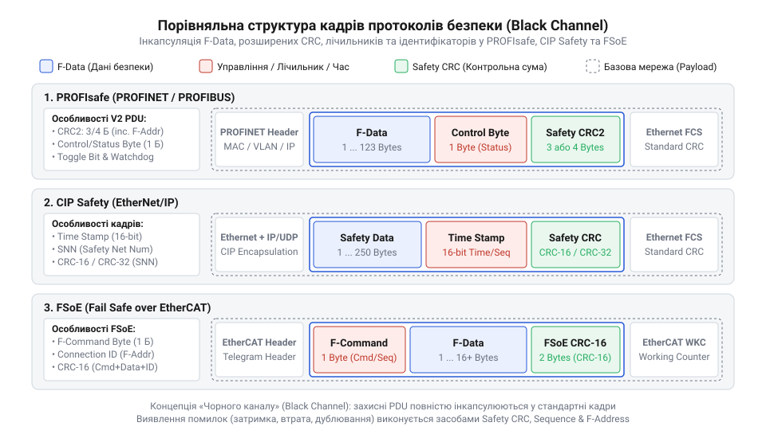

# Довідник протоколів безпекового зв'язку PROFIsafe, CIP Safety та FSoE

<preknowlist>
- [Вхідні модулі дискретних входів безпеки (F-DI)](root:cat-hw-boards/fail-safe-digital-input-modules) — Принципи формування подвоєних безпекових сигналів та гальванічної розв'язки
</preknowlist>

## Концепція чорного каналу та загрози мережі

У сучасних автоматизованих комплексах передача сигналів аварійної зупинки, огороджень та світлових завіс здійснюється через промислові мережі зв'язку. На відміну від прямих виділених ліній, стандартизовані мережеві канали піддаються зовнішнім електромагнітним завадам, викривленням сигналів, затримкам у маршрутизаторах та втратам пакетів. Спроба покластися на надійність базового транспорту (англ. @@en|transport layer@@; @@en|транспортний рівень@@) у завданнях функціональної безпеки створила б загрозу невиявленої відмови, коли критичне повідомлення про зупинку обладнання втрачається або спотворюється в мережі.

Для розв'язання цієї проблеми в архітектурі безпекових систем застосовують концепцію чорного каналу (англ. @@en|Black Channel@@, від німецького та англійського принципів неконтрольованого транспорту; @@en|чорний канал@@). За цієї моделі проміжна мережева інфраструктура — включаючи повторювачі, комутатори, бездротові мости та стандартні протокольні стеки — вважається повністю ненадійною та потенційно небезпечною. Вся відповідальність за перевірку цілісності, автентичності та своєчасності доставки даних покладається виключно на верхній прикладний рівень протоколу безпеки, що виконується в контролерах та [модулях входів безпеки](root:cat-hw-boards/fail-safe-digital-input-modules).

Модель чорного каналу робить неминучим активний захист від восьми стандартних загроз промислових мереж: спотворення даних (англ. @@en|corruption@@), повної втрати пакетів (англ. @@en|loss@@), незапланованого дублювання (англ. @@en|duplication@@), порушення послідовності надходження (англ. @@en|reordering@@), недопустимої затримки передачі (англ. @@en|delay@@), помилкової адресації та підміни вузла (англ. @@en|masquerading@@), зациклення та комбінованих збоїв пам'яті. Для кількісного обґрунтування надійності захисту стандарти IEC 61508 та IEC 61784-3 вимагають обчислення залишкової ймовірності невиявленої помилки (англ. @@en|residual error probability@@, від *residual* — залишковий, та *error* — помилка). Математична оцінка розраховує частоту небезпечних відмов на годину `PFH < 10⁻⁸ 1/h` на основі інтенсивності бітових помилок мережі (англ. @@en|bit error rate@@, @@en|BER@@) та гемингівської відстані (англ. @@en|Hamming distance@@, від імені американського математика Річарда Геммінга) полінома `CRC`. Якщо хоч один із цих збоїв виникає на проміжному транспортному рівні, прикладний протокол безпеки негайно виявляє аномалію та переводить керовану систему в безпечний стан.

Щоб досягти відповідно високого рівня повноти безпеки @@en|SIL3@@ (англ. @@en|Safety Integrity Level@@; @@en|рівень повноти безпеки SIL@@) за стандартом IEC 61508, прикладні протоколи безпечного обміну загортають корисні дані у спеціальний контейнер безпеки (англ. @@en|Safety PDU@@, від @@en|Protocol Data Unit@@; @@en|блок даних протоколу Safety PDU@@). Цей контейнер доповнює кожен пакет комбінацією лічильників послідовності, унікальних мережевих ідентифікаторів `F-Address` та сторожових таймерів. У результаті будь-яке спотворення чи затримка кадру в несертифікованому обладнанні чорного каналу розпізнається приймачем ще до закінчення допустимого часу реакції функції безпеки, виключаючи можливість прийняття помилкових або застарілих команд керування.

## Структура кадрів та механізми захисту

Для протидії загрозам мережі прикладний кадр безпеки (англ. @@en|Safety PDU@@, від @@en|Protocol Data Unit@@; @@en|кадр безпеки@@) формує спеціальне закрите телеграму-контейнер, яка інкапсулюється в стандартний кадр промислової шини. Анатомія такого каду містить чотири обов'язкові компоненти: корисне навантаження безпекових процесів (англ. @@en|Safety Payload@@), службові байти керування та статусу (англ. @@en|Control/Status Byte@@), унікальний лічильник послідовності (англ. @@en|Sequence Counter@@) та розширене поле контрольної суми (англ. @@en|Safety CRC@@).

*Анатомія кадру безпекового зв'язку в концепції чорного каналу.*

Захист від затримок та втрат реалізується через часовий таймер очікування (англ. @@en|Watchdog Timer@@; @@en|сторожовий таймер@@), який конфігурується параметром `F_WD_Time`. Якщо приймач не отримує новий валідний кадр протягом заданого часового вікна, зв'язок вважається втраченим. Помилкова адресація упереджується жорстким зв'язуванням унікальної адреси вузла (англ. @@en|F-Address@@) з розрахунком полінома `CRC`, завдяки чому кадр, випадково доставлений на сусідній пристрій, відхиляється на етапі перевірки контрольної суми.

Лічильник послідовності змінює своє значення з кожним відправленим пакетом, що унеможливлює повторне сприйняття застряглих дублікатів або застарілих даних. Комбінація суворого полінома `CRC-24` або `CRC-32` із перевіркою `F-Address` та лічильника гарантує досягнення необхідного показника повноти безпеки SIL3 (англ. @@en|Safety Integrity Level 3@@; @@en|рівень повноти безпеки 3@@) незалежно від якості фізичного кабелю.

Механізм зв'язування адреси з контрольною сумою полягає у використанні унікального ідентифікатора `F-Address` як початкового значення регістра — сталого насіння (англ. @@en|initialization seed@@, від *initialization* — ініціалізація, та *seed* — зерно, початковий параметр). Перед обробкою байтів кадру генераторний поліном `CRC-24` або `CRC-32` попередньо завантажує у свій зсувний регістр значення конкатенації джерела та призначення `F-Address`. Якщо через збій маршрутизації чи перемикання каналів кадр потрапляє на чужий пристрій, обчислена приймачем контрольна сума не збігається з переданою у пакеті, адже приймальний вузол ініціалізує розрахунок власним ідентифікатором. Завдяки цьому протокольний рівень миттєво відхиляє чужий пакет ще до розбору корисного навантаження, що повністю ліквідує загрозу маскування (англ. @@en|masquerading@@, від *masquerade* — маскарад, приховування під чужим ім'ям) та накладання повідомлень між різними контурами безпеки у спільній промисловій мережі.

## Порівняння PROFIsafe, CIP Safety та FSoE

У промисловості найбільшого поширення набули три протоколи безпеки, побудовані на концепції чорного каналу: @@en|PROFIsafe@@ для мереж PROFINET/PROFIBUS, @@en|CIP Safety@@ для EtherNet/IP та @@en|FSoE@@ (англ. @@en|Fail Safe over EtherCAT@@) для систем на базі EtherCAT. Хоча всі вони реалізують захист від однакових мережевих загроз, їхня внутрішня структура кадру та механізми синхронізації суттєво відрізняються.

Протокол PROFIsafe додає до стандартних даних процесів трейлер безпеки розміром від 4 до 6 байтів, що містить байт керування `F-Control` або статусу `F-Status`, 3-байтний лічильник послідовності `Toggle/Sequence` та 32-бітну контрольну суму `F_CRC`. Входить у специфікації профилів PROFINET і не вимагає синхронізації годинників між вузлами.

Протокол CIP Safety використовує механізм часової координації (англ. @@en|Time Coordination@@), де передавач і приймач порівнюють часові позначки й часові інтервали без потреби в синхронізованому загальному годиннику. В основі цього механізму лежить вимірювання часової різниці (англ. @@en|Time Difference@@, від *time* — час, та *difference* — різниця; @@en|часова різниця Time Difference@@): під час обміну повідомленнями приймач фіксує локальний час надходження пакета `t_receive` і віднімає від нього час відправлення `t_send`, обчислюючи фактичну затримку доставлення `Δt = t_receive - t_send`. Якщо обчислена значенням `Time Difference` затримка перевищує допустимий ліміт очікування через затори, втрату пакетів або перепередачу в середовищі @@en|Black Channel@@, зв'язок негайно вважається компрометованим і вузол переходить у безпечний стан. Кадр містить подвійне поле контрольної суми для довгих повідомлень, що дозволяє передавати корисне навантаження до 250 байтів із високим рівнем завадостійкості.

Протокол FSoE оптимізовано під високошвидкісну циклічную обробку кадру «на льоту» в середовищі EtherCAT. Структура FSoE містить 1 байт команди, від 1 до 128 байтів даних, 2 байти ідентифікатора з'єднання та 16-бітну або 32-бітну `CRC`.

| Параметр протоколу | PROFIsafe | CIP Safety | FSoE (Fail Safe over EtherCAT) |
| :--- | :--- | :--- | :--- |
| **Базова мережа** | PROFINET / PROFIBUS | EtherNet/IP / DeviceNet | EtherCAT |
| **Максимальне навантаження** | До 123 байтів (V2) | До 250 байтів | До 128 байтів |
| **Розмір CRC** | 24-біт або 32-біт (`F_CRC`) | 16-біт або 32-біт (подвійна) | 16-біт або 32-біт |
| **Адресація вузлів** | Унікальний `F-Address` | `Safety Network Number` (SNN) | `Connection ID` |
| **Контроль часу** | `F_WD_Time` сторожовий таймер | Часова координація за інтервалами | Сторожовий таймер за циклами |

## Конфігурування F-Address та діагностика збоїв

Уніфіковане налаштування безпекового зв'язку вимагає суворого узгодження апаратної адресації та програмної конфігурації. Унікальна адреса `F-Address` призначається пристрою за допомогою DIP-перемикачів на корпусі або електронного ключа розпізнавання (англ. @@en|F-Key@@; @@en|ключ конфігурації@@). Під час первинного встановлення зв'язку Safety PLC перевіряє відповідність `F-Address` у файлі конфігурації проекту із фізичним перемикачем пристрою; найменша невідповідність блокує обмін.

Налаштування часового таймера `F_WD_Time` є компромісом між часом реакції функції безпеки (англ. @@en|SFRT@@, від @@en|Safety Function Response Time@@; @@en|час реакції функції безпеки@@) та стійкістю до хибних спрацьвувань через короткочасні сплески затримок у мережі. Якщо значення `F_WD_Time` обрано занадто малим, звичайні коливання затримок передачі кадру призводитимуть до аварійного відключення обладнання.

При виникненні мережевої помилки (перевищення `F_WD_Time`, помилка `CRC` або розсинхронізація лічильника) пристрій негайно переходить у стан пасивації (англ. @@en|Passivation@@; @@en|пасивація каналу@@). У цьому стані реальні значення входів/виходів замінюються на безпечні нульові значення `0` (англ. @@en|Fail-Safe Values@@), а в статусному байті `F-Status` встановлюється прапор збою.

На часовій діаграмі цей процес фіксується послідовною зміною станів: у момент `t_fault` при виникненні апаратної помилки чи вичерпанні сторожового таймера `F_WD_Time` контролер скидає прапор нормального обміну `OA` (англ. @@en|Operator Active@@) у байті `F-Status` та миттєво переводить виходи у безпечні нульові значення `0`. Після фізичного усунення обриву мережі на інтервалі `t_recovery` канал відновлює передачу здорових кадрів `PDU`, проте виходи залишаються заблокованими в стані пасивації до тих пір, поки оператор не згенерує імпульс квитування `ACK` у байті `F-Control`. Отримавши цей підтверджувальний біт, контролер перевіряє цілісність контрольних сум `F_CRC` і завершує процедуру повторної інтеграції (англ. @@en|Reintegration@@; @@en|повторна інтеграція@@), повертаючи прапор `OA = 1` та відновлюючи пряму трансляцію технологічних даних процесів.

Для відновлення нормальної роботи після усунення мережевої несправності недостатньо просто відновити цілісність кабелю. Протокол вимагає виконання процедури повторної інтеграції (англ. @@en|Reintegration@@; @@en|повторна інтеграція@@), яка запускається квитуванням (англ. @@en|Acknowledgment@@; @@en|квитування помилки@@) від оператора через прикладну програму, що гарантує усунення апаратних проблем перед повторним пуском.
