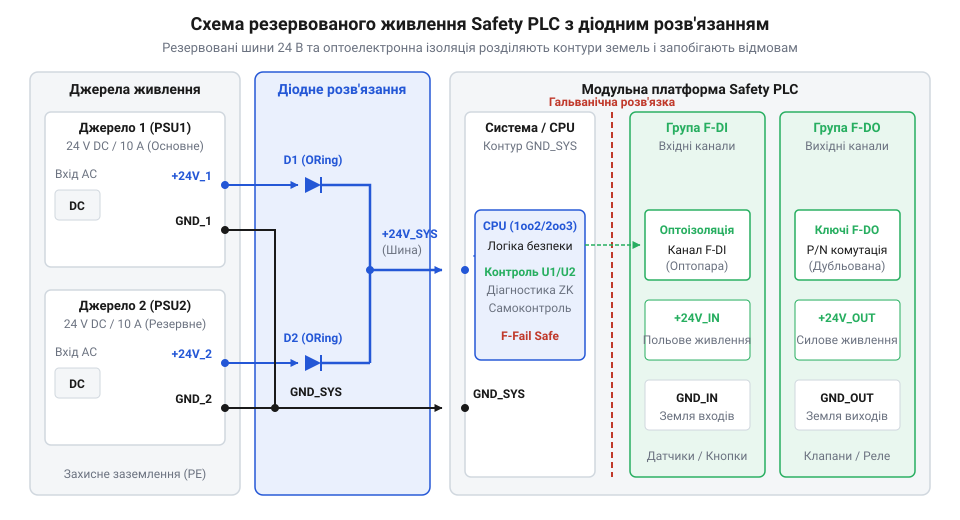
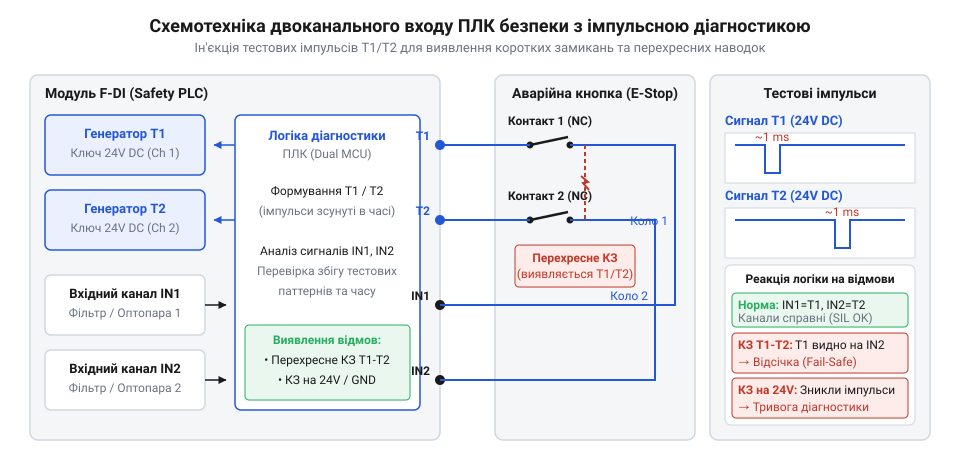

# Схемотехнічний API, резервоване живлення та розпіновка модулів Safety PLC

<preknowlist>
- [Вхідні модулі дискретних входів безпеки (F-DI)](root:cat-hw-boards/fail-safe-digital-input-modules) — внутрішню апаратуру дискретних входів безпеки та принципи їхньої самодіагностики
</preknowlist>

## Небезпека коротких замикань і збоїв живлення

У кабельних трасах промислових об'єктів механічні пошкодження ізоляції, вібрація та вологість створюють постійний ризик виникнення коротких замикань між сусідніми жилами. У звичайних системах автоматизації замикання сигнального проводу дискретного входу на лінію живлення 24 В спричиняє появу хибного високого рівня. Процесор сприймає цей електричний потенціал як замкнений контакт датчика, що унеможливлює виявлення реального розмикання цепу під час натискання кнопки аварійного зупину. Трапляється так звана небезпечна мовчазна відмова (від англ. @@en|Dangerous Undetected Failure@@ — небезпечна недіагностована відмова), коли обладнання продовжує працювати в аварійному стані, а система втрачає здатність знеструмити виконавчі механізми.

Аналогічна проблема виникає у колі живлення. Збій єдиного джерела живлення 24 В постійного струму або просідання напруги через зупинку генератора призводить до раптового вимкнення всього контролера. Без гарантованої гальванічної ізоляції (від латин. @@en|galvanicus@@ — гальванічний) між польовими кола та внутрішньою системною шиною високовольтні імпульсні завади від комутації потужних електродвигунів проникають у процесорний модуль, викликаючи пошкодження мікросхем або зависання конвеєра інструкцій.

Для запобігання подібним катастрофічним наслідкам апаратний інтерфейс (від англ. @@en|Hardware API@@ — апаратний програмний інтерфейс) спеціалізованих контролерів безпеки (від англ. @@en|Safety PLC@@ — програмований логічний контролер безпеки) будується на принципі відмовостійкості (від англ. @@en|Fail-safe@@ — безпека при відмові). Це вимагає впровадження дубльованого живлення, періодичного тестового зондування сигнальних ліній та двокаскадної оптоелектронної ізоляції кожного каналу.

Завдяки апаратному комплексу самодіагностики будь-яка поодинока несправність — будь то пробій вихідного ключа, злив потенціалу на земляну шину чи обрив провідника — виявляється ще до того, як від системи вимагатиметься виконання захисної функції. Замість ризику виникнення небезпечної мовчазної відмови контролер миттєво переводить відповідний канал або всю систему у безпечний знеструмлений стан (від англ. @@en|Safe State@@ — безпечний стан) і сигналізує операторові про необхідність технічного обслуговування.

## Двоканальна архітектура та резервування живлення

Для забезпечення високого коефіцієнта готовності та функціональної безпеки живлення системних модулів і польових кіл @@en|Safety PLC@@ розділяють на два незалежні входи: L+1 (перший канал 24 В) та L+2 (другий канал 24 В) зі спільними або ізольованими нульовими шинами M1 та M2. Усередині модуля живлення напруга від обох ліній об'єднується через потужні розв'язувальні діоди (від англ. @@en|OR-ing Diodes@@ — об'єднувальні діоди) або активні ключі на @@en|MOSFET@@-транзисторах. Якщо один з блоків живлення втрачає напругу або виходить з ладу, діод протилежного каналу залишається відкритим, і контролер продовжує безперервну роботу без перезавантаження.

Внутрішня архітектура містить жорстке схемотехнічне розмежування між системним живленням системної шини (від англ. @@en|backplane@@ — системна плата) та живленням вихідних каскадів (англ. @@en|Field Power@@ — польове живлення). Системна шина живиться через внутрішній ізольований @@en|DC/DC@@-перетворювач, який створює високий бар'єр гальванічної розв'язки (зазвичай до 500 В змінного струму). Це гарантує, що коротке замикання на клемному блоці полегшить вибивання захисного запобіжника конкретної групи виходів, але не пошкодить центральні процесорні модулі.


*Електрична схема резервованого живлення 24 В з діодним розв'язанням, системною шиною та ізольованими групами каналів.*

При розрахунку системи живлення враховують струм споживання процесорної частини та максимальне навантаження вихідних каналів. Загальний струм споживання розраховується як сума власного струму модуля та струмів усіх підключених навантажень:

```
I_total = I_sys + sum(I_out_k)
```

де `I_sys` — струм внутрішніх кіл контролера від шини 24 В, а `I_out_k` — струм k-го вихідного каналу. У разі виходу напруги будь-якої з ліній L+1 чи L+2 за допустимий діапазон (від 20.4 В до 28.8 В) схемотехніка самодіагностики формує апаратний сигнал тривоги та фіксує помилку у системному журналі.

## Схемотехніка входів F-DI та тестові імпульси

Дискретні входи безпеки (від англ. @@en|Fail-safe Digital Input@@ — дискретний вхід безпеки; @@en|F-DI@@) призначені для комутації кнопок аварійного зупину, кінцевих вимикачів та світлових завіс. Для виявлення коротких замикань між суміжними жилами кабелю модуль @@en|F-DI@@ містить спеціальні виходи живлення датчиків (від англ. @@en|Sensor Supply Output@@) VS1 та VS2. Ззвичайне постійне живлення 24 В замінюється сигналом з періодичними тестовими імпульсами зондування (від англ. @@en|Test Pulses@@).

Джерело тестових імпульсів генерує коротковірні вимкнення напруги тривалістю від 0.1 мс до 2 мс. При цьому імпульси на виході VS1 та виході VS2 зсунуті в часі один відносно одного. Якщо між жилою першого каналу та жилою другого каналу виникає перехресне замикання (від англ. @@en|Cross-circuit@@ — перехресне замикання), тестовий імпульс з каналу VS1 потрапляє на вхід другого каналу, де в цей момент очікується високий рівень. Вхідні компаратори фіксують неспівпадіння часових діаграм і миттєво переводять вхідний канал у безпечний стан.


*Схема підключення двоканального датчика до входів F-DI з генераторами тестових імпульсів VS1/VS2 та часовою діаграмою.*

Для запобігання хибним спрацьовуванням від електромагнітних завад вхідні кола містять цифровий фільтр з регульованою затримкою (від англ. @@en|Input Delay Filter@@ — вхідний фільтр затримки). Коли застосовуються [модулі дискретних входів безпеки](root:cat-hw-boards/fail-safe-digital-input-modules), особлива увага приділяється налаштуванню часу фільтрації: він має бути більшим за тривалість тестового імпульсу, але меншим за допустимий час реакції системи безпеки. Схемотехнічно вхідний канал складається з послідовно ввімкненого обмежувального резистора, світлодіода оптопари та схеми зчитування струму, що забезпечує повну гальванічну ізоляцію від внутрішніх шин.

## Схемотехніка виходів F-DO та моніторинг навантаження

Дискретні виходи безпеки (від англ. @@en|Fail-safe Digital Output@@ — дискретний вихід безпеки; @@en|F-DO@@) керують протиаварійними клапанами, контакторами та силовими реле. На відміну від стандартних контролерів, де використовується єдиний транзисторний ключ, модуль @@en|F-DO@@ застосовує двополюсну комутацію навантаження (від англ. @@en|P/M Switching@@ — комутація за позитивним і негативним полюсами).

У схемі P/M-комутації навантаження підключається між виходом ключа верхнього плеча (англ. @@en|High-Side Switch@@ — ключ верхнього плеча; P-switch) та виходом ключа нижнього плеча (англ. @@en|Low-Side Switch@@ — ключ нижнього плеча; M-switch). Для переведення каналу у ввімкнений стан контролер повинен одночасно відкрити обидва напівпровідникові транзистори. Якщо один із транзисторів пробивається або коротить на земляну шину GND, другий транзистор зберігає здатність розірвати коло та знеструмити навантаження.

Для діагностики виходів у ввімкненому стані застосовуються темні імпульси (від англ. @@en|Dark Test@@ — темне тестування): P-ключ та M-ключ по черзі короткочасно розмикаються на час до 1 мс. Завдяки індуктивності та інерційності виконавчих реле механічний контакт не встигає відпасти, проте вимірювальна схема встигає зафіксувати спад напруги на навантаженні. У вимкненому стані застосовуються світлі імпульси (англ. @@en|Light Test@@ — світле тестування), які подають коротке подавання напруги для перевірки цілісності цепу без включення контактора. Паралельно навантаженню обов'язково встановлюється зворотний діод (англ. @@en|Freewheeling Diode@@ — зворотний діод) для гасіння імпульсів самоіндукції при вимкненні.

## Екранування, заземлення та розпіновка клемних блоків

Надійна функціональна безпека @@en|Safety PLC@@ неможлива без правильної організації заземлення та вирівнювання потенціалів. У шафі автоматики встановлюють дві окремі шини: захисне заземлення (від англ. @@en|Protective Earth@@ — захисне заземлення; @@en|PE@@) для забезпечення електробезпеки персоналу та функціональне заземлення (від англ. @@en|Functional Earth@@ — функціональне заземлення; @@en|FE@@) для відведення високочастотних електромагнітних завад.

Корпус контролера та DIN-рейка мають безпосередній низькоімпедансний контакт із шиною @@en|FE@@. Екрани сигнальних кабелів входів та виходів заземлюються за допомогою спеціальних пружинних затискачів (англ. @@en|Shield Connection Clamps@@ — пружинні затискачі екрана) безпосередньо при вводі в клемний блок модуля. Для запобігання виникненню вирівнювальних струмів низької частоти по екрану кабелю, потенціали заземлення контролера та польових пристроїв з'єднують мідними провідниками зрівнювання потенціалів перерізом не менше 16 мм².

Клемні блоки модулів @@en|Safety PLC@@ мають кольорове та цифрове маркування контактів. Схемотехнічна розпіновка клемного блоку розділена на ізольовані секції:
- Клеми L+1/M1 та L+2/M2 — резервоване живлення 24 В постійного струму;
- Клеми VS1, VS2 — виходи тестових імпульсів для живлення контактів датчиків;
- Клеми F-DI0...F-DI7 — сигнальні входи каналів безпеки;
- Клеми F-DO0+...F-DO3+ (P-sw) та F-DO0-...F-DO3- (M-sw) — парні виходи для двополюсної комутації;
- Клема FE — контакт підключення екрана та функціонального заземлення.

Суворе дотримання вимог розпіновки та подвійного підключення провідників запобігає апаратним помилкам монтажу й забезпечує відповідність системи вимогам міжнародних стандартів функціональної безпеки.
