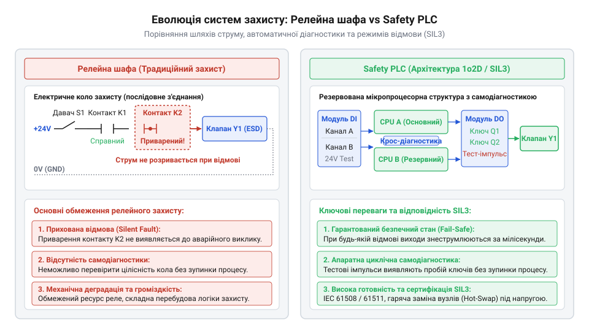
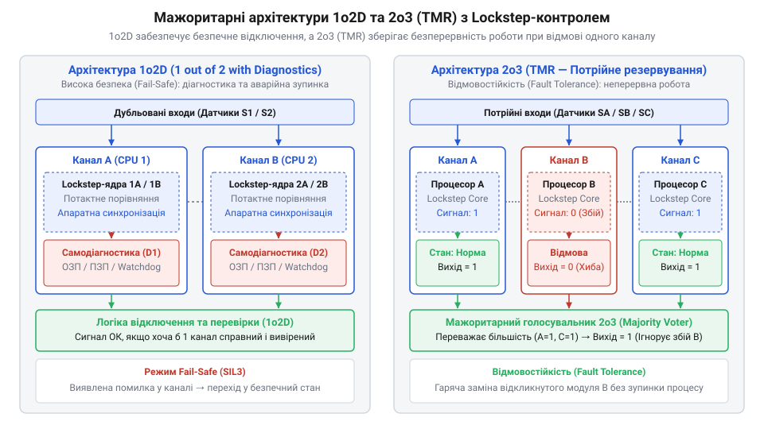

# Еволюція контролерів безпеки: від релейних шаф до дубльованих Safety PLC

<preknowlist>
- [Вхідні модулі дискретних входів безпеки (F-DI)](root:cat-hw-boards/fail-safe-digital-input-modules) — Принципи тестового контролю коротких замикань та обриву ліній датчиків у системах F-DI
</preknowlist>

## Релейні шафи та проблема приварення

Розвиток важкої промисловості, нафтопереробки та енергетики в середині XX століття висунув суворі вимоги до створення автоматизованих систем аварійного вимкнення (від англ. @@en|Emergency Shutdown@@ — аварійне знеструмлення та захист; @@en|ESD@@). До появі мікропроцесорної техніки єдиною базою для побудови приладових систем безпеки (від англ. @@en|Safety Instrumented System@@ — приладова система безпеки; @@en|SIS@@) слугували релейно-контакторні шафи. Логіка захисту реалізовувалася шляхом послідовного або паралельного з'єднання фізичних контактів електромагнітних реле. Принцип безпеки базувався на знеструмленні: у нормальному стані котушки реле перебували під напругою, а при порушенні технологічного параметра коло розмикалося, переводячи обладнання в безпечний знеструмлений стан.

Однак релейна логіка володіла серйозними апаратними обмеженнями. Постійне виникнення електричної дуги при розмиканні індуктивних навантажень спричиняло ерозію та термічне приварення контактів. Якщо контакт реле приварювався у замкненому положенні, система втрачала здатність знеструмити виконавчий механізм при виникненні аварії, що призводило до катастрофічних наслідків. Крім того, механічне зношування рухомих частин, окиснення поверхонь та накопичення пилу викликали приховані відмови. Складність обслуговування сотень реле, величезні габарити шаф і кілометри кабельних трас унеможливлювали гнучку перебудову алгоритмів захисту.

Першою спробою розв'язати проблему небезпечного приварення стало створення реле з примусовим розмиканням контактів (англ. @@en|force-guided contacts@@, від лат. *fortis* — сильний). У таких пристроях усі рухомі контакти жорстко зв'язані єдиною механічною направляючою планкою. Якщо один із замикаючих контактів приварюється під дією дуги, механічний зв'язок фізично блокує переміщення решти групи, унеможливлюючи замикання розмикаючих діагностичних контактів при знеструмленні котушки. Це дозволяло зовнішнім колам моніторингу виявити приварення й заблокувати повторний запуск обладнання, однак не усувало ані механічного зносу, ані величезних габаритів релейних шаф.

*Порівняння апаратної структури релейного ланцюга захисту та дубльованого контролера Safety PLC.*

Крім обмежень надійності, комбінаційні релейні системи вимагали значних витрат на монтаж і пусконалагодження. Будь-яка зміна алгоритму захисту або розширення технологічної лінії передбачала фізичний демонтаж дротів, монтування нових релейних блоків та прокладання перемичок, що збільшувало ризик людської помилки під час підключення. На великих комбінатах релейні шафи займали цілі операторські зали, а пошук несправного реле серед тисяч однотипних елементів перетворювався на тривалий процес. Цей технічний глухий кут змусив промисловість шукати гнучкі електронні рішення, здатні замінити механічні контакти обчислювальною логікою без втрати безпечності знеструмлення.

## Перші спроби застосування стандартних PLC

Поява у 1970-х роках перших програмованих логічних контролерів (від англ. @@en|Programmable Logic Controller@@ — програмований логічний контролер; @@en|PLC@@) революціонізувала промислову автоматизацію. Інженери прагнули замінити громіздкі релейні шафи гнучкими мікропроцесорними системами. Проте перші спроби застосування стандартних @@en|PLC@@ для керування аварійним захистом виявилися неприйнятними для критичних технологічних процесів.

Стандартні контролери розроблялися з орієнтацією на максимальну готовність та безперервність виробництва (англ. @@en|Availability@@ — коефіцієнт готовності). При виникненні внутрішніх збоїв пам'яті або збоях конвеєра інструкцій стандартний процесор намагався продовжити виконання програми або утримував виходи в останньому збереженому стані. У системах аварійного захисту така поведінка є неприпустимою: пробій вихідного транзистора чи зависання лічильника команд призводили до «небезпечної мовчазної відмови» (англ. @@en|Dangerous Undetected Failure@@), коли контролер втрачав здатність знеструмити аварійний об'єкт. 

Стандартним @@en|PLC@@ бракувало внутрішньої апаратної самодіагностики та гарантованої концепції безпечного стану (від англ. @@en|Fail-safe@@ — гарантований перехід у безпечний стан при відмові). На відміну від спеціалізованих рішень, де [вхідні модулі дискретних входів](root:cat-hw-boards/fail-safe-digital-input-modules) виконують постійне тестове зондування ліній для виявлення коротких замикань, звичайні модулі введення-виведення не здатні відрізнити пробій кабелю від спрацювання датчика. Це змусило міжнародні інженерні спільноти розмежувати базові системи керування (англ. @@en|Basic Process Control System@@; @@en|BPCS@@) та спеціалізовані контролери безпеки @@en|Safety PLC@@.

Наочним прикладом такої мовчазної відмови є збій у системі захисту технологічного реактора при перевищенні тиску. У разі аварійного стрибка тиску програма стандартного контролера видає команду на знеструмлення виходу, проте пробій вихідного транзистора дискретного модуля в коротке замикання залишає ланцюг під напругою 24 В. Внаслідок цього аварійний відсічний клапан (від англ. @@en|Emergency Shutdown Valve@@ — аварійний відсічний клапан) залишається у повністю відкритому стані, продовжуючи подачу вибухонебезпечної сировини в аварійну зону. Оскільки звичайний @@en|PLC@@ позбавлений схем зворотного моніторингу струму та динамічного імпульсного тестування вихідних ключів, процесор вважає аварію ліквідованою, хоча насправді технологічний об'єкт прямує до катастрофічного руйнування.

## Виникнення резервованих архітектур 1o2D і 2o3

На початку 1980-х років розробники систем інженерного захисту зіштовхнулися з протиріччям між безпечним знеструмленням та безперервністю технологічного процесу. Звичайний дубльований канал за схемою 1oo2 (англ. *1 out of 2* — один із двох) гарантував негайне вимкнення при виявленні будь-якого збою, проте будь-яке хибне спрацьовування одного з двох каналів призводило до дороговартісної аварійної зупинки заводу. Натомість схема 2oo2 (два з двох) підвищувала готовність обладнання, але знижувала рівень безпеки, оскільки відмова хоча б одного каналу блокувала захисне відключення.

Для розв'язання цього конфлікту компанії HIMA, Pilz та Triconex створили резервовані архітектури з вбудованою безперервною самодіагностикою. Архітектура @@en|1o2D@@ (англ. *1 out of 2 with Diagnostics*) поєднала два паралельні процесорні канали, кожен з яких оснастили апаратними колами контролю виконання команд та моніторингу вихідних ключів. Якщо внутрішня діагностика фіксує апаратний збій в одному з каналів, цей канал негайно ізолюється, а система продовжує роботу в безпечному одноканальному режимі.

*Структура мажоритарного голосування та діагностичних каналів у контролерах безпеки.*

Вершиною еволюційного стрибка 1980-х років стала потроєна мажоритарна архітектура @@en|2o3@@, відома як @@en|TMR@@ (англ. *Triple Modular Redundancy*, від лат. *triplus* — потрійний), яку впровадила компанія Triconex. Три незалежні процесорні канали паралельно обробляють вхідні сигналі й виконують логіку аварійного захисту. Результати обчислень надходять на апаратний мажоритарний орган голосування (англ. *voter*), який приймає рішення за більшістю голосів (два з трьох). Завдяки цьому відмова одного з трьох каналів не викликає хибного зупину й не знижує рівень безпеки: несправний канал автоматично відключається для гарячої заміни.

Для миттєвого виявлення прихованих апаратних помилок у мікропроцесорах застосували обчислення @@en|Lockstep@@ (англ. *lockstep*, синхронний крок). Двоє процесорних ядер виконують однакові інструкції синхронно тактовним імпульсом, а апаратний компаратор порівнює їхні шини даних на кожному такті. Паралельно з цим вихідні ключі та [вхідні модулі дискретних входів безпеки (F-DI)](root:cat-hw-boards/fail-safe-digital-input-modules) генерують короткі тестуючі мікроімпульси (англ. @@en|dark pulses@@, від англ. *dark* — темний та лат. *pulsus* — поштовх), які перевіряють здатність силових транзисторів розмикати коло. Тривалість такого тестового знеструмлення становить від десятків до кількох сотень мікросекунд, що значно коротше за механічну й електричну інерційність виконавчих механізмів (контакторів чи соленоїдних клапанів, час реакції яких вимірюється десятками мілісекунд), завдяки чому внутрішня самодіагностика виявляє пробій ключа без реального відключення чи хибного спрацьовування навантаження.

Поєднання мажоритарних архітектур із безперервним діагностичним тестуванням створило підґрунтя для гарячої заміни (англ. @@en|hot swapping@@, від англ. *hot* — гарячий та *swap* — міняти) несправних модулів під напругою без зупинки технологічного процесу. Якщо діагностичний аналіз розпізнає відмову процесорного або вхідного каналу, мажоритарний арбітр переводить систему у тимчасовий відмовостійкий режим, а оператор отримує сповіщення про локалізовану дефектом плату. Інженер замінює збійний вузол у реальному часі, після чого новий модуль автоматично зчитує поточний стан пам'яті з працюючих каналів, синхронізує логічний крок обчислень і поновлює повний склад резервованої конфігурації. Це остаточно усунуло дилему між безпекою знеструмлення та безперервністю виробництва, зробивши контролери безпеки стандартом для нафтопереробних підприємств і хімічних реакторів.

## Стандартизація SIL3 та міфи безпеки

Накопичений досвід експлуатації резервованих архітектур у 1990-х роках ляг у основу міжнародних нормативів функціональної безпеки. Стандарт @@en|IEC 61508@@ визначив загальні вимоги до систем @@en|Safety PLC@@, сформулювавши концепцію рівнів повноти безпеки @@en|SIL@@ (англ. *Safety Integrity Level*, від лат. *integritas* — цілісність). Для переробної та хімічної промисловості було розроблено спеціалізований стандарт @@en|IEC 61511@@. Більшість технологічних установок високої небезпеки вимагають досягнення рівня @@en|SIL3@@, що відповідає ймовірності небезпечної відмови за запитом менше 10⁻³ або частоті небезпечних відмов нижче 10⁻⁷ на годину.

Поширеним інженерним міфом тривалий час залишалося твердження, що програмне дублювання двох звичайних контролерів @@en|BPCS@@ еквівалентне спеціалізованому @@en|Safety PLC@@. Насправді звичайні промислові контролери позбавлені апаратного розмежування пам'яті, гарантованого детермінованого часу самодіагностики та сертифікованої операційної системи. Якщо звичайна операційна система реального часу орієнтована лише на швидкість обробки переривань і не виявляє мовчазного викривлення даних у пам'яті чи зависання окремих задач, то сертифікована @@en|Safety RTOS@@ (англ. *Safety Real-Time Operating System*, від англ. *real-time* — реальний час та лат. *operari* — працювати) забезпечує понад 99% діагностичного покриття системних відмов. Вона реалізує жорсткий детермінований моніторинг часових меж виконання коду, апаратно ізолює контексти задач за допомогою блоку захисту пам'яті та циклічно перевіряє цілісність власного ядра. Якщо обидва стандартні процесори виконають одну й ту саму логічну помилку в коді або зависнуть через загальну проблему в мікропрограмі, дублювання виявиться недієздатним. Сертифікований @@en|Safety PLC@@ рівня @@en|SIL3@@ гарантує перехід у безпечний стан навіть при виникненні систематичних програмних або апаратних збоїв.

Інший міф стверджував, що класична релейна логіка є надійнішою за будь-який мікропроцесор, оскільки «в ній немає програмного забезпечення». Проте електромеханічне реле позбавлене будь-якої внутрішньої самодіагностики: знос механіки, окиснення або приварення контактів залишаються непоміченими аж до моменту, коли система повинна спрацювати під час аварії. На відміну від реле, сучасний @@en|Safety PLC@@ виконує понад 99% діагностичного покриття в режимі реального часу, виявляючи найменші відхилення параметрів за мілісекунди до виникнення небезпечної ситуації.

Еволюція від релейних шаф до дубльованих та потроєних @@en|Safety PLC@@ довела, що справжня функціональна безпека досягається не відмовою від електронних систем, а поєднанням апаратного резервування, детермінованої самодіагностики та строгих вимог стандартів @@en|IEC 61508@@.
